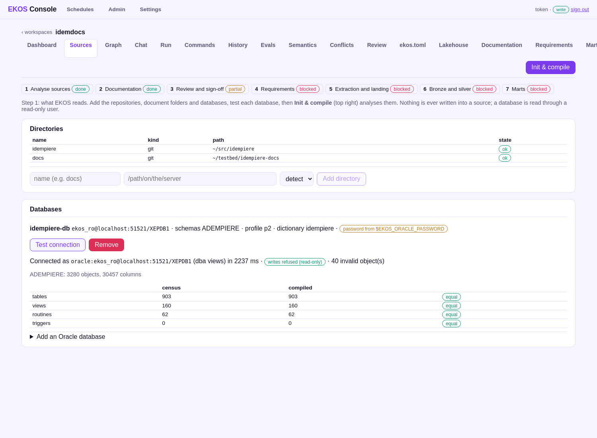

# EKOS on a legacy Oracle estate: iDempiere, end to end

A complete, measured run of [EKOS](https://github.com/alexeyban/EKOS) — a compiler for enterprise knowledge — and
[EKOS Lakehouse](https://github.com/alexeyban/ekos-lakehouse) on [iDempiere](https://github.com/idempiere/idempiere), an
open-source ERP with 903 tables, 20 years of migration scripts, PL/SQL and a large Java code base, running on Oracle.
An operator takes it through the seven steps of the workflow in a web console: analyse the sources, document them,
review and sign off the source model, describe the marts wanted, approve how each table is loaded, build bronze and
silver, and build and reconcile the marts.

**No language model reads the sources.** The one model call in the workflow is step 4's draft of a mart from plain
words (a local model), and every term it writes is resolved against the approved model or asked back. Every number
below comes from a measured run on one 15 GB laptop.

| | |
|---|---|
| **[The video](video/README.md)** ([watch](https://youtu.be/pnGLymT6JH0), 7:52) | a second project from analysis to three reconciled gold marts, narrated, with every console screen, the source / ER / lineage diagrams, a recording runbook and the run log |
| **[The book](book/index.md)** ([PDF](book/demo-book.pdf)) | the seven steps from the console: each screen, the run log behind it, what happens, what the operator gets — generated from the product |
| **[The wiki](https://github.com/alexeyban/ekos-lakehouse-oracle/wiki)** | the 1,060 documentation pages EKOS generated and published from the console (step 2), and the book |
| **[The presentation](presentation/index.html)** ([PDF](presentation/ekos-idempiere.pdf)) | 13 slides |
| **[The results](docs/results/README.md)** | census, run logs, review state, steps 4–7, the release gates ([exit report](docs/results/exit-report.md)) |
| **[The operator guide](docs/guide/operator-workflow.md)** | every step: commands, settings, what is guaranteed, where things are |



## The seven steps on this testbed

| Step | | Result | State |
|---|---|---|---|
| 1 | Analyse sources — code, docs site, live Oracle catalog into one ledger | census = compiled: 903 tables, 160 views, 62 routines | done |
| 2 | Documentation — generated from the ledger, published to [this wiki](https://github.com/alexeyban/ekos-lakehouse-oracle/wiki) | 1,060 pages | done |
| 3 | Review and sign-off — six subjects, each sign-off bound to a digest | 4 of 6 signed; 195 conflicts and 1 identity match await a person | partial |
| 4 | Requirements — marts in words or Markdown, every term resolved | 4 marts approved, nothing invented | behind step 3 |
| 5 | Extraction — per table: load mode, deletes, masking, with the evidence | 715 incremental, 134 full, 1 refused; approved | behind step 3 |
| 6 | Bronze and silver — generated SQL, dbt-trino silver, Dagster | a 165-table subset; 3,664 of 3,667 tests pass | behind step 3 |
| 7 | Marts — proposed, merged, built, each measure reconciled with silver | 4 marts, every total equal | behind step 3 |

Steps 4–7 were built and run; the console's step bar shows them behind step 3, which is not complete — the gate is
the product's and was left as it is. Details: [docs/results/steps-4-to-7.md](docs/results/steps-4-to-7.md).

## What is in this repository

| Path | What |
|---|---|
| [`book/`](book/) | the demo book (Markdown + PDF), regenerated by [`scripts/demo-book.sh`](scripts/demo-book.sh) |
| [`docs/estate/`](docs/estate/index.md) | the generated documentation (also on the wiki) — e.g. [C_ORDER](docs/estate/data-model/c/c_order.md), the [findings](docs/estate/findings/index.md) |
| [`docs/walkthrough/`](docs/walkthrough/01-testbed.md) | how it was made, step by step |
| [`docs/guide/`](docs/guide/operator-workflow.md) | the operator guide (from EKOS) |
| [`docs/results/`](docs/results/README.md) | measurements and exports |
| [`pipeline/`](pipeline/) | **the generated pipeline**: bronze extraction SQL for 849 tables, the dbt-trino project (silver models and tests from the source model, the four gold marts), the Dagster definitions, the mart requirements, the deployed plan (`lakehouse.lock.json`) and its [history](pipeline/HISTORY.md) |
| [`pipeline-sales/`](pipeline-sales/) | the video's project (`idemsales`, prefix `bronze_sales_`): 33 bronze tables, silver in `silver_sales_adempiere`, three marts in `gold_sales`, and its [history](pipeline-sales/HISTORY.md) |
| [`video/`](video/README.md) | the video demo: screenshots, diagrams, narration, runbook, run log, the scripts that made them |
| [`project/ekos.toml`](project/ekos.toml) | the EKOS project: sources, the database, the lakehouse settings |
| [`src/EKOS`](https://github.com/alexeyban/EKOS/tree/0059daa), [`src/ekos-lakehouse`](https://github.com/alexeyban/ekos-lakehouse/tree/775311f) | **the code**, as submodules: the commits of the video run (RFC 0231's fix included; the first run used EKOS 525c782 and ekos-lakehouse 7a6eb94, which differ only in that fix and docs) |
| [`testbed/`](testbed/), [`stack/`](stack/README.md) | **the containers**: Oracle XE with the iDempiere seed; the lakehouse stack; the project's Dagster |
| [`scripts/`](scripts/tours/README.md) | the browser tours that drove each step, the book and docs generators |
| [`presentation/`](presentation/) | the slides |

## What EKOS found, in numbers

| | |
|---|---|
| database (Oracle XE 21c, iDempiere 12 seed) | 903 tables, 160 views, 62 routines, 3,686 foreign keys, 12,958 check constraints |
| code | 4,820 Java types, 31,434 methods; 763 generated model classes read as the application model |
| history | 3,356 migration scripts → 31,620 schema changes; 4,606 tickets from commit history |
| code ↔ database disagreements | 446 (e.g. a model column the database lacks, a mandatory column the database allows null) |
| write behaviour | per table: how rows are updated and deleted, and whether the change log records it |
| pipeline | build 16 s · recover 4 min 22 s · resolve 11 s · compile 32 s · commit 8 min 15 s · 0 model calls |
| documentation | 1,060 pages in 26 s |
| row values in the ledger | 228 text values sampled from 36 business columns: 0 in anything read from the database |

## Run it yourself

```bash
git clone --recurse-submodules https://github.com/alexeyban/ekos-lakehouse-oracle
```

then [`stack/README.md`](stack/README.md): the Oracle testbed, the lakehouse stack, the binary, the project, the
console, Dagster — in that order.

## Not done, honestly

- A complete step-3 sign-off: 195 code ↔ database conflicts and one identity match are a person's decisions.
- The full 849-table load: a 165-table subset was loaded on this laptop; the rest of the pipeline is generated and
  ready ([`pipeline/`](pipeline/)).
- Cascade, keyless and permissions-loss deletes planted on the testbed (designed and classified; single, mass and purge
  deletes were run).
- CDC with Debezium: optional in the plan, built only when an operator asks.

## Licence and what is deliberately not here

GPL-2.0 (the generated documentation and pipeline derive from iDempiere's GPL-2.0 code and schema); files copied from
EKOS keep their MIT notice — see [NOTICE.md](NOTICE.md). No data values (profiles contribute counts only), no text
from the iDempiere documentation site (it has no licence file), no ledger and no credentials.
