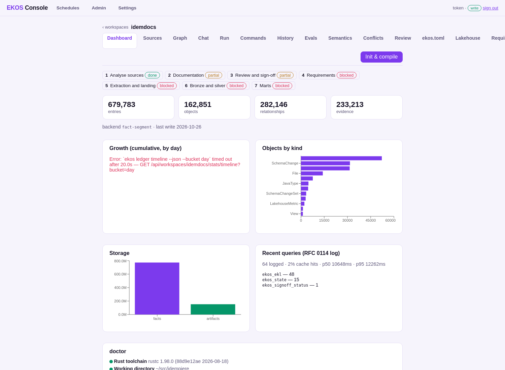

# Step 1 — Analyse sources

**On the step bar:** done — fresh — ledger reflects the source as of 2026-10-25 16:56 UTC (git 3355eb5)

## What the operator sees


_The Sources page: the database, the code and the documents of the project._



_The workspace: the step bar and what the ledger holds._

## What they click

<!-- ekos:manual id="step1-click" -->
On **Sources** the operator adds the database (its connection; the password goes to the keychain), the code repositories and the documentation, tests the connection, and clicks **Analyse**.
<!-- /ekos:manual -->


## What happens behind it

<!-- ekos:manual id="step1-behind" -->
The connectors read the sources as they are: files from the repositories, the live catalog from Oracle (inside a read-only transaction, with a read-only account). Deterministic analyzers turn them into one ledger: Java types and the application model, SQL and PL/SQL, migration scripts as schema history, documents with their tickets, and the database's own tables, routines, keys and constraints. The census the catalog reports is reconciled against what was compiled. No language model reads any of it.
<!-- /ekos:manual -->


## The run log

**`compile`** — succeeded, from a terminal, 2026-10-25T16:53:16+00:00; model calls: 0.

```json
{"stage": "run", "msg": "started", "version": "1.1.0", "cmd": "compile", "t_ms": 0}
{"stage": "pass", "msg": "slow", "ms": 14022, "pass": "semantic-compiler", "cmd": "compile", "t_ms": 19990}
{"stage": "pass", "msg": "passes", "cached": 0, "failed": 0, "ms": 14032, "ran": 1, "cmd": "compile", "t_ms": 19994}
{"stage": "semantic.compile", "msg": "model written", "objects": 144073, "relationships": 218326, "cmd": "compile", "t_ms": 21443}
{"stage": "llm", "msg": "calls", "count": 0, "cache_hits": 0, "embeddings": 0, "cmd": "compile", "t_ms": 33593}
{"stage": "run", "msg": "finished", "ok": true, "ms": 33593, "warnings": 134048, "cmd": "compile", "t_ms": 33593}
```

**`commit`** — succeeded, from a terminal, 2026-10-25T16:53:50+00:00; model calls: 0.

```json
{"stage": "run", "msg": "started", "version": "1.1.0", "cmd": "commit", "t_ms": 0}
{"stage": "ledger.commit", "msg": "facts written", "conflicts": 446, "evidence": 204689, "objects": 0, "objects_skipped": 144073, "relationships": 0, "cmd": "commit", "t_ms": 187515}
{"stage": "write.behaviour", "msg": "tables classified", "tables": 903, "update": {"no_updated_column": 14, "po_only": 737, "raw_sql_sets_updated": 8, "raw_sql_skips_updated": 144}, "delete": {"deleted_by_app": 107, "deleted_by_cascade": 298, "deleted_by_users": 754, "never_deleted_in_code": 9, "purged": 12, "soft_delete_only": 57}, "change_log": {"not_recorded": 180, "recorded": 713, "unknown": 10}, "dictionary": true, "cmd": "commit", "t_ms": 187515}
{"stage": "tickets.link", "msg": "ticket links", "tickets": 4606, "links": {"JavaMethod": 272, "JavaType": 154, "SchemaChangeSet": 3074, "Section": 1743}, "cited_without_commits": 55, "cmd": "commit", "t_ms": 187515}
{"stage": "llm", "msg": "calls", "count": 0, "cache_hits": 0, "embeddings": 0, "cmd": "commit", "t_ms": 188666}
{"stage": "run", "msg": "finished", "ok": true, "ms": 188666, "warnings": 0, "cmd": "commit", "t_ms": 188666}
```

**`database test`** — succeeded, from a terminal, 2026-10-26T14:07:56+00:00; model calls: 0.

```json
{"stage": "run", "msg": "started", "version": "1.1.0", "cmd": "database test", "t_ms": 0}
{"stage": "oracle.catalog", "msg": "read DBA_OBJECTS", "ms": 45, "owner": "ADEMPIERE", "query": "objects", "rows": 3280, "cmd": "database test", "t_ms": 106}
{"stage": "oracle.catalog", "msg": "read DBA_TABLES", "ms": 28, "owner": "ADEMPIERE", "query": "tables", "rows": 903, "cmd": "database test", "t_ms": 135}
{"stage": "oracle.catalog", "msg": "read DBA_TAB_COLUMNS", "ms": 301, "owner": "ADEMPIERE", "query": "columns", "rows": 30457, "cmd": "database test", "t_ms": 437}
{"stage": "oracle.catalog", "msg": "read DBA_CONSTRAINTS", "ms": 195, "owner": "ADEMPIERE", "query": "constraints", "rows": 18444, "cmd": "database test", "t_ms": 632}
{"stage": "oracle.catalog", "msg": "read DBA_CONS_COLUMNS", "ms": 100, "owner": "ADEMPIERE", "query": "constraint_columns", "rows": 18697, "cmd": "database test", "t_ms": 733}
{"stage": "oracle.catalog", "msg": "read DBA_INDEXES", "ms": 44, "owner": "ADEMPIERE", "query": "indexes", "rows": 2109, "cmd": "database test", "t_ms": 777}
{"stage": "oracle.catalog", "msg": "read DBA_IND_COLUMNS", "ms": 34, "owner": "ADEMPIERE", "query": "index_columns", "rows": 2624, "cmd": "database test", "t_ms": 811}
{"stage": "oracle.catalog", "msg": "read DBA_VIEWS", "ms": 15, "owner": "ADEMPIERE", "query": "views", "rows": 160, "cmd": "database test", "t_ms": 827}
{"stage": "oracle.catalog", "msg": "read DBA_MVIEWS", "ms": 0, "owner": "ADEMPIERE", "query": "mviews", "rows": 0, "cmd": "database test", "t_ms": 827}
{"stage": "oracle.catalog", "msg": "read DBA_SEQUENCES", "ms": 1, "owner": "ADEMPIERE", "query": "sequences", "rows": 0, "cmd": "database test", "t_ms": 829}
{"stage": "oracle.catalog", "msg": "read DBA_SOURCE", "ms": 27, "owner": "ADEMPIERE", "query": "source", "rows": 4753, "cmd": "database test", "t_ms": 856}
{"stage": "oracle.catalog", "msg": "read DBA_TRIGGERS", "ms": 1, "owner": "ADEMPIERE", "query": "triggers", "rows": 0, "cmd": "database test", "t_ms": 858}
{"stage": "oracle.catalog", "msg": "read DBA_SYNONYMS", "ms": 1, "owner": "ADEMPIERE", "query": "synonyms", "rows": 0, "cmd": "database test", "t_ms": 859}
{"stage": "oracle.catalog", "msg": "read DBA_TAB_COMMENTS", "ms": 2, "owner": "ADEMPIERE", "query": "table_comments", "rows": 42, "cmd": "database test", "t_ms": 862}
{"stage": "oracle.catalog", "msg": "read DBA_COL_COMMENTS", "ms": 18, "owner": "ADEMPIERE", "query": "column_comments", "rows": 111, "cmd": "database test", "t_ms": 881}
{"stage": "oracle.catalog", "msg": "read DBA_TAB_COL_STATISTICS", "ms": 179, "owner": "ADEMPIERE", "query": "column_statistics", "rows": 18527, "cmd": "database test", "t_ms": 1060}
{"stage": "oracle.catalog", "msg": "reconciled against DBA_OBJECTS", "kinds": 13, "mismatches": 0, "objects": 10613, "owner": "ADEMPIERE", "cmd": "database test", "t_ms": 1211}
{"stage": "llm", "msg": "calls", "count": 0, "cache_hits": 0, "embeddings": 0, "cmd": "database test", "t_ms": 13824}
{"stage": "run", "msg": "finished", "ok": true, "ms": 13824, "warnings": 0, "cmd": "database test", "t_ms": 13824}
```

**`database test`** — succeeded, from a terminal, 2026-10-26T14:11:42+00:00; model calls: 0.

```json
{"stage": "run", "msg": "started", "version": "1.1.0", "cmd": "database test", "t_ms": 0}
{"stage": "oracle.catalog", "msg": "read DBA_OBJECTS", "ms": 35, "owner": "ADEMPIERE", "query": "objects", "rows": 3280, "cmd": "database test", "t_ms": 84}
{"stage": "oracle.catalog", "msg": "read DBA_TABLES", "ms": 28, "owner": "ADEMPIERE", "query": "tables", "rows": 903, "cmd": "database test", "t_ms": 112}
{"stage": "oracle.catalog", "msg": "read DBA_TAB_COLUMNS", "ms": 280, "owner": "ADEMPIERE", "query": "columns", "rows": 30457, "cmd": "database test", "t_ms": 393}
{"stage": "oracle.catalog", "msg": "read DBA_CONSTRAINTS", "ms": 181, "owner": "ADEMPIERE", "query": "constraints", "rows": 18444, "cmd": "database test", "t_ms": 575}
{"stage": "oracle.catalog", "msg": "read DBA_CONS_COLUMNS", "ms": 88, "owner": "ADEMPIERE", "query": "constraint_columns", "rows": 18697, "cmd": "database test", "t_ms": 663}
{"stage": "oracle.catalog", "msg": "read DBA_INDEXES", "ms": 31, "owner": "ADEMPIERE", "query": "indexes", "rows": 2109, "cmd": "database test", "t_ms": 695}
{"stage": "oracle.catalog", "msg": "read DBA_IND_COLUMNS", "ms": 30, "owner": "ADEMPIERE", "query": "index_columns", "rows": 2624, "cmd": "database test", "t_ms": 726}
{"stage": "oracle.catalog", "msg": "read DBA_VIEWS", "ms": 10, "owner": "ADEMPIERE", "query": "views", "rows": 160, "cmd": "database test", "t_ms": 738}
{"stage": "oracle.catalog", "msg": "read DBA_MVIEWS", "ms": 0, "owner": "ADEMPIERE", "query": "mviews", "rows": 0, "cmd": "database test", "t_ms": 738}
{"stage": "oracle.catalog", "msg": "read DBA_SEQUENCES", "ms": 1, "owner": "ADEMPIERE", "query": "sequences", "rows": 0, "cmd": "database test", "t_ms": 739}
{"stage": "oracle.catalog", "msg": "read DBA_SOURCE", "ms": 26, "owner": "ADEMPIERE", "query": "source", "rows": 4753, "cmd": "database test", "t_ms": 766}
{"stage": "oracle.catalog", "msg": "read DBA_TRIGGERS", "ms": 1, "owner": "ADEMPIERE", "query": "triggers", "rows": 0, "cmd": "database test", "t_ms": 767}
{"stage": "oracle.catalog", "msg": "read DBA_SYNONYMS", "ms": 1, "owner": "ADEMPIERE", "query": "synonyms", "rows": 0, "cmd": "database test", "t_ms": 769}
{"stage": "oracle.catalog", "msg": "read DBA_TAB_COMMENTS", "ms": 2, "owner": "ADEMPIERE", "query": "table_comments", "rows": 42, "cmd": "database test", "t_ms": 771}
{"stage": "oracle.catalog", "msg": "read DBA_COL_COMMENTS", "ms": 18, "owner": "ADEMPIERE", "query": "column_comments", "rows": 111, "cmd": "database test", "t_ms": 790}
{"stage": "oracle.catalog", "msg": "read DBA_TAB_COL_STATISTICS", "ms": 162, "owner": "ADEMPIERE", "query": "column_statistics", "rows": 18527, "cmd": "database test", "t_ms": 952}
{"stage": "oracle.catalog", "msg": "reconciled against DBA_OBJECTS", "kinds": 13, "mismatches": 0, "objects": 10613, "owner": "ADEMPIERE", "cmd": "database test", "t_ms": 1095}
{"stage": "llm", "msg": "calls", "count": 0, "cache_hits": 0, "embeddings": 0, "cmd": "database test", "t_ms": 13075}
{"stage": "run", "msg": "finished", "ok": true, "ms": 13075, "warnings": 0, "cmd": "database test", "t_ms": 13075}
```

## What the operator gets

The step's state above.


## Caveats

<!-- ekos:manual id="step1-caveats" -->
The analysis is as good as the parsers: what a parser skipped is counted and shown, never guessed.
<!-- /ekos:manual -->
