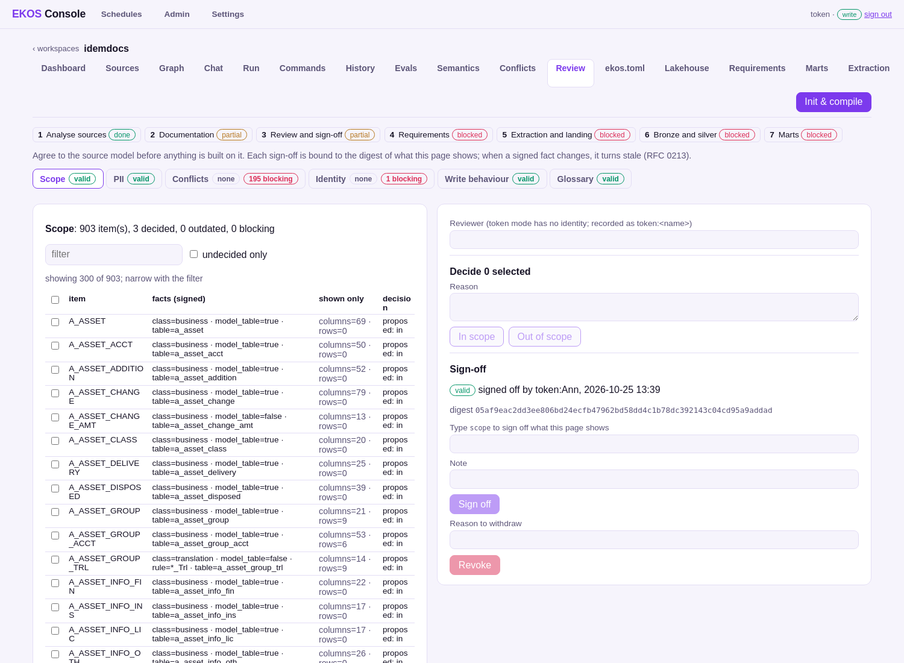
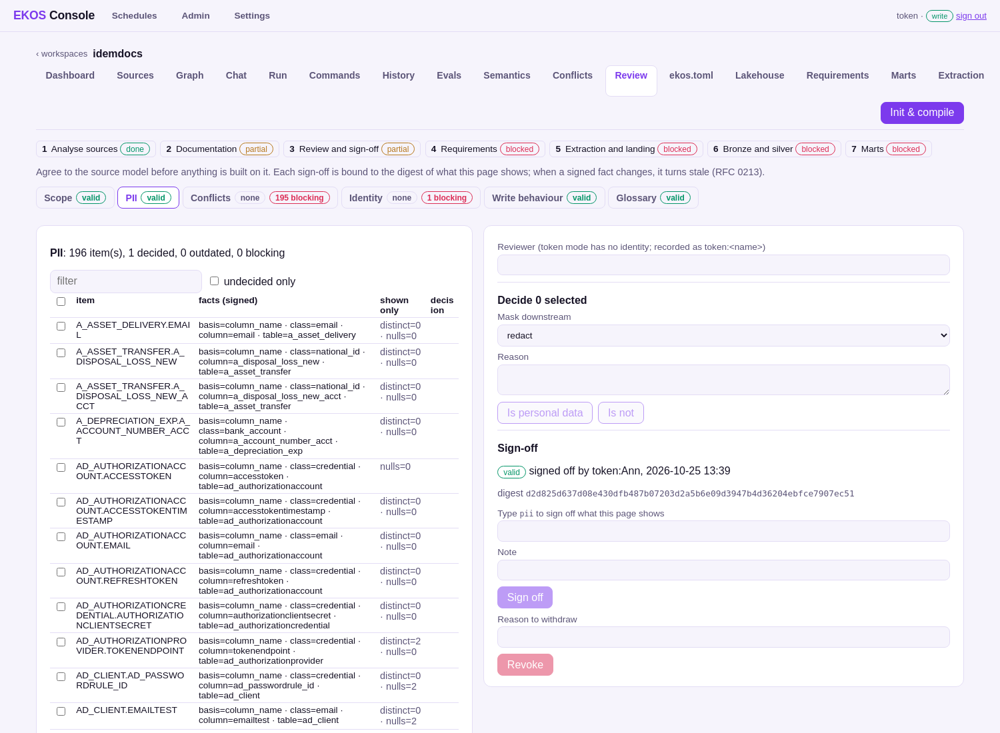
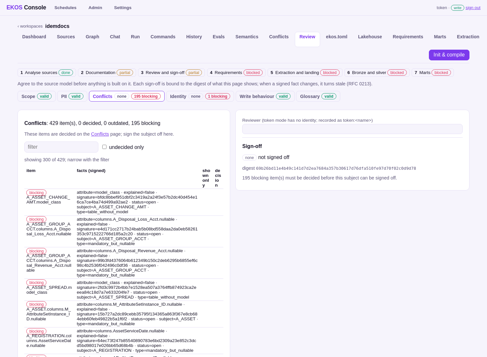

# Step 3 — Review and sign-off

**On the step bar:** partial — 4 of 6 subjects signed, 196 blocking item(s)

## What the operator sees

_Review: scope — which tables are business data._

_Review: personal data, with the proposed masking._

_Review: where the code and the database disagree._

## What they click

<!-- ekos:manual id="step3-click" -->
Per subject (scope, PII, write behaviour, glossary, conflicts, identity) the operator decides the open items, then signs the subject off by typing its name.
<!-- /ekos:manual -->

## What happens behind it

<!-- ekos:manual id="step3-behind" -->
Every decision is a ledger fact. A sign-off is bound to a digest of exactly what was shown; when a later analysis changes one of those facts, the sign-off turns stale by itself. Steps 4–7 stay blocked until every subject is signed.
<!-- /ekos:manual -->

## The run log

_No run of this step's commands was found in the console's history or the project's run logs (`signoff`, `review`, `conflicts resolve`, `identity`)._

## What the operator gets

| Subject | Items | Decided | Blocking | Sign-off |
|---|---|---|---|---|
| scope | 903 | 3 | 0 | valid |
| pii | 196 | 1 | 0 | valid |
| conflicts | 429 | 0 | 195 | none |
| identity | 1 | 0 | 1 | none |
| write-behaviour | 850 | 0 | 0 | valid |
| glossary | 0 | 0 | 0 | valid |

## Caveats

<!-- ekos:manual id="step3-caveats" -->
Hundreds of conflicts take a person's time; the review groups them, but it does not decide them.
<!-- /ekos:manual -->
