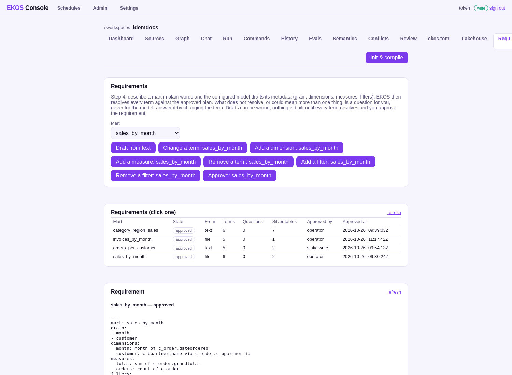

# Step 4 — Requirements

**On the step bar:** blocked — needs a valid sign-off of every review subject (step 3); 4 of 4 requirement(s) approved

## What the operator sees



_Requirements: each mart, its terms and how each resolved._

## What they click

<!-- ekos:manual id="step4-click" -->
The operator describes a mart in plain words (or as Markdown), answers the questions on the page by editing a term, and approves it.
<!-- /ekos:manual -->


## What happens behind it

<!-- ekos:manual id="step4-behind" -->
The configured model (local Ollama here) drafts the mart's header from the request — the only model call in the workflow. EKOS then resolves every term against the approved source model: a column, a join path along declared keys, a filter. What does not resolve becomes a question for the operator, never for the model. Approval commits the description and records who approved which digest.
<!-- /ekos:manual -->


## The run log

**`lakehouse requirements draft --mart=orders_per_customer --text=number of completed sales orders per customer and month`** — succeeded, from the console, 2026-10-26T09:48:55.924491; model calls: not recorded.

_This run left no structured log (it ran before EKOS RFC 0218)._

**`lakehouse requirements approve --mart=orders_per_customer --note=approved in the browser --as=static:write`** — succeeded, from the console, 2026-10-26T09:54:13.084025; model calls: not recorded.

_This run left no structured log (it ran before EKOS RFC 0218)._

**`lakehouse requirements edit --mart=category_region_sales --filter=c_orderline.qtyordered > 0 --as=static:write`** — succeeded, from the console, 2026-10-26T14:08:10.581099; model calls: 0.

```json
{"stage": "run", "msg": "started", "version": "1.1.0", "cmd": "lakehouse requirements edit", "t_ms": 0}
{"stage": "requirements", "msg": "resolved", "mart": "category_region_sales", "questions": 0, "reads": ["C_ORDERLINE", "C_ORDER", "C_BPARTNER_LOCATION", "C_LOCATION", "C_REGION", "M_PRODUCT", "M_PRODUCT_CATEGORY"], "state": "changed", "terms": 7, "cmd": "lakehouse requirements edit", "t_ms": 72}
{"stage": "llm", "msg": "calls", "count": 0, "cache_hits": 0, "embeddings": 0, "cmd": "lakehouse requirements edit", "t_ms": 84}
{"stage": "run", "msg": "finished", "ok": true, "ms": 84, "warnings": 0, "cmd": "lakehouse requirements edit", "t_ms": 84}
```

**`lakehouse requirements edit --mart=category_region_sales --drop-filter=c_orderline.qtyordered > 0 --as=static:write`** — succeeded, from the console, 2026-10-26T14:08:12.008962; model calls: 0.

```json
{"stage": "run", "msg": "started", "version": "1.1.0", "cmd": "lakehouse requirements edit", "t_ms": 0}
{"stage": "requirements", "msg": "resolved", "mart": "category_region_sales", "questions": 0, "reads": ["C_ORDERLINE", "C_ORDER", "C_BPARTNER_LOCATION", "C_LOCATION", "C_REGION", "M_PRODUCT", "M_PRODUCT_CATEGORY"], "state": "approved", "terms": 6, "cmd": "lakehouse requirements edit", "t_ms": 72}
{"stage": "llm", "msg": "calls", "count": 0, "cache_hits": 0, "embeddings": 0, "cmd": "lakehouse requirements edit", "t_ms": 87}
{"stage": "run", "msg": "finished", "ok": true, "ms": 87, "warnings": 0, "cmd": "lakehouse requirements edit", "t_ms": 87}
```

## What the operator gets

| Mart | State | Terms | Questions | Described as | Approved |
|---|---|---|---|---|---|
| `category_region_sales` | approved | 6 | 0 | text | operator 2026-10-26T09:39:03Z |
| `invoices_by_month` | approved | 5 | 0 | file | operator 2026-10-26T11:17:42Z |
| `orders_per_customer` | approved | 5 | 0 | text | static:write 2026-10-26T09:54:13Z |
| `sales_by_month` | approved | 6 | 0 | file | operator 2026-10-26T09:30:24Z |


## Caveats

<!-- ekos:manual id="step4-caveats" -->
A model can draft a term that resolves and is still wrong; that is why approval is a person's.
<!-- /ekos:manual -->
