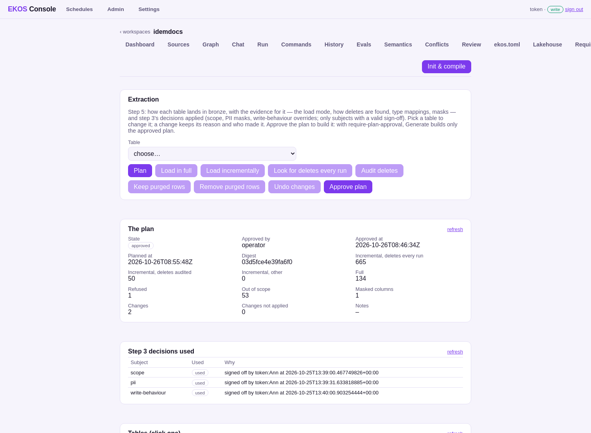

# Step 5 — Extraction and landing

**On the step bar:** blocked — needs a valid sign-off of every review subject (step 3); plan approved by operator at 2026-10-26T08:46:34Z: 715 incremental, 134 full, 1 refused, 53 out of scope

## What the operator sees



_Extraction: per table, load mode, deletes, masking, and why._

## What they click

<!-- ekos:manual id="step5-click" -->
The operator reads the proposed plan per table, changes what they disagree with (with a reason), and approves the plan.
<!-- /ekos:manual -->


## What happens behind it

<!-- ekos:manual id="step5-behind" -->
The planner proposes how each table is loaded from what step 1 found: incremental from an application watermark where the code updates it, full otherwise; how deletes are detected (bucketed key diff, with a guard against mass deletes); purged rows kept; personal data masked as step 3 decided. Approval binds the plan's digest; generating the pipeline refuses another plan.
<!-- /ekos:manual -->


## The run log

**`lakehouse extraction approve --note=C_ORDER in full for now --as=static:write`** — succeeded, from the console, 2026-10-25T23:52:01.242921; model calls: not recorded.

_This run left no structured log (it ran before EKOS RFC 0218)._

**`lakehouse extraction approve --note=C_BPARTNER in full for now --as=static:write`** — succeeded, from the console, 2026-10-25T23:58:13.418732; model calls: not recorded.

_This run left no structured log (it ran before EKOS RFC 0218)._

**`lakehouse extraction change --table=ADEMPIERE.C_BPARTNER --full --reason=shown in the demo book, then undone --as=static:write`** — succeeded, from the console, 2026-10-26T14:08:15.127177; model calls: 0.

```json
{"stage": "run", "msg": "started", "version": "1.1.0", "cmd": "lakehouse extraction change", "t_ms": 0}
{"stage": "extraction", "msg": "changed", "change": "load in full", "table": "ADEMPIERE.C_BPARTNER", "cmd": "lakehouse extraction change", "t_ms": 87}
{"stage": "llm", "msg": "calls", "count": 0, "cache_hits": 0, "embeddings": 0, "cmd": "lakehouse extraction change", "t_ms": 101}
{"stage": "run", "msg": "finished", "ok": true, "ms": 101, "warnings": 0, "cmd": "lakehouse extraction change", "t_ms": 101}
```

**`lakehouse extraction change --table=ADEMPIERE.C_BPARTNER --undo --as=static:write`** — succeeded, from the console, 2026-10-26T14:08:17.422396; model calls: 0.

```json
{"stage": "run", "msg": "started", "version": "1.1.0", "cmd": "lakehouse extraction change", "t_ms": 0}
{"stage": "extraction", "msg": "changes undone", "removed": 1, "table": "ADEMPIERE.C_BPARTNER", "cmd": "lakehouse extraction change", "t_ms": 53}
{"stage": "llm", "msg": "calls", "count": 0, "cache_hits": 0, "embeddings": 0, "cmd": "lakehouse extraction change", "t_ms": 64}
{"stage": "run", "msg": "finished", "ok": true, "ms": 64, "warnings": 0, "cmd": "lakehouse extraction change", "t_ms": 64}
```

## What the operator gets

| Tables | Count |
|---|---|
| incremental, deletes every run | 665 |
| incremental, deletes audited | 50 |
| incremental, other | 0 |
| full | 134 |
| refused (type cannot carry the data) | 1 |
| out of scope (step 3) | 53 |
| masked columns | 1 |
| operator changes | 2 |

Plan `03d5fce4e39fa6f0`, approved by operator at 2026-10-26T08:46:34Z.


## Caveats

<!-- ekos:manual id="step5-caveats" -->
Tables whose data a type cannot carry exactly are refused and named, never rounded.
<!-- /ekos:manual -->
