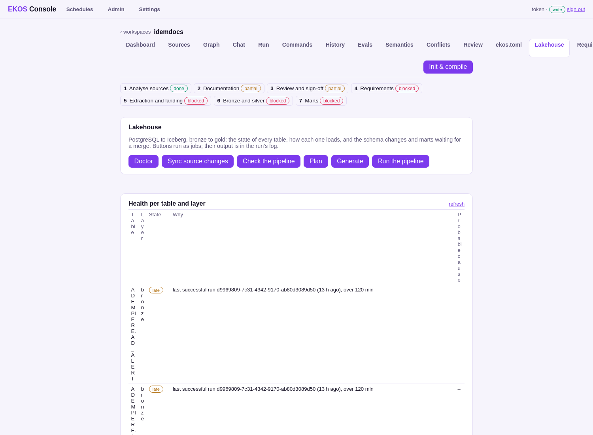

# Step 6 — Bronze and silver

**On the step bar:** blocked — needs a valid sign-off of every review subject (step 3); 325 bronze/silver table(s) built, 142 failing

## What the operator sees

_Lakehouse: each table's latest load and its state._

## What they click

<!-- ekos:manual id="step6-click" -->
The operator generates the pipeline and starts the load.
<!-- /ekos:manual -->

## What happens behind it

<!-- ekos:manual id="step6-behind" -->
EKOS generates the extraction SQL, the dbt-trino silver models with their tests (keys, check lists, code lists the application declares) and the Dagster job. Dagster loads bronze into Iceberg and builds silver; the run's results come back to the ledger per table.
<!-- /ekos:manual -->

## The run log

_No run of this step's commands was found in the console's history or the project's run logs (`lakehouse run`, `lakehouse generate`, `lakehouse sync`, `lakehouse run-report`, `lakehouse reconcile`)._

## What the operator gets

| Layer | State | Tables |
|---|---|---|
| bronze | late | 849 |
| gold | late | 4 |
| silver | failing | 142 |
| silver | late | 23 |

## Caveats

<!-- ekos:manual id="step6-caveats" -->
On this laptop testbed a 165-table subset was loaded, not all 849 tables (EKOS RFC 0227).
<!-- /ekos:manual -->
