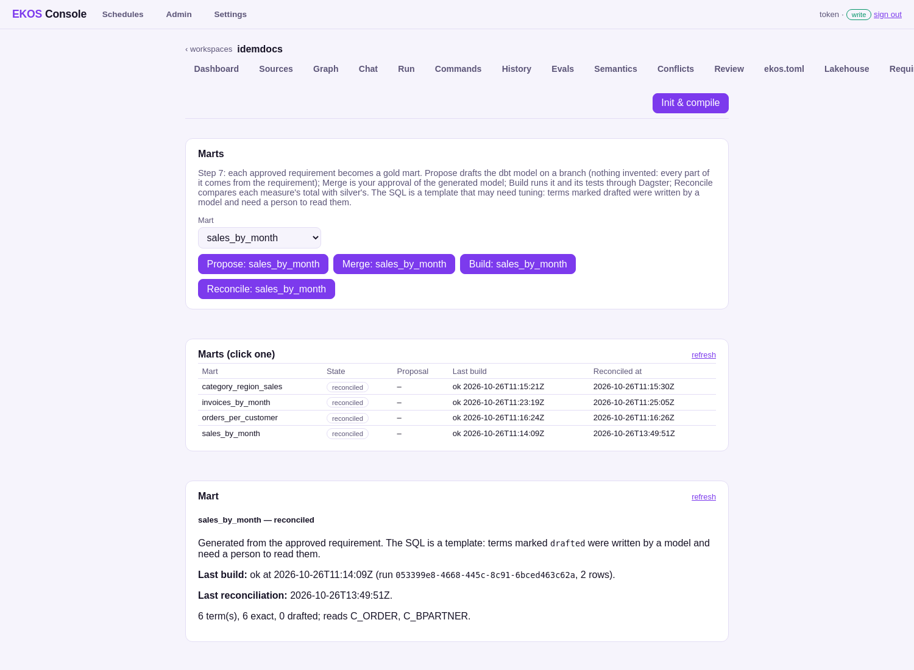

# Step 7 — Marts

**On the step bar:** blocked — needs a valid sign-off of every review subject (step 3); 4 of 4 mart(s) reconciled

## What the operator sees



_Marts: a mart's SQL, terms, tests, totals and lineage._

## What they click

<!-- ekos:manual id="step7-click" -->
Per approved requirement: **Propose**, **Merge** (the approval of the generated model), **Build**, **Reconcile**.
<!-- /ekos:manual -->


## What happens behind it

<!-- ekos:manual id="step7-behind" -->
Propose compiles the approved description into a dbt gold model on a branch and checks that nothing in it was invented. Merging is the approval. Build runs only that mart and its tests through Dagster. Reconcile reads each measure's total from the mart and the same total computed from silver, and shows both.
<!-- /ekos:manual -->


## The run log

**`lakehouse marts build --mart=invoices_by_month`** — failed, from the console, 2026-10-26T11:18:08.172534; model calls: not recorded.

_This run left no structured log (it ran before EKOS RFC 0218)._

**`lakehouse marts build --mart=invoices_by_month`** — succeeded, from the console, 2026-10-26T11:21:36.828306; model calls: not recorded.

_This run left no structured log (it ran before EKOS RFC 0218)._

**`lakehouse marts reconcile --mart=invoices_by_month`** — succeeded, from the console, 2026-10-26T11:25:04.857142; model calls: not recorded.

_This run left no structured log (it ran before EKOS RFC 0218)._

**`lakehouse marts reconcile --mart=sales_by_month`** — succeeded, from the console, 2026-10-26T13:49:49.538054; model calls: 0.

```json
{"stage": "run", "msg": "started", "version": "1.1.0", "cmd": "lakehouse marts reconcile", "t_ms": 0}
{"stage": "marts", "msg": "reconciled", "equal": true, "mart": "sales_by_month", "mart_total": "379.90", "measure": "total", "silver_total": "379.90", "cmd": "lakehouse marts reconcile", "t_ms": 3035}
{"stage": "marts", "msg": "reconciled", "equal": true, "mart": "sales_by_month", "mart_total": "3", "measure": "orders", "silver_total": "3", "cmd": "lakehouse marts reconcile", "t_ms": 3035}
{"stage": "llm", "msg": "calls", "count": 0, "cache_hits": 0, "embeddings": 0, "cmd": "lakehouse marts reconcile", "t_ms": 3553}
{"stage": "run", "msg": "finished", "ok": true, "ms": 3553, "warnings": 0, "cmd": "lakehouse marts reconcile", "t_ms": 3553}
```

## What the operator gets

| Mart | State | Last build |
|---|---|---|
| `category_region_sales` | reconciled | ok 2026-10-26T11:15:21Z |
| `invoices_by_month` | reconciled | ok 2026-10-26T11:23:19Z |
| `orders_per_customer` | reconciled | ok 2026-10-26T11:16:24Z |
| `sales_by_month` | reconciled | ok 2026-10-26T11:14:09Z |

Each measure's total in the mart and the same total computed from silver:

| Mart | Measure | Mart total | Silver total |  |
|---|---|---|---|---|
| `category_region_sales` | `sales` | 358.40 | 358.40 | equal |
| `invoices_by_month` | `invoiced` | 541.02 | 541.02 | equal |
| `invoices_by_month` | `invoices` | 4 | 4 | equal |
| `orders_per_customer` | `count_of_c_order_id` | 7 | 7 | equal |
| `sales_by_month` | `total` | 379.90 | 379.90 | equal |
| `sales_by_month` | `orders` | 3 | 3 | equal |


## Caveats

<!-- ekos:manual id="step7-caveats" -->
Generated transformations are a template that may need tuning; terms a model drafted are marked.
<!-- /ekos:manual -->
