# A_ASSET

Area [A](../../data-model/a/index.md) · class **business** (proposed) · read from database `idempiere-db` (owner `ADEMPIERE`) · 0 row(s) when profiled

Application model: `org.compiere.model.X_A_Asset`, access level 3 - Client - Org.

## Columns

| column | type | key | not null | business name | references (code) | nulls | distinct |
|---|---|---|---|---|---|---|---|
| `A_ASSET_ID` | NUMBER(10,0) | PK | yes | Asset |  | 0 | 0 |
| `AD_CLIENT_ID` | NUMBER(10,0) |  | yes | Tenant |  | 0 | 0 |
| `AD_ORG_ID` | NUMBER(10,0) |  | yes | Organization |  | 0 | 0 |
| `ISACTIVE` | CHAR(1) |  | yes | Active |  | 0 | 0 |
| `CREATED` | DATE |  | yes | Created |  | 0 | 0 |
| `CREATEDBY` | NUMBER(10,0) |  | yes | Created By |  | 0 | 0 |
| `UPDATED` | DATE |  | yes | Updated |  | 0 | 0 |
| `UPDATEDBY` | NUMBER(10,0) |  | yes | Updated By |  | 0 | 0 |
| `VALUE` | VARCHAR2(40 CHAR) |  | yes | Search Key |  | 0 | 0 |
| `NAME` | VARCHAR2(60 CHAR) |  | yes | Name |  | 0 | 0 |
| `DESCRIPTION` | VARCHAR2(255 CHAR) |  |  | Description |  | 0 | 0 |
| `HELP` | VARCHAR2(2000 CHAR) |  |  | Comment/Help |  | 0 | 0 |
| `A_ASSET_GROUP_ID` | NUMBER(10,0) |  | yes | Asset Group | [A_ASSET_GROUP](../../data-model/a/a_asset_group.md) | 0 | 0 |
| `M_PRODUCT_ID` | NUMBER(10,0) |  | yes | Product | [M_PRODUCT](../../data-model/m/m_product.md) | 0 | 0 |
| `SERNO` | VARCHAR2(255 CHAR) |  |  | Serial No |  | 0 | 0 |
| `LOT` | VARCHAR2(255 CHAR) |  |  | Lot No |  | 0 | 0 |
| `VERSIONNO` | VARCHAR2(20 CHAR) |  |  | Version No |  | 0 | 0 |
| `GUARANTEEDATE` | DATE |  |  | Guarantee Date |  | 0 | 0 |
| `ASSETSERVICEDATE` | DATE |  |  | In Service Date |  | 0 | 0 |
| `ISOWNED` | CHAR(1) |  | yes | Owned |  | 0 | 0 |
| `ASSETDEPRECIATIONDATE` | DATE |  |  | Asset Depreciation Date |  | 0 | 0 |
| `USELIFEYEARS` | NUMBER |  |  | Usable Life - Years |  | 0 | 0 |
| `USELIFEMONTHS` | NUMBER(10,0) |  |  | Usable Life - Months |  | 0 | 0 |
| `LIFEUSEUNITS` | NUMBER |  |  | Life use |  | 0 | 0 |
| `USEUNITS` | NUMBER |  |  | Use units |  | 0 | 0 |
| `ISDISPOSED` | CHAR(1) |  | yes | Disposed |  | 0 | 0 |
| `ASSETDISPOSALDATE` | DATE |  |  | Asset Disposal Date |  | 0 | 0 |
| `ISINPOSESSION` | CHAR(1) |  | yes | In Possession |  | 0 | 0 |
| `LOCATIONCOMMENT` | VARCHAR2(255 CHAR) |  |  | Location comment |  | 0 | 0 |
| `M_LOCATOR_ID` | NUMBER(10,0) |  |  | Locator | [M_LOCATOR](../../data-model/m/m_locator.md) | 0 | 0 |
| `C_BPARTNER_ID` | NUMBER(10,0) |  |  | Business Partner | [C_BPARTNER](../../data-model/c/c_bpartner.md) | 0 | 0 |
| `C_BPARTNER_LOCATION_ID` | NUMBER(10,0) |  |  | Partner Location | [C_BPARTNER_LOCATION](../../data-model/c/c_bpartner_location.md) | 0 | 0 |
| `C_LOCATION_ID` | NUMBER(10,0) |  |  | Address | [C_LOCATION](../../data-model/c/c_location.md) | 0 | 0 |
| `PROCESSING` | CHAR(1) |  |  | Process Now |  | 0 | 0 |
| `ISDEPRECIATED` | CHAR(1) |  | yes | Depreciate |  | 0 | 0 |
| `ISFULLYDEPRECIATED` | CHAR(1) |  | yes | Fully depreciated |  | 0 | 0 |
| `AD_USER_ID` | NUMBER(10,0) |  |  | User/Contact | [AD_USER](../../data-model/ad/ad_user.md) | 0 | 0 |
| `M_ATTRIBUTESETINSTANCE_ID` | NUMBER(10,0) |  |  | Attribute Set Instance | [M_ATTRIBUTESETINSTANCE](../../data-model/m/m_attributesetinstance.md) | 0 | 0 |
| `QTY` | NUMBER |  |  | Quantity |  | 0 | 0 |
| `C_PROJECT_ID` | NUMBER(10,0) |  |  | Project | [C_PROJECT](../../data-model/c/c_project.md) | 0 | 0 |
| `C_BPARTNERSR_ID` | NUMBER(10,0) |  |  | BPartner (Agent) | [C_BPARTNER](../../data-model/c/c_bpartner.md) | 0 | 0 |
| `M_INOUTLINE_ID` | NUMBER(10,0) |  |  | Shipment/Receipt Line | [M_INOUTLINE](../../data-model/m/m_inoutline.md) | 0 | 0 |
| `LASTMAINTENENCEDATE` | DATE |  |  |  |  | 0 | 0 |
| `NEXTMAINTENENCEDATE` | DATE |  |  | Next Maintenance |  | 0 | 0 |
| `LASTMAINTENANCEUSEUNIT` | NUMBER(10,0) |  |  |  |  | 0 | 0 |
| `NEXTMAINTENANCEUSEUNIT` | NUMBER(10,0) |  |  |  |  | 0 | 0 |
| `LEASETERMINATIONDATE` | DATE |  |  | Lease Termination |  | 0 | 0 |
| `LEASE_BPARTNER_ID` | NUMBER(10,0) |  |  | Lessor | [C_BPARTNER](../../data-model/c/c_bpartner.md) | 0 | 0 |
| `LASTMAINTENANCENOTE` | VARCHAR2(60 CHAR) |  |  | Last Note |  | 0 | 0 |
| `LASTMAINTENANCEDATE` | DATE |  |  | Last Maintenance |  | 0 | 0 |
| `LASTMAINTENANCEUNIT` | NUMBER(10,0) |  |  | Last Unit |  | 0 | 0 |
| `NEXTMAINTENENCEUNIT` | NUMBER(10,0) |  |  | Next Unit |  | 0 | 0 |
| `A_ASSET_CREATEDATE` | DATE |  |  | Create Date |  | 0 | 0 |
| `A_ASSET_REVALDATE` | DATE |  |  | Revaluation Date |  | 0 | 0 |
| `A_PARENT_ASSET_ID` | NUMBER(10,0) |  |  | Parent Asset | [A_ASSET](../../data-model/a/a_asset.md) | 0 | 0 |
| `A_QTY_CURRENT` | NUMBER |  |  | Current Qty |  | 0 | 0 |
| `A_QTY_ORIGINAL` | NUMBER |  |  | A_QTY_Original |  | 0 | 0 |
| `A_ASSET_UU` | VARCHAR2(36 CHAR) |  |  | A_Asset_UU |  | 0 | 0 |
| `A_ASSET_CLASS_ID` | NUMBER(10,0) |  |  | Asset class | [A_ASSET_CLASS](../../data-model/a/a_asset_class.md) | 0 | 0 |
| `A_ASSET_STATUS` | VARCHAR2(2 CHAR) |  | yes | Asset Status |  | 0 | 0 |
| `A_ASSET_ACTION` | VARCHAR2(2 CHAR) |  | yes | Asset Action |  | 0 | 0 |
| `PROCESSED` | CHAR(1) |  | yes | Processed |  | 0 | 0 |
| `ASSETACTIVATIONDATE` | DATE |  |  | Activation Date |  | 0 | 0 |
| `INVENTORYNO` | VARCHAR2(30 CHAR) |  |  | Inventory No |  | 0 | 0 |
| `A_ASSET_TYPE_ID` | NUMBER(10,0) |  |  | Asset Type | [A_ASSET_TYPE](../../data-model/a/a_asset_type.md) | 0 | 0 |
| `A_ASSETTYPE` | VARCHAR2(3 CHAR) |  | yes | Asset Type |  | 0 | 0 |
| `C_ACTIVITY_ID` | NUMBER(10,0) |  |  | Activity | [C_ACTIVITY](../../data-model/c/c_activity.md) | 0 | 0 |
| `MANUFACTURER` | VARCHAR2(30 CHAR) |  |  | Manufacturer |  | 0 | 0 |
| `MANUFACTUREDYEAR` | NUMBER(10,0) |  |  | Manufactured Year |  | 0 | 0 |

*references (code)* is the table the application model's code says a column points to; *Foreign keys* below are the constraints the database declares. Counts come from the profile; no value is ever shown.

## Check constraints

| name | expression |
|---|---|
| `SYS_C0020471` | `Processed IN ('Y','N')` |
| `SYS_C0020473` | `IsInPosession in ('Y','N')` |
| `SYS_C0020475` | `IsActive in ('Y','N')` |
| `SYS_C0020476` | `IsOwned in ('Y','N')` |
| `SYS_C0020477` | `IsDisposed in ('Y','N')` |

## Foreign keys

**References**

| table | columns | on delete |
|---|---|---|
| [AD_USER](../../data-model/ad/ad_user.md) | A_ASSET.AD_USER_ID → AD_USER.AD_USER_ID | NO ACTION |
| [A_ASSET](../../data-model/a/a_asset.md) | A_ASSET.A_PARENT_ASSET_ID → A_ASSET.A_ASSET_ID | NO ACTION |
| [A_ASSET_CLASS](../../data-model/a/a_asset_class.md) | A_ASSET.A_ASSET_CLASS_ID → A_ASSET_CLASS.A_ASSET_CLASS_ID | NO ACTION |
| [A_ASSET_GROUP](../../data-model/a/a_asset_group.md) | A_ASSET.A_ASSET_GROUP_ID → A_ASSET_GROUP.A_ASSET_GROUP_ID | NO ACTION |
| [A_ASSET_TYPE](../../data-model/a/a_asset_type.md) | A_ASSET.A_ASSET_TYPE_ID → A_ASSET_TYPE.A_ASSET_TYPE_ID | NO ACTION |
| [C_ACTIVITY](../../data-model/c/c_activity.md) | A_ASSET.C_ACTIVITY_ID → C_ACTIVITY.C_ACTIVITY_ID | NO ACTION |
| [C_BPARTNER](../../data-model/c/c_bpartner.md) | A_ASSET.C_BPARTNERSR_ID → C_BPARTNER.C_BPARTNER_ID | NO ACTION |
| [C_BPARTNER_LOCATION](../../data-model/c/c_bpartner_location.md) | A_ASSET.C_BPARTNER_LOCATION_ID → C_BPARTNER_LOCATION.C_BPARTNER_LOCATION_ID | NO ACTION |
| [C_LOCATION](../../data-model/c/c_location.md) | A_ASSET.C_LOCATION_ID → C_LOCATION.C_LOCATION_ID | NO ACTION |
| [C_PROJECT](../../data-model/c/c_project.md) | A_ASSET.C_PROJECT_ID → C_PROJECT.C_PROJECT_ID | NO ACTION |
| [M_ATTRIBUTESETINSTANCE](../../data-model/m/m_attributesetinstance.md) | A_ASSET.M_ATTRIBUTESETINSTANCE_ID → M_ATTRIBUTESETINSTANCE.M_ATTRIBUTESETINSTANCE_ID | NO ACTION |
| [M_INOUTLINE](../../data-model/m/m_inoutline.md) | A_ASSET.M_INOUTLINE_ID → M_INOUTLINE.M_INOUTLINE_ID | NO ACTION |
| [M_LOCATOR](../../data-model/m/m_locator.md) | A_ASSET.M_LOCATOR_ID → M_LOCATOR.M_LOCATOR_ID | NO ACTION |
| [M_PRODUCT](../../data-model/m/m_product.md) | A_ASSET.M_PRODUCT_ID → M_PRODUCT.M_PRODUCT_ID | NO ACTION |

**Referenced by**

| table | columns | on delete |
|---|---|---|
| [AD_ISSUE](../../data-model/ad/ad_issue.md) | AD_ISSUE.A_ASSET_ID → A_ASSET.A_ASSET_ID | SET NULL |
| [A_ASSET](../../data-model/a/a_asset.md) | A_ASSET.A_PARENT_ASSET_ID → A_ASSET.A_ASSET_ID | NO ACTION |
| [A_ASSET_ACCT](../../data-model/a/a_asset_acct.md) | A_ASSET_ACCT.A_ASSET_ID → A_ASSET.A_ASSET_ID | CASCADE |
| [A_ASSET_ADDITION](../../data-model/a/a_asset_addition.md) | A_ASSET_ADDITION.A_ASSET_ID → A_ASSET.A_ASSET_ID | NO ACTION |
| [A_ASSET_CHANGE](../../data-model/a/a_asset_change.md) | A_ASSET_CHANGE.A_ASSET_ID → A_ASSET.A_ASSET_ID | NO ACTION |
| [A_ASSET_DELIVERY](../../data-model/a/a_asset_delivery.md) | A_ASSET_DELIVERY.A_ASSET_ID → A_ASSET.A_ASSET_ID | NO ACTION |
| [A_ASSET_DISPOSED](../../data-model/a/a_asset_disposed.md) | A_ASSET_DISPOSED.A_ASSET_TRADE_ID → A_ASSET.A_ASSET_ID | NO ACTION |
| [A_ASSET_INFO_FIN](../../data-model/a/a_asset_info_fin.md) | A_ASSET_INFO_FIN.A_ASSET_ID → A_ASSET.A_ASSET_ID | NO ACTION |
| [A_ASSET_INFO_LIC](../../data-model/a/a_asset_info_lic.md) | A_ASSET_INFO_LIC.A_ASSET_ID → A_ASSET.A_ASSET_ID | NO ACTION |
| [A_ASSET_PRODUCT](../../data-model/a/a_asset_product.md) | A_ASSET_PRODUCT.A_ASSET_ID → A_ASSET.A_ASSET_ID | NO ACTION |
| [A_ASSET_RETIREMENT](../../data-model/a/a_asset_retirement.md) | A_ASSET_RETIREMENT.A_ASSET_ID → A_ASSET.A_ASSET_ID | NO ACTION |
| [A_ASSET_REVAL](../../data-model/a/a_asset_reval.md) | A_ASSET_REVAL.A_ASSET_ID → A_ASSET.A_ASSET_ID | NO ACTION |
| [A_ASSET_SPLIT](../../data-model/a/a_asset_split.md) | A_ASSET_SPLIT.A_ASSET_ID_TO → A_ASSET.A_ASSET_ID | NO ACTION |
| [A_ASSET_TRANSFER](../../data-model/a/a_asset_transfer.md) | A_ASSET_TRANSFER.A_ASSET_ID → A_ASSET.A_ASSET_ID | NO ACTION |
| [A_ASSET_USE](../../data-model/a/a_asset_use.md) | A_ASSET_USE.A_ASSET_ID → A_ASSET.A_ASSET_ID | NO ACTION |
| [A_DEPRECIATION_BUILD](../../data-model/a/a_depreciation_build.md) | A_DEPRECIATION_BUILD.A_END_ASSET_ID → A_ASSET.A_ASSET_ID | NO ACTION |
| [A_DEPRECIATION_EXP](../../data-model/a/a_depreciation_exp.md) | A_DEPRECIATION_EXP.A_ASSET_ID → A_ASSET.A_ASSET_ID | NO ACTION |
| [A_DEPRECIATION_FORECAST](../../data-model/a/a_depreciation_forecast.md) | A_DEPRECIATION_FORECAST.A_END_ASSET_ID → A_ASSET.A_ASSET_ID | NO ACTION |
| [A_DEPRECIATION_WORKFILE](../../data-model/a/a_depreciation_workfile.md) | A_DEPRECIATION_WORKFILE.A_ASSET_ID → A_ASSET.A_ASSET_ID | NO ACTION |
| [A_REGISTRATION](../../data-model/a/a_registration.md) | A_REGISTRATION.A_ASSET_ID → A_ASSET.A_ASSET_ID | NO ACTION |
| [C_INVOICELINE](../../data-model/c/c_invoiceline.md) | C_INVOICELINE.A_ASSET_ID → A_ASSET.A_ASSET_ID | NO ACTION |
| [FACT_ACCT](../../data-model/fact/fact_acct.md) | FACT_ACCT.A_ASSET_ID → A_ASSET.A_ASSET_ID | NO ACTION |
| [GL_JOURNALLINE](../../data-model/gl/gl_journalline.md) | GL_JOURNALLINE.A_ASSET_ID → A_ASSET.A_ASSET_ID | NO ACTION |
| `I_FIXEDASSET` | I_FIXEDASSET.A_ASSET_ID → A_ASSET.A_ASSET_ID | NO ACTION |
| [M_OPERATIONRESOURCE](../../data-model/m/m_operationresource.md) | M_OPERATIONRESOURCE.A_ASSET_ID → A_ASSET.A_ASSET_ID | NO ACTION |
| [PP_ORDER_NODE_ASSET](../../data-model/pp/pp_order_node_asset.md) | PP_ORDER_NODE_ASSET.A_ASSET_ID → A_ASSET.A_ASSET_ID | NO ACTION |
| [PP_WF_NODE_ASSET](../../data-model/pp/pp_wf_node_asset.md) | PP_WF_NODE_ASSET.A_ASSET_ID → A_ASSET.A_ASSET_ID | NO ACTION |
| [R_ISSUEPROJECT](../../data-model/r/r_issueproject.md) | R_ISSUEPROJECT.A_ASSET_ID → A_ASSET.A_ASSET_ID | NO ACTION |
| [R_ISSUESYSTEM](../../data-model/r/r_issuesystem.md) | R_ISSUESYSTEM.A_ASSET_ID → A_ASSET.A_ASSET_ID | NO ACTION |
| [R_REQUEST](../../data-model/r/r_request.md) | R_REQUEST.A_ASSET_ID → A_ASSET.A_ASSET_ID | NO ACTION |
| [R_REQUESTACTION](../../data-model/r/r_requestaction.md) | R_REQUESTACTION.A_ASSET_ID → A_ASSET.A_ASSET_ID | NO ACTION |

```mermaid
erDiagram
  AD_USER ||--o{ A_ASSET : ""
  A_ASSET ||--o{ AD_ISSUE : ""
  A_ASSET ||--o{ A_ASSET : ""
  A_ASSET ||--o{ A_ASSET_ACCT : ""
  A_ASSET ||--o{ A_ASSET_ADDITION : ""
  A_ASSET ||--o{ A_ASSET_CHANGE : ""
  A_ASSET ||--o{ A_ASSET_DELIVERY : ""
  A_ASSET ||--o{ A_ASSET_DISPOSED : ""
  A_ASSET ||--o{ A_ASSET_INFO_FIN : ""
  A_ASSET ||--o{ A_ASSET_INFO_LIC : ""
  A_ASSET ||--o{ A_ASSET_PRODUCT : ""
  A_ASSET ||--o{ A_ASSET_RETIREMENT : ""
  A_ASSET ||--o{ A_ASSET_REVAL : ""
  A_ASSET ||--o{ A_ASSET_SPLIT : ""
  A_ASSET ||--o{ A_ASSET_TRANSFER : ""
  A_ASSET ||--o{ A_ASSET_USE : ""
  A_ASSET ||--o{ A_DEPRECIATION_BUILD : ""
  A_ASSET ||--o{ A_DEPRECIATION_EXP : ""
  A_ASSET ||--o{ A_DEPRECIATION_FORECAST : ""
  A_ASSET ||--o{ A_DEPRECIATION_WORKFILE : ""
  A_ASSET ||--o{ A_REGISTRATION : ""
  A_ASSET ||--o{ C_INVOICELINE : ""
  A_ASSET_CLASS ||--o{ A_ASSET : ""
  A_ASSET_GROUP ||--o{ A_ASSET : ""
  A_ASSET_TYPE ||--o{ A_ASSET : ""
  C_ACTIVITY ||--o{ A_ASSET : ""
  C_BPARTNER ||--o{ A_ASSET : ""
  C_BPARTNER_LOCATION ||--o{ A_ASSET : ""
  C_LOCATION ||--o{ A_ASSET : ""
  C_PROJECT ||--o{ A_ASSET : ""
```

14 more neighbour(s) not drawn.

## Write behaviour

- updates: **raw_sql_skips_updated**
- deletes: **deleted_by_users**
- change log: **recorded**
- evidence: 5 citation(s)

## Read by

| kind | name |
|---|---|
| View | `RV_ASSET_CUSTOMER` |
| View | `RV_ASSET_DELIVERY` |
| View | `RV_ASSET_SUMMONTH` |
| View | `rv_asset_customer` |
| View | `rv_asset_delivery` |
| View | `rv_asset_summonth` |

## Schema history

91 change(s); the latest:

| applied | release | operation | column | tickets |
|---|---|---|---|---|
| 2023-04-09T15:47 | iD11 | `add_constraint` |  | IDEMPIERE-5567 |
| 2023-04-09T15:47 | iD11 | `add_constraint` |  | IDEMPIERE-5567 |
| 2022-11-11T22:36 | i9 | `modify_column` | UseLifeYears | IDEMPIERE-5474 |
| 2022-11-11T22:36 | i9 | `modify_column` | UseLifeYears | IDEMPIERE-5474 |
| 2021-12-05T16:45 | i8.2z | `add_constraint` |  | IDEMPIERE-5075 |
| 2021-12-05T16:45 | i8.2z | `add_constraint` |  | IDEMPIERE-5075 |
| 2021-12-05T16:45 | i8.2z | `drop_constraint` |  | IDEMPIERE-5075 |
| 2021-12-05T16:45 | i8.2z | `drop_constraint` |  | IDEMPIERE-5075 |
| 2021-12-05T16:45 | i8.2z | `drop_constraint` |  | IDEMPIERE-5075 |
| 2021-12-05T16:45 | i8.2z | `drop_constraint` |  | IDEMPIERE-5075 |
| 2021-12-05T16:45 | i8.2z | `add_constraint` |  | IDEMPIERE-5075 |
| 2021-12-05T16:45 | i8.2z | `add_constraint` |  | IDEMPIERE-5075 |
| 2021-12-05T16:45 | i8.2z | `drop_constraint` |  | IDEMPIERE-5075 |
| 2021-12-05T16:45 | i8.2z | `drop_constraint` |  | IDEMPIERE-5075 |
| 2021-12-05T16:45 | i8.2z | `drop_constraint` |  | IDEMPIERE-5075 |

## Open conflicts

| type | attribute | explanation |
|---|---|---|
| `mandatory_but_nullable` | `columns.M_AttributeSetInstance_ID.nullable` | unexplained |

## Notes

<!-- ekos:manual id="table.a_asset.notes" -->
_Business notes about this table._
<!-- /ekos:manual -->
