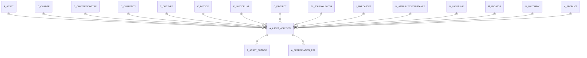

# A_ASSET_ADDITION

Area [A](../../data-model/a/index.md) · class **business** (proposed) · read from database `idempiere-db` (owner `ADEMPIERE`) · 0 row(s) when profiled

Application model: `org.compiere.model.X_A_Asset_Addition`, access level 3 - Client - Org.

## Columns

| column | type | key | not null | business name | references (code) | nulls | distinct |
|---|---|---|---|---|---|---|---|
| `A_ASSET_ADDITION_ID` | NUMBER(10,0) | PK | yes | Asset Addition |  | 0 | 0 |
| `AD_CLIENT_ID` | NUMBER(10,0) |  | yes | Tenant |  | 0 | 0 |
| `AD_ORG_ID` | NUMBER(10,0) |  | yes | Organization |  | 0 | 0 |
| `ISACTIVE` | CHAR(1) |  | yes | Active |  | 0 | 0 |
| `CREATED` | DATE |  | yes | Created |  | 0 | 0 |
| `CREATEDBY` | NUMBER(10,0) |  | yes | Created By |  | 0 | 0 |
| `UPDATED` | DATE |  | yes | Updated |  | 0 | 0 |
| `UPDATEDBY` | NUMBER(10,0) |  | yes | Updated By |  | 0 | 0 |
| `A_ASSET_ID` | NUMBER(10,0) |  | yes | Asset | [A_ASSET](../../data-model/a/a_asset.md) | 0 | 0 |
| `ASSETVALUEAMT` | NUMBER |  | yes | Asset value |  | 0 | 0 |
| `C_INVOICELINE_ID` | NUMBER(10,0) |  |  | Invoice Line | [C_INVOICELINE](../../data-model/c/c_invoiceline.md) | 0 | 0 |
| `A_QTY_CURRENT` | NUMBER |  | yes | Current Qty |  | 0 | 0 |
| `DESCRIPTION` | VARCHAR2(510 CHAR) |  |  | Description |  | 0 | 0 |
| `GL_JOURNALBATCH_ID` | NUMBER(10,0) |  |  | Journal Batch | [GL_JOURNALBATCH](../../data-model/gl/gl_journalbatch.md) | 0 | 0 |
| `LINE` | NUMBER(10,0) |  |  | Line No |  | 0 | 0 |
| `POSTINGTYPE` | CHAR(1) |  | yes | Posting Type |  | 0 | 0 |
| `M_INOUTLINE_ID` | NUMBER(10,0) |  |  | Shipment/Receipt Line | [M_INOUTLINE](../../data-model/m/m_inoutline.md) | 0 | 0 |
| `DOCUMENTNO` | VARCHAR2(30 CHAR) |  |  | Document No |  | 0 | 0 |
| `C_INVOICE_ID` | NUMBER(10,0) |  |  | Invoice | [C_INVOICE](../../data-model/c/c_invoice.md) | 0 | 0 |
| `A_SOURCETYPE` | VARCHAR2(3 CHAR) |  | yes | Source Type |  | 0 | 0 |
| `A_CAPVSEXP` | VARCHAR2(3 CHAR) |  | yes | Capital/Expense |  | 0 | 0 |
| `A_ASSET_ADDITION_UU` | VARCHAR2(36 CHAR) |  |  | A_Asset_Addition_UU |  | 0 | 0 |
| `PROCESSED` | CHAR(1) |  | yes | Processed |  | 0 | 0 |
| `DOCSTATUS` | VARCHAR2(2 CHAR) |  | yes | Document Status |  | 0 | 0 |
| `DOCACTION` | CHAR(2) |  |  | Document Action |  | 0 | 0 |
| `A_CREATEASSET` | CHAR(1) |  | yes | Create Asset |  | 0 | 0 |
| `ISAPPROVED` | CHAR(1) |  | yes | Approved |  | 0 | 0 |
| `M_MATCHINV_ID` | NUMBER(10,0) |  |  | Match Invoice | [M_MATCHINV](../../data-model/m/m_matchinv.md) | 0 | 0 |
| `M_PRODUCT_ID` | NUMBER(10,0) |  |  | Product | [M_PRODUCT](../../data-model/m/m_product.md) | 0 | 0 |
| `M_ATTRIBUTESETINSTANCE_ID` | NUMBER(10,0) |  |  | Attribute Set Instance | [M_ATTRIBUTESETINSTANCE](../../data-model/m/m_attributesetinstance.md) | 0 | 0 |
| `M_LOCATOR_ID` | NUMBER(10,0) |  |  | Locator | [M_LOCATOR](../../data-model/m/m_locator.md) | 0 | 0 |
| `C_CURRENCY_ID` | NUMBER(10,0) |  | yes | Currency | [C_CURRENCY](../../data-model/c/c_currency.md) | 0 | 0 |
| `C_CONVERSIONTYPE_ID` | NUMBER(10,0) |  | yes | Currency Type | [C_CONVERSIONTYPE](../../data-model/c/c_conversiontype.md) | 0 | 0 |
| `ASSETSOURCEAMT` | NUMBER |  |  | Source Amount |  | 0 | 0 |
| `DELTAUSELIFEYEARS` | NUMBER(10,0) |  | yes |  |  | 0 | 0 |
| `DELTAUSELIFEYEARS_F` | NUMBER(10,0) |  | yes |  |  | 0 | 0 |
| `DATEDOC` | DATE |  | yes | Document Date |  | 0 | 0 |
| `I_FIXEDASSET_ID` | NUMBER(10,0) |  |  | Imported Fixed Asset | `I_FIXEDASSET` | 0 | 0 |
| `DATEACCT` | DATE |  |  | Account Date |  | 0 | 0 |
| `CURRENCYRATE` | NUMBER |  |  | Rate |  | 0 | 0 |
| `A_ACCUMULATED_DEPR` | NUMBER |  | yes |  |  | 0 | 0 |
| `A_ACCUMULATED_DEPR_F` | NUMBER |  | yes |  |  | 0 | 0 |
| `C_PROJECT_ID` | NUMBER(10,0) |  |  | Project | [C_PROJECT](../../data-model/c/c_project.md) | 0 | 0 |
| `PROCESSING` | CHAR(1) |  |  | Process Now |  | 0 | 0 |
| `A_ACCUMULATED_DEPR_ADJUST` | CHAR(1) |  | yes |  |  | 0 | 0 |
| `ASSETAMTENTERED` | NUMBER |  | yes | Entered Amount |  | 0 | 0 |
| `POSTED` | CHAR(1) |  | yes | Posted |  | 0 | 0 |
| `A_PERIOD_START` | NUMBER(10,0) |  | yes |  |  | 0 | 0 |
| `C_CHARGE_ID` | NUMBER(10,0) |  |  | Charge | [C_CHARGE](../../data-model/c/c_charge.md) | 0 | 0 |
| `PROCESSEDON` | NUMBER |  |  | Processed On |  | 0 | 0 |
| `A_SALVAGE_VALUE` | NUMBER |  |  | Asset Salvage Value |  | 0 | 0 |
| `C_DOCTYPE_ID` | NUMBER(10,0) |  |  | Document Type | [C_DOCTYPE](../../data-model/c/c_doctype.md) | 0 | 0 |

*references (code)* is the table the application model's code says a column points to; *Foreign keys* below are the constraints the database declares. Counts come from the profile; no value is ever shown.

## Check constraints

| name | expression |
|---|---|
| `SYS_C0020653` | `IsActive in ('Y','N')` |
| `SYS_C0020654` | `Processed IN ('Y','N')` |
| `SYS_C0020655` | `A_CreateAsset IN ('Y','N')` |
| `SYS_C0020656` | `Processing IN ('Y','N')` |
| `SYS_C0020657` | `IsApproved IN ('Y','N')` |
| `SYS_C0020659` | `A_Accumulated_Depr_Adjust IN ('Y','N')` |

## Foreign keys

**References**

| table | columns | on delete |
|---|---|---|
| [A_ASSET](../../data-model/a/a_asset.md) | A_ASSET_ADDITION.A_ASSET_ID → A_ASSET.A_ASSET_ID | NO ACTION |
| [C_CHARGE](../../data-model/c/c_charge.md) | A_ASSET_ADDITION.C_CHARGE_ID → C_CHARGE.C_CHARGE_ID | NO ACTION |
| [C_CONVERSIONTYPE](../../data-model/c/c_conversiontype.md) | A_ASSET_ADDITION.C_CONVERSIONTYPE_ID → C_CONVERSIONTYPE.C_CONVERSIONTYPE_ID | NO ACTION |
| [C_CURRENCY](../../data-model/c/c_currency.md) | A_ASSET_ADDITION.C_CURRENCY_ID → C_CURRENCY.C_CURRENCY_ID | NO ACTION |
| [C_DOCTYPE](../../data-model/c/c_doctype.md) | A_ASSET_ADDITION.C_DOCTYPE_ID → C_DOCTYPE.C_DOCTYPE_ID | NO ACTION |
| [C_INVOICE](../../data-model/c/c_invoice.md) | A_ASSET_ADDITION.C_INVOICE_ID → C_INVOICE.C_INVOICE_ID | NO ACTION |
| [C_INVOICELINE](../../data-model/c/c_invoiceline.md) | A_ASSET_ADDITION.C_INVOICELINE_ID → C_INVOICELINE.C_INVOICELINE_ID | NO ACTION |
| [C_PROJECT](../../data-model/c/c_project.md) | A_ASSET_ADDITION.C_PROJECT_ID → C_PROJECT.C_PROJECT_ID | NO ACTION |
| [GL_JOURNALBATCH](../../data-model/gl/gl_journalbatch.md) | A_ASSET_ADDITION.GL_JOURNALBATCH_ID → GL_JOURNALBATCH.GL_JOURNALBATCH_ID | NO ACTION |
| `I_FIXEDASSET` | A_ASSET_ADDITION.I_FIXEDASSET_ID → I_FIXEDASSET.I_FIXEDASSET_ID | NO ACTION |
| [M_ATTRIBUTESETINSTANCE](../../data-model/m/m_attributesetinstance.md) | A_ASSET_ADDITION.M_ATTRIBUTESETINSTANCE_ID → M_ATTRIBUTESETINSTANCE.M_ATTRIBUTESETINSTANCE_ID | NO ACTION |
| [M_INOUTLINE](../../data-model/m/m_inoutline.md) | A_ASSET_ADDITION.M_INOUTLINE_ID → M_INOUTLINE.M_INOUTLINE_ID | NO ACTION |
| [M_LOCATOR](../../data-model/m/m_locator.md) | A_ASSET_ADDITION.M_LOCATOR_ID → M_LOCATOR.M_LOCATOR_ID | NO ACTION |
| [M_MATCHINV](../../data-model/m/m_matchinv.md) | A_ASSET_ADDITION.M_MATCHINV_ID → M_MATCHINV.M_MATCHINV_ID | NO ACTION |
| [M_PRODUCT](../../data-model/m/m_product.md) | A_ASSET_ADDITION.M_PRODUCT_ID → M_PRODUCT.M_PRODUCT_ID | NO ACTION |

**Referenced by**

| table | columns | on delete |
|---|---|---|
| [A_ASSET_CHANGE](../../data-model/a/a_asset_change.md) | A_ASSET_CHANGE.A_ASSET_ADDITION_ID → A_ASSET_ADDITION.A_ASSET_ADDITION_ID | NO ACTION |
| [A_DEPRECIATION_EXP](../../data-model/a/a_depreciation_exp.md) | A_DEPRECIATION_EXP.A_ASSET_ADDITION_ID → A_ASSET_ADDITION.A_ASSET_ADDITION_ID | NO ACTION |

## Write behaviour

- updates: **po_only**
- deletes: **deleted_by_app, deleted_by_users**
- change log: **recorded**
- evidence: 2 citation(s)

## Schema history

74 change(s); the latest:

| applied | release | operation | column | tickets |
|---|---|---|---|---|
| 2024-05-14T13:59 | iD13 | `add_constraint` |  | IDEMPIERE-5598 |
| 2024-05-14T13:59 | iD13 | `add_constraint` |  | IDEMPIERE-5598 |
| 2024-05-14T13:59 | iD13 | `add_column` | C_Department_ID | IDEMPIERE-5598 |
| 2024-05-14T13:59 | iD13 | `add_column` | C_CostCenter_ID | IDEMPIERE-5598 |
| 2024-05-14T13:59 | iD13 | `add_column` | C_CostCenter_ID | IDEMPIERE-5598 |
| 2024-05-14T13:59 | iD13 | `add_constraint` |  | IDEMPIERE-5598 |
| 2024-05-14T13:59 | iD13 | `add_column` | C_Department_ID | IDEMPIERE-5598 |
| 2024-05-14T13:59 | iD13 | `add_constraint` |  | IDEMPIERE-5598 |
| 2023-04-09T15:47 | iD11 | `add_constraint` |  | IDEMPIERE-5567 |
| 2023-04-09T15:47 | iD11 | `add_constraint` |  | IDEMPIERE-5567 |
| 2021-12-05T16:45 | i8.2z | `add_constraint` |  | IDEMPIERE-5075 |
| 2021-12-05T16:45 | i8.2z | `add_constraint` |  | IDEMPIERE-5075 |
| 2021-12-05T16:45 | i8.2z | `drop_constraint` |  | IDEMPIERE-5075 |
| 2021-12-05T16:45 | i8.2z | `drop_constraint` |  | IDEMPIERE-5075 |
| 2021-12-05T16:45 | i8.2z | `drop_constraint` |  | IDEMPIERE-5075 |

## Open conflicts

| type | attribute | explanation |
|---|---|---|
| `model_column_missing` | `columns.C_CostCenter_ID` | unexplained |
| `model_column_missing` | `columns.C_Department_ID` | unexplained |

## Notes

<!-- ekos:manual id="table.a_asset_addition.notes" -->
_Business notes about this table._
<!-- /ekos:manual -->
