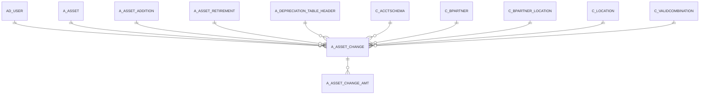

# A_ASSET_CHANGE

Area [A](../../data-model/a/index.md) · class **business** (proposed) · read from database `idempiere-db` (owner `ADEMPIERE`) · 0 row(s) when profiled

Application model: `org.compiere.model.X_A_Asset_Change`, access level 7 - System - Client - Org.

## Columns

| column | type | key | not null | business name | references (code) | nulls | distinct |
|---|---|---|---|---|---|---|---|
| `A_ASSET_CHANGE_ID` | NUMBER(10,0) | PK | yes | A_Asset_Change_ID |  | 0 | 0 |
| `AD_CLIENT_ID` | NUMBER(10,0) |  | yes | Tenant |  | 0 | 0 |
| `AD_ORG_ID` | NUMBER(10,0) |  | yes | Organization |  | 0 | 0 |
| `ISACTIVE` | CHAR(1) |  | yes | Active |  | 0 | 0 |
| `CREATED` | DATE |  | yes | Created |  | 0 | 0 |
| `CREATEDBY` | NUMBER(10,0) |  | yes | Created By |  | 0 | 0 |
| `UPDATED` | DATE |  | yes | Updated |  | 0 | 0 |
| `UPDATEDBY` | NUMBER(10,0) |  | yes | Updated By |  | 0 | 0 |
| `A_ASSET_ID` | NUMBER(10,0) |  | yes | Asset | [A_ASSET](../../data-model/a/a_asset.md) | 0 | 0 |
| `CHANGETYPE` | VARCHAR2(3 CHAR) |  | yes | Change Type |  | 0 | 0 |
| `CHANGEDATE` | DATE |  |  | Change Date |  | 0 | 0 |
| `CHANGEAMT` | NUMBER |  |  | Change Amt |  | 0 | 0 |
| `USELIFEYEARS` | NUMBER |  |  | Usable Life - Years |  | 0 | 0 |
| `USELIFEMONTHS` | NUMBER(10,0) |  |  | Usable Life - Months |  | 0 | 0 |
| `LIFEUSEUNITS` | NUMBER(10,0) |  |  | Life use |  | 0 | 0 |
| `ASSETDEPRECIATIONDATE` | DATE |  |  | Asset Depreciation Date |  | 0 | 0 |
| `A_ASSET_RETIREMENT_ID` | NUMBER(10,0) |  |  | Asset Retirement |  | 0 | 0 |
| `A_ASSET_ADDITION_ID` | NUMBER(10,0) |  |  | Asset Addition |  | 0 | 0 |
| `SERNO` | VARCHAR2(40 CHAR) |  |  | Serial No |  | 0 | 0 |
| `LOT` | VARCHAR2(40 CHAR) |  |  | Lot No |  | 0 | 0 |
| `VERSIONNO` | VARCHAR2(40 CHAR) |  |  | Version No |  | 0 | 0 |
| `A_ACCUMDEPRECIATION_ACCT` | NUMBER(10,0) |  |  | Accumulated Depreciation Account |  | 0 | 0 |
| `A_ASSET_CREATEDATE` | DATE |  |  | Create Date |  | 0 | 0 |
| `A_ASSET_SPREAD_TYPE` | VARCHAR2(10 CHAR) |  |  |  |  | 0 | 0 |
| `A_DEPRECIATION_CALC_TYPE` | VARCHAR2(10 CHAR) |  |  |  |  | 0 | 0 |
| `A_DEPRECIATION_MANUAL_PERIOD` | VARCHAR2(2 CHAR) |  |  | A_Depreciation_Manual_Period |  | 0 | 0 |
| `A_QTY_ORIGINAL` | NUMBER |  |  | A_QTY_Original |  | 0 | 0 |
| `A_QTY_CURRENT` | NUMBER |  |  | Current Qty |  | 0 | 0 |
| `A_PERIOD_START` | NUMBER(10,0) |  |  | A_Period_Start |  | 0 | 0 |
| `A_PERIOD_END` | NUMBER(10,0) |  |  | A_Period_End |  | 0 | 0 |
| `A_PARENT_ASSET_ID` | NUMBER(10,0) |  |  | Parent Asset | [A_ASSET](../../data-model/a/a_asset.md) | 0 | 0 |
| `A_DISPOSAL_REVENUE` | VARCHAR2(22 CHAR) |  |  |  |  | 0 | 0 |
| `A_DISPOSAL_LOSS` | VARCHAR2(22 CHAR) |  |  |  |  | 0 | 0 |
| `A_DEPRECIATION_VARIABLE_PERC` | NUMBER |  |  | Variable Percent |  | 0 | 0 |
| `A_DEPRECIATION_TABLE_HEADER_ID` | NUMBER(10,0) |  |  | A_Depreciation_Table_Header_ID | [A_DEPRECIATION_TABLE_HEADER](../../data-model/a/a_depreciation_table_header.md) | 0 | 0 |
| `C_ACCTSCHEMA_ID` | NUMBER(10,0) |  |  | Accounting Schema | [C_ACCTSCHEMA](../../data-model/c/c_acctschema.md) | 0 | 0 |
| `ASSETVALUEAMT` | INTEGER |  | yes | Asset value |  | 0 | 0 |
| `ASSETSERVICEDATE` | DATE |  |  | In Service Date |  | 0 | 0 |
| `ASSETMARKETVALUEAMT` | NUMBER |  |  | Market value Amount |  | 0 | 0 |
| `ASSETDISPOSALDATE` | DATE |  |  | Asset Disposal Date |  | 0 | 0 |
| `ASSETBOOKVALUEAMT` | NUMBER |  |  | Asset Book Value Amt |  | 0 | 0 |
| `ASSETACCUMDEPRECIATIONAMT` | NUMBER |  |  | Asset Accum Depreciation Amt |  | 0 | 0 |
| `AD_USER_ID` | NUMBER(10,0) |  |  | User/Contact | [AD_USER](../../data-model/ad/ad_user.md) | 0 | 0 |
| `ISINPOSESSION` | CHAR(1) |  |  | In Possession |  | 0 | 0 |
| `ISFULLYDEPRECIATED` | CHAR(1) |  |  | Fully depreciated |  | 0 | 0 |
| `ISDISPOSED` | CHAR(1) |  |  | Disposed |  | 0 | 0 |
| `ISDEPRECIATED` | CHAR(1) |  |  | Depreciate |  | 0 | 0 |
| `DEPRECIATIONTYPE` | VARCHAR2(10 CHAR) |  |  |  |  | 0 | 0 |
| `DATEACCT` | DATE |  |  | Account Date |  | 0 | 0 |
| `USEUNITS` | NUMBER(10,0) |  |  | Use units |  | 0 | 0 |
| `TEXTDETAILS` | VARCHAR2(60 CHAR) |  | yes | Details |  | 0 | 0 |
| `POSTINGTYPE` | VARCHAR2(10 CHAR) |  |  | Posting Type |  | 0 | 0 |
| `ISOWNED` | CHAR(1) |  |  | Owned |  | 0 | 0 |
| `CONVENTIONTYPE` | VARCHAR2(10 CHAR) |  |  |  |  | 0 | 0 |
| `C_VALIDCOMBINATION_ID` | NUMBER(10,0) |  |  | Combination | [C_VALIDCOMBINATION](../../data-model/c/c_validcombination.md) | 0 | 0 |
| `C_LOCATION_ID` | NUMBER(10,0) |  |  | Address | [C_LOCATION](../../data-model/c/c_location.md) | 0 | 0 |
| `C_BPARTNER_LOCATION_ID` | NUMBER(10,0) |  |  | Partner Location | [C_BPARTNER_LOCATION](../../data-model/c/c_bpartner_location.md) | 0 | 0 |
| `C_BPARTNER_ID` | NUMBER(10,0) |  |  | Business Partner | [C_BPARTNER](../../data-model/c/c_bpartner.md) | 0 | 0 |
| `A_SPLIT_PERCENT` | NUMBER |  |  | Split Percent |  | 0 | 0 |
| `A_SALVAGE_VALUE` | NUMBER |  |  | Asset Salvage Value |  | 0 | 0 |
| `A_REVAL_DEPEXP_OFFSET` | NUMBER(10,0) |  |  | Revaluation Expense Offs |  | 0 | 0 |
| `A_REVAL_COST_OFFSET_PRIOR` | NUMBER(10,0) |  |  | Revaluation Cost Offset for Prior Year |  | 0 | 0 |
| `A_REVAL_COST_OFFSET` | NUMBER(10,0) |  |  | Revaluation Cost Offset for Current Year |  | 0 | 0 |
| `A_REVAL_CAL_METHOD` | VARCHAR2(3 CHAR) |  |  | A_Reval_Cal_Method |  | 0 | 0 |
| `A_REVAL_ACCUMDEP_OFFSET_PRIOR` | NUMBER(10,0) |  |  | Revaluation Accumulated Depreciation Offset for Prior Year |  | 0 | 0 |
| `A_REVAL_ACCUMDEP_OFFSET_CUR` | NUMBER(10,0) |  |  | Revaluation Accumulated Depreciation Offset for Current Year |  | 0 | 0 |
| `A_DEPRECIATION_MANUAL_AMOUNT` | NUMBER |  |  | A_Depreciation_Manual_Amount |  | 0 | 0 |
| `A_DEPRECIATION_ACCT` | NUMBER(10,0) |  |  | Depreciation Account |  | 0 | 0 |
| `A_ASSET_REVALDATE` | DATE |  |  | Revaluation Date |  | 0 | 0 |
| `A_ASSET_ACCT` | NUMBER(10,0) |  |  | Asset Acct |  | 0 | 0 |
| `A_ASSET_ACCT_ID` | NUMBER(10,0) |  |  | A_Asset_Acct_ID |  | 0 | 0 |
| `A_ASSET_CHANGE_UU` | VARCHAR2(36 CHAR) |  |  | A_Asset_Change_UU |  | 0 | 0 |
| `A_DISPOSAL_REVENUE_ACCT` | NUMBER(10,0) |  |  | Disposal Revenue Acct |  | 0 | 0 |
| `A_DISPOSAL_LOSS_ACCT` | NUMBER(10,0) |  |  | Disposal Loss Acct |  | 0 | 0 |
| `A_REVAL_DEPEXP_OFFSET_ACCT` | NUMBER(10,0) |  |  | Reval Depexp Offset Acct |  | 0 | 0 |
| `A_REVAL_COST_OFFSET_PRIOR_ACCT` | NUMBER(10,0) |  |  | Reval Cost Offset Prior Acct |  | 0 | 0 |
| `A_REVAL_COST_OFFSET_ACCT` | NUMBER(10,0) |  |  | Reval Cost Offset Acct |  | 0 | 0 |
| `A_REVAL_ADEP_OFFSET_PRIOR_ACCT` | NUMBER(10,0) |  |  | A_Reval_Accumdep_Offset_Prior |  | 0 | 0 |
| `A_REVAL_ADEP_OFFSET_CUR_ACCT` | NUMBER(10,0) |  |  | A_Reval_Accumdep_Offset_Cur |  | 0 | 0 |

*references (code)* is the table the application model's code says a column points to; *Foreign keys* below are the constraints the database declares. Counts come from the profile; no value is ever shown.

## Check constraints

| name | expression |
|---|---|
| `SYS_C0020978` | `IsInPosession IN ('Y','N')` |
| `SYS_C0020979` | `IsFullyDepreciated IN ('Y','N')` |
| `SYS_C0020980` | `IsDepreciated IN ('Y','N')` |
| `SYS_C0020981` | `IsDisposed IN ('Y','N')` |
| `SYS_C0020984` | `IsActive in ('Y','N')` |
| `SYS_C0020985` | `IsOwned IN ('Y','N')` |

## Foreign keys

**References**

| table | columns | on delete |
|---|---|---|
| [AD_USER](../../data-model/ad/ad_user.md) | A_ASSET_CHANGE.AD_USER_ID → AD_USER.AD_USER_ID | NO ACTION |
| [A_ASSET](../../data-model/a/a_asset.md) | A_ASSET_CHANGE.A_ASSET_ID → A_ASSET.A_ASSET_ID | NO ACTION |
| [A_ASSET_ADDITION](../../data-model/a/a_asset_addition.md) | A_ASSET_CHANGE.A_ASSET_ADDITION_ID → A_ASSET_ADDITION.A_ASSET_ADDITION_ID | NO ACTION |
| [A_ASSET_RETIREMENT](../../data-model/a/a_asset_retirement.md) | A_ASSET_CHANGE.A_ASSET_RETIREMENT_ID → A_ASSET_RETIREMENT.A_ASSET_RETIREMENT_ID | NO ACTION |
| [A_DEPRECIATION_TABLE_HEADER](../../data-model/a/a_depreciation_table_header.md) | A_ASSET_CHANGE.A_DEPRECIATION_TABLE_HEADER_ID → A_DEPRECIATION_TABLE_HEADER.A_DEPRECIATION_TABLE_HEADER_ID | NO ACTION |
| [C_ACCTSCHEMA](../../data-model/c/c_acctschema.md) | A_ASSET_CHANGE.C_ACCTSCHEMA_ID → C_ACCTSCHEMA.C_ACCTSCHEMA_ID | NO ACTION |
| [C_BPARTNER](../../data-model/c/c_bpartner.md) | A_ASSET_CHANGE.C_BPARTNER_ID → C_BPARTNER.C_BPARTNER_ID | NO ACTION |
| [C_BPARTNER_LOCATION](../../data-model/c/c_bpartner_location.md) | A_ASSET_CHANGE.C_BPARTNER_LOCATION_ID → C_BPARTNER_LOCATION.C_BPARTNER_LOCATION_ID | NO ACTION |
| [C_LOCATION](../../data-model/c/c_location.md) | A_ASSET_CHANGE.C_LOCATION_ID → C_LOCATION.C_LOCATION_ID | NO ACTION |
| [C_VALIDCOMBINATION](../../data-model/c/c_validcombination.md) | A_ASSET_CHANGE.A_ACCUMDEPRECIATION_ACCT → C_VALIDCOMBINATION.C_VALIDCOMBINATION_ID | NO ACTION |

**Referenced by**

| table | columns | on delete |
|---|---|---|
| [A_ASSET_CHANGE_AMT](../../data-model/a/a_asset_change_amt.md) | A_ASSET_CHANGE_AMT.A_ASSET_CHANGE_ID → A_ASSET_CHANGE.A_ASSET_CHANGE_ID | NO ACTION |

## Write behaviour

- updates: **po_only**
- deletes: **soft_delete_only**
- change log: **recorded**
- evidence: 1 citation(s)

## Schema history

83 change(s); the latest:

| applied | release | operation | column | tickets |
|---|---|---|---|---|
| 2023-04-09T15:47 | iD11 | `add_constraint` |  | IDEMPIERE-5567 |
| 2023-04-09T15:47 | iD11 | `add_constraint` |  | IDEMPIERE-5567 |
| 2022-11-11T22:36 | i9 | `modify_column` | UseLifeYears | IDEMPIERE-5474 |
| 2022-11-11T22:36 | i9 | `modify_column` | UseLifeYears | IDEMPIERE-5474 |
| 2021-12-05T16:45 | i8.2z | `drop_constraint` |  | IDEMPIERE-5075 |
| 2021-12-05T16:45 | i8.2z | `drop_constraint` |  | IDEMPIERE-5075 |
| 2021-12-05T16:45 | i8.2z | `add_constraint` |  | IDEMPIERE-5075 |
| 2021-12-05T16:45 | i8.2z | `add_constraint` |  | IDEMPIERE-5075 |
| 2021-12-05T16:45 | i8.2z | `add_constraint` |  | IDEMPIERE-5075 |
| 2021-12-05T16:45 | i8.2z | `drop_constraint` |  | IDEMPIERE-5075 |
| 2021-12-05T16:45 | i8.2z | `add_constraint` |  | IDEMPIERE-5075 |
| 2021-12-05T16:45 | i8.2z | `drop_constraint` |  | IDEMPIERE-5075 |
| 2021-12-05T16:45 | i8.2z | `drop_constraint` |  | IDEMPIERE-5075 |
| 2021-12-05T16:45 | i8.2z | `drop_constraint` |  | IDEMPIERE-5075 |
| 2021-12-05T16:45 | i8.2z | `drop_constraint` |  | IDEMPIERE-5075 |

## Notes

<!-- ekos:manual id="table.a_asset_change.notes" -->
_Business notes about this table._
<!-- /ekos:manual -->
