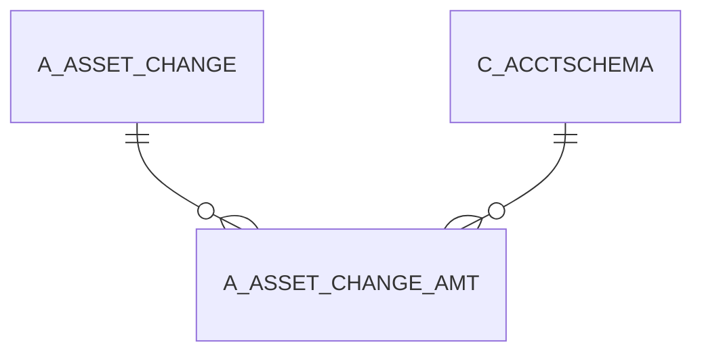

# A_ASSET_CHANGE_AMT

Area [A](../../data-model/a/index.md) · class **business** (proposed) · read from database `idempiere-db` (owner `ADEMPIERE`) · 0 row(s) when profiled

## Columns

| column | type | key | not null | business name | references (code) | nulls | distinct |
|---|---|---|---|---|---|---|---|
| `A_ASSET_CHANGE_ID` | NUMBER(10,0) | PK | yes |  |  | 0 | 0 |
| `C_ACCTSCHEMA_ID` | NUMBER(10,0) | PK | yes |  |  | 0 | 0 |
| `AD_CLIENT_ID` | NUMBER(10,0) |  | yes |  |  | 0 | 0 |
| `AD_ORG_ID` | NUMBER(10,0) |  | yes |  |  | 0 | 0 |
| `ISACTIVE` | CHAR(1) |  | yes |  |  | 0 | 0 |
| `CREATED` | DATE |  | yes |  |  | 0 | 0 |
| `CREATEDBY` | NUMBER(10,0) |  | yes |  |  | 0 | 0 |
| `UPDATED` | DATE |  | yes |  |  | 0 | 0 |
| `UPDATEDBY` | NUMBER(10,0) |  | yes |  |  | 0 | 0 |
| `ASSETVALUEAMT` | NUMBER |  | yes |  |  | 0 | 0 |
| `ASSETMARKETVALUEAMT` | NUMBER |  | yes |  |  | 0 | 0 |
| `ASSETBOOKVALUEAMT` | NUMBER |  | yes |  |  | 0 | 0 |
| `ASSETACCUMDEPRECIATIONAMT` | NUMBER |  | yes |  |  | 0 | 0 |

*references (code)* is the table the application model's code says a column points to; *Foreign keys* below are the constraints the database declares. Counts come from the profile; no value is ever shown.

## Check constraints

| name | expression |
|---|---|
| `SYS_C0021319` | `IsActive in ('Y','N')` |

## Foreign keys

**References**

| table | columns | on delete |
|---|---|---|
| [A_ASSET_CHANGE](../../data-model/a/a_asset_change.md) | A_ASSET_CHANGE_AMT.A_ASSET_CHANGE_ID → A_ASSET_CHANGE.A_ASSET_CHANGE_ID | NO ACTION |
| [C_ACCTSCHEMA](../../data-model/c/c_acctschema.md) | A_ASSET_CHANGE_AMT.C_ACCTSCHEMA_ID → C_ACCTSCHEMA.C_ACCTSCHEMA_ID | NO ACTION |

**Referenced by**

_None._

## Write behaviour

- updates: **po_only**
- deletes: **never_deleted_in_code**
- change log: **unknown**
- evidence: 0 citation(s)

## Schema history

4 change(s); the latest:

| applied | release | operation | column | tickets |
|---|---|---|---|---|
| 2021-12-05T16:45 | i8.2z | `add_constraint` |  | IDEMPIERE-5075 |
| 2021-12-05T16:45 | i8.2z | `add_constraint` |  | IDEMPIERE-5075 |
| 2021-12-05T16:45 | i8.2z | `drop_constraint` |  | IDEMPIERE-5075 |
| 2021-12-05T16:45 | i8.2z | `drop_constraint` |  | IDEMPIERE-5075 |

## Open conflicts

| type | attribute | explanation |
|---|---|---|
| `table_without_model` | `model_class` | unexplained |

## Notes

<!-- ekos:manual id="table.a_asset_change_amt.notes" -->
_Business notes about this table._
<!-- /ekos:manual -->
