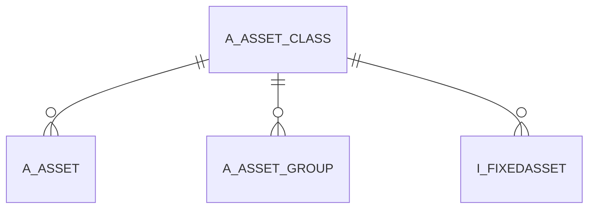

# A_ASSET_CLASS

Area [A](../../data-model/a/index.md) · class **business** (proposed) · read from database `idempiere-db` (owner `ADEMPIERE`) · 0 row(s) when profiled

Application model: `org.compiere.model.X_A_Asset_Class`, access level 7 - System - Client - Org.

## Columns

| column | type | key | not null | business name | references (code) | nulls | distinct |
|---|---|---|---|---|---|---|---|
| `A_ASSET_CLASS_ID` | NUMBER(10,0) | PK | yes | Asset class |  | 0 | 0 |
| `DESCRIPTION` | VARCHAR2(2000 CHAR) |  |  | Description |  | 0 | 0 |
| `AD_CLIENT_ID` | NUMBER(10,0) |  | yes | Tenant |  | 0 | 0 |
| `AD_ORG_ID` | NUMBER(10,0) |  |  | Organization |  | 0 | 0 |
| `CREATED` | DATE |  | yes | Created |  | 0 | 0 |
| `CREATEDBY` | NUMBER(10,0) |  | yes | Created By |  | 0 | 0 |
| `UPDATED` | DATE |  | yes | Updated |  | 0 | 0 |
| `UPDATEDBY` | NUMBER(10,0) |  | yes | Updated By |  | 0 | 0 |
| `ISACTIVE` | CHAR(1) |  |  | Active |  | 0 | 0 |
| `VALUE` | VARCHAR2(40 CHAR) |  | yes | Search Key |  | 0 | 0 |
| `NAME` | VARCHAR2(2000 CHAR) |  | yes | Name |  | 0 | 0 |
| `A_LIFE_PERIOD_MIN` | NUMBER(10,0) |  | yes | Life periods (min) |  | 0 | 0 |
| `A_LIFE_PERIOD_MAX` | NUMBER(10,0) |  | yes | Life periods (max) |  | 0 | 0 |
| `A_VALUE_2004` | VARCHAR2(40 CHAR) |  |  | Value 2004 |  | 0 | 0 |
| `A_LIFE_PERIOD_2004` | NUMBER(10,0) |  |  | Life Periods 2004 (min) |  | 0 | 0 |
| `MFX_GRUPA` | NUMBER(10,0) |  |  | Fixed Asset Group |  | 0 | 0 |
| `MFX_SUBGRUPA` | NUMBER(10,0) |  |  | Fixed Asset Subgroup |  | 0 | 0 |
| `MFX_CLASA` | NUMBER(10,0) |  |  | Fixed Asset Class |  | 0 | 0 |
| `MFX_SUBCLASA` | NUMBER(10,0) |  |  | Fixed Asset Subclass |  | 0 | 0 |
| `A_ASSET_CLASS_UU` | VARCHAR2(36 CHAR) |  |  | A_Asset_Class_UU |  | 0 | 0 |

*references (code)* is the table the application model's code says a column points to; *Foreign keys* below are the constraints the database declares. Counts come from the profile; no value is ever shown.

## Check constraints

| name | expression |
|---|---|
| `SYS_C0020735` | `IsActive IN ('Y','N')` |

## Foreign keys

**References**

_None._

**Referenced by**

| table | columns | on delete |
|---|---|---|
| [A_ASSET](../../data-model/a/a_asset.md) | A_ASSET.A_ASSET_CLASS_ID → A_ASSET_CLASS.A_ASSET_CLASS_ID | NO ACTION |
| [A_ASSET_GROUP](../../data-model/a/a_asset_group.md) | A_ASSET_GROUP.A_ASSET_CLASS_ID → A_ASSET_CLASS.A_ASSET_CLASS_ID | NO ACTION |
| `I_FIXEDASSET` | I_FIXEDASSET.A_ASSET_CLASS_ID → A_ASSET_CLASS.A_ASSET_CLASS_ID | NO ACTION |

## Write behaviour

- updates: **po_only**
- deletes: **deleted_by_users**
- change log: **recorded**
- evidence: 1 citation(s)

## Schema history

29 change(s); the latest:

| applied | release | operation | column | tickets |
|---|---|---|---|---|
| 2023-04-09T15:47 | iD11 | `add_constraint` |  | IDEMPIERE-5567 |
| 2023-04-09T15:47 | iD11 | `add_constraint` |  | IDEMPIERE-5567 |
| 2020-08-04T01:00 | i7.1z | `drop_column` | tmp_col_1_tmp | IDEMPIERE-3862 |
| 2020-08-04T01:00 | i7.1z | `modify_column` | A_VALUE_2004 | IDEMPIERE-3862 |
| 2020-08-04T01:00 | i7.1z | `add_column` | tmp_col_5_tmp | IDEMPIERE-3862 |
| 2020-08-04T01:00 | i7.1z | `modify_column` | DESCRIPTION | IDEMPIERE-3862 |
| 2020-08-04T01:00 | i7.1z | `modify_column` | VALUE | IDEMPIERE-3862 |
| 2020-08-04T01:00 | i7.1z | `drop_column` | tmp_col_5_tmp | IDEMPIERE-3862 |
| 2020-08-04T01:00 | i7.1z | `modify_column` | NAME | IDEMPIERE-3862 |
| 2020-08-04T01:00 | i7.1z | `modify_column` | VALUE | IDEMPIERE-3862 |
| 2020-08-04T01:00 | i7.1z | `drop_column` | tmp_col_3_tmp | IDEMPIERE-3862 |
| 2020-08-04T01:00 | i7.1z | `modify_column` | A_ASSET_CLASS_UU | IDEMPIERE-3862 |
| 2020-08-04T01:00 | i7.1z | `add_column` | tmp_col_4_tmp | IDEMPIERE-3862 |
| 2020-08-04T01:00 | i7.1z | `modify_column` | NAME | IDEMPIERE-3862 |
| 2020-08-04T01:00 | i7.1z | `drop_column` | tmp_col_2_tmp | IDEMPIERE-3862 |

## Notes

<!-- ekos:manual id="table.a_asset_class.notes" -->
_Business notes about this table._
<!-- /ekos:manual -->
