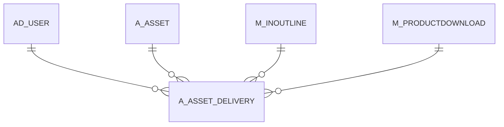

# A_ASSET_DELIVERY

Area [A](../../data-model/a/index.md) · class **business** (proposed) · read from database `idempiere-db` (owner `ADEMPIERE`) · 0 row(s) when profiled

Application model: `org.compiere.model.X_A_Asset_Delivery`, access level 3 - Client - Org.

## Columns

| column | type | key | not null | business name | references (code) | nulls | distinct |
|---|---|---|---|---|---|---|---|
| `A_ASSET_DELIVERY_ID` | NUMBER(10,0) | PK | yes | Asset Delivery |  | 0 | 0 |
| `AD_CLIENT_ID` | NUMBER(10,0) |  | yes | Tenant |  | 0 | 0 |
| `AD_ORG_ID` | NUMBER(10,0) |  | yes | Organization |  | 0 | 0 |
| `ISACTIVE` | CHAR(1) |  | yes | Active |  | 0 | 0 |
| `CREATED` | DATE |  | yes | Created |  | 0 | 0 |
| `CREATEDBY` | NUMBER(10,0) |  | yes | Created By |  | 0 | 0 |
| `UPDATED` | DATE |  | yes | Updated |  | 0 | 0 |
| `UPDATEDBY` | NUMBER(10,0) |  | yes | Updated By |  | 0 | 0 |
| `A_ASSET_ID` | NUMBER(10,0) |  | yes | Asset | [A_ASSET](../../data-model/a/a_asset.md) | 0 | 0 |
| `MOVEMENTDATE` | DATE |  | yes | Movement Date |  | 0 | 0 |
| `SERNO` | VARCHAR2(40 CHAR) |  |  | Serial No |  | 0 | 0 |
| `LOT` | VARCHAR2(40 CHAR) |  |  | Lot No |  | 0 | 0 |
| `VERSIONNO` | VARCHAR2(20 CHAR) |  |  | Version No |  | 0 | 0 |
| `M_INOUTLINE_ID` | NUMBER(10,0) |  |  | Shipment/Receipt Line | [M_INOUTLINE](../../data-model/m/m_inoutline.md) | 0 | 0 |
| `EMAIL` | VARCHAR2(60 CHAR) |  |  | EMail Address |  | 0 | 0 |
| `MESSAGEID` | VARCHAR2(120 CHAR) |  |  | Message ID |  | 0 | 0 |
| `DELIVERYCONFIRMATION` | VARCHAR2(120 CHAR) |  |  | Delivery Confirmation |  | 0 | 0 |
| `URL` | VARCHAR2(120 CHAR) |  |  | URL |  | 0 | 0 |
| `REMOTE_ADDR` | VARCHAR2(60 CHAR) |  |  | Remote Addr |  | 0 | 0 |
| `REMOTE_HOST` | VARCHAR2(60 CHAR) |  |  | Remote Host |  | 0 | 0 |
| `REFERRER` | VARCHAR2(255 CHAR) |  |  | Referrer |  | 0 | 0 |
| `AD_USER_ID` | NUMBER(10,0) |  |  | User/Contact | [AD_USER](../../data-model/ad/ad_user.md) | 0 | 0 |
| `DESCRIPTION` | VARCHAR2(255 CHAR) |  |  | Description |  | 0 | 0 |
| `M_PRODUCTDOWNLOAD_ID` | NUMBER(10,0) |  |  | Product Download | [M_PRODUCTDOWNLOAD](../../data-model/m/m_productdownload.md) | 0 | 0 |
| `A_ASSET_DELIVERY_UU` | VARCHAR2(36 CHAR) |  |  | A_Asset_Delivery_UU |  | 0 | 0 |

*references (code)* is the table the application model's code says a column points to; *Foreign keys* below are the constraints the database declares. Counts come from the profile; no value is ever shown.

## Check constraints

| name | expression |
|---|---|
| `SYS_C0021450` | `IsActive in ('Y','N')` |

## Foreign keys

**References**

| table | columns | on delete |
|---|---|---|
| [AD_USER](../../data-model/ad/ad_user.md) | A_ASSET_DELIVERY.AD_USER_ID → AD_USER.AD_USER_ID | NO ACTION |
| [A_ASSET](../../data-model/a/a_asset.md) | A_ASSET_DELIVERY.A_ASSET_ID → A_ASSET.A_ASSET_ID | NO ACTION |
| [M_INOUTLINE](../../data-model/m/m_inoutline.md) | A_ASSET_DELIVERY.M_INOUTLINE_ID → M_INOUTLINE.M_INOUTLINE_ID | CASCADE |
| [M_PRODUCTDOWNLOAD](../../data-model/m/m_productdownload.md) | A_ASSET_DELIVERY.M_PRODUCTDOWNLOAD_ID → M_PRODUCTDOWNLOAD.M_PRODUCTDOWNLOAD_ID | NO ACTION |

**Referenced by**

_None._

## Write behaviour

- updates: **po_only**
- deletes: **deleted_by_users, deleted_by_cascade**
- change log: **recorded**
- evidence: 2 citation(s)

## Read by

| kind | name |
|---|---|
| View | `RV_ASSET_CUSTOMER` |
| View | `RV_ASSET_DELIVERY` |
| View | `RV_ASSET_SUMMONTH` |
| View | `rv_asset_customer` |
| View | `rv_asset_delivery` |
| View | `rv_asset_summonth` |

## Schema history

42 change(s); the latest:

| applied | release | operation | column | tickets |
|---|---|---|---|---|
| 2023-04-09T15:47 | iD11 | `add_constraint` |  | IDEMPIERE-5567 |
| 2023-04-09T15:47 | iD11 | `add_constraint` |  | IDEMPIERE-5567 |
| 2021-12-05T16:45 | i8.2z | `add_constraint` |  | IDEMPIERE-5075 |
| 2021-12-05T16:45 | i8.2z | `drop_constraint` |  | IDEMPIERE-5075 |
| 2021-12-05T16:45 | i8.2z | `drop_constraint` |  | IDEMPIERE-5075 |
| 2021-12-05T16:45 | i8.2z | `drop_constraint` |  | IDEMPIERE-5075 |
| 2021-12-05T16:45 | i8.2z | `add_constraint` |  | IDEMPIERE-5075 |
| 2021-12-05T16:45 | i8.2z | `drop_constraint` |  | IDEMPIERE-5075 |
| 2021-12-05T16:45 | i8.2z | `add_constraint` |  | IDEMPIERE-5075 |
| 2021-12-05T16:45 | i8.2z | `add_constraint` |  | IDEMPIERE-5075 |
| 2020-08-04T01:00 | i7.1z | `modify_column` | REMOTE_ADDR | IDEMPIERE-3862 |
| 2020-08-04T01:00 | i7.1z | `drop_column` | tmp_col_5_tmp | IDEMPIERE-3862 |
| 2020-08-04T01:00 | i7.1z | `modify_column` | URL | IDEMPIERE-3862 |
| 2020-08-04T01:00 | i7.1z | `drop_column` | tmp_col_8_tmp | IDEMPIERE-3862 |
| 2020-08-04T01:00 | i7.1z | `drop_column` | tmp_col_6_tmp | IDEMPIERE-3862 |

## Notes

<!-- ekos:manual id="table.a_asset_delivery.notes" -->
_Business notes about this table._
<!-- /ekos:manual -->
