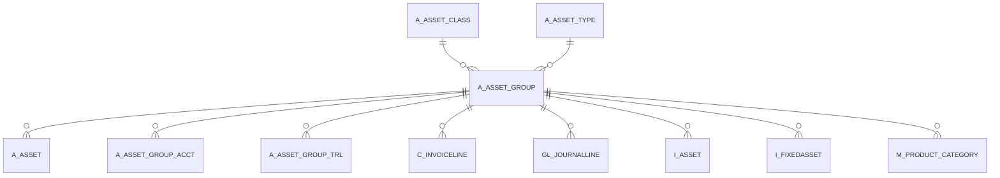

# A_ASSET_GROUP

Area [A](../../data-model/a/index.md) · class **business** (proposed) · read from database `idempiere-db` (owner `ADEMPIERE`) · 9 row(s) when profiled

Application model: `org.compiere.model.X_A_Asset_Group`, access level 3 - Client - Org.

## Columns

| column | type | key | not null | business name | references (code) | nulls | distinct |
|---|---|---|---|---|---|---|---|
| `A_ASSET_GROUP_ID` | NUMBER(10,0) | PK | yes | Asset Group |  | 0 | 9 |
| `AD_CLIENT_ID` | NUMBER(10,0) |  | yes | Tenant |  | 0 | 1 |
| `AD_ORG_ID` | NUMBER(10,0) |  | yes | Organization |  | 0 | 1 |
| `ISACTIVE` | CHAR(1) |  | yes | Active |  | 0 | 1 |
| `CREATED` | DATE |  | yes | Created |  | 0 | 9 |
| `CREATEDBY` | NUMBER(10,0) |  | yes | Created By |  | 0 | 1 |
| `UPDATED` | DATE |  | yes | Updated |  | 0 | 9 |
| `UPDATEDBY` | NUMBER(10,0) |  | yes | Updated By |  | 0 | 2 |
| `NAME` | VARCHAR2(60 CHAR) |  | yes | Name |  | 0 | 8 |
| `DESCRIPTION` | VARCHAR2(255 CHAR) |  |  | Description |  | 0 | 8 |
| `HELP` | VARCHAR2(2000 CHAR) |  |  | Comment/Help |  | 2 | 7 |
| `ISOWNED` | CHAR(1) |  | yes | Owned |  | 0 | 2 |
| `ISDEPRECIATED` | CHAR(1) |  | yes | Depreciate |  | 0 | 1 |
| `ISONEASSETPERUOM` | CHAR(1) |  | yes | One Asset Per UOM |  | 0 | 1 |
| `ISCREATEASACTIVE` | CHAR(1) |  | yes | Create As Active |  | 0 | 1 |
| `ISTRACKISSUES` | CHAR(1) |  | yes | Track Issues |  | 0 | 1 |
| `A_ASSET_GROUP_UU` | VARCHAR2(36 CHAR) |  |  | A_Asset_Group_UU |  | 0 | 9 |
| `A_ASSET_CLASS_ID` | NUMBER(10,0) |  |  | Asset class | [A_ASSET_CLASS](../../data-model/a/a_asset_class.md) | 9 | 0 |
| `ISDEFAULT` | CHAR(1) |  | yes | Default |  | 0 | 1 |
| `A_ASSET_TYPE_ID` | NUMBER(10,0) |  |  | Asset Type | [A_ASSET_TYPE](../../data-model/a/a_asset_type.md) | 9 | 0 |
| `ISFIXEDASSET` | CHAR(1) |  |  | Is Fixed Asset |  | 0 | 1 |

*references (code)* is the table the application model's code says a column points to; *Foreign keys* below are the constraints the database declares. Counts come from the profile; no value is ever shown.

## Check constraints

| name | expression |
|---|---|
| `SYS_C0020963` | `IsActive in ('Y','N')` |
| `SYS_C0020964` | `IsDefault IN ('Y','N')` |
| `SYS_C0020967` | `IsFixedAsset IN ('Y','N')` |
| `SYS_C0020968` | `IsOwned in ('Y','N')` |

## Foreign keys

**References**

| table | columns | on delete |
|---|---|---|
| [A_ASSET_CLASS](../../data-model/a/a_asset_class.md) | A_ASSET_GROUP.A_ASSET_CLASS_ID → A_ASSET_CLASS.A_ASSET_CLASS_ID | NO ACTION |
| [A_ASSET_TYPE](../../data-model/a/a_asset_type.md) | A_ASSET_GROUP.A_ASSET_TYPE_ID → A_ASSET_TYPE.A_ASSET_TYPE_ID | NO ACTION |

**Referenced by**

| table | columns | on delete |
|---|---|---|
| [A_ASSET](../../data-model/a/a_asset.md) | A_ASSET.A_ASSET_GROUP_ID → A_ASSET_GROUP.A_ASSET_GROUP_ID | NO ACTION |
| [A_ASSET_GROUP_ACCT](../../data-model/a/a_asset_group_acct.md) | A_ASSET_GROUP_ACCT.A_ASSET_GROUP_ID → A_ASSET_GROUP.A_ASSET_GROUP_ID | CASCADE |
| [A_ASSET_GROUP_TRL](../../data-model/a/a_asset_group_trl.md) | A_ASSET_GROUP_TRL.A_ASSET_GROUP_ID → A_ASSET_GROUP.A_ASSET_GROUP_ID | CASCADE |
| [C_INVOICELINE](../../data-model/c/c_invoiceline.md) | C_INVOICELINE.A_ASSET_GROUP_ID → A_ASSET_GROUP.A_ASSET_GROUP_ID | NO ACTION |
| [GL_JOURNALLINE](../../data-model/gl/gl_journalline.md) | GL_JOURNALLINE.A_ASSET_GROUP_ID → A_ASSET_GROUP.A_ASSET_GROUP_ID | NO ACTION |
| `I_ASSET` | I_ASSET.A_ASSET_GROUP_ID → A_ASSET_GROUP.A_ASSET_GROUP_ID | NO ACTION |
| `I_FIXEDASSET` | I_FIXEDASSET.A_ASSET_GROUP_ID → A_ASSET_GROUP.A_ASSET_GROUP_ID | NO ACTION |
| [M_PRODUCT_CATEGORY](../../data-model/m/m_product_category.md) | M_PRODUCT_CATEGORY.A_ASSET_GROUP_ID → A_ASSET_GROUP.A_ASSET_GROUP_ID | NO ACTION |

## Write behaviour

- updates: **po_only**
- deletes: **deleted_by_users**
- change log: **recorded**
- evidence: 1 citation(s)

## Schema history

20 change(s); the latest:

| applied | release | operation | column | tickets |
|---|---|---|---|---|
| 2023-04-09T15:47 | iD11 | `add_constraint` |  | IDEMPIERE-5567 |
| 2023-04-09T15:47 | iD11 | `add_constraint` |  | IDEMPIERE-5567 |
| 2021-12-05T16:45 | i8.2z | `add_constraint` |  | IDEMPIERE-5075 |
| 2021-12-05T16:45 | i8.2z | `add_constraint` |  | IDEMPIERE-5075 |
| 2021-12-05T16:45 | i8.2z | `drop_constraint` |  | IDEMPIERE-5075 |
| 2021-12-05T16:45 | i8.2z | `drop_constraint` |  | IDEMPIERE-5075 |
| 2020-08-04T01:00 | i7.1z | `add_column` | tmp_col_3_tmp | IDEMPIERE-3862 |
| 2020-08-04T01:00 | i7.1z | `drop_column` | tmp_col_4_tmp | IDEMPIERE-3862 |
| 2020-08-04T01:00 | i7.1z | `modify_column` | HELP | IDEMPIERE-3862 |
| 2020-08-04T01:00 | i7.1z | `modify_column` | DESCRIPTION | IDEMPIERE-3862 |
| 2020-08-04T01:00 | i7.1z | `add_column` | tmp_col_2_tmp | IDEMPIERE-3862 |
| 2020-08-04T01:00 | i7.1z | `modify_column` | A_ASSET_GROUP_UU | IDEMPIERE-3862 |
| 2020-08-04T01:00 | i7.1z | `modify_column` | NAME | IDEMPIERE-3862 |
| 2020-08-04T01:00 | i7.1z | `modify_column` | NAME | IDEMPIERE-3862 |
| 2020-08-04T01:00 | i7.1z | `add_column` | tmp_col_1_tmp | IDEMPIERE-3862 |

## Notes

<!-- ekos:manual id="table.a_asset_group.notes" -->
_Business notes about this table._
<!-- /ekos:manual -->
