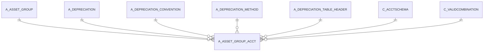

# A_ASSET_GROUP_ACCT

Area [A](../../data-model/a/index.md) · class **business** (proposed) · read from database `idempiere-db` (owner `ADEMPIERE`) · 6 row(s) when profiled

Application model: `org.compiere.model.X_A_Asset_Group_Acct`, access level 3 - Client - Org.

## Columns

| column | type | key | not null | business name | references (code) | nulls | distinct |
|---|---|---|---|---|---|---|---|
| `A_ASSET_GROUP_ID` | NUMBER(10,0) |  | yes | Asset Group | [A_ASSET_GROUP](../../data-model/a/a_asset_group.md) | 0 | 3 |
| `C_ACCTSCHEMA_ID` | NUMBER(10,0) |  | yes | Accounting Schema | [C_ACCTSCHEMA](../../data-model/c/c_acctschema.md) | 0 | 2 |
| `AD_CLIENT_ID` | NUMBER(10,0) |  | yes | Tenant |  | 0 | 1 |
| `AD_ORG_ID` | NUMBER(10,0) |  | yes | Organization |  | 0 | 1 |
| `ISACTIVE` | CHAR(1) |  |  | Active |  | 0 | 1 |
| `CREATED` | DATE |  | yes | Created |  | 0 | 4 |
| `CREATEDBY` | NUMBER(10,0) |  |  | Created By |  | 0 | 1 |
| `UPDATED` | DATE |  | yes | Updated |  | 0 | 4 |
| `UPDATEDBY` | NUMBER(10,0) |  |  | Updated By |  | 0 | 1 |
| `A_ASSET_ACCT` | NUMBER(10,0) |  | yes | Asset Acct |  | 0 | 3 |
| `A_DEPRECIATION_ACCT` | NUMBER(10,0) |  | yes | Depreciation Account |  | 0 | 3 |
| `A_ACCUMDEPRECIATION_ACCT` | NUMBER(10,0) |  | yes | Accumulated Depreciation Account |  | 0 | 3 |
| `A_DISPOSAL_LOSS` | VARCHAR2(22 CHAR) |  |  |  |  | 6 | 0 |
| `A_DISPOSAL_GAIN` | VARCHAR2(10 CHAR) |  |  |  |  | 6 | 0 |
| `A_DEPRECIATION_ID` | NUMBER(10,0) |  | yes | Depreciation | [A_DEPRECIATION](../../data-model/a/a_depreciation.md) | 0 | 1 |
| `A_ASSET_GROUP_ACCT_ID` | NUMBER(10,0) | PK | yes | Asset Group Accounting |  | 0 | 6 |
| `A_DEPRECIATION_MANUAL_PERIOD` | VARCHAR2(2 CHAR) |  |  | A_Depreciation_Manual_Period |  | 6 | 0 |
| `A_DEPRECIATION_VARIABLE_PERC` | NUMBER |  |  | Variable Percent |  | 6 | 0 |
| `A_SPLIT_PERCENT` | NUMBER |  | yes | Split Percent |  | 0 | 1 |
| `A_REVAL_DEPEXP_OFFSET` | VARCHAR2(22 CHAR) |  |  |  |  | 6 | 0 |
| `A_REVAL_COST_OFFSET_PRIOR` | VARCHAR2(22 CHAR) |  |  |  |  | 6 | 0 |
| `A_REVAL_COST_OFFSET` | VARCHAR2(22 CHAR) |  |  |  |  | 6 | 0 |
| `A_REVAL_CAL_METHOD` | VARCHAR2(22 CHAR) |  |  | A_Reval_Cal_Method |  | 6 | 0 |
| `A_REVAL_ACCUMDEP_OFFSET_PRIOR` | VARCHAR2(22 CHAR) |  |  |  |  | 6 | 0 |
| `A_REVAL_ACCUMDEP_OFFSET_CUR` | VARCHAR2(22 CHAR) |  |  |  |  | 6 | 0 |
| `A_DISPOSAL_REVENUE` | VARCHAR2(22 CHAR) |  |  |  |  | 6 | 0 |
| `USELIFEYEARS` | NUMBER |  |  | Usable Life - Years |  | 0 | 1 |
| `USELIFEMONTHS` | NUMBER(10,0) |  |  | Usable Life - Months |  | 0 | 1 |
| `PROCESSING` | CHAR(1) |  |  | Process Now |  | 0 | 1 |
| `POSTINGTYPE` | CHAR(1) |  | yes | Posting Type |  | 0 | 1 |
| `DEPRECIATIONTYPE` | VARCHAR2(10 CHAR) |  |  |  |  | 6 | 0 |
| `CONVENTIONTYPE` | VARCHAR2(10 CHAR) |  |  |  |  | 6 | 0 |
| `A_DEPRECIATION_TABLE_HEADER_ID` | NUMBER(10,0) |  |  | A_Depreciation_Table_Header_ID | [A_DEPRECIATION_TABLE_HEADER](../../data-model/a/a_depreciation_table_header.md) | 6 | 0 |
| `A_DEPRECIATION_MANUAL_AMOUNT` | NUMBER |  |  | A_Depreciation_Manual_Amount |  | 6 | 0 |
| `A_DEPRECIATION_CALC_TYPE` | VARCHAR2(10 CHAR) |  |  |  |  | 6 | 0 |
| `A_ASSET_SPREAD_TYPE` | VARCHAR2(10 CHAR) |  |  |  |  | 6 | 0 |
| `A_REVAL_DEPEXP_OFFSET_ACCT` | NUMBER(10,0) |  |  | Reval Depexp Offset Acct |  | 6 | 0 |
| `A_REVAL_COST_OFFSET_PRIOR_ACCT` | NUMBER(10,0) |  |  | Reval Cost Offset Prior Acct |  | 6 | 0 |
| `A_REVAL_COST_OFFSET_ACCT` | NUMBER(10,0) |  |  | Reval Cost Offset Acct |  | 6 | 0 |
| `A_REVAL_ADEP_OFFSET_PRIOR_ACCT` | NUMBER(10,0) |  |  | A_Reval_Accumdep_Offset_Prior |  | 6 | 0 |
| `A_REVAL_ADEP_OFFSET_CUR_ACCT` | NUMBER(10,0) |  |  | A_Reval_Accumdep_Offset_Cur |  | 6 | 0 |
| `A_DISPOSAL_GAIN_ACCT` | NUMBER(10,0) |  |  | Disposal Gain Acct |  | 6 | 0 |
| `A_DEPRECIATION_METHOD_ID` | NUMBER(10,0) |  |  | Depreciation Method | [A_DEPRECIATION_METHOD](../../data-model/a/a_depreciation_method.md) | 6 | 0 |
| `A_DEPRECIATION_CONV_F_ID` | NUMBER(10,0) |  |  | Depreciation Convention (fiscal) | [A_DEPRECIATION_CONVENTION](../../data-model/a/a_depreciation_convention.md) | 6 | 0 |
| `A_DEPRECIATION_CONV_ID` | NUMBER(10,0) |  |  | Convention Type | [A_DEPRECIATION_CONVENTION](../../data-model/a/a_depreciation_convention.md) | 6 | 0 |
| `A_DEPRECIATION_METHOD_F_ID` | NUMBER(10,0) |  |  | Depreciation Method (fiscal) | [A_DEPRECIATION_METHOD](../../data-model/a/a_depreciation_method.md) | 6 | 0 |
| `A_DEPRECIATION_VARIABLE_PERC_F` | NUMBER |  |  | Variable Percent (fiscal) |  | 6 | 0 |
| `A_DEPRECIATION_F_ID` | NUMBER(10,0) |  | yes | Depreciation (fiscal) | [A_DEPRECIATION](../../data-model/a/a_depreciation.md) | 0 | 1 |
| `USELIFEYEARS_F` | NUMBER |  | yes | Use Life - Years (fiscal) |  | 0 | 3 |
| `USELIFEMONTHS_F` | NUMBER(10,0) |  | yes | Use Life - Months (fiscal) |  | 0 | 3 |
| `A_DISPOSAL_REVENUE_ACCT` | NUMBER(10,0) |  |  | Disposal Revenue Acct |  | 0 | 1 |
| `A_DISPOSAL_LOSS_ACCT` | NUMBER(10,0) |  |  | Disposal Loss Acct |  | 0 | 2 |
| `A_ASSET_GROUP_ACCT_UU` | VARCHAR2(36 CHAR) |  |  | A_Asset_Group_Acct_UU |  | 0 | 6 |

*references (code)* is the table the application model's code says a column points to; *Foreign keys* below are the constraints the database declares. Counts come from the profile; no value is ever shown.

## Check constraints

| name | expression |
|---|---|
| `AASSETGROUPACCTISACTIVE_CHECK` | `IsActive IN ('Y','N')` |
| `AASSETGROUPACCTPROCESSINGCHCK` | `processing IN ('Y','N')` |

## Foreign keys

**References**

| table | columns | on delete |
|---|---|---|
| [A_ASSET_GROUP](../../data-model/a/a_asset_group.md) | A_ASSET_GROUP_ACCT.A_ASSET_GROUP_ID → A_ASSET_GROUP.A_ASSET_GROUP_ID | CASCADE |
| [A_DEPRECIATION](../../data-model/a/a_depreciation.md) | A_ASSET_GROUP_ACCT.A_DEPRECIATION_F_ID → A_DEPRECIATION.A_DEPRECIATION_ID | NO ACTION |
| [A_DEPRECIATION_CONVENTION](../../data-model/a/a_depreciation_convention.md) | A_ASSET_GROUP_ACCT.A_DEPRECIATION_CONV_F_ID → A_DEPRECIATION_CONVENTION.A_DEPRECIATION_CONVENTION_ID | NO ACTION |
| [A_DEPRECIATION_METHOD](../../data-model/a/a_depreciation_method.md) | A_ASSET_GROUP_ACCT.A_DEPRECIATION_METHOD_F_ID → A_DEPRECIATION_METHOD.A_DEPRECIATION_METHOD_ID | NO ACTION |
| [A_DEPRECIATION_TABLE_HEADER](../../data-model/a/a_depreciation_table_header.md) | A_ASSET_GROUP_ACCT.A_DEPRECIATION_TABLE_HEADER_ID → A_DEPRECIATION_TABLE_HEADER.A_DEPRECIATION_TABLE_HEADER_ID | NO ACTION |
| [C_ACCTSCHEMA](../../data-model/c/c_acctschema.md) | A_ASSET_GROUP_ACCT.C_ACCTSCHEMA_ID → C_ACCTSCHEMA.C_ACCTSCHEMA_ID | NO ACTION |
| [C_VALIDCOMBINATION](../../data-model/c/c_validcombination.md) | A_ASSET_GROUP_ACCT.A_ACCUMDEPRECIATION_ACCT → C_VALIDCOMBINATION.C_VALIDCOMBINATION_ID | NO ACTION |

**Referenced by**

_None._

## Write behaviour

- updates: **po_only**
- deletes: **deleted_by_users, deleted_by_cascade**
- change log: **recorded**
- evidence: 2 citation(s)

## Schema history

89 change(s); the latest:

| applied | release | operation | column | tickets |
|---|---|---|---|---|
| 2023-04-09T15:47 | iD11 | `add_constraint` |  | IDEMPIERE-5567 |
| 2023-04-09T15:47 | iD11 | `add_constraint` |  | IDEMPIERE-5567 |
| 2022-11-11T22:36 | i9 | `modify_column` | UseLifeYears | IDEMPIERE-5474 |
| 2022-11-11T22:36 | i9 | `modify_column` | UseLifeYears | IDEMPIERE-5474 |
| 2022-11-11T22:36 | i9 | `modify_column` | UseLifeYears_F | IDEMPIERE-5474 |
| 2022-11-11T22:36 | i9 | `modify_column` | UseLifeYears_F | IDEMPIERE-5474 |
| 2021-12-05T16:45 | i8.2z | `drop_constraint` |  | IDEMPIERE-5075 |
| 2021-12-05T16:45 | i8.2z | `add_constraint` |  | IDEMPIERE-5075 |
| 2021-12-05T16:45 | i8.2z | `add_constraint` |  | IDEMPIERE-5075 |
| 2021-12-05T16:45 | i8.2z | `add_constraint` |  | IDEMPIERE-5075 |
| 2021-12-05T16:45 | i8.2z | `drop_constraint` |  | IDEMPIERE-5075 |
| 2021-12-05T16:45 | i8.2z | `drop_constraint` |  | IDEMPIERE-5075 |
| 2021-12-05T16:45 | i8.2z | `drop_constraint` |  | IDEMPIERE-5075 |
| 2021-12-05T16:45 | i8.2z | `drop_constraint` |  | IDEMPIERE-5075 |
| 2021-12-05T16:45 | i8.2z | `drop_constraint` |  | IDEMPIERE-5075 |

## Open conflicts

| type | attribute | explanation |
|---|---|---|
| `mandatory_but_nullable` | `columns.A_Disposal_Loss_Acct.nullable` | unexplained |
| `mandatory_but_nullable` | `columns.A_Disposal_Revenue_Acct.nullable` | unexplained |

## Notes

<!-- ekos:manual id="table.a_asset_group_acct.notes" -->
_Business notes about this table._
<!-- /ekos:manual -->
