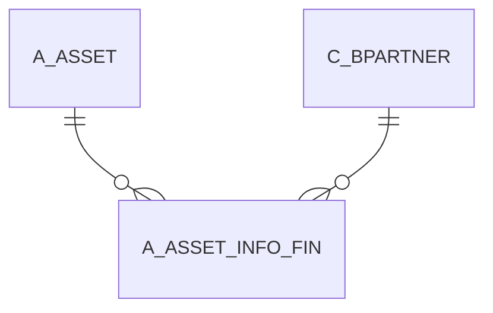

# A_ASSET_INFO_FIN

Area [A](../../data-model/a/index.md) · class **business** (proposed) · read from database `idempiere-db` (owner `ADEMPIERE`) · 0 row(s) when profiled

Application model: `org.compiere.model.X_A_Asset_Info_Fin`, access level 3 - Client - Org.

## Columns

| column | type | key | not null | business name | references (code) | nulls | distinct |
|---|---|---|---|---|---|---|---|
| `A_ASSET_INFO_FIN_ID` | NUMBER(10,0) | PK | yes | Asset Info Financial ID |  | 0 | 0 |
| `AD_CLIENT_ID` | NUMBER(10,0) |  | yes | Tenant |  | 0 | 0 |
| `AD_ORG_ID` | NUMBER(10,0) |  | yes | Organization |  | 0 | 0 |
| `A_DUE_ON` | VARCHAR2(22 CHAR) |  |  | Asset Due On |  | 0 | 0 |
| `A_FINANCE_METH` | VARCHAR2(2 CHAR) |  |  | Asset Finance Method |  | 0 | 0 |
| `A_PURCHASE_OPTION` | CHAR(1) |  |  | Purchase Option |  | 0 | 0 |
| `A_PURCHASE_OPTION_CREDIT_PER` | NUMBER |  |  | Purchase Option Credit % |  | 0 | 0 |
| `C_BPARTNER_ID` | NUMBER(10,0) |  |  | Business Partner | [C_BPARTNER](../../data-model/c/c_bpartner.md) | 0 | 0 |
| `CREATEDBY` | NUMBER(10,0) |  | yes | Created By |  | 0 | 0 |
| `UPDATEDBY` | NUMBER(10,0) |  | yes | Updated By |  | 0 | 0 |
| `UPDATED` | DATE |  | yes | Updated |  | 0 | 0 |
| `TEXTMSG` | VARCHAR2(510 CHAR) |  |  | Text Message |  | 0 | 0 |
| `ISACTIVE` | CHAR(1) |  | yes | Active |  | 0 | 0 |
| `CREATED` | DATE |  | yes | Created |  | 0 | 0 |
| `A_PURCHASE_PRICE` | NUMBER |  |  | Purchase Price |  | 0 | 0 |
| `A_PURCHASE_OPTION_CREDIT` | NUMBER(10,0) |  |  | Purchase Option Credit |  | 0 | 0 |
| `A_MONTHLY_PAYMENT` | NUMBER |  |  | Asset Monthly Payment |  | 0 | 0 |
| `A_EXPIRED_DATE` | DATE |  |  | Asset Expired Date |  | 0 | 0 |
| `A_CONTRACT_DATE` | DATE |  |  | Contract Date |  | 0 | 0 |
| `A_ASSET_ID` | NUMBER(10,0) |  | yes | Asset | [A_ASSET](../../data-model/a/a_asset.md) | 0 | 0 |
| `A_ASSET_INFO_FIN_UU` | VARCHAR2(36 CHAR) |  |  | A_Asset_Info_Fin_UU |  | 0 | 0 |
| `PROCESSED` | CHAR(1) |  |  | Processed |  | 0 | 0 |

*references (code)* is the table the application model's code says a column points to; *Foreign keys* below are the constraints the database declares. Counts come from the profile; no value is ever shown.

## Check constraints

| name | expression |
|---|---|
| `SYS_C0022450` | `IsActive IN ('Y','N')` |
| `SYS_C0022452` | `A_Purchase_Option IN ('Y','N')` |
| `SYS_C0022453` | `Processed IN ('Y','N')` |

## Foreign keys

**References**

| table | columns | on delete |
|---|---|---|
| [A_ASSET](../../data-model/a/a_asset.md) | A_ASSET_INFO_FIN.A_ASSET_ID → A_ASSET.A_ASSET_ID | NO ACTION |
| [C_BPARTNER](../../data-model/c/c_bpartner.md) | A_ASSET_INFO_FIN.C_BPARTNER_ID → C_BPARTNER.C_BPARTNER_ID | NO ACTION |

**Referenced by**

_None._

## Write behaviour

- updates: **po_only**
- deletes: **soft_delete_only**
- change log: **recorded**
- evidence: 1 citation(s)

## Schema history

28 change(s); the latest:

| applied | release | operation | column | tickets |
|---|---|---|---|---|
| 2023-04-09T15:47 | iD11 | `add_constraint` |  | IDEMPIERE-5567 |
| 2023-04-09T15:47 | iD11 | `add_constraint` |  | IDEMPIERE-5567 |
| 2021-12-05T16:45 | i8.2z | `add_constraint` |  | IDEMPIERE-5075 |
| 2021-12-05T16:45 | i8.2z | `drop_constraint` |  | IDEMPIERE-5075 |
| 2021-12-05T16:45 | i8.2z | `add_constraint` |  | IDEMPIERE-5075 |
| 2021-12-05T16:45 | i8.2z | `drop_constraint` |  | IDEMPIERE-5075 |
| 2020-08-04T01:00 | i7.1z | `drop_column` | tmp_col_3_tmp | IDEMPIERE-3862 |
| 2020-08-04T01:00 | i7.1z | `drop_column` | tmp_col_2_tmp | IDEMPIERE-3862 |
| 2020-08-04T01:00 | i7.1z | `modify_column` | A_FINANCE_METH | IDEMPIERE-3862 |
| 2020-08-04T01:00 | i7.1z | `add_column` | tmp_col_2_tmp | IDEMPIERE-3862 |
| 2020-08-04T01:00 | i7.1z | `add_column` | tmp_col_3_tmp | IDEMPIERE-3862 |
| 2020-08-04T01:00 | i7.1z | `add_column` | tmp_col_1_tmp | IDEMPIERE-3862 |
| 2020-08-04T01:00 | i7.1z | `modify_column` | A_ASSET_INFO_FIN_UU | IDEMPIERE-3862 |
| 2020-08-04T01:00 | i7.1z | `modify_column` | TEXTMSG | IDEMPIERE-3862 |
| 2020-08-04T01:00 | i7.1z | `drop_column` | tmp_col_1_tmp | IDEMPIERE-3862 |

## Notes

<!-- ekos:manual id="table.a_asset_info_fin.notes" -->
_Business notes about this table._
<!-- /ekos:manual -->
