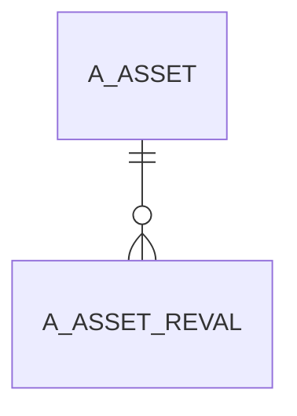

# A_ASSET_REVAL

Area [A](../../data-model/a/index.md) · class **business** (proposed) · read from database `idempiere-db` (owner `ADEMPIERE`) · 0 row(s) when profiled

Application model: `org.compiere.model.X_A_Asset_Reval`, access level 3 - Client - Org.

## Columns

| column | type | key | not null | business name | references (code) | nulls | distinct |
|---|---|---|---|---|---|---|---|
| `A_ASSET_REVAL_ID` | NUMBER(10,0) | PK | yes | Asset Revaluation |  | 0 | 0 |
| `AD_CLIENT_ID` | NUMBER(10,0) |  | yes | Tenant |  | 0 | 0 |
| `AD_ORG_ID` | NUMBER(10,0) |  | yes | Organization |  | 0 | 0 |
| `A_ASSET_ID` | NUMBER(10,0) |  | yes | Asset | [A_ASSET](../../data-model/a/a_asset.md) | 0 | 0 |
| `CREATED` | DATE |  | yes | Created |  | 0 | 0 |
| `CREATEDBY` | NUMBER(10,0) |  | yes | Created By |  | 0 | 0 |
| `DATEACCT` | DATE |  | yes | Account Date |  | 0 | 0 |
| `DATEDOC` | DATE |  |  | Document Date |  | 0 | 0 |
| `DOCSTATUS` | VARCHAR2(2 CHAR) |  | yes | Document Status |  | 0 | 0 |
| `DOCUMENTNO` | VARCHAR2(30 CHAR) |  |  | Document No |  | 0 | 0 |
| `ISACTIVE` | CHAR(1) |  | yes | Active |  | 0 | 0 |
| `POSTED` | CHAR(1) |  |  | Posted |  | 0 | 0 |
| `POSTINGTYPE` | CHAR(1) |  | yes | Posting Type |  | 0 | 0 |
| `PROCESSED` | CHAR(1) |  | yes | Processed |  | 0 | 0 |
| `PROCESSING` | CHAR(1) |  | yes | Process Now |  | 0 | 0 |
| `UPDATED` | DATE |  | yes | Updated |  | 0 | 0 |
| `UPDATEDBY` | NUMBER(10,0) |  | yes | Updated By |  | 0 | 0 |
| `A_ASSET_COST` | NUMBER |  |  | Asset Cost |  | 0 | 0 |
| `A_ACCUMULATED_DEPR` | NUMBER |  |  | Accumulated Depreciation |  | 0 | 0 |
| `A_ASSET_COST_CHANGE` | NUMBER |  | yes | Asset Cost Change |  | 0 | 0 |
| `A_CHANGE_ACUMULATED_DEPR` | NUMBER |  | yes | Change Accumulated Depreciation |  | 0 | 0 |
| `DOCACTION` | CHAR(2) |  | yes | Document Action |  | 0 | 0 |
| `PROCESSEDON` | NUMBER |  |  | Processed On |  | 0 | 0 |
| `A_ASSET_REVAL_UU` | VARCHAR2(36 CHAR) |  |  | A_Asset_Reval_UU |  | 0 | 0 |

*references (code)* is the table the application model's code says a column points to; *Foreign keys* below are the constraints the database declares. Counts come from the profile; no value is ever shown.

## Check constraints

| name | expression |
|---|---|
| `SYS_C0021053` | `Processing IN ('Y','N')` |
| `SYS_C0021055` | `Processed IN ('Y','N')` |
| `SYS_C0021056` | `IsActive IN ('Y','N')` |

## Foreign keys

**References**

| table | columns | on delete |
|---|---|---|
| [A_ASSET](../../data-model/a/a_asset.md) | A_ASSET_REVAL.A_ASSET_ID → A_ASSET.A_ASSET_ID | NO ACTION |

**Referenced by**

_None._

## Write behaviour

- updates: **po_only**
- deletes: **deleted_by_users**
- change log: **recorded**
- evidence: 1 citation(s)

## Schema history

33 change(s); the latest:

| applied | release | operation | column | tickets |
|---|---|---|---|---|
| 2024-05-14T13:59 | iD13 | `add_constraint` |  | IDEMPIERE-5598 |
| 2024-05-14T13:59 | iD13 | `modify_column` | C_CostCenter_ID | IDEMPIERE-5598 |
| 2024-05-14T13:59 | iD13 | `add_constraint` |  | IDEMPIERE-5598 |
| 2024-05-14T13:59 | iD13 | `add_column` | C_CostCenter_ID | IDEMPIERE-5598 |
| 2024-05-14T13:59 | iD13 | `add_column` | C_Department_ID | IDEMPIERE-5598 |
| 2024-05-14T13:59 | iD13 | `add_column` | C_CostCenter_ID | IDEMPIERE-5598 |
| 2024-05-14T13:59 | iD13 | `add_constraint` |  | IDEMPIERE-5598 |
| 2024-05-14T13:59 | iD13 | `add_column` | C_Department_ID | IDEMPIERE-5598 |
| 2024-05-14T13:59 | iD13 | `modify_column` | C_CostCenter_ID | IDEMPIERE-5598 |
| 2024-05-14T13:59 | iD13 | `add_constraint` |  | IDEMPIERE-5598 |
| 2023-04-09T15:47 | iD11 | `add_constraint` |  | IDEMPIERE-5567 |
| 2023-04-09T15:47 | iD11 | `add_constraint` |  | IDEMPIERE-5567 |
| 2021-12-05T16:45 | i8.2z | `add_constraint` |  | IDEMPIERE-5075 |
| 2021-12-05T16:45 | i8.2z | `drop_constraint` |  | IDEMPIERE-5075 |
| 2020-08-04T01:00 | i7.1z | `add_column` | tmp_col_3_tmp | IDEMPIERE-3862 |

## Open conflicts

| type | attribute | explanation |
|---|---|---|
| `model_column_missing` | `columns.C_CostCenter_ID` | unexplained |
| `model_column_missing` | `columns.C_Department_ID` | unexplained |

## Notes

<!-- ekos:manual id="table.a_asset_reval.notes" -->
_Business notes about this table._
<!-- /ekos:manual -->
