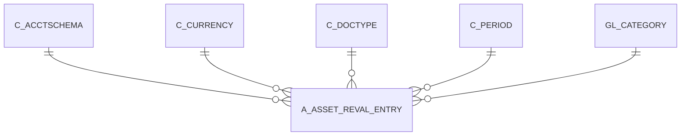

# A_ASSET_REVAL_ENTRY

Area [A](../../data-model/a/index.md) · class **business** (proposed) · read from database `idempiere-db` (owner `ADEMPIERE`) · 0 row(s) when profiled

Application model: `org.compiere.model.X_A_Asset_Reval_Entry`, access level 7 - System - Client - Org.

## Columns

| column | type | key | not null | business name | references (code) | nulls | distinct |
|---|---|---|---|---|---|---|---|
| `A_ASSET_REVAL_ENTRY_ID` | NUMBER(10,0) | PK | yes | Asset Reval. Entry |  | 0 | 0 |
| `AD_CLIENT_ID` | NUMBER(10,0) |  | yes | Tenant |  | 0 | 0 |
| `A_EFFECTIVE_DATE` | DATE |  | yes | Effective Date |  | 0 | 0 |
| `A_REVAL_CAL_METHOD` | VARCHAR2(3 CHAR) |  | yes | A_Reval_Cal_Method |  | 0 | 0 |
| `A_REVAL_MULTIPLIER` | VARCHAR2(3 CHAR) |  | yes | Reval. Multiplier |  | 0 | 0 |
| `C_CURRENCY_ID` | NUMBER(10,0) |  | yes | Currency | [C_CURRENCY](../../data-model/c/c_currency.md) | 0 | 0 |
| `C_PERIOD_ID` | NUMBER(10,0) |  |  | Period | [C_PERIOD](../../data-model/c/c_period.md) | 0 | 0 |
| `CREATEDBY` | NUMBER(10,0) |  | yes | Created By |  | 0 | 0 |
| `DATEDOC` | DATE |  |  | Document Date |  | 0 | 0 |
| `UPDATEDBY` | NUMBER(10,0) |  | yes | Updated By |  | 0 | 0 |
| `UPDATED` | DATE |  | yes | Updated |  | 0 | 0 |
| `PROCESSING` | CHAR(1) |  | yes | Process Now |  | 0 | 0 |
| `PROCESSED` | CHAR(1) |  | yes | Processed |  | 0 | 0 |
| `POSTINGTYPE` | CHAR(1) |  | yes | Posting Type |  | 0 | 0 |
| `ISACTIVE` | CHAR(1) |  | yes | Active |  | 0 | 0 |
| `GL_CATEGORY_ID` | NUMBER(10,0) |  |  | GL Category | [GL_CATEGORY](../../data-model/gl/gl_category.md) | 0 | 0 |
| `DOCUMENTNO` | VARCHAR2(60 CHAR) |  | yes | Document No |  | 0 | 0 |
| `DESCRIPTION` | VARCHAR2(510 CHAR) |  | yes | Description |  | 0 | 0 |
| `DATEACCT` | DATE |  |  | Account Date |  | 0 | 0 |
| `CREATED` | DATE |  | yes | Created |  | 0 | 0 |
| `C_DOCTYPE_ID` | NUMBER(10,0) |  |  | Document Type | [C_DOCTYPE](../../data-model/c/c_doctype.md) | 0 | 0 |
| `C_ACCTSCHEMA_ID` | NUMBER(10,0) |  |  | Accounting Schema | [C_ACCTSCHEMA](../../data-model/c/c_acctschema.md) | 0 | 0 |
| `A_REVAL_EFFECTIVE_DATE` | VARCHAR2(2 CHAR) |  | yes | Reval. Effective Date |  | 0 | 0 |
| `A_REV_CODE` | VARCHAR2(3 CHAR) |  | yes | Rev. Code |  | 0 | 0 |
| `AD_ORG_ID` | NUMBER(10,0) |  | yes | Organization |  | 0 | 0 |
| `A_ASSET_REVAL_ENTRY_UU` | VARCHAR2(36 CHAR) |  |  | A_Asset_Reval_Entry_UU |  | 0 | 0 |

*references (code)* is the table the application model's code says a column points to; *Foreign keys* below are the constraints the database declares. Counts come from the profile; no value is ever shown.

## Check constraints

| name | expression |
|---|---|
| `SYS_C0021423` | `IsActive IN ('Y','N')` |
| `SYS_C0021424` | `Processed IN ('Y','N')` |

## Foreign keys

**References**

| table | columns | on delete |
|---|---|---|
| [C_ACCTSCHEMA](../../data-model/c/c_acctschema.md) | A_ASSET_REVAL_ENTRY.C_ACCTSCHEMA_ID → C_ACCTSCHEMA.C_ACCTSCHEMA_ID | NO ACTION |
| [C_CURRENCY](../../data-model/c/c_currency.md) | A_ASSET_REVAL_ENTRY.C_CURRENCY_ID → C_CURRENCY.C_CURRENCY_ID | NO ACTION |
| [C_DOCTYPE](../../data-model/c/c_doctype.md) | A_ASSET_REVAL_ENTRY.C_DOCTYPE_ID → C_DOCTYPE.C_DOCTYPE_ID | NO ACTION |
| [C_PERIOD](../../data-model/c/c_period.md) | A_ASSET_REVAL_ENTRY.C_PERIOD_ID → C_PERIOD.C_PERIOD_ID | NO ACTION |
| [GL_CATEGORY](../../data-model/gl/gl_category.md) | A_ASSET_REVAL_ENTRY.GL_CATEGORY_ID → GL_CATEGORY.GL_CATEGORY_ID | NO ACTION |

**Referenced by**

_None._

## Write behaviour

- updates: **po_only**
- deletes: **soft_delete_only**
- change log: **recorded**
- evidence: 1 citation(s)

## Schema history

53 change(s); the latest:

| applied | release | operation | column | tickets |
|---|---|---|---|---|
| 2023-04-09T15:47 | iD11 | `add_constraint` |  | IDEMPIERE-5567 |
| 2023-04-09T15:47 | iD11 | `add_constraint` |  | IDEMPIERE-5567 |
| 2021-12-05T16:45 | i8.2z | `add_constraint` |  | IDEMPIERE-5075 |
| 2021-12-05T16:45 | i8.2z | `add_constraint` |  | IDEMPIERE-5075 |
| 2021-12-05T16:45 | i8.2z | `drop_constraint` |  | IDEMPIERE-5075 |
| 2021-12-05T16:45 | i8.2z | `drop_constraint` |  | IDEMPIERE-5075 |
| 2021-12-05T16:45 | i8.2z | `drop_constraint` |  | IDEMPIERE-5075 |
| 2021-12-05T16:45 | i8.2z | `drop_constraint` |  | IDEMPIERE-5075 |
| 2021-12-05T16:45 | i8.2z | `drop_constraint` |  | IDEMPIERE-5075 |
| 2021-12-05T16:45 | i8.2z | `add_constraint` |  | IDEMPIERE-5075 |
| 2021-12-05T16:45 | i8.2z | `add_constraint` |  | IDEMPIERE-5075 |
| 2021-12-05T16:45 | i8.2z | `add_constraint` |  | IDEMPIERE-5075 |
| 2020-08-04T01:00 | i7.1z | `modify_column` | DESCRIPTION | IDEMPIERE-3862 |
| 2020-08-04T01:00 | i7.1z | `drop_column` | tmp_col_4_tmp | IDEMPIERE-3862 |
| 2020-08-04T01:00 | i7.1z | `drop_column` | tmp_col_1_tmp | IDEMPIERE-3862 |

## Notes

<!-- ekos:manual id="table.a_asset_reval_entry.notes" -->
_Business notes about this table._
<!-- /ekos:manual -->
