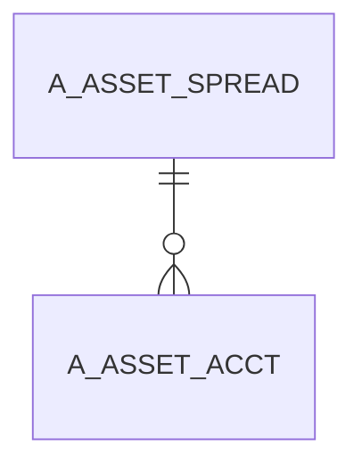

# A_ASSET_SPREAD

Area [A](../../data-model/a/index.md) · class **business** (proposed) · read from database `idempiere-db` (owner `ADEMPIERE`) · 2 row(s) when profiled

## Columns

| column | type | key | not null | business name | references (code) | nulls | distinct |
|---|---|---|---|---|---|---|---|
| `A_ASSET_SPREAD_ID` | NUMBER(10,0) | PK | yes |  |  | 0 | 2 |
| `DESCRIPTION` | VARCHAR2(255 CHAR) |  |  |  |  | 0 | 2 |
| `AD_CLIENT_ID` | NUMBER(10,0) |  | yes |  |  | 0 | 1 |
| `A_ASSET_SPREAD_TYPE` | VARCHAR2(20 CHAR) |  |  |  |  | 0 | 2 |
| `A_PERIOD_10` | NUMBER |  | yes |  |  | 0 | 2 |
| `A_PERIOD_12` | NUMBER |  | yes |  |  | 0 | 2 |
| `A_PERIOD_14` | NUMBER |  | yes |  |  | 0 | 1 |
| `A_PERIOD_3` | NUMBER |  | yes |  |  | 0 | 2 |
| `A_PERIOD_5` | NUMBER |  | yes |  |  | 0 | 2 |
| `A_PERIOD_7` | NUMBER |  | yes |  |  | 0 | 2 |
| `UPDATEDBY` | NUMBER(10,0) |  | yes |  |  | 0 | 1 |
| `UPDATED` | DATE |  | yes |  |  | 0 | 2 |
| `ISACTIVE` | CHAR(1) |  | yes |  |  | 0 | 1 |
| `CREATEDBY` | NUMBER(10,0) |  | yes |  |  | 0 | 1 |
| `CREATED` | DATE |  | yes |  |  | 0 | 2 |
| `A_PERIOD_9` | NUMBER |  | yes |  |  | 0 | 2 |
| `A_PERIOD_8` | NUMBER |  | yes |  |  | 0 | 2 |
| `A_PERIOD_6` | NUMBER |  | yes |  |  | 0 | 2 |
| `A_PERIOD_4` | NUMBER |  | yes |  |  | 0 | 2 |
| `A_PERIOD_2` | NUMBER |  | yes |  |  | 0 | 2 |
| `A_PERIOD_13` | NUMBER |  | yes |  |  | 0 | 1 |
| `A_PERIOD_11` | NUMBER |  | yes |  |  | 0 | 2 |
| `A_PERIOD_1` | NUMBER |  | yes |  |  | 0 | 2 |
| `AD_ORG_ID` | NUMBER(10,0) |  | yes |  |  | 0 | 1 |
| `A_ASSET_SPREAD_UU` | VARCHAR2(36 CHAR) |  |  |  |  | 0 | 2 |

*references (code)* is the table the application model's code says a column points to; *Foreign keys* below are the constraints the database declares. Counts come from the profile; no value is ever shown.

## Check constraints

| name | expression |
|---|---|
| `SYS_C0021198` | `IsActive IN ('Y','N')` |

## Foreign keys

**References**

_None._

**Referenced by**

| table | columns | on delete |
|---|---|---|
| [A_ASSET_ACCT](../../data-model/a/a_asset_acct.md) | A_ASSET_ACCT.A_ASSET_SPREAD_ID → A_ASSET_SPREAD.A_ASSET_SPREAD_ID | NO ACTION |

## Write behaviour

- updates: **po_only**
- deletes: **deleted_by_users**
- change log: **recorded**
- evidence: 1 citation(s)

## Schema history

19 change(s); the latest:

| applied | release | operation | column | tickets |
|---|---|---|---|---|
| 2023-04-09T15:47 | iD11 | `add_constraint` |  | IDEMPIERE-5567 |
| 2023-04-09T15:47 | iD11 | `add_constraint` |  | IDEMPIERE-5567 |
| 2020-08-04T01:00 | i7.1z | `modify_column` | A_ASSET_SPREAD_TYPE | IDEMPIERE-3862 |
| 2020-08-04T01:00 | i7.1z | `drop_column` | tmp_col_2_tmp | IDEMPIERE-3862 |
| 2020-08-04T01:00 | i7.1z | `add_column` | tmp_col_2_tmp | IDEMPIERE-3862 |
| 2020-08-04T01:00 | i7.1z | `drop_column` | tmp_col_1_tmp | IDEMPIERE-3862 |
| 2020-08-04T01:00 | i7.1z | `modify_column` | DESCRIPTION | IDEMPIERE-3862 |
| 2020-08-04T01:00 | i7.1z | `add_column` | tmp_col_1_tmp | IDEMPIERE-3862 |
| 2020-08-04T01:00 | i7.1z | `modify_column` | A_ASSET_SPREAD_UU | IDEMPIERE-3862 |
| 2020-08-04T01:00 | i7.1z | `drop_column` | tmp_col_3_tmp | IDEMPIERE-3862 |
| 2020-08-04T01:00 | i7.1z | `add_column` | tmp_col_3_tmp | IDEMPIERE-3862 |
| 2014-05-02T10:09 | i2.0 | `modify_column` | created | IDEMPIERE-709 |
| 2014-05-02T10:09 | i2.0 | `modify_column` | updated | IDEMPIERE-709 |
| 2014-04-17T15:00 | i2.0 | `modify_column` | updated | IDEMPIERE-709 |
| 2014-04-17T15:00 | i2.0 | `modify_column` | created | IDEMPIERE-709 |

## Open conflicts

| type | attribute | explanation |
|---|---|---|
| `table_without_model` | `model_class` | unexplained |

## Notes

<!-- ekos:manual id="table.a_asset_spread.notes" -->
_Business notes about this table._
<!-- /ekos:manual -->
