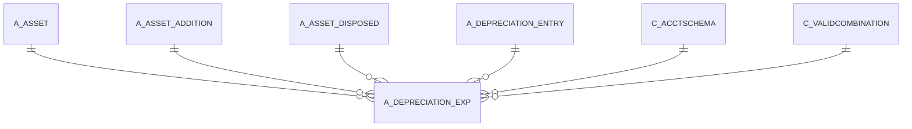

# A_DEPRECIATION_EXP

Area [A](../../data-model/a/index.md) · class **business** (proposed) · read from database `idempiere-db` (owner `ADEMPIERE`) · 0 row(s) when profiled

Application model: `org.compiere.model.X_A_Depreciation_Exp`, access level 3 - Client - Org.

## Columns

| column | type | key | not null | business name | references (code) | nulls | distinct |
|---|---|---|---|---|---|---|---|
| `A_DEPRECIATION_EXP_ID` | NUMBER(10,0) | PK | yes | A_Depreciation_Exp_ID |  | 0 | 0 |
| `AD_CLIENT_ID` | NUMBER(10,0) |  | yes | Tenant |  | 0 | 0 |
| `AD_ORG_ID` | NUMBER(10,0) |  | yes | Organization |  | 0 | 0 |
| `A_ENTRY_TYPE` | VARCHAR2(3 CHAR) |  | yes | Entry Type |  | 0 | 0 |
| `CREATED` | DATE |  | yes | Created |  | 0 | 0 |
| `DATEACCT` | DATE |  |  | Account Date |  | 0 | 0 |
| `EXPENSE` | NUMBER |  | yes | Expense |  | 0 | 0 |
| `ISDEPRECIATED` | CHAR(1) |  | yes | Depreciate |  | 0 | 0 |
| `PROCESSED` | CHAR(1) |  | yes | Processed |  | 0 | 0 |
| `UPDATEDBY` | NUMBER(10,0) |  | yes | Updated By |  | 0 | 0 |
| `UPDATED` | DATE |  | yes | Updated |  | 0 | 0 |
| `POSTINGTYPE` | CHAR(1) |  |  | Posting Type |  | 0 | 0 |
| `ISACTIVE` | CHAR(1) |  | yes | Active |  | 0 | 0 |
| `DESCRIPTION` | VARCHAR2(255 CHAR) |  | yes | Description |  | 0 | 0 |
| `CREATEDBY` | NUMBER(10,0) |  | yes | Created By |  | 0 | 0 |
| `A_PERIOD` | NUMBER(10,0) |  | yes | Asset Period |  | 0 | 0 |
| `A_ASSET_ID` | NUMBER(10,0) |  | yes | Asset | [A_ASSET](../../data-model/a/a_asset.md) | 0 | 0 |
| `A_DEPRECIATION_EXP_UU` | VARCHAR2(36 CHAR) |  |  | A_Depreciation_Exp_UU |  | 0 | 0 |
| `DR_ACCOUNT_ID` | NUMBER(10,0) |  |  | Account (debit) | [C_VALIDCOMBINATION](../../data-model/c/c_validcombination.md) | 0 | 0 |
| `CR_ACCOUNT_ID` | NUMBER(10,0) |  |  | Account (credit) | [C_VALIDCOMBINATION](../../data-model/c/c_validcombination.md) | 0 | 0 |
| `EXPENSE_F` | NUMBER |  | yes | Expense (fiscal) |  | 0 | 0 |
| `PROCESSING` | CHAR(1) |  |  | Process Now |  | 0 | 0 |
| `HELP` | VARCHAR2(2000 CHAR) |  |  | Comment/Help |  | 0 | 0 |
| `A_ASSET_COST` | NUMBER |  |  | Asset Cost |  | 0 | 0 |
| `A_ACCUMULATED_DEPR` | NUMBER |  |  | Accumulated Depreciation |  | 0 | 0 |
| `A_ACCUMULATED_DEPR_F` | NUMBER |  |  | Accumulated Depreciation (fiscal) |  | 0 | 0 |
| `USELIFEMONTHS` | NUMBER(10,0) |  |  | Usable Life - Months |  | 0 | 0 |
| `USELIFEMONTHS_F` | NUMBER(10,0) |  |  | Use Life - Months (fiscal) |  | 0 | 0 |
| `A_ASSET_REMAINING` | NUMBER |  |  | Remaining Amt |  | 0 | 0 |
| `A_ASSET_REMAINING_F` | NUMBER |  |  | Remaining Amt (fiscal) |  | 0 | 0 |
| `A_ASSET_COST_DELTA` | NUMBER |  | yes | Delta Asset Cost |  | 0 | 0 |
| `A_ACCUMULATED_DEPR_DELTA` | NUMBER |  | yes | Accumulated Depreciation (delta) |  | 0 | 0 |
| `A_ACCUMULATED_DEPR_F_DELTA` | NUMBER |  | yes | Accumulated Depreciation - fiscal (delta) |  | 0 | 0 |
| `A_ASSET_ADDITION_ID` | NUMBER(10,0) |  |  | Asset Addition | [A_ASSET_ADDITION](../../data-model/a/a_asset_addition.md) | 0 | 0 |
| `A_ASSET_DISPOSED_ID` | NUMBER(10,0) |  |  | Asset Disposed | [A_ASSET_DISPOSED](../../data-model/a/a_asset_disposed.md) | 0 | 0 |
| `A_DEPRECIATION_ENTRY_ID` | NUMBER(10,0) |  |  | Depreciation Entry | [A_DEPRECIATION_ENTRY](../../data-model/a/a_depreciation_entry.md) | 0 | 0 |
| `A_ACCOUNT_NUMBER_ACCT` | NUMBER(10,0) |  |  | A_Account_Number_Acct |  | 0 | 0 |
| `C_ACCTSCHEMA_ID` | NUMBER(10,0) |  |  | Accounting Schema | [C_ACCTSCHEMA](../../data-model/c/c_acctschema.md) | 0 | 0 |

*references (code)* is the table the application model's code says a column points to; *Foreign keys* below are the constraints the database declares. Counts come from the profile; no value is ever shown.

## Check constraints

| name | expression |
|---|---|
| `SYS_C0020833` | `IsActive IN ('Y','N')` |
| `SYS_C0020835` | `Processed IN ('Y','N')` |
| `SYS_C0020836` | `IsDepreciated IN ('Y','N')` |

## Foreign keys

**References**

| table | columns | on delete |
|---|---|---|
| [A_ASSET](../../data-model/a/a_asset.md) | A_DEPRECIATION_EXP.A_ASSET_ID → A_ASSET.A_ASSET_ID | NO ACTION |
| [A_ASSET_ADDITION](../../data-model/a/a_asset_addition.md) | A_DEPRECIATION_EXP.A_ASSET_ADDITION_ID → A_ASSET_ADDITION.A_ASSET_ADDITION_ID | NO ACTION |
| [A_ASSET_DISPOSED](../../data-model/a/a_asset_disposed.md) | A_DEPRECIATION_EXP.A_ASSET_DISPOSED_ID → A_ASSET_DISPOSED.A_ASSET_DISPOSED_ID | NO ACTION |
| [A_DEPRECIATION_ENTRY](../../data-model/a/a_depreciation_entry.md) | A_DEPRECIATION_EXP.A_DEPRECIATION_ENTRY_ID → A_DEPRECIATION_ENTRY.A_DEPRECIATION_ENTRY_ID | NO ACTION |
| [C_ACCTSCHEMA](../../data-model/c/c_acctschema.md) | A_DEPRECIATION_EXP.C_ACCTSCHEMA_ID → C_ACCTSCHEMA.C_ACCTSCHEMA_ID | CASCADE |
| [C_VALIDCOMBINATION](../../data-model/c/c_validcombination.md) | A_DEPRECIATION_EXP.A_ACCOUNT_NUMBER_ACCT → C_VALIDCOMBINATION.C_VALIDCOMBINATION_ID | NO ACTION |

**Referenced by**

_None._

## Write behaviour

- updates: **raw_sql_skips_updated**
- deletes: **deleted_by_app, deleted_by_users, deleted_by_cascade**
- change log: **recorded**
- evidence: 8 citation(s)

## Schema history

44 change(s); the latest:

| applied | release | operation | column | tickets |
|---|---|---|---|---|
| 2023-04-09T15:47 | iD11 | `add_constraint` |  | IDEMPIERE-5567 |
| 2023-04-09T15:47 | iD11 | `add_constraint` |  | IDEMPIERE-5567 |
| 2021-12-05T16:45 | i8.2z | `add_constraint` |  | IDEMPIERE-5075 |
| 2021-12-05T16:45 | i8.2z | `drop_constraint` |  | IDEMPIERE-5075 |
| 2021-12-05T16:45 | i8.2z | `add_constraint` |  | IDEMPIERE-5075 |
| 2021-12-05T16:45 | i8.2z | `add_constraint` |  | IDEMPIERE-5075 |
| 2021-12-05T16:45 | i8.2z | `add_constraint` |  | IDEMPIERE-5075 |
| 2021-12-05T16:45 | i8.2z | `drop_constraint` |  | IDEMPIERE-5075 |
| 2021-12-05T16:45 | i8.2z | `drop_constraint` |  | IDEMPIERE-5075 |
| 2021-12-05T16:45 | i8.2z | `add_constraint` |  | IDEMPIERE-5075 |
| 2021-12-05T16:45 | i8.2z | `drop_constraint` |  | IDEMPIERE-5075 |
| 2021-12-05T16:45 | i8.2z | `add_constraint` |  | IDEMPIERE-5075 |
| 2021-12-05T16:45 | i8.2z | `drop_constraint` |  | IDEMPIERE-5075 |
| 2021-12-05T16:45 | i8.2z | `add_constraint` |  | IDEMPIERE-5075 |
| 2021-12-05T16:45 | i8.2z | `drop_constraint` |  | IDEMPIERE-5075 |

## Notes

<!-- ekos:manual id="table.a_depreciation_exp.notes" -->
_Business notes about this table._
<!-- /ekos:manual -->
