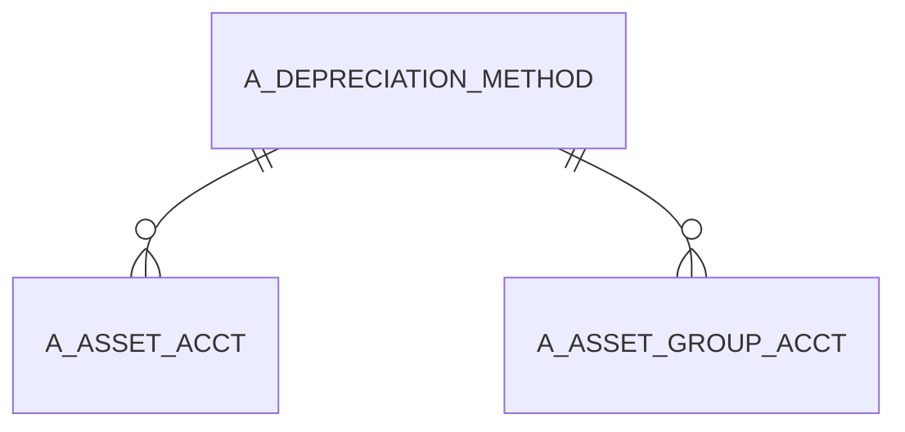

# A_DEPRECIATION_METHOD

Area [A](../../data-model/a/index.md) · class **business** (proposed) · read from database `idempiere-db` (owner `ADEMPIERE`) · 3 row(s) when profiled

Application model: `org.compiere.model.X_A_Depreciation_Method`, access level 7 - System - Client - Org.

## Columns

| column | type | key | not null | business name | references (code) | nulls | distinct |
|---|---|---|---|---|---|---|---|
| `A_DEPRECIATION_METHOD_ID` | NUMBER(10,0) | PK | yes | Depreciation Method |  | 0 | 3 |
| `NAME` | VARCHAR2(120 CHAR) |  |  | Name |  | 0 | 3 |
| `AD_CLIENT_ID` | NUMBER(10,0) |  | yes | Tenant |  | 0 | 1 |
| `CREATED` | DATE |  | yes | Created |  | 0 | 3 |
| `DEPRECIATIONTYPE` | VARCHAR2(10 CHAR) |  |  | Depreciation Type |  | 0 | 3 |
| `ISACTIVE` | CHAR(1) |  | yes | Active |  | 0 | 1 |
| `PROCESSED` | CHAR(1) |  | yes | Processed |  | 0 | 1 |
| `UPDATED` | DATE |  | yes | Updated |  | 0 | 3 |
| `UPDATEDBY` | NUMBER(10,0) |  | yes | Updated By |  | 0 | 1 |
| `TEXT` | VARCHAR2(2000 CHAR) |  |  | Description |  | 0 | 1 |
| `DESCRIPTION` | VARCHAR2(510 CHAR) |  |  | Description |  | 0 | 3 |
| `CREATEDBY` | NUMBER(10,0) |  | yes | Created By |  | 0 | 1 |
| `AD_ORG_ID` | NUMBER(10,0) |  | yes | Organization |  | 0 | 1 |
| `A_DEPRECIATION_METHOD_UU` | VARCHAR2(36 CHAR) |  |  | A_Depreciation_Method_UU |  | 0 | 3 |

*references (code)* is the table the application model's code says a column points to; *Foreign keys* below are the constraints the database declares. Counts come from the profile; no value is ever shown.

## Check constraints

| name | expression |
|---|---|
| `SYS_C0021404` | `IsActive IN ('Y','N')` |

## Foreign keys

**References**

_None._

**Referenced by**

| table | columns | on delete |
|---|---|---|
| [A_ASSET_ACCT](../../data-model/a/a_asset_acct.md) | A_ASSET_ACCT.A_DEPRECIATION_METHOD_F_ID → A_DEPRECIATION_METHOD.A_DEPRECIATION_METHOD_ID | NO ACTION |
| [A_ASSET_GROUP_ACCT](../../data-model/a/a_asset_group_acct.md) | A_ASSET_GROUP_ACCT.A_DEPRECIATION_METHOD_F_ID → A_DEPRECIATION_METHOD.A_DEPRECIATION_METHOD_ID | NO ACTION |

## Write behaviour

- updates: **po_only**
- deletes: **deleted_by_users**
- change log: **recorded**
- evidence: 1 citation(s)

## Schema history

25 change(s); the latest:

| applied | release | operation | column | tickets |
|---|---|---|---|---|
| 2023-04-09T15:47 | iD11 | `add_constraint` |  | IDEMPIERE-5567 |
| 2023-04-09T15:47 | iD11 | `add_constraint` |  | IDEMPIERE-5567 |
| 2020-08-04T01:00 | i7.1z | `modify_column` | A_DEPRECIATION_METHOD_UU | IDEMPIERE-3862 |
| 2020-08-04T01:00 | i7.1z | `modify_column` | NAME | IDEMPIERE-3862 |
| 2020-08-04T01:00 | i7.1z | `modify_column` | DEPRECIATIONTYPE | IDEMPIERE-3862 |
| 2020-08-04T01:00 | i7.1z | `drop_column` | tmp_col_2_tmp | IDEMPIERE-3862 |
| 2020-08-04T01:00 | i7.1z | `drop_column` | tmp_col_5_tmp | IDEMPIERE-3862 |
| 2020-08-04T01:00 | i7.1z | `drop_column` | tmp_col_1_tmp | IDEMPIERE-3862 |
| 2020-08-04T01:00 | i7.1z | `add_column` | tmp_col_1_tmp | IDEMPIERE-3862 |
| 2020-08-04T01:00 | i7.1z | `add_column` | tmp_col_2_tmp | IDEMPIERE-3862 |
| 2020-08-04T01:00 | i7.1z | `drop_column` | tmp_col_4_tmp | IDEMPIERE-3862 |
| 2020-08-04T01:00 | i7.1z | `add_column` | tmp_col_4_tmp | IDEMPIERE-3862 |
| 2020-08-04T01:00 | i7.1z | `add_column` | tmp_col_3_tmp | IDEMPIERE-3862 |
| 2020-08-04T01:00 | i7.1z | `drop_column` | tmp_col_3_tmp | IDEMPIERE-3862 |
| 2020-08-04T01:00 | i7.1z | `modify_column` | TEXT | IDEMPIERE-3862 |

## Notes

<!-- ekos:manual id="table.a_depreciation_method.notes" -->
_Business notes about this table._
<!-- /ekos:manual -->
