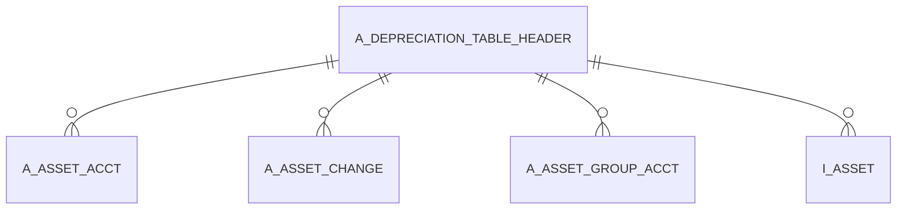

# A_DEPRECIATION_TABLE_HEADER

Area [A](../../data-model/a/index.md) · class **business** (proposed) · read from database `idempiere-db` (owner `ADEMPIERE`) · 122 row(s) when profiled

Application model: `org.compiere.model.X_A_Depreciation_Table_Header`, access level 7 - System - Client - Org.

## Columns

| column | type | key | not null | business name | references (code) | nulls | distinct |
|---|---|---|---|---|---|---|---|
| `A_DEPRECIATION_TABLE_HEADER_ID` | NUMBER(10,0) | PK | yes | A_Depreciation_Table_Header_ID |  | 0 | 122 |
| `AD_CLIENT_ID` | NUMBER(10,0) |  | yes | Tenant |  | 0 | 1 |
| `AD_ORG_ID` | NUMBER(10,0) |  | yes | Organization |  | 0 | 1 |
| `A_TERM` | VARCHAR2(2 CHAR) |  | yes | Period/Yearly |  | 0 | 1 |
| `CREATEDBY` | NUMBER(10,0) |  | yes | Created By |  | 0 | 1 |
| `ISACTIVE` | CHAR(1) |  | yes | Active |  | 0 | 1 |
| `UPDATED` | DATE |  | yes | Updated |  | 0 | 1 |
| `UPDATEDBY` | NUMBER(10,0) |  | yes | Updated By |  | 0 | 1 |
| `PROCESSED` | CHAR(1) |  | yes | Processed |  | 0 | 1 |
| `DESCRIPTION` | VARCHAR2(510 CHAR) |  | yes | Description |  | 0 | 122 |
| `CREATED` | DATE |  | yes | Created |  | 0 | 1 |
| `A_TABLE_RATE_TYPE` | VARCHAR2(2 CHAR) |  | yes | Type |  | 0 | 1 |
| `A_DEPRECIATION_TABLE_CODE` | VARCHAR2(20 CHAR) |  | yes | Depreciation Code |  | 0 | 122 |
| `A_DEPRECIATION_TABLE_HEADER_UU` | VARCHAR2(36 CHAR) |  |  | A_Depreciation_Table_Header_UU |  | 0 | 122 |

*references (code)* is the table the application model's code says a column points to; *Foreign keys* below are the constraints the database declares. Counts come from the profile; no value is ever shown.

## Check constraints

| name | expression |
|---|---|
| `SYS_C0021593` | `IsActive IN ('Y','N')` |
| `SYS_C0021595` | `Processed IN ('Y','N')` |

## Foreign keys

**References**

_None._

**Referenced by**

| table | columns | on delete |
|---|---|---|
| [A_ASSET_ACCT](../../data-model/a/a_asset_acct.md) | A_ASSET_ACCT.A_DEPRECIATION_TABLE_HEADER_ID → A_DEPRECIATION_TABLE_HEADER.A_DEPRECIATION_TABLE_HEADER_ID | NO ACTION |
| [A_ASSET_CHANGE](../../data-model/a/a_asset_change.md) | A_ASSET_CHANGE.A_DEPRECIATION_TABLE_HEADER_ID → A_DEPRECIATION_TABLE_HEADER.A_DEPRECIATION_TABLE_HEADER_ID | NO ACTION |
| [A_ASSET_GROUP_ACCT](../../data-model/a/a_asset_group_acct.md) | A_ASSET_GROUP_ACCT.A_DEPRECIATION_TABLE_HEADER_ID → A_DEPRECIATION_TABLE_HEADER.A_DEPRECIATION_TABLE_HEADER_ID | NO ACTION |
| `I_ASSET` | I_ASSET.A_DEPRECIATION_TABLE_HEADER_ID → A_DEPRECIATION_TABLE_HEADER.A_DEPRECIATION_TABLE_HEADER_ID | NO ACTION |

## Write behaviour

- updates: **po_only**
- deletes: **deleted_by_users**
- change log: **recorded**
- evidence: 1 citation(s)

## Schema history

33 change(s); the latest:

| applied | release | operation | column | tickets |
|---|---|---|---|---|
| 2023-04-09T15:47 | iD11 | `add_constraint` |  | IDEMPIERE-5567 |
| 2023-04-09T15:47 | iD11 | `add_constraint` |  | IDEMPIERE-5567 |
| 2020-08-04T01:00 | i7.1z | `modify_column` | A_DEPRECIATION_TABLE_CODE | IDEMPIERE-3862 |
| 2020-08-04T01:00 | i7.1z | `modify_column` | DESCRIPTION | IDEMPIERE-3862 |
| 2020-08-04T01:00 | i7.1z | `modify_column` | A_TABLE_RATE_TYPE | IDEMPIERE-3862 |
| 2020-08-04T01:00 | i7.1z | `modify_column` | A_TABLE_RATE_TYPE | IDEMPIERE-3862 |
| 2020-08-04T01:00 | i7.1z | `modify_column` | A_DEPRECIATION_TABLE_HEADER_UU | IDEMPIERE-3862 |
| 2020-08-04T01:00 | i7.1z | `drop_column` | tmp_col_4_tmp | IDEMPIERE-3862 |
| 2020-08-04T01:00 | i7.1z | `modify_column` | A_TERM | IDEMPIERE-3862 |
| 2020-08-04T01:00 | i7.1z | `modify_column` | A_DEPRECIATION_TABLE_CODE | IDEMPIERE-3862 |
| 2020-08-04T01:00 | i7.1z | `add_column` | tmp_col_1_tmp | IDEMPIERE-3862 |
| 2020-08-04T01:00 | i7.1z | `add_column` | tmp_col_4_tmp | IDEMPIERE-3862 |
| 2020-08-04T01:00 | i7.1z | `modify_column` | A_TERM | IDEMPIERE-3862 |
| 2020-08-04T01:00 | i7.1z | `drop_column` | tmp_col_2_tmp | IDEMPIERE-3862 |
| 2020-08-04T01:00 | i7.1z | `add_column` | tmp_col_3_tmp | IDEMPIERE-3862 |

## Notes

<!-- ekos:manual id="table.a_depreciation_table_header.notes" -->
_Business notes about this table._
<!-- /ekos:manual -->
