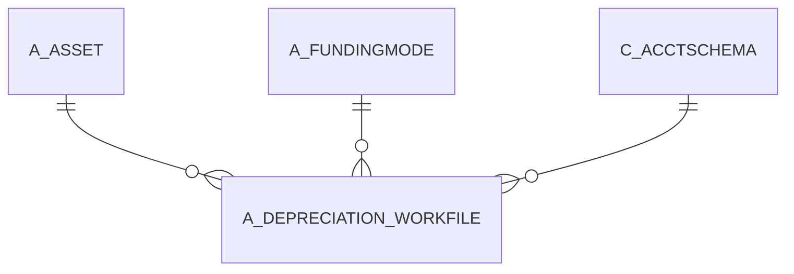

# A_DEPRECIATION_WORKFILE

Area [A](../../data-model/a/index.md) · class **business** (proposed) · read from database `idempiere-db` (owner `ADEMPIERE`) · 0 row(s) when profiled

Application model: `org.compiere.model.X_A_Depreciation_Workfile`, access level 7 - System - Client - Org.

## Columns

| column | type | key | not null | business name | references (code) | nulls | distinct |
|---|---|---|---|---|---|---|---|
| `A_DEPRECIATION_WORKFILE_ID` | NUMBER(10,0) | PK | yes | A_Depreciation_Workfile_ID |  | 0 | 0 |
| `AD_CLIENT_ID` | NUMBER(10,0) |  | yes | Tenant |  | 0 | 0 |
| `AD_ORG_ID` | NUMBER(10,0) |  | yes | Organization |  | 0 | 0 |
| `A_ACCUMULATED_DEPR` | NUMBER |  | yes | Accumulated Depreciation |  | 0 | 0 |
| `A_ASSET_COST` | NUMBER |  | yes | Asset Cost |  | 0 | 0 |
| `A_ASSET_ID` | NUMBER(10,0) |  | yes | Asset | [A_ASSET](../../data-model/a/a_asset.md) | 0 | 0 |
| `A_ASSET_LIFE_CURRENT_YEAR` | NUMBER |  | yes | A_Asset_Life_Current_Year |  | 0 | 0 |
| `A_PERIOD_FORECAST` | NUMBER |  |  | A_Period_Forecast |  | 0 | 0 |
| `A_PRIOR_YEAR_ACCUMULATED_DEPR` | NUMBER |  |  | A_Prior_Year_Accumulated_Depr |  | 0 | 0 |
| `POSTINGTYPE` | CHAR(1) |  |  | Posting Type |  | 0 | 0 |
| `ISDEPRECIATED` | CHAR(1) |  |  | Depreciate |  | 0 | 0 |
| `ISACTIVE` | CHAR(1) |  | yes | Active |  | 0 | 0 |
| `DATEACCT` | DATE |  |  | Account Date |  | 0 | 0 |
| `CREATEDBY` | NUMBER(10,0) |  | yes | Created By |  | 0 | 0 |
| `CREATED` | DATE |  | yes | Created |  | 0 | 0 |
| `ASSETDEPRECIATIONDATE` | DATE |  |  | Asset Depreciation Date |  | 0 | 0 |
| `A_SALVAGE_VALUE` | NUMBER |  | yes | Asset Salvage Value |  | 0 | 0 |
| `A_QTY_CURRENT` | NUMBER |  | yes | Current Qty |  | 0 | 0 |
| `UPDATEDBY` | NUMBER(10,0) |  | yes | Updated By |  | 0 | 0 |
| `UPDATED` | DATE |  | yes | Updated |  | 0 | 0 |
| `PROCESSING` | CHAR(1) |  |  | Process Now |  | 0 | 0 |
| `A_PERIOD_POSTED` | NUMBER(10,0) |  |  | A_Period_Posted |  | 0 | 0 |
| `A_LIFE_PERIOD` | NUMBER(10,0) |  | yes | Life Periods |  | 0 | 0 |
| `A_ASSET_LIFE_YEARS` | NUMBER |  | yes | Life Years |  | 0 | 0 |
| `A_BASE_AMOUNT` | NUMBER |  |  | A_Base_Amount |  | 0 | 0 |
| `A_CALC_ACCUMULATED_DEPR` | NUMBER |  |  | A_Calc_Accumulated_Depr |  | 0 | 0 |
| `A_CURR_DEP_EXP` | NUMBER |  | yes | A_Curr_Dep_Exp |  | 0 | 0 |
| `A_CURRENT_PERIOD` | NUMBER(10,0) |  |  | Current Period |  | 0 | 0 |
| `A_DEPRECIATION_WORKFILE_UU` | VARCHAR2(36 CHAR) |  |  | A_Depreciation_Workfile_UU |  | 0 | 0 |
| `A_ACCUMULATED_DEPR_F` | NUMBER |  | yes | Accumulated Depreciation (fiscal) |  | 0 | 0 |
| `A_ASSET_LIFE_YEARS_F` | NUMBER |  | yes | Life Years (fiscal) |  | 0 | 0 |
| `A_LIFE_PERIOD_F` | NUMBER(10,0) |  | yes | Life Period (fiscal) |  | 0 | 0 |
| `USELIFEYEARS` | NUMBER |  | yes | Usable Life - Years |  | 0 | 0 |
| `USELIFEMONTHS` | NUMBER(10,0) |  | yes | Usable Life - Months |  | 0 | 0 |
| `USELIFEYEARS_F` | NUMBER |  | yes | Use Life - Years (fiscal) |  | 0 | 0 |
| `USELIFEMONTHS_F` | NUMBER(10,0) |  | yes | Use Life - Months (fiscal) |  | 0 | 0 |
| `A_ASSET_REMAINING` | NUMBER |  |  | Remaining Amt |  | 0 | 0 |
| `A_ASSET_REMAINING_F` | NUMBER |  |  | Remaining Amt (fiscal) |  | 0 | 0 |
| `A_TIP_FINANTARE` | CHAR(1) |  | yes | Financing Type |  | 0 | 0 |
| `A_VALOARE_COFINANTARE` | NUMBER |  |  | Own contribution |  | 0 | 0 |
| `A_VALOARE_TERT` | NUMBER |  |  | Third contribution |  | 0 | 0 |
| `DESCRIPTION` | VARCHAR2(255 CHAR) |  |  | Description |  | 0 | 0 |
| `A_FUNDINGMODE_ID` | NUMBER(10,0) |  |  | Asset Funding Mode | [A_FUNDINGMODE](../../data-model/a/a_fundingmode.md) | 0 | 0 |
| `PROCESSED` | CHAR(1) |  | yes | Processed |  | 0 | 0 |
| `C_ACCTSCHEMA_ID` | NUMBER(10,0) |  |  | Accounting Schema | [C_ACCTSCHEMA](../../data-model/c/c_acctschema.md) | 0 | 0 |

*references (code)* is the table the application model's code says a column points to; *Foreign keys* below are the constraints the database declares. Counts come from the profile; no value is ever shown.

## Check constraints

| name | expression |
|---|---|
| `SYS_C0022925` | `IsDepreciated IN ('Y','N')` |
| `SYS_C0022926` | `IsActive IN ('Y','N')` |
| `SYS_C0022927` | `Processing IN ('Y','N')` |
| `SYS_C0022930` | `Processed IN ('Y','N')` |

## Foreign keys

**References**

| table | columns | on delete |
|---|---|---|
| [A_ASSET](../../data-model/a/a_asset.md) | A_DEPRECIATION_WORKFILE.A_ASSET_ID → A_ASSET.A_ASSET_ID | NO ACTION |
| [A_FUNDINGMODE](../../data-model/a/a_fundingmode.md) | A_DEPRECIATION_WORKFILE.A_FUNDINGMODE_ID → A_FUNDINGMODE.A_FUNDINGMODE_ID | NO ACTION |
| [C_ACCTSCHEMA](../../data-model/c/c_acctschema.md) | A_DEPRECIATION_WORKFILE.C_ACCTSCHEMA_ID → C_ACCTSCHEMA.C_ACCTSCHEMA_ID | CASCADE |

**Referenced by**

_None._

## Write behaviour

- updates: **raw_sql_skips_updated**
- deletes: **deleted_by_app, deleted_by_cascade**
- change log: **recorded**
- evidence: 4 citation(s)

## Schema history

32 change(s); the latest:

| applied | release | operation | column | tickets |
|---|---|---|---|---|
| 2023-04-09T15:47 | iD11 | `add_constraint` |  | IDEMPIERE-5567 |
| 2023-04-09T15:47 | iD11 | `add_constraint` |  | IDEMPIERE-5567 |
| 2022-11-11T22:36 | i9 | `modify_column` | A_Asset_Life_Years_F | IDEMPIERE-5474 |
| 2022-11-11T22:36 | i9 | `modify_column` | UseLifeYears_F | IDEMPIERE-5474 |
| 2022-11-11T22:36 | i9 | `modify_column` | UseLifeYears_F | IDEMPIERE-5474 |
| 2022-11-11T22:36 | i9 | `modify_column` | A_Asset_Life_Years | IDEMPIERE-5474 |
| 2022-11-11T22:36 | i9 | `modify_column` | A_Asset_Life_Years_F | IDEMPIERE-5474 |
| 2022-11-11T22:36 | i9 | `modify_column` | UseLifeYears | IDEMPIERE-5474 |
| 2022-11-11T22:36 | i9 | `modify_column` | A_Asset_Life_Years | IDEMPIERE-5474 |
| 2022-11-11T22:36 | i9 | `modify_column` | UseLifeYears | IDEMPIERE-5474 |
| 2021-12-05T16:45 | i8.2z | `drop_constraint` |  | IDEMPIERE-5075 |
| 2021-12-05T16:45 | i8.2z | `add_constraint` |  | IDEMPIERE-5075 |
| 2021-12-05T16:45 | i8.2z | `drop_constraint` |  | IDEMPIERE-5075 |
| 2021-12-05T16:45 | i8.2z | `add_constraint` |  | IDEMPIERE-5075 |
| 2020-08-04T01:00 | i7.1z | `drop_column` | tmp_col_1_tmp | IDEMPIERE-3862 |

## Notes

<!-- ekos:manual id="table.a_depreciation_workfile.notes" -->
_Business notes about this table._
<!-- /ekos:manual -->
