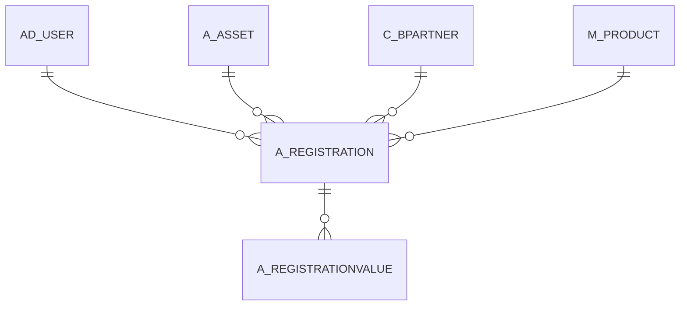

# A_REGISTRATION

Area [A](../../data-model/a/index.md) · class **business** (proposed) · read from database `idempiere-db` (owner `ADEMPIERE`) · 0 row(s) when profiled

Application model: `org.compiere.model.X_A_Registration`, access level 3 - Client - Org.

## Columns

| column | type | key | not null | business name | references (code) | nulls | distinct |
|---|---|---|---|---|---|---|---|
| `A_REGISTRATION_ID` | NUMBER(10,0) | PK | yes | Registration |  | 0 | 0 |
| `AD_CLIENT_ID` | NUMBER(10,0) |  | yes | Tenant |  | 0 | 0 |
| `AD_ORG_ID` | NUMBER(10,0) |  | yes | Organization |  | 0 | 0 |
| `ISACTIVE` | CHAR(1) |  | yes | Active |  | 0 | 0 |
| `CREATED` | DATE |  | yes | Created |  | 0 | 0 |
| `CREATEDBY` | NUMBER(10,0) |  | yes | Created By |  | 0 | 0 |
| `UPDATED` | DATE |  | yes | Updated |  | 0 | 0 |
| `UPDATEDBY` | NUMBER(10,0) |  | yes | Updated By |  | 0 | 0 |
| `NAME` | VARCHAR2(60 CHAR) |  | yes | Name |  | 0 | 0 |
| `DESCRIPTION` | VARCHAR2(255 CHAR) |  |  | Description |  | 0 | 0 |
| `HELP` | VARCHAR2(2000 CHAR) |  |  | Comment/Help |  | 0 | 0 |
| `A_ASSET_ID` | NUMBER(10,0) |  |  | Asset | [A_ASSET](../../data-model/a/a_asset.md) | 0 | 0 |
| `M_PRODUCT_ID` | NUMBER(10,0) |  |  | Product | [M_PRODUCT](../../data-model/m/m_product.md) | 0 | 0 |
| `C_BPARTNER_ID` | NUMBER(10,0) |  |  | Business Partner | [C_BPARTNER](../../data-model/c/c_bpartner.md) | 0 | 0 |
| `AD_USER_ID` | NUMBER(10,0) |  |  | User/Contact | [AD_USER](../../data-model/ad/ad_user.md) | 0 | 0 |
| `ISREGISTERED` | CHAR(1) |  | yes | Registered |  | 0 | 0 |
| `ISINPRODUCTION` | CHAR(1) |  | yes | In Production |  | 0 | 0 |
| `ISALLOWPUBLISH` | CHAR(1) |  | yes | Allowed to be Published |  | 0 | 0 |
| `REMOTE_HOST` | VARCHAR2(120 CHAR) |  |  | Remote Host |  | 0 | 0 |
| `REMOTE_ADDR` | VARCHAR2(60 CHAR) |  |  | Remote Addr |  | 0 | 0 |
| `PROCESSING` | CHAR(1) |  |  | Process Now |  | 0 | 0 |
| `ASSETSERVICEDATE` | DATE |  |  | In Service Date |  | 0 | 0 |
| `NOTE` | VARCHAR2(2000 CHAR) |  |  | Note |  | 0 | 0 |
| `A_REGISTRATION_UU` | VARCHAR2(36 CHAR) |  |  | A_Registration_UU |  | 0 | 0 |

*references (code)* is the table the application model's code says a column points to; *Foreign keys* below are the constraints the database declares. Counts come from the profile; no value is ever shown.

## Check constraints

| name | expression |
|---|---|
| `SYS_C0022043` | `IsActive in ('Y','N')` |
| `SYS_C0022045` | `IsRegistered in ('Y','N')` |
| `SYS_C0022046` | `IsAllowPublish in ('Y','N')` |
| `SYS_C0022048` | `IsInProduction in ('Y','N')` |

## Foreign keys

**References**

| table | columns | on delete |
|---|---|---|
| [AD_USER](../../data-model/ad/ad_user.md) | A_REGISTRATION.AD_USER_ID → AD_USER.AD_USER_ID | NO ACTION |
| [A_ASSET](../../data-model/a/a_asset.md) | A_REGISTRATION.A_ASSET_ID → A_ASSET.A_ASSET_ID | NO ACTION |
| [C_BPARTNER](../../data-model/c/c_bpartner.md) | A_REGISTRATION.C_BPARTNER_ID → C_BPARTNER.C_BPARTNER_ID | NO ACTION |
| [M_PRODUCT](../../data-model/m/m_product.md) | A_REGISTRATION.M_PRODUCT_ID → M_PRODUCT.M_PRODUCT_ID | NO ACTION |

**Referenced by**

| table | columns | on delete |
|---|---|---|
| [A_REGISTRATIONVALUE](../../data-model/a/a_registrationvalue.md) | A_REGISTRATIONVALUE.A_REGISTRATION_ID → A_REGISTRATION.A_REGISTRATION_ID | CASCADE |

## Write behaviour

- updates: **po_only**
- deletes: **deleted_by_users**
- change log: **recorded**
- evidence: 1 citation(s)

## Schema history

33 change(s); the latest:

| applied | release | operation | column | tickets |
|---|---|---|---|---|
| 2023-04-09T15:47 | iD11 | `add_constraint` |  | IDEMPIERE-5567 |
| 2023-04-09T15:47 | iD11 | `add_constraint` |  | IDEMPIERE-5567 |
| 2021-12-05T16:45 | i8.2z | `drop_constraint` |  | IDEMPIERE-5075 |
| 2021-12-05T16:45 | i8.2z | `drop_constraint` |  | IDEMPIERE-5075 |
| 2021-12-05T16:45 | i8.2z | `add_constraint` |  | IDEMPIERE-5075 |
| 2021-12-05T16:45 | i8.2z | `add_constraint` |  | IDEMPIERE-5075 |
| 2021-12-05T16:45 | i8.2z | `drop_constraint` |  | IDEMPIERE-5075 |
| 2021-12-05T16:45 | i8.2z | `add_constraint` |  | IDEMPIERE-5075 |
| 2021-12-05T16:45 | i8.2z | `drop_constraint` |  | IDEMPIERE-5075 |
| 2021-12-05T16:45 | i8.2z | `add_constraint` |  | IDEMPIERE-5075 |
| 2020-08-04T01:00 | i7.1z | `add_column` | tmp_col_5_tmp | IDEMPIERE-3862 |
| 2020-08-04T01:00 | i7.1z | `add_column` | tmp_col_6_tmp | IDEMPIERE-3862 |
| 2020-08-04T01:00 | i7.1z | `modify_column` | HELP | IDEMPIERE-3862 |
| 2020-08-04T01:00 | i7.1z | `drop_column` | tmp_col_3_tmp | IDEMPIERE-3862 |
| 2020-08-04T01:00 | i7.1z | `modify_column` | NAME | IDEMPIERE-3862 |

## Open conflicts

| type | attribute | explanation |
|---|---|---|
| `mandatory_but_nullable` | `columns.AssetServiceDate.nullable` | unexplained |

## Notes

<!-- ekos:manual id="table.a_registration.notes" -->
_Business notes about this table._
<!-- /ekos:manual -->
