# Area A

42 table(s), 42 in scope.

```mermaid
erDiagram
  A_ASSET ||--o{ A_ASSET : ""
  A_ASSET ||--o{ A_ASSET_ACCT : ""
  A_ASSET ||--o{ A_ASSET_ADDITION : ""
  A_ASSET ||--o{ A_ASSET_CHANGE : ""
  A_ASSET ||--o{ A_ASSET_DELIVERY : ""
  A_ASSET ||--o{ A_ASSET_DISPOSED : ""
  A_ASSET ||--o{ A_ASSET_INFO_FIN : ""
  A_ASSET ||--o{ A_ASSET_INFO_LIC : ""
  A_ASSET ||--o{ A_ASSET_PRODUCT : ""
  A_ASSET ||--o{ A_ASSET_RETIREMENT : ""
  A_ASSET ||--o{ A_ASSET_REVAL : ""
  A_ASSET ||--o{ A_ASSET_SPLIT : ""
  A_ASSET ||--o{ A_ASSET_TRANSFER : ""
  A_ASSET ||--o{ A_DEPRECIATION_EXP : ""
  A_ASSET ||--o{ A_DEPRECIATION_WORKFILE : ""
  A_ASSET ||--o{ A_REGISTRATION : ""
  A_ASSET_ADDITION ||--o{ A_ASSET_CHANGE : ""
  A_ASSET_ADDITION ||--o{ A_DEPRECIATION_EXP : ""
  A_ASSET_CHANGE ||--o{ A_ASSET_CHANGE_AMT : ""
  A_ASSET_CLASS ||--o{ A_ASSET : ""
  A_ASSET_CLASS ||--o{ A_ASSET_GROUP : ""
  A_ASSET_DISPOSED ||--o{ A_DEPRECIATION_EXP : ""
  A_ASSET_GROUP ||--o{ A_ASSET : ""
  A_ASSET_GROUP ||--o{ A_ASSET_GROUP_ACCT : ""
  A_ASSET_GROUP ||--o{ A_ASSET_GROUP_TRL : ""
  A_ASSET_RETIREMENT ||--o{ A_ASSET_CHANGE : ""
  A_ASSET_SPREAD ||--o{ A_ASSET_ACCT : ""
  A_ASSET_TYPE ||--o{ A_ASSET : ""
  A_ASSET_TYPE ||--o{ A_ASSET_GROUP : ""
  A_DEPRECIATION ||--o{ A_ASSET_ACCT : ""
  A_DEPRECIATION ||--o{ A_ASSET_GROUP_ACCT : ""
  A_DEPRECIATION_CONVENTION ||--o{ A_ASSET_ACCT : ""
  A_DEPRECIATION_CONVENTION ||--o{ A_ASSET_GROUP_ACCT : ""
  A_DEPRECIATION_METHOD ||--o{ A_ASSET_ACCT : ""
  A_DEPRECIATION_METHOD ||--o{ A_ASSET_GROUP_ACCT : ""
  A_DEPRECIATION_TABLE_HEADER ||--o{ A_ASSET_ACCT : ""
  A_DEPRECIATION_TABLE_HEADER ||--o{ A_ASSET_CHANGE : ""
  A_DEPRECIATION_TABLE_HEADER ||--o{ A_ASSET_GROUP_ACCT : ""
  A_FUNDINGMODE ||--o{ A_DEPRECIATION_WORKFILE : ""
  A_REGISTRATION ||--o{ A_REGISTRATIONVALUE : ""
  A_REGISTRATIONATTRIBUTE ||--o{ A_REGISTRATIONVALUE : ""
```

The diagram shows the 30 most connected tables; 12 more are listed below.

| table | class | scope | rows | description |
|---|---|---|---|---|
| [A_ASSET](../../data-model/a/a_asset.md) | business | in | 0 |  |
| [A_ASSET_ACCT](../../data-model/a/a_asset_acct.md) | business | in | 0 |  |
| [A_ASSET_ADDITION](../../data-model/a/a_asset_addition.md) | business | in | 0 |  |
| [A_ASSET_CHANGE](../../data-model/a/a_asset_change.md) | business | in | 0 |  |
| [A_ASSET_CHANGE_AMT](../../data-model/a/a_asset_change_amt.md) | business | in | 0 |  |
| [A_ASSET_CLASS](../../data-model/a/a_asset_class.md) | business | in | 0 |  |
| [A_ASSET_DELIVERY](../../data-model/a/a_asset_delivery.md) | business | in | 0 |  |
| [A_ASSET_DISPOSED](../../data-model/a/a_asset_disposed.md) | business | in | 0 |  |
| [A_ASSET_GROUP](../../data-model/a/a_asset_group.md) | business | in | 9 |  |
| [A_ASSET_GROUP_ACCT](../../data-model/a/a_asset_group_acct.md) | business | in | 6 |  |
| [A_ASSET_GROUP_TRL](../../data-model/a/a_asset_group_trl.md) | translation | in | 9 |  |
| [A_ASSET_INFO_FIN](../../data-model/a/a_asset_info_fin.md) | business | in | 0 |  |
| [A_ASSET_INFO_INS](../../data-model/a/a_asset_info_ins.md) | business | in | 0 |  |
| [A_ASSET_INFO_LIC](../../data-model/a/a_asset_info_lic.md) | business | in | 0 |  |
| [A_ASSET_INFO_OTH](../../data-model/a/a_asset_info_oth.md) | business | in | 0 |  |
| [A_ASSET_INFO_TAX](../../data-model/a/a_asset_info_tax.md) | business | in | 0 |  |
| [A_ASSET_PRODUCT](../../data-model/a/a_asset_product.md) | business | in | 0 |  |
| [A_ASSET_RETIREMENT](../../data-model/a/a_asset_retirement.md) | business | in | 0 |  |
| [A_ASSET_REVAL](../../data-model/a/a_asset_reval.md) | business | in | 0 |  |
| [A_ASSET_REVAL_ENTRY](../../data-model/a/a_asset_reval_entry.md) | business | in | 0 |  |
| [A_ASSET_REVAL_INDEX](../../data-model/a/a_asset_reval_index.md) | business | in | 0 |  |
| [A_ASSET_SPLIT](../../data-model/a/a_asset_split.md) | business | in | 0 |  |
| [A_ASSET_SPREAD](../../data-model/a/a_asset_spread.md) | business | in | 2 |  |
| [A_ASSET_TRANSFER](../../data-model/a/a_asset_transfer.md) | business | in | 0 |  |
| [A_ASSET_TYPE](../../data-model/a/a_asset_type.md) | business | in | 0 |  |
| [A_ASSET_USE](../../data-model/a/a_asset_use.md) | business | in | 0 |  |
| [A_DEPRECIATION](../../data-model/a/a_depreciation.md) | business | in | 11 |  |
| [A_DEPRECIATION_BUILD](../../data-model/a/a_depreciation_build.md) | business | in | 0 |  |
| [A_DEPRECIATION_CONVENTION](../../data-model/a/a_depreciation_convention.md) | business | in | 6 |  |
| [A_DEPRECIATION_ENTRY](../../data-model/a/a_depreciation_entry.md) | business | in | 0 |  |
| [A_DEPRECIATION_EXP](../../data-model/a/a_depreciation_exp.md) | business | in | 0 |  |
| [A_DEPRECIATION_FORECAST](../../data-model/a/a_depreciation_forecast.md) | business | in | 0 |  |
| [A_DEPRECIATION_METHOD](../../data-model/a/a_depreciation_method.md) | business | in | 3 |  |
| [A_DEPRECIATION_TABLE_DETAIL](../../data-model/a/a_depreciation_table_detail.md) | business | in | 2579 |  |
| [A_DEPRECIATION_TABLE_HEADER](../../data-model/a/a_depreciation_table_header.md) | business | in | 122 |  |
| [A_DEPRECIATION_WORKFILE](../../data-model/a/a_depreciation_workfile.md) | business | in | 0 |  |
| [A_FUNDINGMODE](../../data-model/a/a_fundingmode.md) | business | in | 0 |  |
| [A_FUNDINGMODE_ACCT](../../data-model/a/a_fundingmode_acct.md) | business | in | 0 |  |
| [A_REGISTRATION](../../data-model/a/a_registration.md) | business | in | 0 |  |
| [A_REGISTRATIONATTRIBUTE](../../data-model/a/a_registrationattribute.md) | business | in | 0 |  |
| [A_REGISTRATIONPRODUCT](../../data-model/a/a_registrationproduct.md) | business | in | 0 |  |
| [A_REGISTRATIONVALUE](../../data-model/a/a_registrationvalue.md) | business | in | 0 |  |
