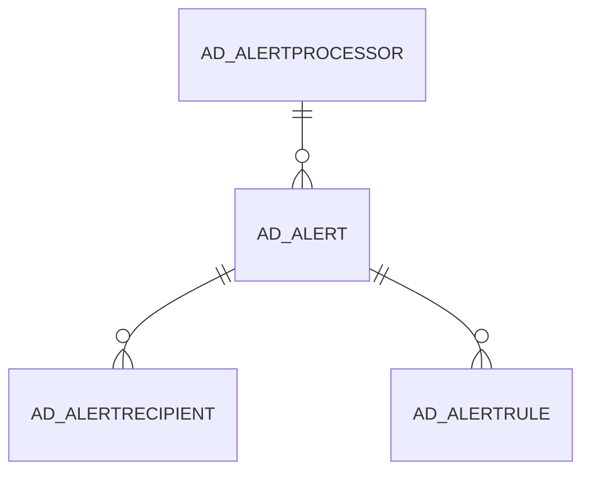

# AD_ALERT

Area [AD](../../data-model/ad/index.md) · class **config** (proposed) · read from database `idempiere-db` (owner `ADEMPIERE`) · 1 row(s) when profiled

Application model: `org.compiere.model.X_AD_Alert`, access level 6 - System - Client.

## Columns

| column | type | key | not null | business name | references (code) | nulls | distinct |
|---|---|---|---|---|---|---|---|
| `AD_ALERT_ID` | NUMBER(10,0) | PK | yes | Alert |  | 0 | 1 |
| `AD_CLIENT_ID` | NUMBER(10,0) |  | yes | Tenant |  | 0 | 1 |
| `AD_ORG_ID` | NUMBER(10,0) |  | yes | Organization |  | 0 | 1 |
| `ISACTIVE` | CHAR(1) |  | yes | Active |  | 0 | 1 |
| `CREATED` | DATE |  | yes | Created |  | 0 | 1 |
| `CREATEDBY` | NUMBER(10,0) |  | yes | Created By |  | 0 | 1 |
| `UPDATED` | DATE |  | yes | Updated |  | 0 | 1 |
| `UPDATEDBY` | NUMBER(10,0) |  | yes | Updated By |  | 0 | 1 |
| `NAME` | VARCHAR2(60 CHAR) |  | yes | Name |  | 0 | 1 |
| `DESCRIPTION` | VARCHAR2(255 CHAR) |  |  | Description |  | 0 | 1 |
| `HELP` | VARCHAR2(2000 CHAR) |  |  | Comment/Help |  | 1 | 0 |
| `ALERTMESSAGE` | VARCHAR2(2000 CHAR) |  | yes | Alert Message |  | 0 | 1 |
| `ENFORCECLIENTSECURITY` | CHAR(1) |  | yes | Enforce Tenant Security |  | 0 | 1 |
| `ENFORCEROLESECURITY` | CHAR(1) |  | yes | Enforce Role Security |  | 0 | 1 |
| `AD_ALERTPROCESSOR_ID` | NUMBER(10,0) |  |  | Alert Processor | [AD_ALERTPROCESSOR](../../data-model/ad/ad_alertprocessor.md) | 0 | 1 |
| `ISVALID` | CHAR(1) |  | yes | Valid |  | 0 | 1 |
| `AD_ALERT_UU` | VARCHAR2(36 CHAR) |  |  | AD_Alert_UU |  | 0 | 1 |
| `ALERTSUBJECT` | VARCHAR2(255 CHAR) |  | yes | Alert Subject |  | 0 | 1 |

*references (code)* is the table the application model's code says a column points to; *Foreign keys* below are the constraints the database declares. Counts come from the profile; no value is ever shown.

## Check constraints

| name | expression |
|---|---|
| `SYS_C0019494` | `EnforceRoleSecurity in ('Y','N')` |
| `SYS_C0019495` | `IsActive in ('Y','N')` |
| `SYS_C0019498` | `EnforceClientSecurity in ('Y','N')` |

## Foreign keys

**References**

| table | columns | on delete |
|---|---|---|
| [AD_ALERTPROCESSOR](../../data-model/ad/ad_alertprocessor.md) | AD_ALERT.AD_ALERTPROCESSOR_ID → AD_ALERTPROCESSOR.AD_ALERTPROCESSOR_ID | SET NULL |

**Referenced by**

| table | columns | on delete |
|---|---|---|
| [AD_ALERTRECIPIENT](../../data-model/ad/ad_alertrecipient.md) | AD_ALERTRECIPIENT.AD_ALERT_ID → AD_ALERT.AD_ALERT_ID | NO ACTION |
| [AD_ALERTRULE](../../data-model/ad/ad_alertrule.md) | AD_ALERTRULE.AD_ALERT_ID → AD_ALERT.AD_ALERT_ID | NO ACTION |

## Write behaviour

- updates: **raw_sql_skips_updated**
- deletes: **deleted_by_users**
- change log: **recorded**
- evidence: 2 citation(s)

## Schema history

33 change(s); the latest:

| applied | release | operation | column | tickets |
|---|---|---|---|---|
| 2023-04-09T15:47 | iD11 | `add_constraint` |  | IDEMPIERE-5567 |
| 2023-04-09T15:47 | iD11 | `add_constraint` |  | IDEMPIERE-5567 |
| 2021-12-05T16:45 | i8.2z | `drop_constraint` |  | IDEMPIERE-5075 |
| 2021-12-05T16:45 | i8.2z | `add_constraint` |  | IDEMPIERE-5075 |
| 2020-08-04T01:00 | i7.1z | `drop_column` | tmp_col_6_tmp | IDEMPIERE-3862 |
| 2020-08-04T01:00 | i7.1z | `modify_column` | NAME | IDEMPIERE-3862 |
| 2020-08-04T01:00 | i7.1z | `modify_column` | ALERTMESSAGE | IDEMPIERE-3862 |
| 2020-08-04T01:00 | i7.1z | `add_column` | tmp_col_6_tmp | IDEMPIERE-3862 |
| 2020-08-04T01:00 | i7.1z | `drop_column` | tmp_col_3_tmp | IDEMPIERE-3862 |
| 2020-08-04T01:00 | i7.1z | `modify_column` | AD_ALERT_UU | IDEMPIERE-3862 |
| 2020-08-04T01:00 | i7.1z | `add_column` | tmp_col_3_tmp | IDEMPIERE-3862 |
| 2020-08-04T01:00 | i7.1z | `drop_column` | tmp_col_4_tmp | IDEMPIERE-3862 |
| 2020-08-04T01:00 | i7.1z | `add_column` | tmp_col_5_tmp | IDEMPIERE-3862 |
| 2020-08-04T01:00 | i7.1z | `add_column` | tmp_col_1_tmp | IDEMPIERE-3862 |
| 2020-08-04T01:00 | i7.1z | `modify_column` | DESCRIPTION | IDEMPIERE-3862 |

## Open conflicts

| type | attribute | explanation |
|---|---|---|
| `mandatory_but_nullable` | `columns.AD_AlertProcessor_ID.nullable` | unexplained |

## Notes

<!-- ekos:manual id="table.ad_alert.notes" -->
_Business notes about this table._
<!-- /ekos:manual -->
