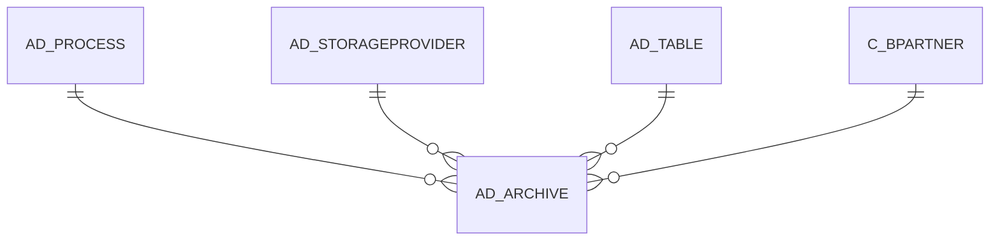

# AD_ARCHIVE

Area [AD](../../data-model/ad/index.md) · class **config** (proposed) · read from database `idempiere-db` (owner `ADEMPIERE`) · 0 row(s) when profiled

Application model: `org.compiere.model.X_AD_Archive`, access level 7 - System - Client - Org.

## Columns

| column | type | key | not null | business name | references (code) | nulls | distinct |
|---|---|---|---|---|---|---|---|
| `AD_ARCHIVE_ID` | NUMBER(10,0) | PK | yes | Archive |  | 0 | 0 |
| `AD_CLIENT_ID` | NUMBER(10,0) |  | yes | Tenant |  | 0 | 0 |
| `AD_ORG_ID` | NUMBER(10,0) |  | yes | Organization |  | 0 | 0 |
| `ISACTIVE` | CHAR(1) |  | yes | Active |  | 0 | 0 |
| `CREATED` | DATE |  | yes | Created |  | 0 | 0 |
| `CREATEDBY` | NUMBER(10,0) |  | yes | Created By |  | 0 | 0 |
| `UPDATED` | DATE |  | yes | Updated |  | 0 | 0 |
| `UPDATEDBY` | NUMBER(10,0) |  | yes | Updated By |  | 0 | 0 |
| `NAME` | VARCHAR2(60 CHAR) |  | yes | Name |  | 0 | 0 |
| `DESCRIPTION` | VARCHAR2(255 CHAR) |  |  | Description |  | 0 | 0 |
| `HELP` | VARCHAR2(2000 CHAR) |  |  | Comment/Help |  | 0 | 0 |
| `AD_TABLE_ID` | NUMBER(10,0) |  |  | Table | [AD_TABLE](../../data-model/ad/ad_table.md) | 0 | 0 |
| `RECORD_ID` | NUMBER(10,0) |  |  | Record ID |  | 0 | 0 |
| `AD_PROCESS_ID` | NUMBER(10,0) |  |  | Process | [AD_PROCESS](../../data-model/ad/ad_process.md) | 0 | 0 |
| `BINARYDATA` | BLOB |  |  | Binary Data |  | 0 |  |
| `C_BPARTNER_ID` | NUMBER(10,0) |  |  | Business Partner | [C_BPARTNER](../../data-model/c/c_bpartner.md) | 0 | 0 |
| `ISREPORT` | CHAR(1) |  | yes | Report |  | 0 | 0 |
| `AD_ARCHIVE_UU` | VARCHAR2(36 CHAR) |  |  | AD_Archive_UU |  | 0 | 0 |
| `AD_STORAGEPROVIDER_ID` | NUMBER(10,0) |  |  | Storage Provider | [AD_STORAGEPROVIDER](../../data-model/ad/ad_storageprovider.md) | 0 | 0 |
| `RECORD_UU` | VARCHAR2(36 CHAR) |  |  | Record UUID |  | 0 | 0 |

*references (code)* is the table the application model's code says a column points to; *Foreign keys* below are the constraints the database declares. Counts come from the profile; no value is ever shown.

## Check constraints

| name | expression |
|---|---|
| `SYS_C0022430` | `IsActive in ('Y','N')` |

## Foreign keys

**References**

| table | columns | on delete |
|---|---|---|
| [AD_PROCESS](../../data-model/ad/ad_process.md) | AD_ARCHIVE.AD_PROCESS_ID → AD_PROCESS.AD_PROCESS_ID | NO ACTION |
| [AD_STORAGEPROVIDER](../../data-model/ad/ad_storageprovider.md) | AD_ARCHIVE.AD_STORAGEPROVIDER_ID → AD_STORAGEPROVIDER.AD_STORAGEPROVIDER_ID | NO ACTION |
| [AD_TABLE](../../data-model/ad/ad_table.md) | AD_ARCHIVE.AD_TABLE_ID → AD_TABLE.AD_TABLE_ID | NO ACTION |
| [C_BPARTNER](../../data-model/c/c_bpartner.md) | AD_ARCHIVE.C_BPARTNER_ID → C_BPARTNER.C_BPARTNER_ID | NO ACTION |

**Referenced by**

_None._

## Write behaviour

- updates: **po_only**
- deletes: **deleted_by_app**
- change log: **recorded**
- evidence: 2 citation(s)

## Schema history

32 change(s); the latest:

| applied | release | operation | column | tickets |
|---|---|---|---|---|
| 2023-06-10T14:12 | iD11 | `create_index` |  |  |
| 2023-06-10T14:12 | iD11 | `add_column` | Record_UU |  |
| 2023-06-10T14:12 | iD11 | `create_index` |  |  |
| 2023-06-10T14:12 | iD11 | `add_column` | Record_UU |  |
| 2023-06-10T14:12 | iD11 | `create_index` |  |  |
| 2023-06-10T14:12 | iD11 | `create_index` |  |  |
| 2023-04-09T15:47 | iD11 | `add_constraint` |  | IDEMPIERE-5567 |
| 2023-04-09T15:47 | iD11 | `add_constraint` |  | IDEMPIERE-5567 |
| 2021-12-05T16:45 | i8.2z | `drop_constraint` |  | IDEMPIERE-5075 |
| 2021-12-05T16:45 | i8.2z | `add_constraint` |  | IDEMPIERE-5075 |
| 2021-12-05T16:45 | i8.2z | `drop_constraint` |  | IDEMPIERE-5075 |
| 2021-12-05T16:45 | i8.2z | `drop_constraint` |  | IDEMPIERE-5075 |
| 2021-12-05T16:45 | i8.2z | `add_constraint` |  | IDEMPIERE-5075 |
| 2021-12-05T16:45 | i8.2z | `add_constraint` |  | IDEMPIERE-5075 |
| 2021-04-16T22:11 | i8.2 | `add_column` | AD_StorageProvider_ID | IDEMPIERE-4762 |

## Open conflicts

| type | attribute | explanation |
|---|---|---|
| `mandatory_but_nullable` | `columns.BinaryData.nullable` | unexplained |

## Notes

<!-- ekos:manual id="table.ad_archive.notes" -->
_Business notes about this table._
<!-- /ekos:manual -->
