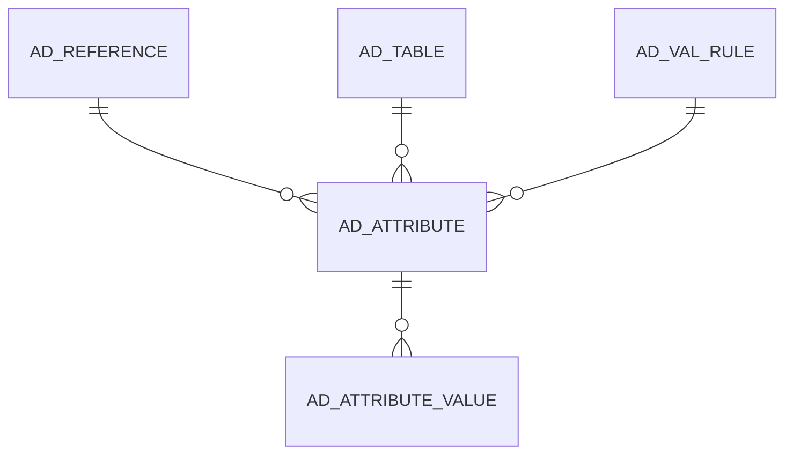

# AD_ATTRIBUTE

User Defined Attributes

Area [AD](../../data-model/ad/index.md) · class **config** (proposed) · read from database `idempiere-db` (owner `ADEMPIERE`) · 0 row(s) when profiled

Application model: `org.compiere.model.X_AD_Attribute`, access level 7 - System - Client - Org.

## Columns

| column | type | key | not null | business name | references (code) | nulls | distinct |
|---|---|---|---|---|---|---|---|
| `AD_ATTRIBUTE_ID` | NUMBER(10,0) | PK | yes | System Attribute |  | 0 | 0 |
| `AD_CLIENT_ID` | NUMBER(10,0) |  | yes | Tenant |  | 0 | 0 |
| `AD_ORG_ID` | NUMBER(10,0) |  | yes | Organization |  | 0 | 0 |
| `ISACTIVE` | CHAR(1) |  | yes | Active |  | 0 | 0 |
| `CREATED` | DATE |  | yes | Created |  | 0 | 0 |
| `CREATEDBY` | NUMBER(10,0) |  | yes | Created By |  | 0 | 0 |
| `UPDATED` | DATE |  | yes | Updated |  | 0 | 0 |
| `UPDATEDBY` | NUMBER(10,0) |  | yes | Updated By |  | 0 | 0 |
| `NAME` | VARCHAR2(60 CHAR) |  | yes | Name |  | 0 | 0 |
| `DESCRIPTION` | VARCHAR2(255 CHAR) |  |  | Description |  | 0 | 0 |
| `HELP` | VARCHAR2(2000 CHAR) |  |  | Comment/Help |  | 0 | 0 |
| `AD_TABLE_ID` | NUMBER(10,0) |  | yes | Table | [AD_TABLE](../../data-model/ad/ad_table.md) | 0 | 0 |
| `AD_REFERENCE_ID` | NUMBER(10,0) |  | yes | Reference | [AD_REFERENCE](../../data-model/ad/ad_reference.md) | 0 | 0 |
| `AD_REFERENCE_VALUE_ID` | NUMBER(10,0) |  |  | Reference Key | [AD_REFERENCE](../../data-model/ad/ad_reference.md) | 0 | 0 |
| `AD_VAL_RULE_ID` | NUMBER(10,0) |  |  | Dynamic Validation | [AD_VAL_RULE](../../data-model/ad/ad_val_rule.md) | 0 | 0 |
| `CALLOUT` | VARCHAR2(60 CHAR) |  |  | Callout |  | 0 | 0 |
| `VALUEMIN` | VARCHAR2(20 CHAR) |  |  | Min. Value |  | 0 | 0 |
| `VALUEMAX` | VARCHAR2(20 CHAR) |  |  | Max. Value |  | 0 | 0 |
| `DEFAULTVALUE` | VARCHAR2(2000 CHAR) |  |  | Default Logic |  | 0 | 0 |
| `ISREADONLY` | CHAR(1) |  | yes | Read Only |  | 0 | 0 |
| `ISUPDATEABLE` | CHAR(1) |  | yes | Updatable |  | 0 | 0 |
| `ISMANDATORY` | CHAR(1) |  | yes | Mandatory |  | 0 | 0 |
| `ISENCRYPTED` | CHAR(1) |  | yes | Encrypted |  | 0 | 0 |
| `FIELDLENGTH` | NUMBER(10,0) |  |  | Length |  | 0 | 0 |
| `DISPLAYLENGTH` | NUMBER(10,0) |  |  | Display Length |  | 0 | 0 |
| `DISPLAYLOGIC` | VARCHAR2(2000 CHAR) |  |  | Display Logic |  | 0 | 0 |
| `VFORMAT` | VARCHAR2(60 CHAR) |  |  | Value Format |  | 0 | 0 |
| `ISSAMELINE` | CHAR(1) |  | yes | Same Line |  | 0 | 0 |
| `ISHEADING` | CHAR(1) |  | yes | Heading only |  | 0 | 0 |
| `ISFIELDONLY` | CHAR(1) |  | yes | Field Only |  | 0 | 0 |
| `SEQNO` | NUMBER(10,0) |  |  | Sequence |  | 0 | 0 |
| `AD_ATTRIBUTE_UU` | VARCHAR2(36 CHAR) |  |  | AD_Attribute_UU |  | 0 | 0 |

*references (code)* is the table the application model's code says a column points to; *Foreign keys* below are the constraints the database declares. Counts come from the profile; no value is ever shown.

## Check constraints

| name | expression |
|---|---|
| `SYS_C0019725` | `IsHeading in ('Y','N')` |
| `SYS_C0019726` | `IsFieldOnly in ('Y','N')` |
| `SYS_C0019727` | `IsReadOnly in ('Y','N')` |
| `SYS_C0019728` | `IsActive in ('Y','N')` |
| `SYS_C0019729` | `IsUpdateable in ('Y','N')` |
| `SYS_C0019730` | `IsMandatory in ('Y','N')` |
| `SYS_C0019731` | `IsSameLine in ('Y','N')` |
| `SYS_C0019732` | `IsEncrypted in ('Y','N')` |

## Foreign keys

**References**

| table | columns | on delete |
|---|---|---|
| [AD_REFERENCE](../../data-model/ad/ad_reference.md) | AD_ATTRIBUTE.AD_REFERENCE_VALUE_ID → AD_REFERENCE.AD_REFERENCE_ID | NO ACTION |
| [AD_TABLE](../../data-model/ad/ad_table.md) | AD_ATTRIBUTE.AD_TABLE_ID → AD_TABLE.AD_TABLE_ID | CASCADE |
| [AD_VAL_RULE](../../data-model/ad/ad_val_rule.md) | AD_ATTRIBUTE.AD_VAL_RULE_ID → AD_VAL_RULE.AD_VAL_RULE_ID | SET NULL |

**Referenced by**

| table | columns | on delete |
|---|---|---|
| [AD_ATTRIBUTE_VALUE](../../data-model/ad/ad_attribute_value.md) | AD_ATTRIBUTE_VALUE.AD_ATTRIBUTE_ID → AD_ATTRIBUTE.AD_ATTRIBUTE_ID | CASCADE |

## Write behaviour

- updates: **po_only**
- deletes: **deleted_by_users, deleted_by_cascade**
- change log: **recorded**
- evidence: 2 citation(s)

## Schema history

42 change(s); the latest:

| applied | release | operation | column | tickets |
|---|---|---|---|---|
| 2023-04-09T15:47 | iD11 | `add_constraint` |  | IDEMPIERE-5567 |
| 2023-04-09T15:47 | iD11 | `add_constraint` |  | IDEMPIERE-5567 |
| 2021-12-05T16:45 | i8.2z | `drop_constraint` |  | IDEMPIERE-5075 |
| 2021-12-05T16:45 | i8.2z | `add_constraint` |  | IDEMPIERE-5075 |
| 2021-12-05T16:45 | i8.2z | `add_constraint` |  | IDEMPIERE-5075 |
| 2021-12-05T16:45 | i8.2z | `drop_constraint` |  | IDEMPIERE-5075 |
| 2021-12-05T16:45 | i8.2z | `drop_constraint` |  | IDEMPIERE-5075 |
| 2021-12-05T16:45 | i8.2z | `add_constraint` |  | IDEMPIERE-5075 |
| 2021-12-05T16:45 | i8.2z | `add_constraint` |  | IDEMPIERE-5075 |
| 2021-12-05T16:45 | i8.2z | `drop_constraint` |  | IDEMPIERE-5075 |
| 2020-08-04T01:00 | i7.1z | `drop_column` | tmp_col_2_tmp | IDEMPIERE-3862 |
| 2020-08-04T01:00 | i7.1z | `modify_column` | VALUEMIN | IDEMPIERE-3862 |
| 2020-08-04T01:00 | i7.1z | `add_column` | tmp_col_1_tmp | IDEMPIERE-3862 |
| 2020-08-04T01:00 | i7.1z | `modify_column` | NAME | IDEMPIERE-3862 |
| 2020-08-04T01:00 | i7.1z | `drop_column` | tmp_col_5_tmp | IDEMPIERE-3862 |

## Notes

<!-- ekos:manual id="table.ad_attribute.notes" -->
_Business notes about this table._
<!-- /ekos:manual -->
