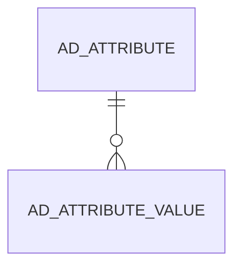

# AD_ATTRIBUTE_VALUE

Values for user defined attributes

Area [AD](../../data-model/ad/index.md) · class **config** (proposed) · read from database `idempiere-db` (owner `ADEMPIERE`) · 0 row(s) when profiled

Application model: `org.compiere.model.X_AD_Attribute_Value`, access level 7 - System - Client - Org.

## Columns

| column | type | key | not null | business name | references (code) | nulls | distinct |
|---|---|---|---|---|---|---|---|
| `AD_ATTRIBUTE_ID` | NUMBER(10,0) | PK | yes | System Attribute |  | 0 | 0 |
| `RECORD_ID` | NUMBER(10,0) | PK | yes | Record ID |  | 0 | 0 |
| `V_NUMBER` | NUMBER |  |  | Number |  | 0 | 0 |
| `V_DATE` | DATE |  |  | Date |  | 0 | 0 |
| `V_STRING` | VARCHAR2(2000 CHAR) |  |  | String |  | 0 | 0 |
| `AD_ATTRIBUTE_VALUE_UU` | VARCHAR2(36 CHAR) |  |  | AD_Attribute_Value_UU |  | 0 | 0 |

*references (code)* is the table the application model's code says a column points to; *Foreign keys* below are the constraints the database declares. Counts come from the profile; no value is ever shown.

## Foreign keys

**References**

| table | columns | on delete |
|---|---|---|
| [AD_ATTRIBUTE](../../data-model/ad/ad_attribute.md) | AD_ATTRIBUTE_VALUE.AD_ATTRIBUTE_ID → AD_ATTRIBUTE.AD_ATTRIBUTE_ID | CASCADE |

**Referenced by**

_None._

## Write behaviour

- updates: **no_updated_column**
- deletes: **deleted_by_users, deleted_by_cascade**
- change log: **not_recorded**
- evidence: 2 citation(s)

## Schema history

10 change(s); the latest:

| applied | release | operation | column | tickets |
|---|---|---|---|---|
| 2023-04-09T15:47 | iD11 | `add_constraint` |  | IDEMPIERE-5567 |
| 2023-04-09T15:47 | iD11 | `add_constraint` |  | IDEMPIERE-5567 |
| 2021-12-05T16:45 | i8.2z | `drop_constraint` |  | IDEMPIERE-5075 |
| 2021-12-05T16:45 | i8.2z | `add_constraint` |  | IDEMPIERE-5075 |
| 2020-08-04T01:00 | i7.1z | `add_column` | tmp_col_1_tmp | IDEMPIERE-3862 |
| 2020-08-04T01:00 | i7.1z | `add_column` | tmp_col_2_tmp | IDEMPIERE-3862 |
| 2020-08-04T01:00 | i7.1z | `modify_column` | AD_ATTRIBUTE_VALUE_UU | IDEMPIERE-3862 |
| 2020-08-04T01:00 | i7.1z | `drop_column` | tmp_col_1_tmp | IDEMPIERE-3862 |
| 2020-08-04T01:00 | i7.1z | `modify_column` | V_STRING | IDEMPIERE-3862 |
| 2020-08-04T01:00 | i7.1z | `drop_column` | tmp_col_2_tmp | IDEMPIERE-3862 |

## Notes

<!-- ekos:manual id="table.ad_attribute_value.notes" -->
_Business notes about this table._
<!-- /ekos:manual -->
