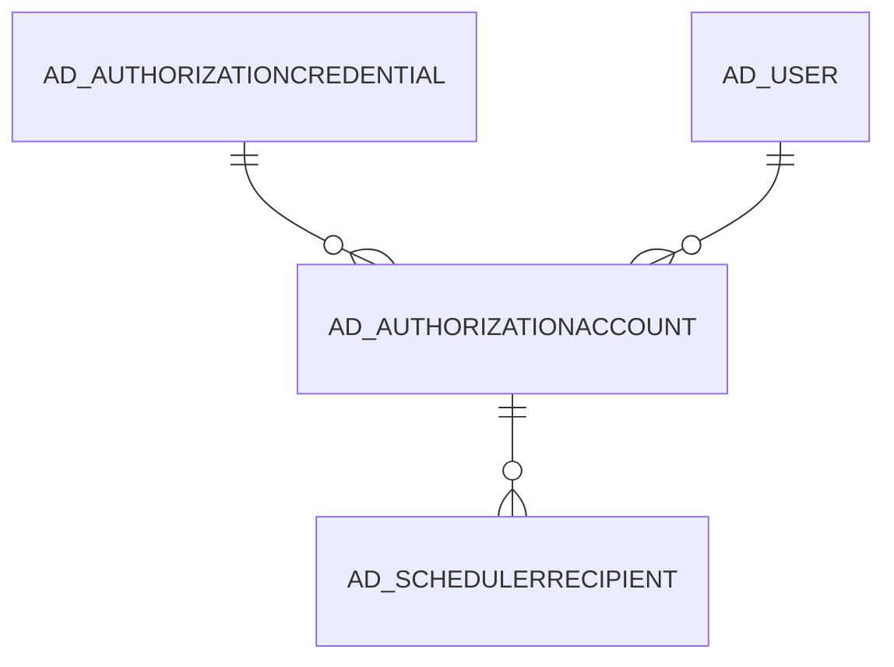

# AD_AUTHORIZATIONACCOUNT

Area [AD](../../data-model/ad/index.md) · class **config** (proposed) · read from database `idempiere-db` (owner `ADEMPIERE`) · 0 row(s) when profiled

Application model: `org.compiere.model.X_AD_AuthorizationAccount`, access level 6 - System - Client.

## Columns

| column | type | key | not null | business name | references (code) | nulls | distinct |
|---|---|---|---|---|---|---|---|
| `AD_AUTHORIZATIONACCOUNT_ID` | NUMBER(10,0) | PK | yes | Authorization Account |  | 0 | 0 |
| `AD_CLIENT_ID` | NUMBER(10,0) |  | yes | Tenant |  | 0 | 0 |
| `AD_ORG_ID` | NUMBER(10,0) |  | yes | Organization |  | 0 | 0 |
| `CREATED` | DATE |  | yes | Created |  | 0 | 0 |
| `CREATEDBY` | NUMBER(10,0) |  | yes | Created By |  | 0 | 0 |
| `HELP` | VARCHAR2(2000 CHAR) |  |  | Comment/Help |  | 0 | 0 |
| `ISACTIVE` | CHAR(1) |  | yes | Active |  | 0 | 0 |
| `AD_AUTHORIZATIONACCOUNT_UU` | VARCHAR2(36 CHAR) |  |  | AD_AuthorizationAccount_UU |  | 0 | 0 |
| `UPDATED` | DATE |  | yes | Updated |  | 0 | 0 |
| `UPDATEDBY` | NUMBER(10,0) |  | yes | Updated By |  | 0 | 0 |
| `EMAIL` | VARCHAR2(200 CHAR) |  |  | EMail Address |  | 0 | 0 |
| `REFRESHTOKEN` | VARCHAR2(4000 CHAR) |  |  | Refresh Token |  | 0 | 0 |
| `EXPIREINSECONDS` | NUMBER |  |  | Expire in Seconds |  | 0 | 0 |
| `AD_AUTHORIZATIONSCOPE` | VARCHAR2(10 CHAR) |  |  |  |  | 0 | 0 |
| `ACCESSTOKENTIMESTAMP` | DATE |  |  | Access Token Timestamp |  | 0 | 0 |
| `ISAUTHORIZED` | CHAR(1) |  | yes | Authorized |  | 0 | 0 |
| `AD_AUTHORIZATIONCREDENTIAL_ID` | NUMBER(10,0) |  |  | Authorization Credential | [AD_AUTHORIZATIONCREDENTIAL](../../data-model/ad/ad_authorizationcredential.md) | 0 | 0 |
| `ISACCESSREVOKED` | CHAR(1) |  | yes | Access Revoked |  | 0 | 0 |
| `AD_USER_ID` | NUMBER(10,0) |  |  | User/Contact | [AD_USER](../../data-model/ad/ad_user.md) | 0 | 0 |
| `AD_AUTHORIZATIONSCOPES` | VARCHAR2(255 CHAR) |  |  | Authorization Scopes |  | 0 | 0 |
| `ACCESSTOKEN` | CLOB |  |  | Access Token |  | 0 |  |
| `PREFERRED_USERNAME` | VARCHAR2(1000 CHAR) |  |  | Preferred User Name |  | 0 | 0 |

*references (code)* is the table the application model's code says a column points to; *Foreign keys* below are the constraints the database declares. Counts come from the profile; no value is ever shown.

## Check constraints

| name | expression |
|---|---|
| `SYS_C0019897` | `IsActive IN ('Y','N')` |
| `SYS_C0019898` | `IsAccessRevoked IN ('Y','N')` |
| `SYS_C0019900` | `IsAuthorized IN ('Y','N')` |

## Foreign keys

**References**

| table | columns | on delete |
|---|---|---|
| [AD_AUTHORIZATIONCREDENTIAL](../../data-model/ad/ad_authorizationcredential.md) | AD_AUTHORIZATIONACCOUNT.AD_AUTHORIZATIONCREDENTIAL_ID → AD_AUTHORIZATIONCREDENTIAL.AD_AUTHORIZATIONCREDENTIAL_ID | NO ACTION |
| [AD_USER](../../data-model/ad/ad_user.md) | AD_AUTHORIZATIONACCOUNT.AD_USER_ID → AD_USER.AD_USER_ID | NO ACTION |

**Referenced by**

| table | columns | on delete |
|---|---|---|
| [AD_SCHEDULERRECIPIENT](../../data-model/ad/ad_schedulerrecipient.md) | AD_SCHEDULERRECIPIENT.AD_AUTHORIZATIONACCOUNT_ID → AD_AUTHORIZATIONACCOUNT.AD_AUTHORIZATIONACCOUNT_ID | NO ACTION |

## Write behaviour

- updates: **raw_sql_skips_updated**
- deletes: **deleted_by_users**
- change log: **recorded**
- evidence: 2 citation(s)

## Schema history

59 change(s); the latest:

| applied | release | operation | column | tickets |
|---|---|---|---|---|
| 2022-09-06T18:39 | i9 | `add_column` | Preferred_UserName | IDEMPIERE-5354 |
| 2022-09-06T18:39 | i9 | `add_column` | Preferred_UserName | IDEMPIERE-5354 |
| 2022-01-30T23:36 | i9 | `add_column` | Tmp_AccessToken | IDEMPIERE-5168 |
| 2022-01-30T23:36 | i9 | `modify_column` | AccessToken | IDEMPIERE-5168 |
| 2022-01-30T23:36 | i9 | `drop_column` | AccessToken | IDEMPIERE-5168 |
| 2022-01-30T23:36 | i9 | `modify_column` | AccessToken | IDEMPIERE-5168 |
| 2022-01-30T23:36 | i9 | `rename_column` | Tmp_AccessToken | IDEMPIERE-5168 |
| 2021-05-09T10:48 | i8.2z | `add_column` | AD_AuthorizationScopes | IDEMPIERE-4771 |
| 2021-05-09T10:48 | i8.2z | `add_column` | AD_AuthorizationScopes | IDEMPIERE-4771 |
| 2021-02-24T18:58 | i8.2 | `add_column` | ExpireInSeconds | IDEMPIERE-3101 |
| 2021-02-24T18:58 | i8.2 | `add_column` | IsActive | IDEMPIERE-3101 |
| 2021-02-24T18:58 | i8.2 | `modify_column` | RefreshToken | IDEMPIERE-3101 |
| 2021-02-24T18:58 | i8.2 | `add_column` | IsActive | IDEMPIERE-3101 |
| 2021-02-24T18:58 | i8.2 | `add_column` | AD_Org_ID | IDEMPIERE-3101 |
| 2021-02-24T18:58 | i8.2 | `add_constraint` |  | IDEMPIERE-3101 |

## Notes

<!-- ekos:manual id="table.ad_authorizationaccount.notes" -->
_Business notes about this table._
<!-- /ekos:manual -->
