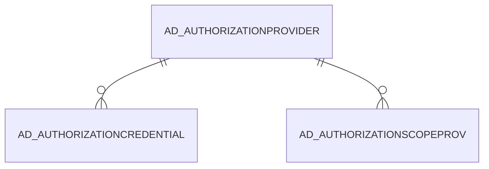

# AD_AUTHORIZATIONPROVIDER

Area [AD](../../data-model/ad/index.md) · class **config** (proposed) · read from database `idempiere-db` (owner `ADEMPIERE`) · 2 row(s) when profiled

Application model: `org.compiere.model.X_AD_AuthorizationProvider`, access level 6 - System - Client.

## Columns

| column | type | key | not null | business name | references (code) | nulls | distinct |
|---|---|---|---|---|---|---|---|
| `AD_AUTHORIZATIONPROVIDER_ID` | NUMBER(10,0) | PK | yes | Authorization Provider |  | 0 | 2 |
| `AD_CLIENT_ID` | NUMBER(10,0) |  | yes | Tenant |  | 0 | 1 |
| `AD_ORG_ID` | NUMBER(10,0) |  | yes | Organization |  | 0 | 1 |
| `CREATED` | DATE |  | yes | Created |  | 0 | 2 |
| `CREATEDBY` | NUMBER(10,0) |  | yes | Created By |  | 0 | 1 |
| `DESCRIPTION` | VARCHAR2(255 CHAR) |  |  | Description |  | 2 | 0 |
| `HELP` | VARCHAR2(2000 CHAR) |  |  | Comment/Help |  | 2 | 0 |
| `ISACTIVE` | CHAR(1) |  | yes | Active |  | 0 | 1 |
| `AD_AUTHORIZATIONPROVIDER_UU` | VARCHAR2(36 CHAR) |  |  | AD_AuthorizationProvider_UU |  | 0 | 2 |
| `NAME` | VARCHAR2(60 CHAR) |  | yes | Name |  | 0 | 2 |
| `UPDATED` | DATE |  | yes | Updated |  | 0 | 2 |
| `UPDATEDBY` | NUMBER(10,0) |  | yes | Updated By |  | 0 | 1 |
| `AUTHORIZATIONENDPOINT` | VARCHAR2(2000 CHAR) |  | yes | Authorization Endpoint |  | 0 | 2 |
| `TOKENENDPOINT` | VARCHAR2(2000 CHAR) |  | yes | Token Endpoint |  | 0 | 2 |
| `REVOKEENDPOINT` | VARCHAR2(2000 CHAR) |  |  | Revoke Endpoint |  | 1 | 1 |
| `AD_AUTHORIZATIONTYPE` | VARCHAR2(10 CHAR) |  | yes | Authorization Type |  | 0 | 1 |

*references (code)* is the table the application model's code says a column points to; *Foreign keys* below are the constraints the database declares. Counts come from the profile; no value is ever shown.

## Check constraints

| name | expression |
|---|---|
| `SYS_C0020851` | `IsActive IN ('Y','N')` |

## Foreign keys

**References**

_None._

**Referenced by**

| table | columns | on delete |
|---|---|---|
| [AD_AUTHORIZATIONCREDENTIAL](../../data-model/ad/ad_authorizationcredential.md) | AD_AUTHORIZATIONCREDENTIAL.AD_AUTHORIZATIONPROVIDER_ID → AD_AUTHORIZATIONPROVIDER.AD_AUTHORIZATIONPROVIDER_ID | NO ACTION |
| [AD_AUTHORIZATIONSCOPEPROV](../../data-model/ad/ad_authorizationscopeprov.md) | AD_AUTHORIZATIONSCOPEPROV.AD_AUTHORIZATIONPROVIDER_ID → AD_AUTHORIZATIONPROVIDER.AD_AUTHORIZATIONPROVIDER_ID | NO ACTION |

## Write behaviour

- updates: **po_only**
- deletes: **deleted_by_users**
- change log: **recorded**
- evidence: 1 citation(s)

## Schema history

44 change(s); the latest:

| applied | release | operation | column | tickets |
|---|---|---|---|---|
| 2021-02-24T18:58 | i8.2 | `add_column` | AD_AuthorizationType | IDEMPIERE-3101 |
| 2021-02-24T18:58 | i8.2 | `add_column` | Created | IDEMPIERE-3101 |
| 2021-02-24T18:58 | i8.2 | `add_column` | AD_Org_ID | IDEMPIERE-3101 |
| 2021-02-24T18:58 | i8.2 | `add_column` | AD_Org_ID | IDEMPIERE-3101 |
| 2021-02-24T18:58 | i8.2 | `modify_column` | TokenEndpoint | IDEMPIERE-3101 |
| 2021-02-24T18:58 | i8.2 | `add_column` | AD_AuthorizationType | IDEMPIERE-3101 |
| 2021-02-24T18:58 | i8.2 | `add_column` | Description | IDEMPIERE-3101 |
| 2021-02-24T18:58 | i8.2 | `add_column` | UpdatedBy | IDEMPIERE-3101 |
| 2021-02-24T18:58 | i8.2 | `add_column` | Created | IDEMPIERE-3101 |
| 2021-02-24T18:58 | i8.2 | `modify_column` | AuthorizationEndpoint | IDEMPIERE-3101 |
| 2021-02-24T18:58 | i8.2 | `modify_column` | TokenEndpoint | IDEMPIERE-3101 |
| 2021-02-24T18:58 | i8.2 | `add_column` | CreatedBy | IDEMPIERE-3101 |
| 2021-02-24T18:58 | i8.2 | `create_table` |  | IDEMPIERE-3101 |
| 2021-02-24T18:58 | i8.2 | `modify_column` | AuthorizationEndpoint | IDEMPIERE-3101 |
| 2021-02-24T18:58 | i8.2 | `create_table` |  | IDEMPIERE-3101 |

## Notes

<!-- ekos:manual id="table.ad_authorizationprovider.notes" -->
_Business notes about this table._
<!-- /ekos:manual -->
