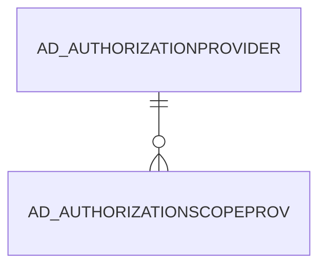

# AD_AUTHORIZATIONSCOPEPROV

Area [AD](../../data-model/ad/index.md) · class **config** (proposed) · read from database `idempiere-db` (owner `ADEMPIERE`) · 3 row(s) when profiled

Application model: `org.compiere.model.X_AD_AuthorizationScopeProv`, access level 6 - System - Client.

## Columns

| column | type | key | not null | business name | references (code) | nulls | distinct |
|---|---|---|---|---|---|---|---|
| `AD_AUTHORIZATIONSCOPEPROV_ID` | NUMBER(10,0) | PK | yes | Authorization Scope Provider |  | 0 | 3 |
| `AD_CLIENT_ID` | NUMBER(10,0) |  | yes | Tenant |  | 0 | 1 |
| `AD_ORG_ID` | NUMBER(10,0) |  | yes | Organization |  | 0 | 1 |
| `CREATED` | DATE |  | yes | Created |  | 0 | 3 |
| `CREATEDBY` | NUMBER(10,0) |  | yes | Created By |  | 0 | 1 |
| `ISACTIVE` | CHAR(1) |  | yes | Active |  | 0 | 1 |
| `AD_AUTHORIZATIONSCOPEPROV_UU` | VARCHAR2(36 CHAR) |  |  | AD_AuthorizationScopeProv_UU |  | 0 | 3 |
| `UPDATED` | DATE |  | yes | Updated |  | 0 | 3 |
| `UPDATEDBY` | NUMBER(10,0) |  | yes | Updated By |  | 0 | 1 |
| `AD_AUTHORIZATIONPROVIDER_ID` | NUMBER(10,0) |  |  | Authorization Provider | [AD_AUTHORIZATIONPROVIDER](../../data-model/ad/ad_authorizationprovider.md) | 0 | 2 |
| `AD_AUTHORIZATIONSCOPE` | VARCHAR2(10 CHAR) |  | yes | Authorization Scope |  | 0 | 2 |
| `SCOPEURL` | VARCHAR2(2000 CHAR) |  | yes | Scope URL |  | 0 | 3 |

*references (code)* is the table the application model's code says a column points to; *Foreign keys* below are the constraints the database declares. Counts come from the profile; no value is ever shown.

## Check constraints

| name | expression |
|---|---|
| `SYS_C0021672` | `IsActive IN ('Y','N')` |

## Foreign keys

**References**

| table | columns | on delete |
|---|---|---|
| [AD_AUTHORIZATIONPROVIDER](../../data-model/ad/ad_authorizationprovider.md) | AD_AUTHORIZATIONSCOPEPROV.AD_AUTHORIZATIONPROVIDER_ID → AD_AUTHORIZATIONPROVIDER.AD_AUTHORIZATIONPROVIDER_ID | NO ACTION |

**Referenced by**

_None._

## Write behaviour

- updates: **po_only**
- deletes: **deleted_by_users**
- change log: **recorded**
- evidence: 1 citation(s)

## Schema history

38 change(s); the latest:

| applied | release | operation | column | tickets |
|---|---|---|---|---|
| 2021-02-24T18:58 | i8.2 | `add_column` | CreatedBy | IDEMPIERE-3101 |
| 2021-02-24T18:58 | i8.2 | `create_table` |  | IDEMPIERE-3101 |
| 2021-02-24T18:58 | i8.2 | `create_index` |  | IDEMPIERE-3101 |
| 2021-02-24T18:58 | i8.2 | `add_column` | AD_Org_ID | IDEMPIERE-3101 |
| 2021-02-24T18:58 | i8.2 | `add_constraint` |  | IDEMPIERE-3101 |
| 2021-02-24T18:58 | i8.2 | `add_column` | AD_AuthorizationScope | IDEMPIERE-3101 |
| 2021-02-24T18:58 | i8.2 | `add_column` | UpdatedBy | IDEMPIERE-3101 |
| 2021-02-24T18:58 | i8.2 | `add_column` | Created | IDEMPIERE-3101 |
| 2021-02-24T18:58 | i8.2 | `create_index` |  | IDEMPIERE-3101 |
| 2021-02-24T18:58 | i8.2 | `add_column` | AD_Client_ID | IDEMPIERE-3101 |
| 2021-02-24T18:58 | i8.2 | `add_column` | AD_Org_ID | IDEMPIERE-3101 |
| 2021-02-24T18:58 | i8.2 | `add_column` | Updated | IDEMPIERE-3101 |
| 2021-02-24T18:58 | i8.2 | `modify_column` | AD_AuthorizationScope | IDEMPIERE-3101 |
| 2021-02-24T18:58 | i8.2 | `add_column` | UpdatedBy | IDEMPIERE-3101 |
| 2021-02-24T18:58 | i8.2 | `add_column` | ScopeURL | IDEMPIERE-3101 |

## Notes

<!-- ekos:manual id="table.ad_authorizationscopeprov.notes" -->
_Business notes about this table._
<!-- /ekos:manual -->
