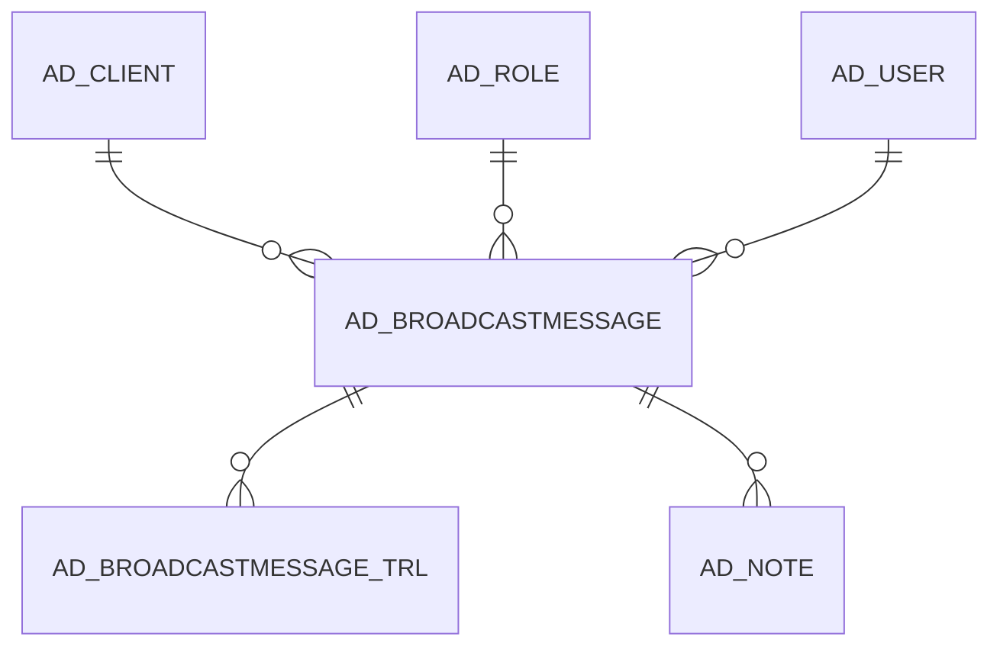

# AD_BROADCASTMESSAGE

Area [AD](../../data-model/ad/index.md) · class **config** (proposed) · read from database `idempiere-db` (owner `ADEMPIERE`) · 0 row(s) when profiled

Application model: `org.compiere.model.X_AD_BroadcastMessage`, access level 6 - System - Client.

## Columns

| column | type | key | not null | business name | references (code) | nulls | distinct |
|---|---|---|---|---|---|---|---|
| `AD_CLIENT_ID` | NUMBER(10,0) |  | yes | Tenant |  | 0 | 0 |
| `AD_ORG_ID` | NUMBER(10,0) |  | yes | Organization |  | 0 | 0 |
| `ISACTIVE` | CHAR(1) |  | yes | Active |  | 0 | 0 |
| `CREATED` | DATE |  | yes | Created |  | 0 | 0 |
| `CREATEDBY` | NUMBER(10,0) |  | yes | Created By |  | 0 | 0 |
| `UPDATED` | DATE |  | yes | Updated |  | 0 | 0 |
| `UPDATEDBY` | NUMBER(10,0) |  | yes | Updated By |  | 0 | 0 |
| `BROADCASTFREQUENCY` | VARCHAR2(60 CHAR) |  | yes | Broadcast Frequency |  | 0 | 0 |
| `BROADCASTTYPE` | VARCHAR2(32 CHAR) |  | yes | Broadcast Type |  | 0 | 0 |
| `EXPIRATION` | DATE |  |  | Expire On |  | 0 | 0 |
| `LOGACKNOWLEDGE` | CHAR(1) |  | yes | Log Acknowledge |  | 0 | 0 |
| `TARGET` | VARCHAR2(60 CHAR) |  | yes | Target |  | 0 | 0 |
| `AD_ROLE_ID` | NUMBER(10,0) |  |  | Role | [AD_ROLE](../../data-model/ad/ad_role.md) | 0 | 0 |
| `AD_USER_ID` | NUMBER(10,0) |  |  | User/Contact | [AD_USER](../../data-model/ad/ad_user.md) | 0 | 0 |
| `TESTMESSAGE` | CHAR(1) |  |  | Test Message |  | 0 | 0 |
| `PUBLISH` | CHAR(1) |  |  | Publish |  | 0 | 0 |
| `EXPIRENOW` | CHAR(1) |  |  | Expire Now |  | 0 | 0 |
| `AD_BROADCASTMESSAGE_ID` | NUMBER(10,0) | PK | yes | Broadcast Message |  | 0 | 0 |
| `ISPUBLISHED` | CHAR(1) |  |  | Published |  | 0 | 0 |
| `PROCESSED` | CHAR(1) |  |  | Processed |  | 0 | 0 |
| `EXPIRED` | CHAR(1) |  |  | Expired |  | 0 | 0 |
| `AD_BROADCASTMESSAGE_UU` | VARCHAR2(36 CHAR) |  |  | AD_BroadcastMessage_UU |  | 0 | 0 |
| `NOTIFICATION_CLIENT_ID` | NUMBER(10,0) |  |  | Notification Tenant |  | 0 | 0 |
| `TITLE` | VARCHAR2(60 CHAR) |  |  | Title |  | 0 | 0 |
| `BROADCASTMESSAGE` | CLOB |  |  | Broadcast Message |  | 0 |  |

*references (code)* is the table the application model's code says a column points to; *Foreign keys* below are the constraints the database declares. Counts come from the profile; no value is ever shown.

## Check constraints

| name | expression |
|---|---|
| `SYS_C0020600` | `processed  IN ('Y','N')` |
| `SYS_C0020601` | `ispublished  IN ('Y','N')` |
| `SYS_C0020602` | `IsActive  IN ('Y','N')` |
| `SYS_C0020603` | `logacknowledge  IN ('Y','N')` |
| `SYS_C0020604` | `expired  IN ('Y','N')` |

## Foreign keys

**References**

| table | columns | on delete |
|---|---|---|
| [AD_CLIENT](../../data-model/ad/ad_client.md) | AD_BROADCASTMESSAGE.NOTIFICATION_CLIENT_ID → AD_CLIENT.AD_CLIENT_ID | NO ACTION |
| [AD_ROLE](../../data-model/ad/ad_role.md) | AD_BROADCASTMESSAGE.AD_ROLE_ID → AD_ROLE.AD_ROLE_ID | NO ACTION |
| [AD_USER](../../data-model/ad/ad_user.md) | AD_BROADCASTMESSAGE.AD_USER_ID → AD_USER.AD_USER_ID | NO ACTION |

**Referenced by**

| table | columns | on delete |
|---|---|---|
| [AD_BROADCASTMESSAGE_TRL](../../data-model/ad/ad_broadcastmessage_trl.md) | AD_BROADCASTMESSAGE_TRL.AD_BROADCASTMESSAGE_ID → AD_BROADCASTMESSAGE.AD_BROADCASTMESSAGE_ID | CASCADE |
| [AD_NOTE](../../data-model/ad/ad_note.md) | AD_NOTE.AD_BROADCASTMESSAGE_ID → AD_BROADCASTMESSAGE.AD_BROADCASTMESSAGE_ID | NO ACTION |

## Write behaviour

- updates: **po_only**
- deletes: **deleted_by_users**
- change log: **recorded**
- evidence: 1 citation(s)

## Schema history

58 change(s); the latest:

| applied | release | operation | column | tickets |
|---|---|---|---|---|
| 2023-09-11T13:58 | iD11 | `modify_column` | BroadcastMessage | IDEMPIERE-5852 |
| 2023-09-11T13:58 | iD11 | `add_column` | Tmp_BroadcastMessage_ToRename | IDEMPIERE-5852 |
| 2023-09-11T13:58 | iD11 | `rename_column` | Tmp_BroadcastMessage_ToRename | IDEMPIERE-5852 |
| 2023-09-11T13:58 | iD11 | `drop_column` | BroadcastMessage | IDEMPIERE-5852 |
| 2023-04-09T15:47 | iD11 | `add_constraint` |  | IDEMPIERE-5567 |
| 2023-04-09T15:47 | iD11 | `add_constraint` |  | IDEMPIERE-5567 |
| 2022-01-12T16:30 | i9 | `add_column` | Title | IDEMPIERE-5152 |
| 2022-01-12T16:30 | i9 | `add_column` | Title | IDEMPIERE-5152 |
| 2020-08-04T01:00 | i7.1z | `modify_column` | TARGET | IDEMPIERE-3862 |
| 2020-08-04T01:00 | i7.1z | `modify_column` | BROADCASTFREQUENCY | IDEMPIERE-3862 |
| 2020-08-04T01:00 | i7.1z | `modify_column` | TARGET | IDEMPIERE-3862 |
| 2020-08-04T01:00 | i7.1z | `add_column` | tmp_col_2_tmp | IDEMPIERE-3862 |
| 2020-08-04T01:00 | i7.1z | `drop_column` | tmp_col_3_tmp | IDEMPIERE-3862 |
| 2020-08-04T01:00 | i7.1z | `modify_column` | BROADCASTMESSAGE | IDEMPIERE-3862 |
| 2020-08-04T01:00 | i7.1z | `modify_column` | TARGET | IDEMPIERE-3862 |

## Open conflicts

| type | attribute | explanation |
|---|---|---|
| `mandatory_but_nullable` | `columns.BroadcastMessage.nullable` | unexplained |

## Notes

<!-- ekos:manual id="table.ad_broadcastmessage.notes" -->
_Business notes about this table._
<!-- /ekos:manual -->
