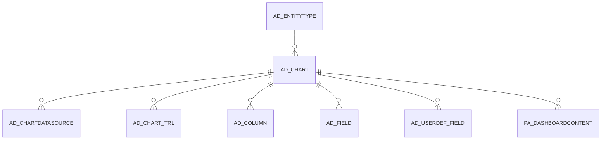

# AD_CHART

Area [AD](../../data-model/ad/index.md) · class **config** (proposed) · read from database `idempiere-db` (owner `ADEMPIERE`) · 4 row(s) when profiled

Application model: `org.compiere.model.X_AD_Chart`, access level 6 - System - Client.

## Columns

| column | type | key | not null | business name | references (code) | nulls | distinct |
|---|---|---|---|---|---|---|---|
| `AD_CHART_ID` | NUMBER(10,0) | PK | yes | Chart |  | 0 | 4 |
| `AD_CLIENT_ID` | NUMBER(10,0) |  | yes | Tenant |  | 0 | 1 |
| `AD_ORG_ID` | NUMBER(10,0) |  | yes | Organization |  | 0 | 1 |
| `CHARTTYPE` | VARCHAR2(2 CHAR) |  | yes | Chart Type |  | 0 | 3 |
| `CREATED` | DATE |  | yes | Created |  | 0 | 1 |
| `CREATEDBY` | NUMBER(10,0) |  | yes | Created By |  | 0 | 1 |
| `DESCRIPTION` | VARCHAR2(255 CHAR) |  |  | Description |  | 4 | 0 |
| `ISACTIVE` | CHAR(1) |  |  | Active |  | 0 | 1 |
| `NAME` | VARCHAR2(60 CHAR) |  | yes | Name |  | 0 | 4 |
| `UPDATED` | DATE |  | yes | Updated |  | 0 | 1 |
| `UPDATEDBY` | NUMBER(10,0) |  | yes | Updated By |  | 0 | 1 |
| `WINHEIGHT` | NUMBER(10,0) |  |  | Window Height |  | 0 | 1 |
| `ISDISPLAYLEGEND` | CHAR(1) |  | yes | Display Legend |  | 0 | 2 |
| `CHARTORIENTATION` | CHAR(1) |  | yes | Orientation |  | 0 | 2 |
| `ISTIMESERIES` | CHAR(1) |  | yes | Time Series |  | 0 | 2 |
| `TIMEUNIT` | CHAR(1) |  |  | Time Unit |  | 3 | 1 |
| `TIMESCOPE` | NUMBER(10,0) |  |  | Time Scope |  | 0 | 2 |
| `DOMAINLABEL` | VARCHAR2(60 CHAR) |  |  | Domain Label |  | 1 | 3 |
| `RANGELABEL` | VARCHAR2(60 CHAR) |  |  | Range Label |  | 1 | 2 |
| `AD_CHART_UU` | VARCHAR2(36 CHAR) |  |  | AD_Chart_UU |  | 0 | 4 |
| `ENTITYTYPE` | VARCHAR2(40 CHAR) |  | yes | Entity Type |  | 0 | 1 |

*references (code)* is the table the application model's code says a column points to; *Foreign keys* below are the constraints the database declares. Counts come from the profile; no value is ever shown.

## Check constraints

| name | expression |
|---|---|
| `SYS_C0022573` | `IsActive IN ('Y','N')` |
| `SYS_C0022574` | `IsDisplayLegend IN ('Y','N')` |
| `SYS_C0022575` | `IsTimeSeries IN ('Y','N')` |

## Foreign keys

**References**

| table | columns | on delete |
|---|---|---|
| [AD_ENTITYTYPE](../../data-model/ad/ad_entitytype.md) | AD_CHART.ENTITYTYPE → AD_ENTITYTYPE.ENTITYTYPE | NO ACTION |

**Referenced by**

| table | columns | on delete |
|---|---|---|
| [AD_CHARTDATASOURCE](../../data-model/ad/ad_chartdatasource.md) | AD_CHARTDATASOURCE.AD_CHART_ID → AD_CHART.AD_CHART_ID | NO ACTION |
| [AD_CHART_TRL](../../data-model/ad/ad_chart_trl.md) | AD_CHART_TRL.AD_CHART_ID → AD_CHART.AD_CHART_ID | CASCADE |
| [AD_COLUMN](../../data-model/ad/ad_column.md) | AD_COLUMN.AD_CHART_ID → AD_CHART.AD_CHART_ID | NO ACTION |
| [AD_FIELD](../../data-model/ad/ad_field.md) | AD_FIELD.AD_CHART_ID → AD_CHART.AD_CHART_ID | NO ACTION |
| [AD_USERDEF_FIELD](../../data-model/ad/ad_userdef_field.md) | AD_USERDEF_FIELD.AD_CHART_ID → AD_CHART.AD_CHART_ID | NO ACTION |
| [PA_DASHBOARDCONTENT](../../data-model/pa/pa_dashboardcontent.md) | PA_DASHBOARDCONTENT.AD_CHART_ID → AD_CHART.AD_CHART_ID | NO ACTION |

## Write behaviour

- updates: **po_only**
- deletes: **deleted_by_users**
- change log: **recorded**
- evidence: 1 citation(s)

## Schema history

57 change(s); the latest:

| applied | release | operation | column | tickets |
|---|---|---|---|---|
| 2020-08-04T01:00 | i7.1z | `modify_column` | CHARTTYPE | IDEMPIERE-3862 |
| 2020-08-04T01:00 | i7.1z | `drop_column` | tmp_col_5_tmp | IDEMPIERE-3862 |
| 2020-08-04T01:00 | i7.1z | `drop_column` | tmp_col_3_tmp | IDEMPIERE-3862 |
| 2020-08-04T01:00 | i7.1z | `drop_column` | tmp_col_2_tmp | IDEMPIERE-3862 |
| 2020-08-04T01:00 | i7.1z | `add_column` | tmp_col_4_tmp | IDEMPIERE-3862 |
| 2020-08-04T01:00 | i7.1z | `drop_column` | tmp_col_1_tmp | IDEMPIERE-3862 |
| 2020-08-04T01:00 | i7.1z | `modify_column` | DESCRIPTION | IDEMPIERE-3862 |
| 2020-08-04T01:00 | i7.1z | `modify_column` | NAME | IDEMPIERE-3862 |
| 2020-08-04T01:00 | i7.1z | `modify_column` | DOMAINLABEL | IDEMPIERE-3862 |
| 2020-08-04T01:00 | i7.1z | `add_column` | tmp_col_2_tmp | IDEMPIERE-3862 |
| 2020-08-04T01:00 | i7.1z | `modify_column` | AD_CHART_UU | IDEMPIERE-3862 |
| 2020-08-04T01:00 | i7.1z | `modify_column` | NAME | IDEMPIERE-3862 |
| 2020-08-04T01:00 | i7.1z | `drop_column` | tmp_col_6_tmp | IDEMPIERE-3862 |
| 2020-08-04T01:00 | i7.1z | `modify_column` | CHARTTYPE | IDEMPIERE-3862 |
| 2020-08-04T01:00 | i7.1z | `add_column` | tmp_col_3_tmp | IDEMPIERE-3862 |

## Notes

<!-- ekos:manual id="table.ad_chart.notes" -->
_Business notes about this table._
<!-- /ekos:manual -->
