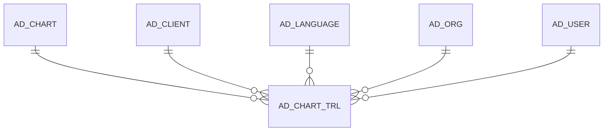

# AD_CHART_TRL

Area [AD](../../data-model/ad/index.md) · class **translation** (proposed) · read from database `idempiere-db` (owner `ADEMPIERE`) · 4 row(s) when profiled

## Columns

| column | type | key | not null | business name | references (code) | nulls | distinct |
|---|---|---|---|---|---|---|---|
| `AD_CHART_ID` | NUMBER(10,0) | PK | yes |  |  | 0 | 4 |
| `AD_CHART_TRL_UU` | VARCHAR2(36 CHAR) |  |  |  |  | 4 | 0 |
| `AD_CLIENT_ID` | NUMBER(10,0) |  | yes |  |  | 0 | 1 |
| `AD_LANGUAGE` | VARCHAR2(6 CHAR) | PK | yes |  |  | 0 | 1 |
| `AD_ORG_ID` | NUMBER(10,0) |  | yes |  |  | 0 | 1 |
| `CREATED` | DATE |  | yes |  |  | 0 | 1 |
| `CREATEDBY` | NUMBER(10,0) |  | yes |  |  | 0 | 1 |
| `DESCRIPTION` | VARCHAR2(255 CHAR) |  |  |  |  | 4 | 0 |
| `ISACTIVE` | CHAR(1) |  | yes |  |  | 0 | 1 |
| `ISTRANSLATED` | CHAR(1) |  | yes |  |  | 0 | 1 |
| `NAME` | VARCHAR2(60 CHAR) |  | yes |  |  | 0 | 4 |
| `UPDATED` | DATE |  | yes |  |  | 0 | 1 |
| `UPDATEDBY` | NUMBER(10,0) |  | yes |  |  | 0 | 1 |
| `DOMAINLABEL` | VARCHAR2(60 CHAR) |  |  |  |  | 1 | 3 |
| `RANGELABEL` | VARCHAR2(60 CHAR) |  |  |  |  | 1 | 2 |

*references (code)* is the table the application model's code says a column points to; *Foreign keys* below are the constraints the database declares. Counts come from the profile; no value is ever shown.

## Check constraints

| name | expression |
|---|---|
| `SYS_C0021043` | `IsTranslated IN ('Y','N')` |
| `SYS_C0021045` | `IsActive IN ('Y','N')` |

## Foreign keys

**References**

| table | columns | on delete |
|---|---|---|
| [AD_CHART](../../data-model/ad/ad_chart.md) | AD_CHART_TRL.AD_CHART_ID → AD_CHART.AD_CHART_ID | CASCADE |
| [AD_CLIENT](../../data-model/ad/ad_client.md) | AD_CHART_TRL.AD_CLIENT_ID → AD_CLIENT.AD_CLIENT_ID | NO ACTION |
| [AD_LANGUAGE](../../data-model/ad/ad_language.md) | AD_CHART_TRL.AD_LANGUAGE → AD_LANGUAGE.AD_LANGUAGE | NO ACTION |
| [AD_ORG](../../data-model/ad/ad_org.md) | AD_CHART_TRL.AD_ORG_ID → AD_ORG.AD_ORG_ID | NO ACTION |
| [AD_USER](../../data-model/ad/ad_user.md) | AD_CHART_TRL.CREATEDBY → AD_USER.AD_USER_ID | NO ACTION |

**Referenced by**

_None._

## Write behaviour

- updates: **po_only**
- deletes: **deleted_by_cascade**
- change log: **not_recorded**
- evidence: 2 citation(s)

## Schema history

34 change(s); the latest:

| applied | release | operation | column | tickets |
|---|---|---|---|---|
| 2020-08-04T01:00 | i7.1z | `modify_column` | DOMAINLABEL | IDEMPIERE-3862 |
| 2020-08-04T01:00 | i7.1z | `drop_column` | tmp_col_3_tmp | IDEMPIERE-3862 |
| 2020-08-04T01:00 | i7.1z | `modify_column` | NAME | IDEMPIERE-3862 |
| 2020-08-04T01:00 | i7.1z | `modify_column` | NAME | IDEMPIERE-3862 |
| 2020-08-04T01:00 | i7.1z | `modify_column` | NAME | IDEMPIERE-3862 |
| 2020-08-04T01:00 | i7.1z | `modify_column` | RANGELABEL | IDEMPIERE-3862 |
| 2020-08-04T01:00 | i7.1z | `add_column` | tmp_col_2_tmp | IDEMPIERE-3862 |
| 2020-08-04T01:00 | i7.1z | `drop_column` | tmp_col_2_tmp | IDEMPIERE-3862 |
| 2020-08-04T01:00 | i7.1z | `modify_column` | DESCRIPTION | IDEMPIERE-3862 |
| 2020-08-04T01:00 | i7.1z | `modify_column` | AD_LANGUAGE | IDEMPIERE-3862 |
| 2020-08-04T01:00 | i7.1z | `drop_column` | tmp_col_1_tmp | IDEMPIERE-3862 |
| 2020-08-04T01:00 | i7.1z | `modify_column` | AD_CHART_TRL_UU | IDEMPIERE-3862 |
| 2020-08-04T01:00 | i7.1z | `add_column` | tmp_col_1_tmp | IDEMPIERE-3862 |
| 2020-08-04T01:00 | i7.1z | `add_column` | tmp_col_4_tmp | IDEMPIERE-3862 |
| 2020-08-04T01:00 | i7.1z | `drop_column` | tmp_col_4_tmp | IDEMPIERE-3862 |

## Open conflicts

| type | attribute | explanation |
|---|---|---|
| `table_without_model` | `model_class` | unexplained |

## Notes

<!-- ekos:manual id="table.ad_chart_trl.notes" -->
_Business notes about this table._
<!-- /ekos:manual -->
