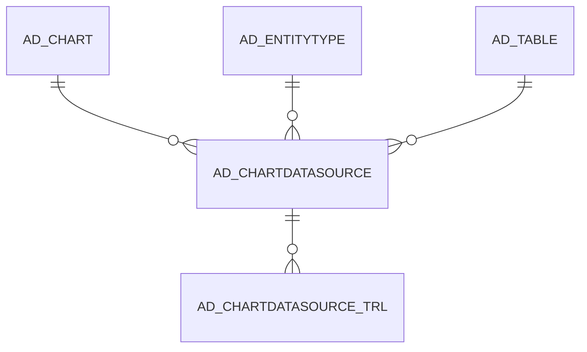

# AD_CHARTDATASOURCE

Area [AD](../../data-model/ad/index.md) · class **config** (proposed) · read from database `idempiere-db` (owner `ADEMPIERE`) · 6 row(s) when profiled

Application model: `org.compiere.model.X_AD_ChartDatasource`, access level 6 - System - Client.

## Columns

| column | type | key | not null | business name | references (code) | nulls | distinct |
|---|---|---|---|---|---|---|---|
| `AD_CHARTDATASOURCE_ID` | NUMBER(10,0) | PK | yes | Chart Datasource |  | 0 | 6 |
| `AD_CHART_ID` | NUMBER(10,0) |  | yes | Chart | [AD_CHART](../../data-model/ad/ad_chart.md) | 0 | 4 |
| `AD_CLIENT_ID` | NUMBER(10,0) |  | yes | Tenant |  | 0 | 1 |
| `AD_ORG_ID` | NUMBER(10,0) |  | yes | Organization |  | 0 | 1 |
| `AD_TABLE_ID` | NUMBER(10,0) |  |  | Table | [AD_TABLE](../../data-model/ad/ad_table.md) | 0 | 4 |
| `CATEGORYCOLUMN` | VARCHAR2(124 CHAR) |  |  | Category Column |  | 2 | 3 |
| `CREATED` | DATE |  | yes | Created |  | 0 | 2 |
| `CREATEDBY` | NUMBER(10,0) |  | yes | Created By |  | 0 | 1 |
| `DATECOLUMN` | VARCHAR2(124 CHAR) |  |  | Date Column |  | 4 | 1 |
| `DESCRIPTION` | VARCHAR2(255 CHAR) |  |  | Description |  | 6 | 0 |
| `ENTITYTYPE` | VARCHAR2(40 CHAR) |  | yes | Entity Type |  | 0 | 1 |
| `FROMCLAUSE` | VARCHAR2(2000 CHAR) |  | yes | Sql FROM |  | 0 | 4 |
| `ISACTIVE` | CHAR(1) |  | yes | Active |  | 0 | 2 |
| `KEYCOLUMN` | VARCHAR2(124 CHAR) |  |  | Key Column |  | 0 | 4 |
| `NAME` | VARCHAR2(60 CHAR) |  | yes | Name |  | 0 | 6 |
| `UPDATED` | DATE |  | yes | Updated |  | 0 | 5 |
| `UPDATEDBY` | NUMBER(10,0) |  | yes | Updated By |  | 0 | 1 |
| `VALUECOLUMN` | VARCHAR2(124 CHAR) |  | yes | Value Column |  | 0 | 4 |
| `WHERECLAUSE` | VARCHAR2(2000 CHAR) |  |  | Sql WHERE |  | 0 | 5 |
| `TIMEOFFSET` | NUMBER(10,0) |  |  | Time Offset |  | 0 | 2 |
| `SERIESCOLUMN` | VARCHAR2(124 CHAR) |  |  | Series Column |  | 5 | 1 |
| `AD_CHARTDATASOURCE_UU` | VARCHAR2(36 CHAR) |  |  | AD_ChartDatasource_UU |  | 0 | 6 |

*references (code)* is the table the application model's code says a column points to; *Foreign keys* below are the constraints the database declares. Counts come from the profile; no value is ever shown.

## Check constraints

| name | expression |
|---|---|
| `SYS_C0020650` | `IsActive IN ('Y','N')` |

## Foreign keys

**References**

| table | columns | on delete |
|---|---|---|
| [AD_CHART](../../data-model/ad/ad_chart.md) | AD_CHARTDATASOURCE.AD_CHART_ID → AD_CHART.AD_CHART_ID | NO ACTION |
| [AD_ENTITYTYPE](../../data-model/ad/ad_entitytype.md) | AD_CHARTDATASOURCE.ENTITYTYPE → AD_ENTITYTYPE.ENTITYTYPE | NO ACTION |
| [AD_TABLE](../../data-model/ad/ad_table.md) | AD_CHARTDATASOURCE.AD_TABLE_ID → AD_TABLE.AD_TABLE_ID | NO ACTION |

**Referenced by**

| table | columns | on delete |
|---|---|---|
| [AD_CHARTDATASOURCE_TRL](../../data-model/ad/ad_chartdatasource_trl.md) | AD_CHARTDATASOURCE_TRL.AD_CHARTDATASOURCE_ID → AD_CHARTDATASOURCE.AD_CHARTDATASOURCE_ID | CASCADE |

## Write behaviour

- updates: **po_only**
- deletes: **deleted_by_users**
- change log: **recorded**
- evidence: 1 citation(s)

## Schema history

91 change(s); the latest:

| applied | release | operation | column | tickets |
|---|---|---|---|---|
| 2024-04-03T12:26 | iD11 | `modify_column` | KeyColumn | IDEMPIERE-6064 |
| 2024-04-03T12:26 | iD11 | `modify_column` | SeriesColumn | IDEMPIERE-6064 |
| 2024-04-03T12:26 | iD11 | `modify_column` | CategoryColumn | IDEMPIERE-6064 |
| 2024-04-03T12:26 | iD11 | `modify_column` | DateColumn | IDEMPIERE-6064 |
| 2024-04-03T12:26 | iD11 | `modify_column` | KeyColumn | IDEMPIERE-6064 |
| 2024-04-03T12:26 | iD11 | `modify_column` | CategoryColumn | IDEMPIERE-6064 |
| 2024-04-03T12:26 | iD11 | `modify_column` | ValueColumn | IDEMPIERE-6064 |
| 2024-04-03T12:26 | iD11 | `modify_column` | DateColumn | IDEMPIERE-6064 |
| 2024-04-03T12:26 | iD11 | `modify_column` | ValueColumn | IDEMPIERE-6064 |
| 2024-04-03T12:26 | iD11 | `modify_column` | SeriesColumn | IDEMPIERE-6064 |
| 2022-03-24T10:11 | i9 | `modify_column` | WhereClause | IDEMPIERE-5241 |
| 2022-03-24T10:11 | i9 | `modify_column` | WhereClause | IDEMPIERE-5241 |
| 2022-03-24T10:11 | i9 | `modify_column` | WhereClause | IDEMPIERE-5241 |
| 2022-03-24T10:11 | i9 | `modify_column` | WhereClause | IDEMPIERE-5241 |
| 2020-08-04T01:00 | i7.1z | `modify_column` | NAME | IDEMPIERE-3862 |

## Notes

<!-- ekos:manual id="table.ad_chartdatasource.notes" -->
_Business notes about this table._
<!-- /ekos:manual -->
