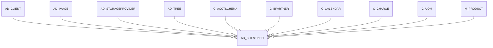

# AD_CLIENTINFO

Area [AD](../../data-model/ad/index.md) · class **config** (proposed) · read from database `idempiere-db` (owner `ADEMPIERE`) · 2 row(s) when profiled

Application model: `org.compiere.model.X_AD_ClientInfo`, access level 6 - System - Client.

## Columns

| column | type | key | not null | business name | references (code) | nulls | distinct |
|---|---|---|---|---|---|---|---|
| `AD_CLIENT_ID` | NUMBER(10,0) | PK | yes | Tenant |  | 0 | 2 |
| `AD_ORG_ID` | NUMBER(10,0) |  | yes | Organization |  | 0 | 1 |
| `ISACTIVE` | CHAR(1) |  | yes | Active |  | 0 | 1 |
| `CREATED` | DATE |  | yes | Created |  | 0 | 2 |
| `CREATEDBY` | NUMBER(10,0) |  | yes | Created By |  | 0 | 1 |
| `UPDATED` | DATE |  | yes | Updated |  | 0 | 2 |
| `UPDATEDBY` | NUMBER(10,0) |  | yes | Updated By |  | 0 | 2 |
| `ISDISCOUNTLINEAMT` | CHAR(1) |  | yes | Discount calculated from Line Amounts |  | 0 | 1 |
| `C_CALENDAR_ID` | NUMBER(10,0) |  |  | Calendar | [C_CALENDAR](../../data-model/c/c_calendar.md) | 1 | 1 |
| `C_ACCTSCHEMA1_ID` | NUMBER(10,0) |  |  | Primary Accounting Schema | [C_ACCTSCHEMA](../../data-model/c/c_acctschema.md) | 1 | 1 |
| `C_UOM_VOLUME_ID` | NUMBER(10,0) |  |  | UOM for Volume | [C_UOM](../../data-model/c/c_uom.md) | 2 | 0 |
| `C_UOM_WEIGHT_ID` | NUMBER(10,0) |  |  | UOM for Weight | [C_UOM](../../data-model/c/c_uom.md) | 1 | 1 |
| `C_UOM_LENGTH_ID` | NUMBER(10,0) |  |  | UOM for Length | [C_UOM](../../data-model/c/c_uom.md) | 1 | 1 |
| `C_UOM_TIME_ID` | NUMBER(10,0) |  |  | UOM for Time | [C_UOM](../../data-model/c/c_uom.md) | 1 | 1 |
| `AD_TREE_MENU_ID` | NUMBER(10,0) |  |  | Menu Tree | [AD_TREE](../../data-model/ad/ad_tree.md) | 0 | 1 |
| `AD_TREE_ORG_ID` | NUMBER(10,0) |  |  | Organization Tree | [AD_TREE](../../data-model/ad/ad_tree.md) | 0 | 2 |
| `AD_TREE_BPARTNER_ID` | NUMBER(10,0) |  |  | BPartner Tree | [AD_TREE](../../data-model/ad/ad_tree.md) | 0 | 2 |
| `AD_TREE_PROJECT_ID` | NUMBER(10,0) |  |  | Project Tree | [AD_TREE](../../data-model/ad/ad_tree.md) | 0 | 2 |
| `AD_TREE_SALESREGION_ID` | NUMBER(10,0) |  |  | Sales Region Tree | [AD_TREE](../../data-model/ad/ad_tree.md) | 0 | 2 |
| `AD_TREE_PRODUCT_ID` | NUMBER(10,0) |  |  | Product Tree | [AD_TREE](../../data-model/ad/ad_tree.md) | 0 | 2 |
| `M_PRODUCTFREIGHT_ID` | NUMBER(10,0) |  |  | Product for Freight | [M_PRODUCT](../../data-model/m/m_product.md) | 2 | 0 |
| `C_BPARTNERCASHTRX_ID` | NUMBER(10,0) |  |  | Template B.Partner | [C_BPARTNER](../../data-model/c/c_bpartner.md) | 1 | 1 |
| `KEEPLOGDAYS` | NUMBER(10,0) |  |  | Days to keep Log |  | 1 | 1 |
| `AD_TREE_ACTIVITY_ID` | NUMBER(10,0) |  |  | Activity Tree | [AD_TREE](../../data-model/ad/ad_tree.md) | 1 | 1 |
| `AD_TREE_CAMPAIGN_ID` | NUMBER(10,0) |  |  | Campaign Tree | [AD_TREE](../../data-model/ad/ad_tree.md) | 1 | 1 |
| `LOGO_ID` | NUMBER(10,0) |  |  | Logo |  | 2 | 0 |
| `LOGOREPORT_ID` | NUMBER(10,0) |  |  | Logo Report |  | 2 | 0 |
| `LOGOWEB_ID` | NUMBER(10,0) |  |  | Logo Web |  | 2 | 0 |
| `AD_CLIENTINFO_UU` | VARCHAR2(36 CHAR) |  |  | AD_ClientInfo_UU |  | 0 | 2 |
| `AD_STORAGEPROVIDER_ID` | NUMBER(10,0) |  |  | Storage Provider | [AD_STORAGEPROVIDER](../../data-model/ad/ad_storageprovider.md) | 2 | 0 |
| `STORAGEARCHIVE_ID` | NUMBER(10,0) |  |  | Archive Store | [AD_STORAGEPROVIDER](../../data-model/ad/ad_storageprovider.md) | 2 | 0 |
| `C_CHARGEFREIGHT_ID` | NUMBER(10,0) |  |  | Charge for Freight | [C_CHARGE](../../data-model/c/c_charge.md) | 1 | 1 |
| `FY_STARTDATE` | DATE |  |  | Financial Year Start Date |  | 2 | 0 |
| `ISCONFIRMONDOCCLOSE` | CHAR(1) |  | yes | Show Confirmation On Document Action Close |  | 0 | 1 |
| `ISCONFIRMONDOCVOID` | CHAR(1) |  | yes | Show Confirmation On Document Action Void |  | 0 | 1 |
| `STORAGEIMAGE_ID` | NUMBER(10,0) |  |  | Image Store | [AD_STORAGEPROVIDER](../../data-model/ad/ad_storageprovider.md) | 2 | 0 |
| `TIMEZONE` | VARCHAR2(60 CHAR) |  |  | Time Zone |  | 2 | 0 |

*references (code)* is the table the application model's code says a column points to; *Foreign keys* below are the constraints the database declares. Counts come from the profile; no value is ever shown.

## Check constraints

| name | expression |
|---|---|
| `SYS_C0022383` | `IsActive in ('Y','N')` |
| `SYS_C0022385` | `IsConfirmOnDocVoid IN ('Y','N')` |
| `SYS_C0022387` | `IsDiscountLineAmt in ('Y','N')` |
| `SYS_C0022388` | `IsConfirmOnDocClose IN ('Y','N')` |

## Foreign keys

**References**

| table | columns | on delete |
|---|---|---|
| [AD_CLIENT](../../data-model/ad/ad_client.md) | AD_CLIENTINFO.AD_CLIENT_ID → AD_CLIENT.AD_CLIENT_ID | CASCADE |
| [AD_IMAGE](../../data-model/ad/ad_image.md) | AD_CLIENTINFO.LOGOREPORT_ID → AD_IMAGE.AD_IMAGE_ID | NO ACTION |
| [AD_STORAGEPROVIDER](../../data-model/ad/ad_storageprovider.md) | AD_CLIENTINFO.AD_STORAGEPROVIDER_ID → AD_STORAGEPROVIDER.AD_STORAGEPROVIDER_ID | NO ACTION |
| [AD_TREE](../../data-model/ad/ad_tree.md) | AD_CLIENTINFO.AD_TREE_ACTIVITY_ID → AD_TREE.AD_TREE_ID | NO ACTION |
| [C_ACCTSCHEMA](../../data-model/c/c_acctschema.md) | AD_CLIENTINFO.C_ACCTSCHEMA1_ID → C_ACCTSCHEMA.C_ACCTSCHEMA_ID | NO ACTION |
| [C_BPARTNER](../../data-model/c/c_bpartner.md) | AD_CLIENTINFO.C_BPARTNERCASHTRX_ID → C_BPARTNER.C_BPARTNER_ID | NO ACTION |
| [C_CALENDAR](../../data-model/c/c_calendar.md) | AD_CLIENTINFO.C_CALENDAR_ID → C_CALENDAR.C_CALENDAR_ID | NO ACTION |
| [C_CHARGE](../../data-model/c/c_charge.md) | AD_CLIENTINFO.C_CHARGEFREIGHT_ID → C_CHARGE.C_CHARGE_ID | NO ACTION |
| [C_UOM](../../data-model/c/c_uom.md) | AD_CLIENTINFO.C_UOM_LENGTH_ID → C_UOM.C_UOM_ID | NO ACTION |
| [M_PRODUCT](../../data-model/m/m_product.md) | AD_CLIENTINFO.M_PRODUCTFREIGHT_ID → M_PRODUCT.M_PRODUCT_ID | NO ACTION |

**Referenced by**

_None._

## Write behaviour

- updates: **raw_sql_skips_updated**
- deletes: **deleted_by_cascade**
- change log: **recorded**
- evidence: 4 citation(s)

## Read by

| kind | name |
|---|---|
| Procedure | [currencyBase](../../logic/currencybase.md) |
| Procedure | [currencyConvertInvoice](../../logic/currencyconvertinvoice.md) |
| Procedure | [currencyConvertPayment](../../logic/currencyconvertpayment.md) |
| Procedure | [invoiceDiscount](../../logic/invoicediscount.md) |
| Procedure | [paymentTermDiscount](../../logic/paymenttermdiscount.md) |
| Procedure | [paymenttermDiscount](../../logic/paymenttermdiscount.md) |
| View | `C_DUNNING_HEADER_V` |
| View | `C_DUNNING_HEADER_VT` |
| View | `C_INVOICE_HEADER_V` |
| View | `C_INVOICE_HEADER_VT` |
| View | `C_ORDER_HEADER_V` |
| View | `C_ORDER_HEADER_VT` |
| View | `C_PAYSELECTION_CHECK_V` |
| View | `C_PAYSELECTION_CHECK_VT` |
| View | `C_PROJECT_HEADER_V` |
| View | `C_PROJECT_HEADER_VT` |
| View | `DD_ORDER_HEADER_V` |
| View | `DD_ORDER_HEADER_VT` |
| View | `M_INOUT_HEADER_V` |
| View | `M_INOUT_HEADER_VT` |
| View | `M_PACKAGELINES_AVAIL_V` |
| View | `PP_ORDER_BOM_HEADER_V` |
| View | `PP_ORDER_BOM_HEADER_VT` |
| View | `PP_ORDER_HEADER_V` |
| View | `PP_ORDER_HEADER_VT` |
| View | `PP_ORDER_WORKFLOW_HEADER_V` |
| View | `PP_ORDER_WORKFLOW_HEADER_VT` |
| View | `RV_FACT_ADAXA` |
| View | `c_dunning_header_v` |
| View | `c_dunning_header_vt` |
| View | `c_invoice_header_v` |
| View | `c_invoice_header_vt` |
| View | `c_order_header_v` |
| View | `c_order_header_vt` |
| View | `c_payselection_check_v` |
| View | `c_payselection_check_vt` |
| View | `c_project_header_v` |
| View | `c_project_header_vt` |
| View | `dd_order_header_v` |
| View | `dd_order_header_vt` |
| View | `m_inout_header_v` |
| View | `m_inout_header_vt` |
| View | `m_packagelines_avail_v` |
| View | `pp_order_bom_header_v` |
| View | `pp_order_bom_header_vt` |
| View | `pp_order_header_v` |
| View | `pp_order_header_vt` |
| View | `pp_order_workflow_header_v` |
| View | `pp_order_workflow_header_vt` |
| View | `pp_product_bom_header_v` |
| View | `pp_product_bom_header_vt` |
| View | `rv_fact_adaxa` |

## Schema history

71 change(s); the latest:

| applied | release | operation | column | tickets |
|---|---|---|---|---|
| 2023-04-09T15:47 | iD11 | `add_constraint` |  | IDEMPIERE-5567 |
| 2023-04-09T15:47 | iD11 | `add_constraint` |  | IDEMPIERE-5567 |
| 2022-03-24T08:30 | iD10 | `add_column` | TimeZone | IDEMPIERE-5093 |
| 2022-03-24T08:30 | iD10 | `add_column` | TimeZone | IDEMPIERE-5093 |
| 2021-12-05T16:45 | i8.2z | `drop_constraint` |  | IDEMPIERE-5075 |
| 2021-12-05T16:45 | i8.2z | `drop_constraint` |  | IDEMPIERE-5075 |
| 2021-12-05T16:45 | i8.2z | `add_constraint` |  | IDEMPIERE-5075 |
| 2021-12-05T16:45 | i8.2z | `drop_constraint` |  | IDEMPIERE-5075 |
| 2021-12-05T16:45 | i8.2z | `drop_constraint` |  | IDEMPIERE-5075 |
| 2021-12-05T16:45 | i8.2z | `drop_constraint` |  | IDEMPIERE-5075 |
| 2021-12-05T16:45 | i8.2z | `add_constraint` |  | IDEMPIERE-5075 |
| 2021-12-05T16:45 | i8.2z | `add_constraint` |  | IDEMPIERE-5075 |
| 2021-12-05T16:45 | i8.2z | `add_constraint` |  | IDEMPIERE-5075 |
| 2021-12-05T16:45 | i8.2z | `add_constraint` |  | IDEMPIERE-5075 |
| 2021-12-05T16:45 | i8.2z | `drop_constraint` |  | IDEMPIERE-5075 |

## Notes

<!-- ekos:manual id="table.ad_clientinfo.notes" -->
_Business notes about this table._
<!-- /ekos:manual -->
