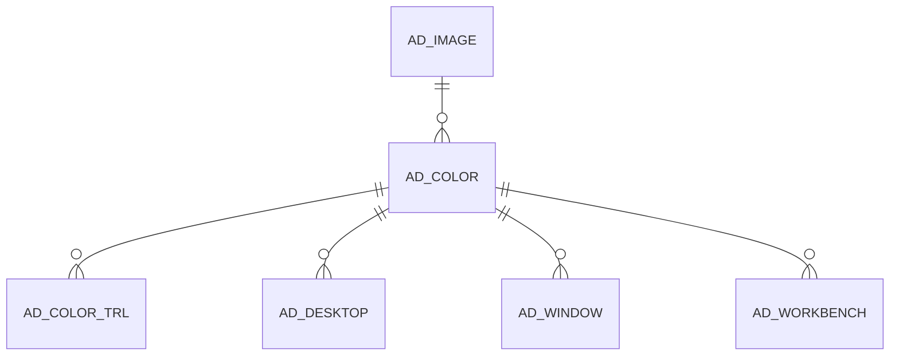

# AD_COLOR

Area [AD](../../data-model/ad/index.md) · class **config** (proposed) · read from database `idempiere-db` (owner `ADEMPIERE`) · 0 row(s) when profiled

Application model: `org.compiere.model.X_AD_Color`, access level 4 - System.

## Columns

| column | type | key | not null | business name | references (code) | nulls | distinct |
|---|---|---|---|---|---|---|---|
| `AD_COLOR_ID` | NUMBER(10,0) | PK | yes | System Color |  | 0 | 0 |
| `AD_CLIENT_ID` | NUMBER(10,0) |  | yes | Tenant |  | 0 | 0 |
| `AD_ORG_ID` | NUMBER(10,0) |  | yes | Organization |  | 0 | 0 |
| `ISACTIVE` | CHAR(1) |  | yes | Active |  | 0 | 0 |
| `CREATED` | DATE |  | yes | Created |  | 0 | 0 |
| `CREATEDBY` | NUMBER(10,0) |  | yes | Created By |  | 0 | 0 |
| `UPDATED` | DATE |  | yes | Updated |  | 0 | 0 |
| `UPDATEDBY` | NUMBER(10,0) |  | yes | Updated By |  | 0 | 0 |
| `NAME` | VARCHAR2(60 CHAR) |  | yes | Name |  | 0 | 0 |
| `ISDEFAULT` | CHAR(1) |  | yes | Default |  | 0 | 0 |
| `COLORTYPE` | CHAR(1) |  | yes | Color Type |  | 0 | 0 |
| `RED` | NUMBER(10,0) |  | yes | Red |  | 0 | 0 |
| `GREEN` | NUMBER(10,0) |  | yes | Green |  | 0 | 0 |
| `BLUE` | NUMBER(10,0) |  | yes | Blue |  | 0 | 0 |
| `ALPHA` | NUMBER(10,0) |  | yes | Alpha |  | 0 | 0 |
| `AD_IMAGE_ID` | NUMBER(10,0) |  |  | Image | [AD_IMAGE](../../data-model/ad/ad_image.md) | 0 | 0 |
| `IMAGEALPHA` | NUMBER |  | yes | Image Alpha |  | 0 | 0 |
| `RED_1` | NUMBER(10,0) |  |  | 2nd Red |  | 0 | 0 |
| `GREEN_1` | NUMBER(10,0) |  |  | 2nd Green |  | 0 | 0 |
| `BLUE_1` | NUMBER(10,0) |  |  | 2nd Blue |  | 0 | 0 |
| `ALPHA_1` | NUMBER(10,0) |  |  | 2nd Alpha |  | 0 | 0 |
| `LINEWIDTH` | NUMBER(10,0) |  |  | Line Width |  | 0 | 0 |
| `LINEDISTANCE` | NUMBER(10,0) |  |  | Line Distance |  | 0 | 0 |
| `STARTPOINT` | NUMBER(10,0) |  |  | Start Point |  | 0 | 0 |
| `REPEATDISTANCE` | NUMBER(10,0) |  |  | Repeat Distance |  | 0 | 0 |
| `AD_COLOR_UU` | VARCHAR2(36 CHAR) |  |  | AD_Color_UU |  | 0 | 0 |

*references (code)* is the table the application model's code says a column points to; *Foreign keys* below are the constraints the database declares. Counts come from the profile; no value is ever shown.

## Check constraints

| name | expression |
|---|---|
| `SYS_C0021898` | `IsActive in ('Y','N')` |

## Foreign keys

**References**

| table | columns | on delete |
|---|---|---|
| [AD_IMAGE](../../data-model/ad/ad_image.md) | AD_COLOR.AD_IMAGE_ID → AD_IMAGE.AD_IMAGE_ID | NO ACTION |

**Referenced by**

| table | columns | on delete |
|---|---|---|
| [AD_COLOR_TRL](../../data-model/ad/ad_color_trl.md) | AD_COLOR_TRL.AD_COLOR_ID → AD_COLOR.AD_COLOR_ID | CASCADE |
| [AD_DESKTOP](../../data-model/ad/ad_desktop.md) | AD_DESKTOP.AD_COLOR_ID → AD_COLOR.AD_COLOR_ID | NO ACTION |
| [AD_WINDOW](../../data-model/ad/ad_window.md) | AD_WINDOW.AD_COLOR_ID → AD_COLOR.AD_COLOR_ID | NO ACTION |
| [AD_WORKBENCH](../../data-model/ad/ad_workbench.md) | AD_WORKBENCH.AD_COLOR_ID → AD_COLOR.AD_COLOR_ID | NO ACTION |

## Write behaviour

- updates: **po_only**
- deletes: **deleted_by_users**
- change log: **recorded**
- evidence: 1 citation(s)

## Schema history

12 change(s); the latest:

| applied | release | operation | column | tickets |
|---|---|---|---|---|
| 2023-04-09T15:47 | iD11 | `add_constraint` |  | IDEMPIERE-5567 |
| 2023-04-09T15:47 | iD11 | `add_constraint` |  | IDEMPIERE-5567 |
| 2021-12-05T16:45 | i8.2z | `add_constraint` |  | IDEMPIERE-5075 |
| 2021-12-05T16:45 | i8.2z | `drop_constraint` |  | IDEMPIERE-5075 |
| 2020-08-04T01:00 | i7.1z | `modify_column` | NAME | IDEMPIERE-3862 |
| 2020-08-04T01:00 | i7.1z | `drop_column` | tmp_col_1_tmp | IDEMPIERE-3862 |
| 2020-08-04T01:00 | i7.1z | `add_column` | tmp_col_1_tmp | IDEMPIERE-3862 |
| 2020-08-04T01:00 | i7.1z | `add_column` | tmp_col_2_tmp | IDEMPIERE-3862 |
| 2020-08-04T01:00 | i7.1z | `modify_column` | NAME | IDEMPIERE-3862 |
| 2020-08-04T01:00 | i7.1z | `modify_column` | AD_COLOR_UU | IDEMPIERE-3862 |
| 2020-08-04T01:00 | i7.1z | `modify_column` | NAME | IDEMPIERE-3862 |
| 2020-08-04T01:00 | i7.1z | `drop_column` | tmp_col_2_tmp | IDEMPIERE-3862 |

## Notes

<!-- ekos:manual id="table.ad_color.notes" -->
_Business notes about this table._
<!-- /ekos:manual -->
