# AD_COLUMN

AD Column definition

Area [AD](../../data-model/ad/index.md) · class **config** (proposed) · read from database `idempiere-db` (owner `ADEMPIERE`) · 26006 row(s) when profiled

Application model: `org.compiere.model.X_AD_Column`, access level 4 - System.

## Columns

| column | type | key | not null | business name | references (code) | nulls | distinct |
|---|---|---|---|---|---|---|---|
| `AD_COLUMN_ID` | NUMBER(10,0) | PK | yes | Column |  | 0 | 26006 |
| `AD_CLIENT_ID` | NUMBER(10,0) |  | yes | Tenant |  | 0 | 1 |
| `AD_ORG_ID` | NUMBER(10,0) |  | yes | Organization |  | 0 | 1 |
| `ISACTIVE` | CHAR(1) |  | yes | Active |  | 0 | 2 |
| `CREATED` | DATE |  | yes | Created |  | 0 | 12695 |
| `UPDATED` | DATE |  | yes | Updated |  | 0 | 13220 |
| `CREATEDBY` | NUMBER(10,0) |  | yes | Created By |  | 0 | 3 |
| `UPDATEDBY` | NUMBER(10,0) |  | yes | Updated By |  | 0 | 3 |
| `NAME` | VARCHAR2(60 CHAR) |  | yes | Name |  | 0 | 5616 |
| `DESCRIPTION` | VARCHAR2(255 CHAR) |  |  | Description |  | 5771 | 2384 |
| `HELP` | VARCHAR2(2000 CHAR) |  |  | Comment/Help |  | 7512 | 1637 |
| `VERSION` | NUMBER |  | yes | Version |  | 0 | 4 |
| `ENTITYTYPE` | VARCHAR2(40 CHAR) |  | yes | Entity Type |  | 0 | 7 |
| `COLUMNNAME` | VARCHAR2(63 CHAR) |  | yes | DB Column Name |  | 0 | 5775 |
| `AD_TABLE_ID` | NUMBER(10,0) |  | yes | Table | [AD_TABLE](../../data-model/ad/ad_table.md) | 0 | 1007 |
| `AD_REFERENCE_ID` | NUMBER(10,0) |  | yes | Reference | [AD_REFERENCE](../../data-model/ad/ad_reference.md) | 0 | 44 |
| `AD_REFERENCE_VALUE_ID` | NUMBER(10,0) |  |  | Reference Key | [AD_REFERENCE](../../data-model/ad/ad_reference.md) | 21304 | 462 |
| `AD_VAL_RULE_ID` | NUMBER(10,0) |  |  | Dynamic Validation | [AD_VAL_RULE](../../data-model/ad/ad_val_rule.md) | 23638 | 242 |
| `FIELDLENGTH` | NUMBER(10,0) |  |  | Length |  | 5 | 54 |
| `DEFAULTVALUE` | VARCHAR2(2000 CHAR) |  |  | Default Logic |  | 20444 | 234 |
| `ISKEY` | CHAR(1) |  | yes | Key column |  | 0 | 2 |
| `ISPARENT` | CHAR(1) |  | yes | Parent link column |  | 0 | 2 |
| `ISMANDATORY` | CHAR(1) |  | yes | Mandatory |  | 0 | 2 |
| `ISUPDATEABLE` | CHAR(1) |  | yes | Updatable |  | 0 | 2 |
| `READONLYLOGIC` | VARCHAR2(2000 CHAR) |  |  | Read Only Logic |  | 25725 | 128 |
| `ISIDENTIFIER` | CHAR(1) |  | yes | Identifier |  | 0 | 2 |
| `SEQNO` | NUMBER(10,0) |  |  | Sequence |  | 15085 | 29 |
| `ISTRANSLATED` | CHAR(1) |  | yes | Translated |  | 0 | 2 |
| `ISENCRYPTED` | CHAR(1) |  | yes | Encrypted |  | 0 | 1 |
| `CALLOUT` | VARCHAR2(255 CHAR) |  |  | Callout |  | 25728 | 146 |
| `VFORMAT` | VARCHAR2(255 CHAR) |  |  | Value Format |  | 26005 | 1 |
| `VALUEMIN` | VARCHAR2(20 CHAR) |  |  | Min. Value |  | 25956 | 6 |
| `VALUEMAX` | VARCHAR2(20 CHAR) |  |  | Max. Value |  | 25990 | 7 |
| `ISSELECTIONCOLUMN` | CHAR(1) |  | yes | Selection Column |  | 0 | 2 |
| `AD_ELEMENT_ID` | NUMBER(10,0) |  |  | System Element | [AD_ELEMENT](../../data-model/ad/ad_element.md) | 0 | 5775 |
| `AD_PROCESS_ID` | NUMBER(10,0) |  |  | Process | [AD_PROCESS](../../data-model/ad/ad_process.md) | 25788 | 201 |
| `ISSYNCDATABASE` | CHAR(1) |  |  | Synchronize Database |  | 0 | 2 |
| `ISALWAYSUPDATEABLE` | CHAR(1) |  | yes | Always Updatable |  | 0 | 2 |
| `MANDATORYLOGIC` | VARCHAR2(2000 CHAR) |  |  | Mandatory Logic |  | 25978 | 27 |
| `INFOFACTORYCLASS` | VARCHAR2(255 CHAR) |  |  |  |  | 26006 | 0 |
| `ISAUTOCOMPLETE` | CHAR(1) |  | yes | Auto complete |  | 0 | 1 |
| `ISALLOWLOGGING` | CHAR(1) |  |  | Allow Logging |  | 0 | 2 |
| `FORMATPATTERN` | VARCHAR2(22 CHAR) |  |  | Format Pattern |  | 26006 | 0 |
| `AD_COLUMN_UU` | VARCHAR2(36 CHAR) |  |  | AD_Column_UU |  | 0 | 26006 |
| `ISALLOWCOPY` | CHAR(1) |  | yes | Allow Copy |  | 0 | 2 |
| `SEQNOSELECTION` | NUMBER(10,0) |  |  | Selection Column Sequence |  | 24425 | 4 |
| `ISSECURE` | CHAR(1) |  | yes | Secure content |  | 0 | 2 |
| `AD_CHART_ID` | NUMBER(10,0) |  |  | Chart | [AD_CHART](../../data-model/ad/ad_chart.md) | 26002 | 4 |
| `FKCONSTRAINTNAME` | VARCHAR2(63 CHAR) |  |  | Constraint Name |  | 22345 | 3661 |
| `FKCONSTRAINTTYPE` | CHAR(1) |  |  | Constraint Type |  | 17499 | 6 |
| `ISTOOLBARBUTTON` | CHAR(1) |  |  | Toolbar Button |  | 0 | 3 |
| `PA_DASHBOARDCONTENT_ID` | NUMBER(10,0) |  |  | Dashboard Content | [PA_DASHBOARDCONTENT](../../data-model/pa/pa_dashboardcontent.md) | 26006 | 0 |
| `PLACEHOLDER` | VARCHAR2(255 CHAR) |  |  | Placeholder |  | 26003 | 1 |
| `ISHTML` | CHAR(1) |  |  | HTML |  | 0 | 2 |
| `COLUMNSQL` | VARCHAR2(4000 CHAR) |  |  | Column SQL |  | 25940 | 64 |
| `AD_VAL_RULE_LOOKUP_ID` | NUMBER(10,0) |  |  | Dynamic Validation (Lookup) | [AD_VAL_RULE](../../data-model/ad/ad_val_rule.md) | 26005 | 1 |
| `AD_INFOWINDOW_ID` | NUMBER(10,0) |  |  | Info Window | [AD_INFOWINDOW](../../data-model/ad/ad_infowindow.md) | 26002 | 4 |
| `ALWAYSUPDATABLELOGIC` | VARCHAR2(2000 CHAR) |  |  | Always Updatable Logic |  | 26006 | 0 |
| `FKCONSTRAINTMSG_ID` | NUMBER(10,0) |  |  | Constraint Message | [AD_MESSAGE](../../data-model/ad/ad_message.md) | 26006 | 0 |
| `PARTITIONINGMETHOD` | VARCHAR2(2 CHAR) |  |  | Partitioning Method |  | 26006 | 0 |
| `ISPARTITIONKEY` | CHAR(1) |  | yes | Partition Key |  | 0 | 1 |
| `SEQNOPARTITION` | NUMBER(10,0) |  |  | Partition Key Sequence |  | 26005 | 1 |
| `RANGEPARTITIONINTERVAL` | VARCHAR2(30 CHAR) |  |  | Range Partition Interval |  | 26006 | 0 |

*references (code)* is the table the application model's code says a column points to; *Foreign keys* below are the constraints the database declares. Counts come from the profile; no value is ever shown.

## Check constraints

| name | expression |
|---|---|
| `SYS_C0021976` | `IsParent in ('Y','N')` |
| `SYS_C0021977` | `IsActive in ('Y','N')` |
| `SYS_C0021978` | `IsUpdateable in ('Y','N')` |
| `SYS_C0021979` | `IsKey in ('Y','N')` |
| `SYS_C0021980` | `IsAutocomplete IN ('Y','N')` |
| `SYS_C0021981` | `IsIdentifier in ('Y','N')` |
| `SYS_C0021982` | `IsAllowLogging IN ('Y','N')` |
| `SYS_C0021983` | `IsPartitionKey IN ('Y','N')` |
| `SYS_C0021984` | `IsSecure IN ('Y','N')` |
| `SYS_C0021986` | `IsSyncDatabase in ('Y','N')` |
| `SYS_C0021987` | `IsEncrypted in ('Y','N')` |
| `SYS_C0021988` | `IsTranslated in ('Y','N')` |
| `SYS_C0021989` | `IsAllowCopy IN ('Y','N')` |
| `SYS_C0021990` | `IsHtml IN ('Y','N')` |
| `SYS_C0021992` | `IsMandatory in ('Y','N')` |
| `SYS_C0021993` | `IsSelectionColumn in ('Y','N')` |

## Foreign keys

**References**

| table | columns | on delete |
|---|---|---|
| [AD_CHART](../../data-model/ad/ad_chart.md) | AD_COLUMN.AD_CHART_ID → AD_CHART.AD_CHART_ID | NO ACTION |
| [AD_CLIENT](../../data-model/ad/ad_client.md) | AD_COLUMN.AD_CLIENT_ID → AD_CLIENT.AD_CLIENT_ID | NO ACTION |
| [AD_ELEMENT](../../data-model/ad/ad_element.md) | AD_COLUMN.AD_ELEMENT_ID → AD_ELEMENT.AD_ELEMENT_ID | NO ACTION |
| [AD_ENTITYTYPE](../../data-model/ad/ad_entitytype.md) | AD_COLUMN.ENTITYTYPE → AD_ENTITYTYPE.ENTITYTYPE | NO ACTION |
| [AD_INFOWINDOW](../../data-model/ad/ad_infowindow.md) | AD_COLUMN.AD_INFOWINDOW_ID → AD_INFOWINDOW.AD_INFOWINDOW_ID | SET NULL |
| [AD_MESSAGE](../../data-model/ad/ad_message.md) | AD_COLUMN.FKCONSTRAINTMSG_ID → AD_MESSAGE.AD_MESSAGE_ID | NO ACTION |
| [AD_ORG](../../data-model/ad/ad_org.md) | AD_COLUMN.AD_ORG_ID → AD_ORG.AD_ORG_ID | NO ACTION |
| [AD_PROCESS](../../data-model/ad/ad_process.md) | AD_COLUMN.AD_PROCESS_ID → AD_PROCESS.AD_PROCESS_ID | SET NULL |
| [AD_REFERENCE](../../data-model/ad/ad_reference.md) | AD_COLUMN.AD_REFERENCE_ID → AD_REFERENCE.AD_REFERENCE_ID | NO ACTION |
| [AD_TABLE](../../data-model/ad/ad_table.md) | AD_COLUMN.AD_TABLE_ID → AD_TABLE.AD_TABLE_ID | CASCADE |
| [AD_VAL_RULE](../../data-model/ad/ad_val_rule.md) | AD_COLUMN.AD_VAL_RULE_LOOKUP_ID → AD_VAL_RULE.AD_VAL_RULE_ID | NO ACTION |
| [PA_DASHBOARDCONTENT](../../data-model/pa/pa_dashboardcontent.md) | AD_COLUMN.PA_DASHBOARDCONTENT_ID → PA_DASHBOARDCONTENT.PA_DASHBOARDCONTENT_ID | NO ACTION |

**Referenced by**

| table | columns | on delete |
|---|---|---|
| `AD_ACCESSLOG` | AD_ACCESSLOG.AD_COLUMN_ID → AD_COLUMN.AD_COLUMN_ID | CASCADE |
| `AD_CHANGELOG` | AD_CHANGELOG.AD_COLUMN_ID → AD_COLUMN.AD_COLUMN_ID | CASCADE |
| [AD_COLUMN_ACCESS](../../data-model/ad/ad_column_access.md) | AD_COLUMN_ACCESS.AD_COLUMN_ID → AD_COLUMN.AD_COLUMN_ID | NO ACTION |
| [AD_COLUMN_TRL](../../data-model/ad/ad_column_trl.md) | AD_COLUMN_TRL.AD_COLUMN_ID → AD_COLUMN.AD_COLUMN_ID | CASCADE |
| [AD_FIELD](../../data-model/ad/ad_field.md) | AD_FIELD.AD_COLUMN_ID → AD_COLUMN.AD_COLUMN_ID | NO ACTION |
| [AD_FIND](../../data-model/ad/ad_find.md) | AD_FIND.AD_COLUMN_ID → AD_COLUMN.AD_COLUMN_ID | NO ACTION |
| [AD_IMPFORMAT_ROW](../../data-model/ad/ad_impformat_row.md) | AD_IMPFORMAT_ROW.AD_COLUMN_ID → AD_COLUMN.AD_COLUMN_ID | NO ACTION |
| [AD_INDEXCOLUMN](../../data-model/ad/ad_indexcolumn.md) | AD_INDEXCOLUMN.AD_COLUMN_ID → AD_COLUMN.AD_COLUMN_ID | NO ACTION |
| [AD_PACKAGE_IMP_BACKUP](../../data-model/ad/ad_package_imp_backup.md) | AD_PACKAGE_IMP_BACKUP.AD_COLUMN_ID → AD_COLUMN.AD_COLUMN_ID | NO ACTION |
| [AD_PRINTFORMATITEM](../../data-model/ad/ad_printformatitem.md) | AD_PRINTFORMATITEM.AD_COLUMN_ID → AD_COLUMN.AD_COLUMN_ID | NO ACTION |
| [AD_PRINTLABELLINE](../../data-model/ad/ad_printlabelline.md) | AD_PRINTLABELLINE.AD_COLUMN_ID → AD_COLUMN.AD_COLUMN_ID | NO ACTION |
| [AD_REF_TABLE](../../data-model/ad/ad_ref_table.md) | AD_REF_TABLE.AD_DISPLAY → AD_COLUMN.AD_COLUMN_ID | NO ACTION |
| [AD_REPORTVIEW_COL](../../data-model/ad/ad_reportview_col.md) | AD_REPORTVIEW_COL.AD_COLUMN_ID → AD_COLUMN.AD_COLUMN_ID | NO ACTION |
| [AD_REPORTVIEW_COLUMN](../../data-model/ad/ad_reportview_column.md) | AD_REPORTVIEW_COLUMN.AD_COLUMN_ID → AD_COLUMN.AD_COLUMN_ID | NO ACTION |
| [AD_SEARCHDEFINITION](../../data-model/ad/ad_searchdefinition.md) | AD_SEARCHDEFINITION.AD_COLUMN_ID → AD_COLUMN.AD_COLUMN_ID | NO ACTION |
| [AD_TAB](../../data-model/ad/ad_tab.md) | AD_TAB.AD_COLUMNSORTORDER_ID → AD_COLUMN.AD_COLUMN_ID | NO ACTION |
| [AD_TABLEPARTITION](../../data-model/ad/ad_tablepartition.md) | AD_TABLEPARTITION.AD_COLUMN_ID → AD_COLUMN.AD_COLUMN_ID | NO ACTION |
| [AD_TREE](../../data-model/ad/ad_tree.md) | AD_TREE.PARENT_COLUMN_ID → AD_COLUMN.AD_COLUMN_ID | NO ACTION |
| [AD_VERIFYMIGRATION](../../data-model/ad/ad_verifymigration.md) | AD_VERIFYMIGRATION.AD_COLUMN_ID → AD_COLUMN.AD_COLUMN_ID | NO ACTION |
| [AD_WF_NEXTCONDITION](../../data-model/ad/ad_wf_nextcondition.md) | AD_WF_NEXTCONDITION.AD_COLUMN_ID → AD_COLUMN.AD_COLUMN_ID | NO ACTION |
| [AD_WF_NODE](../../data-model/ad/ad_wf_node.md) | AD_WF_NODE.AD_COLUMN_ID → AD_COLUMN.AD_COLUMN_ID | NO ACTION |
| [AD_WORKBENCH](../../data-model/ad/ad_workbench.md) | AD_WORKBENCH.AD_COLUMN_ID → AD_COLUMN.AD_COLUMN_ID | NO ACTION |
| [C_ACCTSCHEMA_ELEMENT](../../data-model/c/c_acctschema_element.md) | C_ACCTSCHEMA_ELEMENT.AD_COLUMN_ID → AD_COLUMN.AD_COLUMN_ID | NO ACTION |
| [EXP_FORMATLINE](../../data-model/exp/exp_formatline.md) | EXP_FORMATLINE.AD_COLUMN_ID → AD_COLUMN.AD_COLUMN_ID | NO ACTION |
| `I_ELEMENTVALUE` | I_ELEMENTVALUE.AD_COLUMN_ID → AD_COLUMN.AD_COLUMN_ID | SET NULL |
| [PP_ORDER_NODE](../../data-model/pp/pp_order_node.md) | PP_ORDER_NODE.AD_COLUMN_ID → AD_COLUMN.AD_COLUMN_ID | NO ACTION |
| [WS_WEBSERVICEFIELDINPUT](../../data-model/ws/ws_webservicefieldinput.md) | WS_WEBSERVICEFIELDINPUT.AD_COLUMN_ID → AD_COLUMN.AD_COLUMN_ID | NO ACTION |
| [WS_WEBSERVICEFIELDOUTPUT](../../data-model/ws/ws_webservicefieldoutput.md) | WS_WEBSERVICEFIELDOUTPUT.AD_COLUMN_ID → AD_COLUMN.AD_COLUMN_ID | NO ACTION |

```mermaid
erDiagram
  AD_CHART ||--o{ AD_COLUMN : ""
  AD_CLIENT ||--o{ AD_COLUMN : ""
  AD_COLUMN ||--o{ AD_ACCESSLOG : ""
  AD_COLUMN ||--o{ AD_CHANGELOG : ""
  AD_COLUMN ||--o{ AD_COLUMN_ACCESS : ""
  AD_COLUMN ||--o{ AD_COLUMN_TRL : ""
  AD_COLUMN ||--o{ AD_FIELD : ""
  AD_COLUMN ||--o{ AD_FIND : ""
  AD_COLUMN ||--o{ AD_IMPFORMAT_ROW : ""
  AD_COLUMN ||--o{ AD_INDEXCOLUMN : ""
  AD_COLUMN ||--o{ AD_PACKAGE_IMP_BACKUP : ""
  AD_COLUMN ||--o{ AD_PRINTFORMATITEM : ""
  AD_COLUMN ||--o{ AD_PRINTLABELLINE : ""
  AD_COLUMN ||--o{ AD_REF_TABLE : ""
  AD_COLUMN ||--o{ AD_REPORTVIEW_COL : ""
  AD_COLUMN ||--o{ AD_REPORTVIEW_COLUMN : ""
  AD_COLUMN ||--o{ AD_SEARCHDEFINITION : ""
  AD_COLUMN ||--o{ AD_TAB : ""
  AD_COLUMN ||--o{ AD_TABLEPARTITION : ""
  AD_COLUMN ||--o{ AD_TREE : ""
  AD_ELEMENT ||--o{ AD_COLUMN : ""
  AD_ENTITYTYPE ||--o{ AD_COLUMN : ""
  AD_INFOWINDOW ||--o{ AD_COLUMN : ""
  AD_MESSAGE ||--o{ AD_COLUMN : ""
  AD_ORG ||--o{ AD_COLUMN : ""
  AD_PROCESS ||--o{ AD_COLUMN : ""
  AD_REFERENCE ||--o{ AD_COLUMN : ""
  AD_TABLE ||--o{ AD_COLUMN : ""
  AD_VAL_RULE ||--o{ AD_COLUMN : ""
```

11 more neighbour(s) not drawn.

## Write behaviour

- updates: **raw_sql_skips_updated**
- deletes: **deleted_by_users, deleted_by_cascade**
- change log: **recorded**
- evidence: 8 citation(s)

## Read by

| kind | name |
|---|---|
| Procedure | [AD_Column_Sync](../../logic/ad_column_sync.md) |
| Procedure | [AD_Synchronize](../../logic/ad_synchronize.md) |
| Procedure | [add_missing_translations](../../logic/add_missing_translations.md) |
| Procedure | [torecordid](../../logic/torecordid.md) |
| Procedure | [update_sequences](../../logic/update_sequences.md) |
| View | `AD_CHANGELOG_V` |
| View | `AD_FIELD_V` |
| View | `AD_FIELD_VT` |
| View | `ad_changelog_v` |
| View | `ad_field_v` |
| View | `ad_field_vt` |

## Written by

| kind | name |
|---|---|
| Procedure | [AD_Synchronize](../../logic/ad_synchronize.md) |

## Schema history

148 change(s); the latest:

| applied | release | operation | column | tickets |
|---|---|---|---|---|
| 2024-04-03T12:26 | iD11 | `modify_column` | ColumnName | IDEMPIERE-6064 |
| 2024-04-03T12:26 | iD11 | `modify_column` | ColumnName | IDEMPIERE-6064 |
| 2024-04-03T12:26 | iD11 | `modify_column` | FKConstraintName | IDEMPIERE-6064 |
| 2024-04-03T12:26 | iD11 | `create_index` |  | IDEMPIERE-6064 |
| 2024-04-03T12:26 | iD11 | `create_index` |  | IDEMPIERE-6064 |
| 2024-04-03T12:26 | iD11 | `modify_column` | FKConstraintName | IDEMPIERE-6064 |
| 2023-12-13T10:39 | iD11 | `add_column` | RangePartitionInterval | IDEMPIERE-5943 |
| 2023-12-13T10:39 | iD11 | `add_column` | RangePartitionInterval | IDEMPIERE-5943 |
| 2023-12-04T15:49 | iD11 | `add_column` | SeqNoPartition | IDEMPIERE-5943 |
| 2023-12-04T15:49 | iD11 | `add_column` | IsPartitionKey | IDEMPIERE-5943 |
| 2023-12-04T15:49 | iD11 | `add_column` | PartitioningMethod | IDEMPIERE-5943 |
| 2023-12-04T15:49 | iD11 | `add_column` | SeqNoPartition | IDEMPIERE-5943 |
| 2023-12-04T15:49 | iD11 | `add_column` | IsPartitionKey | IDEMPIERE-5943 |
| 2023-12-04T15:49 | iD11 | `add_column` | PartitioningMethod | IDEMPIERE-5943 |
| 2023-10-17T12:31 | iD11 | `add_column` | FKConstraintMsg_ID | IDEMPIERE-5886 |

## Open conflicts

| type | attribute | explanation |
|---|---|---|
| `mandatory_but_nullable` | `columns.AD_Element_ID.nullable` | unexplained |
| `mandatory_but_nullable` | `columns.IsToolbarButton.nullable` | unexplained |

## Notes

<!-- ekos:manual id="table.ad_column.notes" -->
_Business notes about this table._
<!-- /ekos:manual -->
