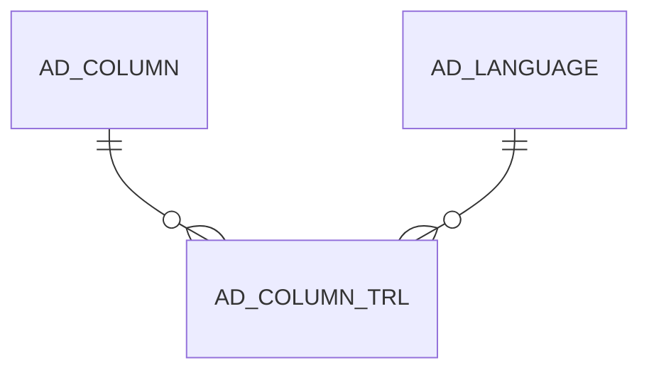

# AD_COLUMN_TRL

Area [AD](../../data-model/ad/index.md) · class **translation** (proposed) · read from database `idempiere-db` (owner `ADEMPIERE`) · 26006 row(s) when profiled

## Columns

| column | type | key | not null | business name | references (code) | nulls | distinct |
|---|---|---|---|---|---|---|---|
| `AD_COLUMN_ID` | NUMBER(10,0) | PK | yes |  |  | 0 | 26006 |
| `AD_LANGUAGE` | VARCHAR2(6 CHAR) | PK | yes |  |  | 0 | 1 |
| `AD_CLIENT_ID` | NUMBER(10,0) |  | yes |  |  | 0 | 1 |
| `AD_ORG_ID` | NUMBER(10,0) |  | yes |  |  | 0 | 1 |
| `ISACTIVE` | CHAR(1) |  | yes |  |  | 0 | 2 |
| `CREATED` | DATE |  | yes |  |  | 0 | 11374 |
| `CREATEDBY` | NUMBER(10,0) |  | yes |  |  | 0 | 3 |
| `UPDATED` | DATE |  | yes |  |  | 0 | 11186 |
| `UPDATEDBY` | NUMBER(10,0) |  | yes |  |  | 0 | 3 |
| `NAME` | VARCHAR2(60 CHAR) |  | yes |  |  | 0 | 5603 |
| `ISTRANSLATED` | CHAR(1) |  | yes |  |  | 0 | 2 |
| `AD_COLUMN_TRL_UU` | VARCHAR2(36 CHAR) |  |  |  |  | 2546 | 23460 |
| `PLACEHOLDER` | VARCHAR2(255 CHAR) |  |  |  |  | 26003 | 1 |

*references (code)* is the table the application model's code says a column points to; *Foreign keys* below are the constraints the database declares. Counts come from the profile; no value is ever shown.

## Check constraints

| name | expression |
|---|---|
| `SYS_C0021539` | `IsActive in ('Y','N')` |
| `SYS_C0021541` | `IsTranslated in ('Y','N')` |

## Foreign keys

**References**

| table | columns | on delete |
|---|---|---|
| [AD_COLUMN](../../data-model/ad/ad_column.md) | AD_COLUMN_TRL.AD_COLUMN_ID → AD_COLUMN.AD_COLUMN_ID | CASCADE |
| [AD_LANGUAGE](../../data-model/ad/ad_language.md) | AD_COLUMN_TRL.AD_LANGUAGE → AD_LANGUAGE.AD_LANGUAGE | NO ACTION |

**Referenced by**

_None._

## Write behaviour

- updates: **raw_sql_skips_updated**
- deletes: **deleted_by_users, deleted_by_cascade**
- change log: **not_recorded**
- evidence: 4 citation(s)

## Read by

| kind | name |
|---|---|
| View | `AD_FIELD_VT` |
| View | `ad_field_vt` |

## Written by

| kind | name |
|---|---|
| Procedure | [AD_Synchronize](../../logic/ad_synchronize.md) |

## Schema history

20 change(s); the latest:

| applied | release | operation | column | tickets |
|---|---|---|---|---|
| 2023-04-09T15:47 | iD11 | `add_constraint` |  | IDEMPIERE-5567 |
| 2023-04-09T15:47 | iD11 | `add_constraint` |  | IDEMPIERE-5567 |
| 2021-12-05T16:45 | i8.2z | `add_constraint` |  | IDEMPIERE-5075 |
| 2021-12-05T16:45 | i8.2z | `add_constraint` |  | IDEMPIERE-5075 |
| 2021-12-05T16:45 | i8.2z | `drop_constraint` |  | IDEMPIERE-5075 |
| 2021-12-05T16:45 | i8.2z | `drop_constraint` |  | IDEMPIERE-5075 |
| 2020-08-04T01:00 | i7.1z | `drop_column` | tmp_col_1_tmp | IDEMPIERE-3862 |
| 2020-08-04T01:00 | i7.1z | `modify_column` | PLACEHOLDER | IDEMPIERE-3862 |
| 2020-08-04T01:00 | i7.1z | `modify_column` | AD_LANGUAGE | IDEMPIERE-3862 |
| 2020-08-04T01:00 | i7.1z | `add_column` | tmp_col_1_tmp | IDEMPIERE-3862 |
| 2020-08-04T01:00 | i7.1z | `modify_column` | NAME | IDEMPIERE-3862 |
| 2020-08-04T01:00 | i7.1z | `modify_column` | AD_COLUMN_TRL_UU | IDEMPIERE-3862 |
| 2020-08-04T01:00 | i7.1z | `modify_column` | NAME | IDEMPIERE-3862 |
| 2020-08-04T01:00 | i7.1z | `drop_column` | tmp_col_2_tmp | IDEMPIERE-3862 |
| 2020-08-04T01:00 | i7.1z | `add_column` | tmp_col_2_tmp | IDEMPIERE-3862 |

## Open conflicts

| type | attribute | explanation |
|---|---|---|
| `table_without_model` | `model_class` | unexplained |

## Notes

<!-- ekos:manual id="table.ad_column_trl.notes" -->
_Business notes about this table._
<!-- /ekos:manual -->
