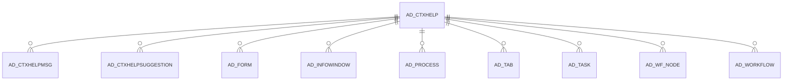

# AD_CTXHELP

Area [AD](../../data-model/ad/index.md) · class **config** (proposed) · read from database `idempiere-db` (owner `ADEMPIERE`) · 0 row(s) when profiled

Application model: `org.compiere.model.X_AD_CtxHelp`, access level 7 - System - Client - Org.

## Columns

| column | type | key | not null | business name | references (code) | nulls | distinct |
|---|---|---|---|---|---|---|---|
| `AD_CLIENT_ID` | NUMBER(10,0) |  | yes | Tenant |  | 0 | 0 |
| `AD_CTXHELP_ID` | NUMBER(10,0) | PK | yes | Context Help |  | 0 | 0 |
| `AD_CTXHELP_UU` | VARCHAR2(36 CHAR) |  |  | AD_CtxHelp_UU |  | 0 | 0 |
| `AD_FORM_ID` | NUMBER(10,0) |  |  |  |  | 0 | 0 |
| `AD_ORG_ID` | NUMBER(10,0) |  | yes | Organization |  | 0 | 0 |
| `AD_PROCESS_ID` | NUMBER(10,0) |  |  |  |  | 0 | 0 |
| `AD_TAB_ID` | NUMBER(10,0) |  |  |  |  | 0 | 0 |
| `CREATED` | DATE |  | yes | Created |  | 0 | 0 |
| `CREATEDBY` | NUMBER(10,0) |  | yes | Created By |  | 0 | 0 |
| `CTXTYPE` | CHAR(1) |  |  | Context Type |  | 0 | 0 |
| `DESCRIPTION` | VARCHAR2(255 CHAR) |  |  | Description |  | 0 | 0 |
| `ISACTIVE` | CHAR(1) |  | yes | Active |  | 0 | 0 |
| `NAME` | VARCHAR2(120 CHAR) |  | yes | Name |  | 0 | 0 |
| `UPDATED` | DATE |  | yes | Updated |  | 0 | 0 |
| `UPDATEDBY` | NUMBER(10,0) |  | yes | Updated By |  | 0 | 0 |
| `AD_INFOWINDOW_ID` | NUMBER(10,0) |  |  |  |  | 0 | 0 |
| `AD_WORKFLOW_ID` | NUMBER(10,0) |  |  |  |  | 0 | 0 |
| `AD_TASK_ID` | NUMBER(10,0) |  |  |  |  | 0 | 0 |
| `AD_TABLE_ID` | NUMBER(10,0) |  |  |  |  | 0 | 0 |

*references (code)* is the table the application model's code says a column points to; *Foreign keys* below are the constraints the database declares. Counts come from the profile; no value is ever shown.

## Check constraints

| name | expression |
|---|---|
| `SYS_C0021048` | `IsActive IN ('Y','N')` |

## Foreign keys

**References**

_None._

**Referenced by**

| table | columns | on delete |
|---|---|---|
| [AD_CTXHELPMSG](../../data-model/ad/ad_ctxhelpmsg.md) | AD_CTXHELPMSG.AD_CTXHELP_ID → AD_CTXHELP.AD_CTXHELP_ID | NO ACTION |
| [AD_CTXHELPSUGGESTION](../../data-model/ad/ad_ctxhelpsuggestion.md) | AD_CTXHELPSUGGESTION.AD_CTXHELP_ID → AD_CTXHELP.AD_CTXHELP_ID | NO ACTION |
| [AD_FORM](../../data-model/ad/ad_form.md) | AD_FORM.AD_CTXHELP_ID → AD_CTXHELP.AD_CTXHELP_ID | NO ACTION |
| [AD_INFOWINDOW](../../data-model/ad/ad_infowindow.md) | AD_INFOWINDOW.AD_CTXHELP_ID → AD_CTXHELP.AD_CTXHELP_ID | NO ACTION |
| [AD_PROCESS](../../data-model/ad/ad_process.md) | AD_PROCESS.AD_CTXHELP_ID → AD_CTXHELP.AD_CTXHELP_ID | NO ACTION |
| [AD_TAB](../../data-model/ad/ad_tab.md) | AD_TAB.AD_CTXHELP_ID → AD_CTXHELP.AD_CTXHELP_ID | NO ACTION |
| [AD_TASK](../../data-model/ad/ad_task.md) | AD_TASK.AD_CTXHELP_ID → AD_CTXHELP.AD_CTXHELP_ID | NO ACTION |
| [AD_WF_NODE](../../data-model/ad/ad_wf_node.md) | AD_WF_NODE.AD_CTXHELP_ID → AD_CTXHELP.AD_CTXHELP_ID | NO ACTION |
| [AD_WORKFLOW](../../data-model/ad/ad_workflow.md) | AD_WORKFLOW.AD_CTXHELP_ID → AD_CTXHELP.AD_CTXHELP_ID | NO ACTION |

## Write behaviour

- updates: **po_only**
- deletes: **deleted_by_users**
- change log: **recorded**
- evidence: 1 citation(s)

## Schema history

39 change(s); the latest:

| applied | release | operation | column | tickets |
|---|---|---|---|---|
| 2023-04-09T15:47 | iD11 | `add_constraint` |  | IDEMPIERE-5567 |
| 2023-04-09T15:47 | iD11 | `add_constraint` |  | IDEMPIERE-5567 |
| 2020-08-04T01:00 | i7.1z | `modify_column` | AD_CTXHELP_UU | IDEMPIERE-3862 |
| 2020-08-04T01:00 | i7.1z | `add_column` | tmp_col_1_tmp | IDEMPIERE-3862 |
| 2020-08-04T01:00 | i7.1z | `modify_column` | NAME | IDEMPIERE-3862 |
| 2020-08-04T01:00 | i7.1z | `drop_column` | tmp_col_2_tmp | IDEMPIERE-3862 |
| 2020-08-04T01:00 | i7.1z | `add_column` | tmp_col_2_tmp | IDEMPIERE-3862 |
| 2020-08-04T01:00 | i7.1z | `modify_column` | NAME | IDEMPIERE-3862 |
| 2020-08-04T01:00 | i7.1z | `modify_column` | NAME | IDEMPIERE-3862 |
| 2020-08-04T01:00 | i7.1z | `drop_column` | tmp_col_1_tmp | IDEMPIERE-3862 |
| 2020-08-04T01:00 | i7.1z | `drop_column` | tmp_col_3_tmp | IDEMPIERE-3862 |
| 2020-08-04T01:00 | i7.1z | `modify_column` | DESCRIPTION | IDEMPIERE-3862 |
| 2020-08-04T01:00 | i7.1z | `add_column` | tmp_col_3_tmp | IDEMPIERE-3862 |
| 2014-05-02T10:09 | i2.0 | `modify_column` | updated | IDEMPIERE-709 |
| 2014-05-02T10:09 | i2.0 | `modify_column` | created | IDEMPIERE-709 |

## Notes

<!-- ekos:manual id="table.ad_ctxhelp.notes" -->
_Business notes about this table._
<!-- /ekos:manual -->
