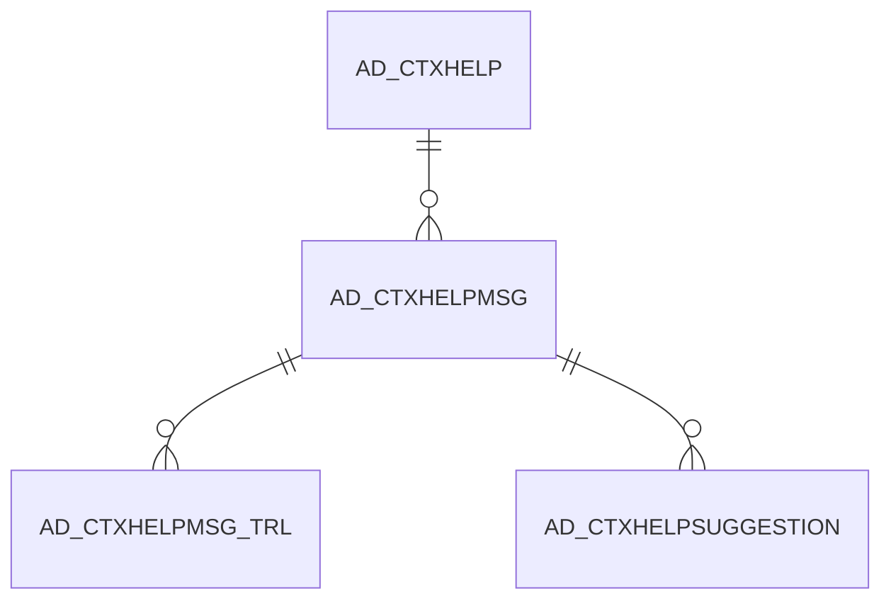

# AD_CTXHELPMSG

Area [AD](../../data-model/ad/index.md) · class **config** (proposed) · read from database `idempiere-db` (owner `ADEMPIERE`) · 0 row(s) when profiled

Application model: `org.compiere.model.X_AD_CtxHelpMsg`, access level 7 - System - Client - Org.

## Columns

| column | type | key | not null | business name | references (code) | nulls | distinct |
|---|---|---|---|---|---|---|---|
| `AD_CLIENT_ID` | NUMBER(10,0) |  | yes | Tenant |  | 0 | 0 |
| `AD_CTXHELP_ID` | NUMBER(10,0) |  | yes | Context Help | [AD_CTXHELP](../../data-model/ad/ad_ctxhelp.md) | 0 | 0 |
| `AD_CTXHELPMSG_ID` | NUMBER(10,0) | PK | yes | Context Help Message |  | 0 | 0 |
| `AD_CTXHELPMSG_UU` | VARCHAR2(36 CHAR) |  |  | AD_CtxHelpMsg_UU |  | 0 | 0 |
| `AD_ORG_ID` | NUMBER(10,0) |  | yes | Organization |  | 0 | 0 |
| `CREATED` | DATE |  | yes | Created |  | 0 | 0 |
| `CREATEDBY` | NUMBER(10,0) |  | yes | Created By |  | 0 | 0 |
| `ISACTIVE` | CHAR(1) |  | yes | Active |  | 0 | 0 |
| `LINE` | NUMBER(10,0) |  |  |  |  | 0 | 0 |
| `MSGTEXT` | VARCHAR2(2000 CHAR) |  | yes | Message Text |  | 0 | 0 |
| `UPDATED` | DATE |  | yes | Updated |  | 0 | 0 |
| `UPDATEDBY` | NUMBER(10,0) |  | yes | Updated By |  | 0 | 0 |

*references (code)* is the table the application model's code says a column points to; *Foreign keys* below are the constraints the database declares. Counts come from the profile; no value is ever shown.

## Check constraints

| name | expression |
|---|---|
| `SYS_C0021089` | `IsActive IN ('Y','N')` |

## Foreign keys

**References**

| table | columns | on delete |
|---|---|---|
| [AD_CTXHELP](../../data-model/ad/ad_ctxhelp.md) | AD_CTXHELPMSG.AD_CTXHELP_ID → AD_CTXHELP.AD_CTXHELP_ID | NO ACTION |

**Referenced by**

| table | columns | on delete |
|---|---|---|
| [AD_CTXHELPMSG_TRL](../../data-model/ad/ad_ctxhelpmsg_trl.md) | AD_CTXHELPMSG_TRL.AD_CTXHELPMSG_ID → AD_CTXHELPMSG.AD_CTXHELPMSG_ID | CASCADE |
| [AD_CTXHELPSUGGESTION](../../data-model/ad/ad_ctxhelpsuggestion.md) | AD_CTXHELPSUGGESTION.AD_CTXHELPMSG_ID → AD_CTXHELPMSG.AD_CTXHELPMSG_ID | NO ACTION |

## Write behaviour

- updates: **po_only**
- deletes: **deleted_by_users**
- change log: **recorded**
- evidence: 1 citation(s)

## Schema history

30 change(s); the latest:

| applied | release | operation | column | tickets |
|---|---|---|---|---|
| 2023-04-09T15:47 | iD11 | `add_constraint` |  | IDEMPIERE-5567 |
| 2023-04-09T15:47 | iD11 | `add_constraint` |  | IDEMPIERE-5567 |
| 2022-02-25T10:53 | iD10 | `create_index` |  | IDEMPIERE-1981 |
| 2022-02-25T10:53 | iD10 | `create_index` |  | IDEMPIERE-1981 |
| 2020-08-04T01:00 | i7.1z | `modify_column` | AD_CTXHELPMSG_UU | IDEMPIERE-3862 |
| 2020-08-04T01:00 | i7.1z | `drop_column` | tmp_col_1_tmp | IDEMPIERE-3862 |
| 2020-08-04T01:00 | i7.1z | `add_column` | tmp_col_1_tmp | IDEMPIERE-3862 |
| 2020-08-04T01:00 | i7.1z | `modify_column` | MSGTEXT | IDEMPIERE-3862 |
| 2020-08-04T01:00 | i7.1z | `drop_column` | tmp_col_2_tmp | IDEMPIERE-3862 |
| 2020-08-04T01:00 | i7.1z | `modify_column` | MSGTEXT | IDEMPIERE-3862 |
| 2020-08-04T01:00 | i7.1z | `modify_column` | MSGTEXT | IDEMPIERE-3862 |
| 2020-08-04T01:00 | i7.1z | `add_column` | tmp_col_2_tmp | IDEMPIERE-3862 |
| 2014-05-02T10:09 | i2.0 | `modify_column` | created | IDEMPIERE-709 |
| 2014-05-02T10:09 | i2.0 | `modify_column` | updated | IDEMPIERE-709 |
| 2014-04-17T15:00 | i2.0 | `modify_column` | created | IDEMPIERE-709 |

## Notes

<!-- ekos:manual id="table.ad_ctxhelpmsg.notes" -->
_Business notes about this table._
<!-- /ekos:manual -->
