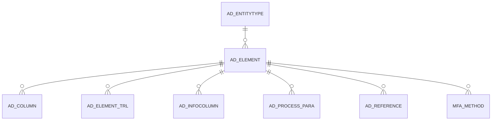

# AD_ELEMENT

Area [AD](../../data-model/ad/index.md) · class **config** (proposed) · read from database `idempiere-db` (owner `ADEMPIERE`) · 5923 row(s) when profiled

Application model: `org.compiere.model.X_AD_Element`, access level 4 - System.

## Columns

| column | type | key | not null | business name | references (code) | nulls | distinct |
|---|---|---|---|---|---|---|---|
| `AD_ELEMENT_ID` | NUMBER(10,0) | PK | yes | System Element |  | 0 | 5923 |
| `AD_CLIENT_ID` | NUMBER(10,0) |  | yes | Tenant |  | 0 | 1 |
| `AD_ORG_ID` | NUMBER(10,0) |  | yes | Organization |  | 0 | 1 |
| `ISACTIVE` | CHAR(1) |  | yes | Active |  | 0 | 2 |
| `CREATED` | DATE |  | yes | Created |  | 0 | 4072 |
| `CREATEDBY` | NUMBER(10,0) |  | yes | Created By |  | 0 | 3 |
| `UPDATED` | DATE |  | yes | Updated |  | 0 | 4228 |
| `UPDATEDBY` | NUMBER(10,0) |  | yes | Updated By |  | 0 | 3 |
| `COLUMNNAME` | VARCHAR2(63 CHAR) |  | yes | DB Column Name |  | 0 | 5923 |
| `ENTITYTYPE` | VARCHAR2(40 CHAR) |  | yes | Entity Type |  | 0 | 5 |
| `NAME` | VARCHAR2(60 CHAR) |  | yes | Name |  | 0 | 5758 |
| `PRINTNAME` | VARCHAR2(60 CHAR) |  | yes | Print Text |  | 0 | 5733 |
| `DESCRIPTION` | VARCHAR2(255 CHAR) |  |  | Description |  | 3411 | 2459 |
| `HELP` | VARCHAR2(2000 CHAR) |  |  | Comment/Help |  | 4170 | 1657 |
| `PO_NAME` | VARCHAR2(60 CHAR) |  |  | PO Name |  | 5909 | 11 |
| `PO_PRINTNAME` | VARCHAR2(60 CHAR) |  |  | PO Print name |  | 5909 | 12 |
| `PO_DESCRIPTION` | VARCHAR2(255 CHAR) |  |  | PO Description |  | 5911 | 11 |
| `PO_HELP` | VARCHAR2(2000 CHAR) |  |  | PO Help |  | 5913 | 9 |
| `AD_ELEMENT_UU` | VARCHAR2(36 CHAR) |  |  | AD_Element_UU |  | 0 | 5923 |
| `PLACEHOLDER` | VARCHAR2(255 CHAR) |  |  | Placeholder |  | 5922 | 1 |

*references (code)* is the table the application model's code says a column points to; *Foreign keys* below are the constraints the database declares. Counts come from the profile; no value is ever shown.

## Check constraints

| name | expression |
|---|---|
| `SYS_C0022221` | `IsActive in ('Y','N')` |

## Foreign keys

**References**

| table | columns | on delete |
|---|---|---|
| [AD_ENTITYTYPE](../../data-model/ad/ad_entitytype.md) | AD_ELEMENT.ENTITYTYPE → AD_ENTITYTYPE.ENTITYTYPE | NO ACTION |

**Referenced by**

| table | columns | on delete |
|---|---|---|
| [AD_COLUMN](../../data-model/ad/ad_column.md) | AD_COLUMN.AD_ELEMENT_ID → AD_ELEMENT.AD_ELEMENT_ID | NO ACTION |
| [AD_ELEMENT_TRL](../../data-model/ad/ad_element_trl.md) | AD_ELEMENT_TRL.AD_ELEMENT_ID → AD_ELEMENT.AD_ELEMENT_ID | CASCADE |
| [AD_INFOCOLUMN](../../data-model/ad/ad_infocolumn.md) | AD_INFOCOLUMN.AD_ELEMENT_ID → AD_ELEMENT.AD_ELEMENT_ID | NO ACTION |
| [AD_PROCESS_PARA](../../data-model/ad/ad_process_para.md) | AD_PROCESS_PARA.AD_ELEMENT_ID → AD_ELEMENT.AD_ELEMENT_ID | NO ACTION |
| [AD_REFERENCE](../../data-model/ad/ad_reference.md) | AD_REFERENCE.AD_ELEMENT_ID → AD_ELEMENT.AD_ELEMENT_ID | NO ACTION |
| [MFA_METHOD](../../data-model/mfa/mfa_method.md) | MFA_METHOD.MFA_ELEMENTPRM_ID → AD_ELEMENT.AD_ELEMENT_ID | NO ACTION |

## Write behaviour

- updates: **po_only**
- deletes: **deleted_by_users**
- change log: **recorded**
- evidence: 1 citation(s)

## Read by

| kind | name |
|---|---|
| Procedure | [AD_Synchronize](../../logic/ad_synchronize.md) |

## Written by

| kind | name |
|---|---|
| Procedure | [AD_Synchronize](../../logic/ad_synchronize.md) |

## Schema history

56 change(s); the latest:

| applied | release | operation | column | tickets |
|---|---|---|---|---|
| 2024-04-03T12:26 | iD11 | `create_index` |  | IDEMPIERE-6064 |
| 2024-04-03T12:26 | iD11 | `modify_column` | ColumnName | IDEMPIERE-6064 |
| 2024-04-03T12:26 | iD11 | `modify_column` | ColumnName | IDEMPIERE-6064 |
| 2023-04-09T15:47 | iD11 | `add_constraint` |  | IDEMPIERE-5567 |
| 2023-04-09T15:47 | iD11 | `add_constraint` |  | IDEMPIERE-5567 |
| 2021-12-05T16:45 | i8.2z | `add_constraint` |  | IDEMPIERE-5075 |
| 2021-12-05T16:45 | i8.2z | `drop_constraint` |  | IDEMPIERE-5075 |
| 2020-08-04T01:00 | i7.1z | `modify_column` | PLACEHOLDER | IDEMPIERE-3862 |
| 2020-08-04T01:00 | i7.1z | `modify_column` | NAME | IDEMPIERE-3862 |
| 2020-08-04T01:00 | i7.1z | `drop_column` | tmp_col_8_tmp | IDEMPIERE-3862 |
| 2020-08-04T01:00 | i7.1z | `modify_column` | NAME | IDEMPIERE-3862 |
| 2020-08-04T01:00 | i7.1z | `add_column` | tmp_col_11_tmp | IDEMPIERE-3862 |
| 2020-08-04T01:00 | i7.1z | `drop_column` | tmp_col_2_tmp | IDEMPIERE-3862 |
| 2020-08-04T01:00 | i7.1z | `modify_column` | PRINTNAME | IDEMPIERE-3862 |
| 2020-08-04T01:00 | i7.1z | `drop_column` | tmp_col_9_tmp | IDEMPIERE-3862 |

## Notes

<!-- ekos:manual id="table.ad_element.notes" -->
_Business notes about this table._
<!-- /ekos:manual -->
