# AD_ENTITYTYPE

Area [AD](../../data-model/ad/index.md) · class **config** (proposed) · read from database `idempiere-db` (owner `ADEMPIERE`) · 12 row(s) when profiled

Application model: `org.compiere.model.X_AD_EntityType`, access level 4 - System.

## Columns

| column | type | key | not null | business name | references (code) | nulls | distinct |
|---|---|---|---|---|---|---|---|
| `ENTITYTYPE` | VARCHAR2(40 CHAR) | PK | yes | Entity Type |  | 0 | 12 |
| `AD_CLIENT_ID` | NUMBER(10,0) |  | yes | Tenant |  | 0 | 1 |
| `AD_ORG_ID` | NUMBER(10,0) |  | yes | Organization |  | 0 | 1 |
| `AD_ENTITYTYPE_ID` | NUMBER(10,0) |  | yes | Entity Type |  | 0 | 12 |
| `ISACTIVE` | CHAR(1) |  | yes | Active |  | 0 | 1 |
| `CREATED` | DATE |  | yes | Created |  | 0 | 12 |
| `CREATEDBY` | NUMBER(10,0) |  | yes | Created By |  | 0 | 2 |
| `UPDATED` | DATE |  | yes | Updated |  | 0 | 12 |
| `UPDATEDBY` | NUMBER(10,0) |  | yes | Updated By |  | 0 | 2 |
| `NAME` | VARCHAR2(60 CHAR) |  | yes | Name |  | 0 | 12 |
| `DESCRIPTION` | VARCHAR2(255 CHAR) |  |  | Description |  | 1 | 11 |
| `HELP` | VARCHAR2(2000 CHAR) |  |  | Comment/Help |  | 2 | 7 |
| `VERSION` | VARCHAR2(20 CHAR) |  |  | Version |  | 8 | 2 |
| `MODELPACKAGE` | VARCHAR2(255 CHAR) |  |  | Model Package |  | 8 | 2 |
| `CLASSPATH` | VARCHAR2(255 CHAR) |  |  | Classpath |  | 12 | 0 |
| `PROCESSING` | CHAR(1) |  |  | Process Now |  | 0 | 1 |
| `AD_ENTITYTYPE_UU` | VARCHAR2(36 CHAR) |  |  | AD_EntityType_UU |  | 0 | 12 |

*references (code)* is the table the application model's code says a column points to; *Foreign keys* below are the constraints the database declares. Counts come from the profile; no value is ever shown.

## Check constraints

| name | expression |
|---|---|
| `SYS_C0021372` | `IsActive in ('Y','N')` |

## Foreign keys

**References**

_None._

**Referenced by**

| table | columns | on delete |
|---|---|---|
| [AD_CHART](../../data-model/ad/ad_chart.md) | AD_CHART.ENTITYTYPE → AD_ENTITYTYPE.ENTITYTYPE | NO ACTION |
| [AD_CHARTDATASOURCE](../../data-model/ad/ad_chartdatasource.md) | AD_CHARTDATASOURCE.ENTITYTYPE → AD_ENTITYTYPE.ENTITYTYPE | NO ACTION |
| [AD_COLUMN](../../data-model/ad/ad_column.md) | AD_COLUMN.ENTITYTYPE → AD_ENTITYTYPE.ENTITYTYPE | NO ACTION |
| [AD_ELEMENT](../../data-model/ad/ad_element.md) | AD_ELEMENT.ENTITYTYPE → AD_ENTITYTYPE.ENTITYTYPE | NO ACTION |
| [AD_FIELD](../../data-model/ad/ad_field.md) | AD_FIELD.ENTITYTYPE → AD_ENTITYTYPE.ENTITYTYPE | NO ACTION |
| [AD_FIELDGROUP](../../data-model/ad/ad_fieldgroup.md) | AD_FIELDGROUP.ENTITYTYPE → AD_ENTITYTYPE.ENTITYTYPE | NO ACTION |
| [AD_FORM](../../data-model/ad/ad_form.md) | AD_FORM.ENTITYTYPE → AD_ENTITYTYPE.ENTITYTYPE | NO ACTION |
| [AD_IMAGE](../../data-model/ad/ad_image.md) | AD_IMAGE.ENTITYTYPE → AD_ENTITYTYPE.ENTITYTYPE | NO ACTION |
| [AD_INDEXCOLUMN](../../data-model/ad/ad_indexcolumn.md) | AD_INDEXCOLUMN.ENTITYTYPE → AD_ENTITYTYPE.ENTITYTYPE | NO ACTION |
| [AD_INFOCOLUMN](../../data-model/ad/ad_infocolumn.md) | AD_INFOCOLUMN.ENTITYTYPE → AD_ENTITYTYPE.ENTITYTYPE | NO ACTION |
| [AD_INFOPROCESS](../../data-model/ad/ad_infoprocess.md) | AD_INFOPROCESS.ENTITYTYPE → AD_ENTITYTYPE.ENTITYTYPE | NO ACTION |
| [AD_INFORELATED](../../data-model/ad/ad_inforelated.md) | AD_INFORELATED.ENTITYTYPE → AD_ENTITYTYPE.ENTITYTYPE | NO ACTION |
| [AD_INFOWINDOW](../../data-model/ad/ad_infowindow.md) | AD_INFOWINDOW.ENTITYTYPE → AD_ENTITYTYPE.ENTITYTYPE | NO ACTION |
| [AD_MENU](../../data-model/ad/ad_menu.md) | AD_MENU.ENTITYTYPE → AD_ENTITYTYPE.ENTITYTYPE | NO ACTION |
| [AD_MESSAGE](../../data-model/ad/ad_message.md) | AD_MESSAGE.ENTITYTYPE → AD_ENTITYTYPE.ENTITYTYPE | NO ACTION |
| [AD_MODELVALIDATOR](../../data-model/ad/ad_modelvalidator.md) | AD_MODELVALIDATOR.ENTITYTYPE → AD_ENTITYTYPE.ENTITYTYPE | NO ACTION |
| [AD_MODIFICATION](../../data-model/ad/ad_modification.md) | AD_MODIFICATION.ENTITYTYPE → AD_ENTITYTYPE.ENTITYTYPE | NO ACTION |
| [AD_PACKAGE_EXP_DETAIL](../../data-model/ad/ad_package_exp_detail.md) | AD_PACKAGE_EXP_DETAIL.AD_ENTITYTYPE_ID → AD_ENTITYTYPE.AD_ENTITYTYPE_ID | NO ACTION |
| [AD_PROCESS](../../data-model/ad/ad_process.md) | AD_PROCESS.ENTITYTYPE → AD_ENTITYTYPE.ENTITYTYPE | NO ACTION |
| [AD_PROCESS_PARA](../../data-model/ad/ad_process_para.md) | AD_PROCESS_PARA.ENTITYTYPE → AD_ENTITYTYPE.ENTITYTYPE | NO ACTION |
| [AD_REFERENCE](../../data-model/ad/ad_reference.md) | AD_REFERENCE.ENTITYTYPE → AD_ENTITYTYPE.ENTITYTYPE | NO ACTION |
| [AD_REF_LIST](../../data-model/ad/ad_ref_list.md) | AD_REF_LIST.ENTITYTYPE → AD_ENTITYTYPE.ENTITYTYPE | NO ACTION |
| [AD_REF_TABLE](../../data-model/ad/ad_ref_table.md) | AD_REF_TABLE.ENTITYTYPE → AD_ENTITYTYPE.ENTITYTYPE | NO ACTION |
| [AD_RELATIONTYPE](../../data-model/ad/ad_relationtype.md) | AD_RELATIONTYPE.ENTITYTYPE → AD_ENTITYTYPE.ENTITYTYPE | NO ACTION |
| [AD_REPLICATIONSTRATEGY](../../data-model/ad/ad_replicationstrategy.md) | AD_REPLICATIONSTRATEGY.ENTITYTYPE → AD_ENTITYTYPE.ENTITYTYPE | NO ACTION |
| [AD_REPLICATIONTABLE](../../data-model/ad/ad_replicationtable.md) | AD_REPLICATIONTABLE.ENTITYTYPE → AD_ENTITYTYPE.ENTITYTYPE | NO ACTION |
| [AD_REPORTVIEW](../../data-model/ad/ad_reportview.md) | AD_REPORTVIEW.ENTITYTYPE → AD_ENTITYTYPE.ENTITYTYPE | NO ACTION |
| [AD_RULE](../../data-model/ad/ad_rule.md) | AD_RULE.ENTITYTYPE → AD_ENTITYTYPE.ENTITYTYPE | NO ACTION |
| [AD_SEARCHDEFINITION](../../data-model/ad/ad_searchdefinition.md) | AD_SEARCHDEFINITION.ENTITYTYPE → AD_ENTITYTYPE.ENTITYTYPE | NO ACTION |
| [AD_STATUSLINE](../../data-model/ad/ad_statusline.md) | AD_STATUSLINE.ENTITYTYPE → AD_ENTITYTYPE.ENTITYTYPE | NO ACTION |
| [AD_STATUSLINEUSEDIN](../../data-model/ad/ad_statuslineusedin.md) | AD_STATUSLINEUSEDIN.ENTITYTYPE → AD_ENTITYTYPE.ENTITYTYPE | NO ACTION |
| [AD_STYLE](../../data-model/ad/ad_style.md) | AD_STYLE.ENTITYTYPE → AD_ENTITYTYPE.ENTITYTYPE | NO ACTION |
| [AD_STYLELINE](../../data-model/ad/ad_styleline.md) | AD_STYLELINE.ENTITYTYPE → AD_ENTITYTYPE.ENTITYTYPE | NO ACTION |
| [AD_SYSCONFIG](../../data-model/ad/ad_sysconfig.md) | AD_SYSCONFIG.ENTITYTYPE → AD_ENTITYTYPE.ENTITYTYPE | NO ACTION |
| [AD_TAB](../../data-model/ad/ad_tab.md) | AD_TAB.ENTITYTYPE → AD_ENTITYTYPE.ENTITYTYPE | NO ACTION |
| [AD_TABLE](../../data-model/ad/ad_table.md) | AD_TABLE.ENTITYTYPE → AD_ENTITYTYPE.ENTITYTYPE | NO ACTION |
| [AD_TABLEINDEX](../../data-model/ad/ad_tableindex.md) | AD_TABLEINDEX.ENTITYTYPE → AD_ENTITYTYPE.ENTITYTYPE | NO ACTION |
| [AD_TASK](../../data-model/ad/ad_task.md) | AD_TASK.ENTITYTYPE → AD_ENTITYTYPE.ENTITYTYPE | NO ACTION |
| [AD_TOOLBARBUTTON](../../data-model/ad/ad_toolbarbutton.md) | AD_TOOLBARBUTTON.ENTITYTYPE → AD_ENTITYTYPE.ENTITYTYPE | NO ACTION |
| [AD_VAL_RULE](../../data-model/ad/ad_val_rule.md) | AD_VAL_RULE.ENTITYTYPE → AD_ENTITYTYPE.ENTITYTYPE | NO ACTION |
| [AD_VIEWCOLUMN](../../data-model/ad/ad_viewcolumn.md) | AD_VIEWCOLUMN.ENTITYTYPE → AD_ENTITYTYPE.ENTITYTYPE | NO ACTION |
| [AD_VIEWCOMPONENT](../../data-model/ad/ad_viewcomponent.md) | AD_VIEWCOMPONENT.ENTITYTYPE → AD_ENTITYTYPE.ENTITYTYPE | NO ACTION |
| [AD_WF_NEXTCONDITION](../../data-model/ad/ad_wf_nextcondition.md) | AD_WF_NEXTCONDITION.ENTITYTYPE → AD_ENTITYTYPE.ENTITYTYPE | NO ACTION |
| [AD_WF_NODE](../../data-model/ad/ad_wf_node.md) | AD_WF_NODE.ENTITYTYPE → AD_ENTITYTYPE.ENTITYTYPE | NO ACTION |
| [AD_WF_NODENEXT](../../data-model/ad/ad_wf_nodenext.md) | AD_WF_NODENEXT.ENTITYTYPE → AD_ENTITYTYPE.ENTITYTYPE | NO ACTION |
| [AD_WF_NODE_PARA](../../data-model/ad/ad_wf_node_para.md) | AD_WF_NODE_PARA.ENTITYTYPE → AD_ENTITYTYPE.ENTITYTYPE | NO ACTION |
| [AD_WF_RESPONSIBLE](../../data-model/ad/ad_wf_responsible.md) | AD_WF_RESPONSIBLE.ENTITYTYPE → AD_ENTITYTYPE.ENTITYTYPE | NO ACTION |
| [AD_WINDOW](../../data-model/ad/ad_window.md) | AD_WINDOW.ENTITYTYPE → AD_ENTITYTYPE.ENTITYTYPE | NO ACTION |
| [AD_WORKBENCH](../../data-model/ad/ad_workbench.md) | AD_WORKBENCH.ENTITYTYPE → AD_ENTITYTYPE.ENTITYTYPE | NO ACTION |
| [AD_WORKBENCHWINDOW](../../data-model/ad/ad_workbenchwindow.md) | AD_WORKBENCHWINDOW.ENTITYTYPE → AD_ENTITYTYPE.ENTITYTYPE | NO ACTION |
| [AD_WORKFLOW](../../data-model/ad/ad_workflow.md) | AD_WORKFLOW.ENTITYTYPE → AD_ENTITYTYPE.ENTITYTYPE | NO ACTION |
| [AD_ZOOMCONDITION](../../data-model/ad/ad_zoomcondition.md) | AD_ZOOMCONDITION.ENTITYTYPE → AD_ENTITYTYPE.ENTITYTYPE | NO ACTION |
| [PA_COLORSCHEMA](../../data-model/pa/pa_colorschema.md) | PA_COLORSCHEMA.ENTITYTYPE → AD_ENTITYTYPE.ENTITYTYPE | NO ACTION |
| [PA_DOCUMENTSTATUS](../../data-model/pa/pa_documentstatus.md) | PA_DOCUMENTSTATUS.ENTITYTYPE → AD_ENTITYTYPE.ENTITYTYPE | NO ACTION |
| [PA_MEASURECALC](../../data-model/pa/pa_measurecalc.md) | PA_MEASURECALC.ENTITYTYPE → AD_ENTITYTYPE.ENTITYTYPE | NO ACTION |
| [PP_ORDER_NODE](../../data-model/pp/pp_order_node.md) | PP_ORDER_NODE.ENTITYTYPE → AD_ENTITYTYPE.ENTITYTYPE | NO ACTION |
| [PP_ORDER_NODENEXT](../../data-model/pp/pp_order_nodenext.md) | PP_ORDER_NODENEXT.ENTITYTYPE → AD_ENTITYTYPE.ENTITYTYPE | NO ACTION |
| [PP_ORDER_WORKFLOW](../../data-model/pp/pp_order_workflow.md) | PP_ORDER_WORKFLOW.ENTITYTYPE → AD_ENTITYTYPE.ENTITYTYPE | NO ACTION |
| [PP_WF_NODE_PRODUCT](../../data-model/pp/pp_wf_node_product.md) | PP_WF_NODE_PRODUCT.ENTITYTYPE → AD_ENTITYTYPE.ENTITYTYPE | NO ACTION |

```mermaid
erDiagram
  AD_ENTITYTYPE ||--o{ AD_CHART : ""
  AD_ENTITYTYPE ||--o{ AD_CHARTDATASOURCE : ""
  AD_ENTITYTYPE ||--o{ AD_COLUMN : ""
  AD_ENTITYTYPE ||--o{ AD_ELEMENT : ""
  AD_ENTITYTYPE ||--o{ AD_FIELD : ""
  AD_ENTITYTYPE ||--o{ AD_FIELDGROUP : ""
  AD_ENTITYTYPE ||--o{ AD_FORM : ""
  AD_ENTITYTYPE ||--o{ AD_IMAGE : ""
  AD_ENTITYTYPE ||--o{ AD_INDEXCOLUMN : ""
  AD_ENTITYTYPE ||--o{ AD_INFOCOLUMN : ""
  AD_ENTITYTYPE ||--o{ AD_INFOPROCESS : ""
  AD_ENTITYTYPE ||--o{ AD_INFORELATED : ""
  AD_ENTITYTYPE ||--o{ AD_INFOWINDOW : ""
  AD_ENTITYTYPE ||--o{ AD_MENU : ""
  AD_ENTITYTYPE ||--o{ AD_MESSAGE : ""
  AD_ENTITYTYPE ||--o{ AD_MODELVALIDATOR : ""
  AD_ENTITYTYPE ||--o{ AD_MODIFICATION : ""
  AD_ENTITYTYPE ||--o{ AD_PACKAGE_EXP_DETAIL : ""
  AD_ENTITYTYPE ||--o{ AD_PROCESS : ""
  AD_ENTITYTYPE ||--o{ AD_PROCESS_PARA : ""
  AD_ENTITYTYPE ||--o{ AD_REFERENCE : ""
  AD_ENTITYTYPE ||--o{ AD_REF_LIST : ""
  AD_ENTITYTYPE ||--o{ AD_REF_TABLE : ""
  AD_ENTITYTYPE ||--o{ AD_RELATIONTYPE : ""
  AD_ENTITYTYPE ||--o{ AD_REPLICATIONSTRATEGY : ""
  AD_ENTITYTYPE ||--o{ AD_REPLICATIONTABLE : ""
  AD_ENTITYTYPE ||--o{ AD_REPORTVIEW : ""
  AD_ENTITYTYPE ||--o{ AD_RULE : ""
  AD_ENTITYTYPE ||--o{ AD_SEARCHDEFINITION : ""
```

30 more neighbour(s) not drawn.

## Write behaviour

- updates: **po_only**
- deletes: **deleted_by_users**
- change log: **recorded**
- evidence: 1 citation(s)

## Schema history

28 change(s); the latest:

| applied | release | operation | column | tickets |
|---|---|---|---|---|
| 2023-04-09T15:47 | iD11 | `add_constraint` |  | IDEMPIERE-5567 |
| 2023-04-09T15:47 | iD11 | `add_constraint` |  | IDEMPIERE-5567 |
| 2020-08-04T01:00 | i7.1z | `add_column` | tmp_col_6_tmp | IDEMPIERE-3862 |
| 2020-08-04T01:00 | i7.1z | `modify_column` | VERSION | IDEMPIERE-3862 |
| 2020-08-04T01:00 | i7.1z | `add_column` | tmp_col_1_tmp | IDEMPIERE-3862 |
| 2020-08-04T01:00 | i7.1z | `drop_column` | tmp_col_4_tmp | IDEMPIERE-3862 |
| 2020-08-04T01:00 | i7.1z | `add_column` | tmp_col_7_tmp | IDEMPIERE-3862 |
| 2020-08-04T01:00 | i7.1z | `modify_column` | NAME | IDEMPIERE-3862 |
| 2020-08-04T01:00 | i7.1z | `drop_column` | tmp_col_5_tmp | IDEMPIERE-3862 |
| 2020-08-04T01:00 | i7.1z | `add_column` | tmp_col_3_tmp | IDEMPIERE-3862 |
| 2020-08-04T01:00 | i7.1z | `drop_column` | tmp_col_7_tmp | IDEMPIERE-3862 |
| 2020-08-04T01:00 | i7.1z | `drop_column` | tmp_col_2_tmp | IDEMPIERE-3862 |
| 2020-08-04T01:00 | i7.1z | `modify_column` | ENTITYTYPE | IDEMPIERE-3862 |
| 2020-08-04T01:00 | i7.1z | `modify_column` | NAME | IDEMPIERE-3862 |
| 2020-08-04T01:00 | i7.1z | `modify_column` | NAME | IDEMPIERE-3862 |

## Notes

<!-- ekos:manual id="table.ad_entitytype.notes" -->
_Business notes about this table._
<!-- /ekos:manual -->
