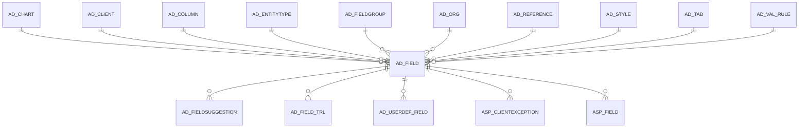

# AD_FIELD

Area [AD](../../data-model/ad/index.md) · class **config** (proposed) · read from database `idempiere-db` (owner `ADEMPIERE`) · 20951 row(s) when profiled

Application model: `org.compiere.model.X_AD_Field`, access level 4 - System.

## Columns

| column | type | key | not null | business name | references (code) | nulls | distinct |
|---|---|---|---|---|---|---|---|
| `AD_FIELD_ID` | NUMBER(10,0) | PK | yes | Field |  | 0 | 20951 |
| `AD_CLIENT_ID` | NUMBER(10,0) |  | yes | Tenant |  | 0 | 1 |
| `AD_ORG_ID` | NUMBER(10,0) |  | yes | Organization |  | 0 | 1 |
| `ISACTIVE` | CHAR(1) |  | yes | Active |  | 0 | 2 |
| `CREATED` | DATE |  | yes | Created |  | 0 | 7410 |
| `CREATEDBY` | NUMBER(10,0) |  | yes | Created By |  | 0 | 3 |
| `UPDATED` | DATE |  | yes | Updated |  | 0 | 6675 |
| `UPDATEDBY` | NUMBER(10,0) |  | yes | Updated By |  | 0 | 3 |
| `NAME` | VARCHAR2(60 CHAR) |  | yes | Name |  | 0 | 4139 |
| `DESCRIPTION` | VARCHAR2(255 CHAR) |  |  | Description |  | 3243 | 2447 |
| `HELP` | VARCHAR2(2000 CHAR) |  |  | Comment/Help |  | 4862 | 1733 |
| `ISCENTRALLYMAINTAINED` | CHAR(1) |  | yes | Centrally maintained |  | 0 | 2 |
| `AD_TAB_ID` | NUMBER(10,0) |  | yes | Tab | [AD_TAB](../../data-model/ad/ad_tab.md) | 0 | 1133 |
| `AD_COLUMN_ID` | NUMBER(10,0) |  |  | Column | [AD_COLUMN](../../data-model/ad/ad_column.md) | 0 | 14192 |
| `AD_FIELDGROUP_ID` | NUMBER(10,0) |  |  | Field Group | [AD_FIELDGROUP](../../data-model/ad/ad_fieldgroup.md) | 19660 | 72 |
| `ISDISPLAYED` | CHAR(1) |  | yes | Displayed |  | 0 | 2 |
| `DISPLAYLOGIC` | VARCHAR2(2000 CHAR) |  |  | Display Logic |  | 18504 | 729 |
| `DISPLAYLENGTH` | NUMBER(10,0) |  |  | Display Length |  | 8 | 49 |
| `ISREADONLY` | CHAR(1) |  | yes | Read Only |  | 0 | 2 |
| `SEQNO` | NUMBER(10,0) |  |  | Sequence |  | 734 | 111 |
| `SORTNO` | NUMBER(10,0) |  |  | Record Sort No |  | 15287 | 9 |
| `ISSAMELINE` | CHAR(1) |  | yes | Same Line |  | 0 | 2 |
| `ISHEADING` | CHAR(1) |  | yes | Heading only |  | 0 | 1 |
| `ISFIELDONLY` | CHAR(1) |  | yes | Field Only |  | 0 | 2 |
| `ISENCRYPTED` | CHAR(1) |  | yes | Encrypted |  | 0 | 2 |
| `ENTITYTYPE` | VARCHAR2(40 CHAR) |  | yes | Entity Type |  | 0 | 7 |
| `OBSCURETYPE` | CHAR(3) |  |  | Obscure |  | 20945 | 2 |
| `AD_REFERENCE_ID` | NUMBER(10,0) |  |  | Reference | [AD_REFERENCE](../../data-model/ad/ad_reference.md) | 20922 | 6 |
| `ISMANDATORY` | CHAR(1) |  |  | Mandatory |  | 20911 | 1 |
| `INCLUDED_TAB_ID` | NUMBER(10,0) |  |  | Included Tab | [AD_TAB](../../data-model/ad/ad_tab.md) | 20951 | 0 |
| `DEFAULTVALUE` | VARCHAR2(2000 CHAR) |  |  | Default Logic |  | 20919 | 18 |
| `AD_REFERENCE_VALUE_ID` | NUMBER(10,0) |  |  | Reference Key | [AD_REFERENCE](../../data-model/ad/ad_reference.md) | 20944 | 5 |
| `AD_VAL_RULE_ID` | NUMBER(10,0) |  |  | Dynamic Validation | [AD_VAL_RULE](../../data-model/ad/ad_val_rule.md) | 20942 | 9 |
| `INFOFACTORYCLASS` | VARCHAR2(255 CHAR) |  |  |  |  | 20951 | 0 |
| `AD_FIELD_UU` | VARCHAR2(36 CHAR) |  |  | AD_Field_UU |  | 0 | 20951 |
| `ISALLOWCOPY` | CHAR(1) |  |  | Allow Copy |  | 18934 | 2 |
| `SEQNOGRID` | NUMBER(10,0) |  |  | Grid Sequence No |  | 1309 | 131 |
| `ISDISPLAYEDGRID` | CHAR(1) |  |  | Show in Grid |  | 0 | 2 |
| `XPOSITION` | NUMBER(10,0) |  |  | X Position |  | 0 | 9 |
| `NUMLINES` | NUMBER(10,0) |  |  | Number of Lines |  | 0 | 8 |
| `COLUMNSPAN` | NUMBER(10,0) |  |  | Column Span |  | 0 | 4 |
| `ISQUICKENTRY` | CHAR(1) |  | yes | Quick Entry |  | 0 | 2 |
| `ISUPDATEABLE` | CHAR(1) |  |  | Updatable |  | 20949 | 1 |
| `ISALWAYSUPDATEABLE` | CHAR(1) |  |  | Always Updatable |  | 20950 | 1 |
| `MANDATORYLOGIC` | VARCHAR2(2000 CHAR) |  |  | Mandatory Logic |  | 20937 | 8 |
| `READONLYLOGIC` | VARCHAR2(2000 CHAR) |  |  | Read Only Logic |  | 20899 | 42 |
| `ISTOOLBARBUTTON` | CHAR(1) |  |  | Toolbar Button |  | 20951 | 0 |
| `ISADVANCEDFIELD` | CHAR(1) |  |  | Advanced Field |  | 0 | 2 |
| `ISDEFAULTFOCUS` | CHAR(1) |  | yes | Default Focus |  | 0 | 1 |
| `VFORMAT` | VARCHAR2(255 CHAR) |  |  | Value Format |  | 20951 | 0 |
| `AD_LABELSTYLE_ID` | NUMBER(10,0) |  |  | Label Style | [AD_STYLE](../../data-model/ad/ad_style.md) | 20951 | 0 |
| `AD_FIELDSTYLE_ID` | NUMBER(10,0) |  |  | Field Style | [AD_STYLE](../../data-model/ad/ad_style.md) | 20950 | 1 |
| `PLACEHOLDER` | VARCHAR2(255 CHAR) |  |  | Placeholder |  | 20948 | 1 |
| `ISQUICKFORM` | CHAR(1) |  | yes | Quick Form |  | 0 | 2 |
| `ISSELECTIONCOLUMN` | CHAR(1) |  |  | Selection Column |  | 20951 | 0 |
| `AD_VAL_RULE_LOOKUP_ID` | NUMBER(10,0) |  |  | Dynamic Validation (Lookup) | [AD_VAL_RULE](../../data-model/ad/ad_val_rule.md) | 20951 | 0 |
| `COLUMNSQL` | VARCHAR2(4000 CHAR) |  |  | Column SQL |  | 20949 | 2 |
| `AD_CHART_ID` | NUMBER(10,0) |  |  | Chart | [AD_CHART](../../data-model/ad/ad_chart.md) | 20951 | 0 |
| `ALWAYSUPDATABLELOGIC` | VARCHAR2(2000 CHAR) |  |  | Always Updatable Logic |  | 20951 | 0 |
| `ISHTML` | CHAR(1) |  |  | HTML |  | 20946 | 1 |

*references (code)* is the table the application model's code says a column points to; *Foreign keys* below are the constraints the database declares. Counts come from the profile; no value is ever shown.

## Check constraints

| name | expression |
|---|---|
| `SYS_C0022306` | `IsQuickForm IN ('Y','N')` |
| `SYS_C0022307` | `IsEncrypted in ('Y','N')` |
| `SYS_C0022308` | `IsActive in ('Y','N')` |
| `SYS_C0022309` | `IsFieldOnly in ('Y','N')` |
| `SYS_C0022310` | `IsSameLine in ('Y','N')` |
| `SYS_C0022311` | `IsDisplayedGrid IN ('Y','N')` |
| `SYS_C0022313` | `IsDefaultFocus IN ('Y','N')` |
| `SYS_C0022314` | `IsHeading in ('Y','N')` |
| `SYS_C0022315` | `IsCentrallyMaintained in ('Y','N')` |
| `SYS_C0022317` | `IsDisplayed in ('Y','N')` |
| `SYS_C0022318` | `IsQuickEntry IN ('Y','N')` |
| `SYS_C0022319` | `IsReadOnly in ('Y','N')` |
| `SYS_C0022320` | `IsAdvancedField IN ('Y','N')` |

## Foreign keys

**References**

| table | columns | on delete |
|---|---|---|
| [AD_CHART](../../data-model/ad/ad_chart.md) | AD_FIELD.AD_CHART_ID → AD_CHART.AD_CHART_ID | NO ACTION |
| [AD_CLIENT](../../data-model/ad/ad_client.md) | AD_FIELD.AD_CLIENT_ID → AD_CLIENT.AD_CLIENT_ID | NO ACTION |
| [AD_COLUMN](../../data-model/ad/ad_column.md) | AD_FIELD.AD_COLUMN_ID → AD_COLUMN.AD_COLUMN_ID | NO ACTION |
| [AD_ENTITYTYPE](../../data-model/ad/ad_entitytype.md) | AD_FIELD.ENTITYTYPE → AD_ENTITYTYPE.ENTITYTYPE | NO ACTION |
| [AD_FIELDGROUP](../../data-model/ad/ad_fieldgroup.md) | AD_FIELD.AD_FIELDGROUP_ID → AD_FIELDGROUP.AD_FIELDGROUP_ID | NO ACTION |
| [AD_ORG](../../data-model/ad/ad_org.md) | AD_FIELD.AD_ORG_ID → AD_ORG.AD_ORG_ID | NO ACTION |
| [AD_REFERENCE](../../data-model/ad/ad_reference.md) | AD_FIELD.AD_REFERENCE_VALUE_ID → AD_REFERENCE.AD_REFERENCE_ID | NO ACTION |
| [AD_STYLE](../../data-model/ad/ad_style.md) | AD_FIELD.AD_FIELDSTYLE_ID → AD_STYLE.AD_STYLE_ID | NO ACTION |
| [AD_TAB](../../data-model/ad/ad_tab.md) | AD_FIELD.AD_TAB_ID → AD_TAB.AD_TAB_ID | CASCADE |
| [AD_VAL_RULE](../../data-model/ad/ad_val_rule.md) | AD_FIELD.AD_VAL_RULE_LOOKUP_ID → AD_VAL_RULE.AD_VAL_RULE_ID | NO ACTION |

**Referenced by**

| table | columns | on delete |
|---|---|---|
| [AD_FIELDSUGGESTION](../../data-model/ad/ad_fieldsuggestion.md) | AD_FIELDSUGGESTION.AD_FIELD_ID → AD_FIELD.AD_FIELD_ID | NO ACTION |
| [AD_FIELD_TRL](../../data-model/ad/ad_field_trl.md) | AD_FIELD_TRL.AD_FIELD_ID → AD_FIELD.AD_FIELD_ID | CASCADE |
| [AD_USERDEF_FIELD](../../data-model/ad/ad_userdef_field.md) | AD_USERDEF_FIELD.AD_FIELD_ID → AD_FIELD.AD_FIELD_ID | NO ACTION |
| [ASP_CLIENTEXCEPTION](../../data-model/asp/asp_clientexception.md) | ASP_CLIENTEXCEPTION.AD_FIELD_ID → AD_FIELD.AD_FIELD_ID | NO ACTION |
| [ASP_FIELD](../../data-model/asp/asp_field.md) | ASP_FIELD.AD_FIELD_ID → AD_FIELD.AD_FIELD_ID | NO ACTION |

## Write behaviour

- updates: **raw_sql_skips_updated**
- deletes: **deleted_by_users, deleted_by_cascade**
- change log: **recorded**
- evidence: 11 citation(s)

## Read by

| kind | name |
|---|---|
| Procedure | [AD_Synchronize](../../logic/ad_synchronize.md) |
| View | `AD_FIELD_V` |
| View | `AD_FIELD_VT` |
| View | `ad_field_v` |
| View | `ad_field_vt` |

## Written by

| kind | name |
|---|---|
| Procedure | [AD_Synchronize](../../logic/ad_synchronize.md) |

## Schema history

108 change(s); the latest:

| applied | release | operation | column | tickets |
|---|---|---|---|---|
| 2024-05-17T16:07 | iD12 | `add_column` | IsHtml | IDEMPIERE-6147 |
| 2024-05-17T16:07 | iD12 | `add_column` | IsHtml | IDEMPIERE-6147 |
| 2023-04-09T15:47 | iD11 | `add_constraint` |  | IDEMPIERE-5567 |
| 2023-04-09T15:47 | iD11 | `add_constraint` |  | IDEMPIERE-5567 |
| 2022-10-05T20:03 | iD10 | `add_column` | AlwaysUpdatableLogic | IDEMPIERE-5349 |
| 2022-10-05T20:03 | iD10 | `add_column` | AlwaysUpdatableLogic | IDEMPIERE-5349 |
| 2022-03-15T14:30 | iD10 | `add_column` | AD_Chart_ID | IDEMPIERE-5232 |
| 2022-03-15T14:30 | iD10 | `add_constraint` |  | IDEMPIERE-5232 |
| 2022-03-15T14:30 | iD10 | `add_column` | AD_Chart_ID | IDEMPIERE-5232 |
| 2022-03-15T14:30 | iD10 | `add_constraint` |  | IDEMPIERE-5232 |
| 2021-12-05T16:45 | i8.2z | `drop_constraint` |  | IDEMPIERE-5075 |
| 2021-12-05T16:45 | i8.2z | `add_constraint` |  | IDEMPIERE-5075 |
| 2021-12-05T16:45 | i8.2z | `add_constraint` |  | IDEMPIERE-5075 |
| 2021-12-05T16:45 | i8.2z | `drop_constraint` |  | IDEMPIERE-5075 |
| 2021-12-05T16:45 | i8.2z | `add_constraint` |  | IDEMPIERE-5075 |

## Open conflicts

| type | attribute | explanation |
|---|---|---|
| `mandatory_but_nullable` | `columns.AD_Column_ID.nullable` | unexplained |

## Notes

<!-- ekos:manual id="table.ad_field.notes" -->
_Business notes about this table._
<!-- /ekos:manual -->
