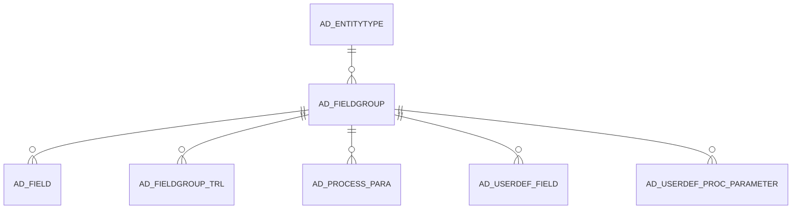

# AD_FIELDGROUP

Area [AD](../../data-model/ad/index.md) · class **config** (proposed) · read from database `idempiere-db` (owner `ADEMPIERE`) · 77 row(s) when profiled

Application model: `org.compiere.model.X_AD_FieldGroup`, access level 4 - System.

## Columns

| column | type | key | not null | business name | references (code) | nulls | distinct |
|---|---|---|---|---|---|---|---|
| `AD_FIELDGROUP_ID` | NUMBER(10,0) | PK | yes | Field Group |  | 0 | 77 |
| `AD_CLIENT_ID` | NUMBER(10,0) |  | yes | Tenant |  | 0 | 1 |
| `AD_ORG_ID` | NUMBER(10,0) |  | yes | Organization |  | 0 | 1 |
| `ISACTIVE` | CHAR(1) |  | yes | Active |  | 0 | 1 |
| `CREATED` | DATE |  | yes | Created |  | 0 | 75 |
| `CREATEDBY` | NUMBER(10,0) |  | yes | Created By |  | 0 | 2 |
| `UPDATED` | DATE |  | yes | Updated |  | 0 | 50 |
| `UPDATEDBY` | NUMBER(10,0) |  | yes | Updated By |  | 0 | 2 |
| `NAME` | VARCHAR2(60 CHAR) |  | yes | Name |  | 0 | 77 |
| `ENTITYTYPE` | VARCHAR2(40 CHAR) |  | yes | Entity Type |  | 0 | 1 |
| `FIELDGROUPTYPE` | VARCHAR2(10 CHAR) |  |  | Field Group Type |  | 4 | 4 |
| `ISCOLLAPSEDBYDEFAULT` | CHAR(1) |  |  | Collapsed By Default |  | 0 | 2 |
| `AD_FIELDGROUP_UU` | VARCHAR2(36 CHAR) |  |  | AD_FieldGroup_UU |  | 0 | 77 |

*references (code)* is the table the application model's code says a column points to; *Foreign keys* below are the constraints the database declares. Counts come from the profile; no value is ever shown.

## Check constraints

| name | expression |
|---|---|
| `SYS_C0019740` | `IsActive in ('Y','N')` |
| `SYS_C0019741` | `IsCollapsedByDefault IN ('Y','N')` |

## Foreign keys

**References**

| table | columns | on delete |
|---|---|---|
| [AD_ENTITYTYPE](../../data-model/ad/ad_entitytype.md) | AD_FIELDGROUP.ENTITYTYPE → AD_ENTITYTYPE.ENTITYTYPE | NO ACTION |

**Referenced by**

| table | columns | on delete |
|---|---|---|
| [AD_FIELD](../../data-model/ad/ad_field.md) | AD_FIELD.AD_FIELDGROUP_ID → AD_FIELDGROUP.AD_FIELDGROUP_ID | NO ACTION |
| [AD_FIELDGROUP_TRL](../../data-model/ad/ad_fieldgroup_trl.md) | AD_FIELDGROUP_TRL.AD_FIELDGROUP_ID → AD_FIELDGROUP.AD_FIELDGROUP_ID | CASCADE |
| [AD_PROCESS_PARA](../../data-model/ad/ad_process_para.md) | AD_PROCESS_PARA.AD_FIELDGROUP_ID → AD_FIELDGROUP.AD_FIELDGROUP_ID | NO ACTION |
| [AD_USERDEF_FIELD](../../data-model/ad/ad_userdef_field.md) | AD_USERDEF_FIELD.AD_FIELDGROUP_ID → AD_FIELDGROUP.AD_FIELDGROUP_ID | NO ACTION |
| [AD_USERDEF_PROC_PARAMETER](../../data-model/ad/ad_userdef_proc_parameter.md) | AD_USERDEF_PROC_PARAMETER.AD_FIELDGROUP_ID → AD_FIELDGROUP.AD_FIELDGROUP_ID | NO ACTION |

## Write behaviour

- updates: **po_only**
- deletes: **deleted_by_users**
- change log: **recorded**
- evidence: 1 citation(s)

## Read by

| kind | name |
|---|---|
| View | `AD_FIELD_V` |
| View | `AD_FIELD_VT` |
| View | `ad_field_v` |
| View | `ad_field_vt` |

## Schema history

15 change(s); the latest:

| applied | release | operation | column | tickets |
|---|---|---|---|---|
| 2023-04-09T15:47 | iD11 | `add_constraint` |  | IDEMPIERE-5567 |
| 2023-04-09T15:47 | iD11 | `add_constraint` |  | IDEMPIERE-5567 |
| 2022-03-26T18:37 | iD10 | `modify_column` | FieldGroupType | IDEMPIERE-4550 |
| 2022-03-26T18:37 | iD10 | `modify_column` | FieldGroupType | IDEMPIERE-4550 |
| 2021-12-05T16:45 | i8.2z | `drop_constraint` |  | IDEMPIERE-5075 |
| 2021-12-05T16:45 | i8.2z | `add_constraint` |  | IDEMPIERE-5075 |
| 2020-08-04T01:00 | i7.1z | `modify_column` | NAME | IDEMPIERE-3862 |
| 2020-08-04T01:00 | i7.1z | `add_column` | tmp_col_2_tmp | IDEMPIERE-3862 |
| 2020-08-04T01:00 | i7.1z | `drop_column` | tmp_col_1_tmp | IDEMPIERE-3862 |
| 2020-08-04T01:00 | i7.1z | `modify_column` | AD_FIELDGROUP_UU | IDEMPIERE-3862 |
| 2020-08-04T01:00 | i7.1z | `modify_column` | NAME | IDEMPIERE-3862 |
| 2020-08-04T01:00 | i7.1z | `modify_column` | NAME | IDEMPIERE-3862 |
| 2020-08-04T01:00 | i7.1z | `drop_column` | tmp_col_2_tmp | IDEMPIERE-3862 |
| 2020-08-04T01:00 | i7.1z | `modify_column` | ENTITYTYPE | IDEMPIERE-3862 |
| 2020-08-04T01:00 | i7.1z | `add_column` | tmp_col_1_tmp | IDEMPIERE-3862 |

## Notes

<!-- ekos:manual id="table.ad_fieldgroup.notes" -->
_Business notes about this table._
<!-- /ekos:manual -->
