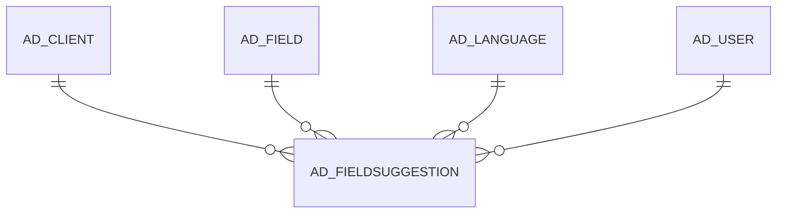

# AD_FIELDSUGGESTION

Area [AD](../../data-model/ad/index.md) · class **config** (proposed) · read from database `idempiere-db` (owner `ADEMPIERE`) · 0 row(s) when profiled

Application model: `org.compiere.model.X_AD_FieldSuggestion`, access level 4 - System.

## Columns

| column | type | key | not null | business name | references (code) | nulls | distinct |
|---|---|---|---|---|---|---|---|
| `ACCEPTSUGGESTION` | CHAR(1) |  |  | Accept |  | 0 | 0 |
| `AD_CLIENT_ID` | NUMBER(10,0) |  | yes | Tenant |  | 0 | 0 |
| `AD_FIELD_ID` | NUMBER(10,0) |  | yes | Field | [AD_FIELD](../../data-model/ad/ad_field.md) | 0 | 0 |
| `AD_FIELDSUGGESTION_ID` | NUMBER(10,0) | PK | yes | Field Suggestions |  | 0 | 0 |
| `AD_FIELDSUGGESTION_UU` | VARCHAR2(36 CHAR) |  | yes | Field Suggestions UUID |  | 0 | 0 |
| `AD_LANGUAGE` | VARCHAR2(6 CHAR) |  | yes | Language |  | 0 | 0 |
| `AD_ORG_ID` | NUMBER(10,0) |  | yes | Organization |  | 0 | 0 |
| `AD_USERCLIENT_ID` | NUMBER(10,0) |  | yes | Tenant of User | `AD_ALLCLIENTS_V` | 0 | 0 |
| `AD_USER_ID` | NUMBER(10,0) |  | yes | User/Contact | `AD_ALLUSERS_V` | 0 | 0 |
| `COMPARESUGGESTION` | CHAR(1) |  |  | Compare |  | 0 | 0 |
| `CREATED` | DATE |  | yes | Created |  | 0 | 0 |
| `CREATEDBY` | NUMBER(10,0) |  | yes | Created By |  | 0 | 0 |
| `DESCRIPTION` | VARCHAR2(255 CHAR) |  |  | Description |  | 0 | 0 |
| `FIELDSUGGESTIONTARGET` | CHAR(1) |  | yes | Apply Suggestion To |  | 0 | 0 |
| `HELP` | VARCHAR2(2000 CHAR) |  |  | Comment/Help |  | 0 | 0 |
| `ISACTIVE` | CHAR(1) |  | yes | Active |  | 0 | 0 |
| `ISAPPROVED` | CHAR(1) |  | yes | Approved |  | 0 | 0 |
| `ISUPDATEBASELANGUAGE` | CHAR(1) |  | yes | Update Base Language |  | 0 | 0 |
| `NAME` | VARCHAR2(60 CHAR) |  |  | Name |  | 0 | 0 |
| `PROCESSED` | CHAR(1) |  | yes | Processed |  | 0 | 0 |
| `REJECTSUGGESTION` | CHAR(1) |  |  | Reject |  | 0 | 0 |
| `UPDATED` | DATE |  | yes | Updated |  | 0 | 0 |
| `UPDATEDBY` | NUMBER(10,0) |  | yes | Updated By |  | 0 | 0 |

*references (code)* is the table the application model's code says a column points to; *Foreign keys* below are the constraints the database declares. Counts come from the profile; no value is ever shown.

## Check constraints

| name | expression |
|---|---|
| `SYS_C0021017` | `IsUpdateBaseLanguage IN ('Y','N')` |
| `SYS_C0021018` | `IsApproved IN ('Y','N')` |
| `SYS_C0021019` | `IsActive IN ('Y','N')` |
| `SYS_C0021020` | `Processed IN ('Y','N')` |

## Foreign keys

**References**

| table | columns | on delete |
|---|---|---|
| [AD_CLIENT](../../data-model/ad/ad_client.md) | AD_FIELDSUGGESTION.AD_USERCLIENT_ID → AD_CLIENT.AD_CLIENT_ID | NO ACTION |
| [AD_FIELD](../../data-model/ad/ad_field.md) | AD_FIELDSUGGESTION.AD_FIELD_ID → AD_FIELD.AD_FIELD_ID | NO ACTION |
| [AD_LANGUAGE](../../data-model/ad/ad_language.md) | AD_FIELDSUGGESTION.AD_LANGUAGE → AD_LANGUAGE.AD_LANGUAGE | NO ACTION |
| [AD_USER](../../data-model/ad/ad_user.md) | AD_FIELDSUGGESTION.AD_USER_ID → AD_USER.AD_USER_ID | NO ACTION |

**Referenced by**

_None._

## Write behaviour

- updates: **po_only**
- deletes: **soft_delete_only**
- change log: **recorded**
- evidence: 1 citation(s)

## Schema history

27 change(s); the latest:

| applied | release | operation | column | tickets |
|---|---|---|---|---|
| 2020-08-04T01:00 | i7.1z | `modify_column` | DESCRIPTION | IDEMPIERE-3862 |
| 2020-08-04T01:00 | i7.1z | `modify_column` | AD_LANGUAGE | IDEMPIERE-3862 |
| 2020-08-04T01:00 | i7.1z | `modify_column` | HELP | IDEMPIERE-3862 |
| 2020-08-04T01:00 | i7.1z | `modify_column` | NAME | IDEMPIERE-3862 |
| 2020-08-04T01:00 | i7.1z | `modify_column` | AD_FIELDSUGGESTION_UU | IDEMPIERE-3862 |
| 2019-06-17T12:20 | i6.2 | `modify_column` | AD_UserClient_ID | IDEMPIERE-3439 |
| 2019-06-17T12:20 | i6.2 | `add_constraint` |  | IDEMPIERE-3439 |
| 2019-06-17T12:20 | i6.2 | `modify_column` | AD_User_ID | IDEMPIERE-3439 |
| 2019-06-17T12:20 | i6.2 | `modify_column` | AD_User_ID | IDEMPIERE-3439 |
| 2019-06-17T12:20 | i6.2 | `add_constraint` |  | IDEMPIERE-3439 |
| 2019-06-17T12:20 | i6.2 | `add_constraint` |  | IDEMPIERE-3439 |
| 2019-06-17T12:20 | i6.2 | `modify_column` | AD_UserClient_ID | IDEMPIERE-3439 |
| 2019-06-17T12:20 | i6.2 | `add_constraint` |  | IDEMPIERE-3439 |
| 2017-07-28T18:28 | i4.1z | `drop_constraint` |  | IDEMPIERE-3438 |
| 2017-07-28T18:28 | i4.1z | `drop_constraint` |  | IDEMPIERE-3438 |

## Notes

<!-- ekos:manual id="table.ad_fieldsuggestion.notes" -->
_Business notes about this table._
<!-- /ekos:manual -->
