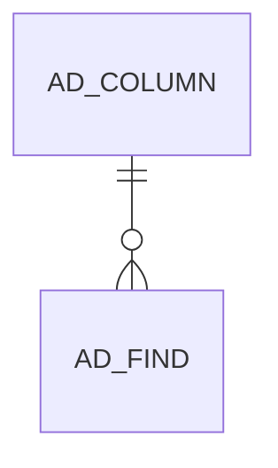

# AD_FIND

Search Window

Area [AD](../../data-model/ad/index.md) · class **config** (proposed) · read from database `idempiere-db` (owner `ADEMPIERE`) · 0 row(s) when profiled

Application model: `org.compiere.model.X_AD_Find`, access level 7 - System - Client - Org.

## Columns

| column | type | key | not null | business name | references (code) | nulls | distinct |
|---|---|---|---|---|---|---|---|
| `AD_FIND_ID` | NUMBER(10,0) | PK | yes | Find |  | 0 | 0 |
| `FIND_ID` | NUMBER |  | yes | Find |  | 0 | 0 |
| `AD_CLIENT_ID` | NUMBER(10,0) |  | yes | Tenant |  | 0 | 0 |
| `AD_ORG_ID` | NUMBER(10,0) |  | yes | Organization |  | 0 | 0 |
| `ISACTIVE` | CHAR(1) |  | yes | Active |  | 0 | 0 |
| `CREATED` | DATE |  | yes | Created |  | 0 | 0 |
| `CREATEDBY` | NUMBER(10,0) |  | yes | Created By |  | 0 | 0 |
| `UPDATED` | DATE |  | yes | Updated |  | 0 | 0 |
| `UPDATEDBY` | NUMBER(10,0) |  | yes | Updated By |  | 0 | 0 |
| `ANDOR` | CHAR(1) |  | yes | And/Or |  | 0 | 0 |
| `AD_COLUMN_ID` | NUMBER(10,0) |  | yes | Column | [AD_COLUMN](../../data-model/ad/ad_column.md) | 0 | 0 |
| `OPERATION` | CHAR(2) |  | yes | Operation |  | 0 | 0 |
| `VALUE` | VARCHAR2(40 CHAR) |  | yes | Search Key |  | 0 | 0 |
| `VALUE2` | VARCHAR2(40 CHAR) |  |  | Value To |  | 0 | 0 |
| `AD_FIND_UU` | VARCHAR2(36 CHAR) |  |  | AD_Find_UU |  | 0 | 0 |

*references (code)* is the table the application model's code says a column points to; *Foreign keys* below are the constraints the database declares. Counts come from the profile; no value is ever shown.

## Check constraints

| name | expression |
|---|---|
| `SYS_C0020266` | `IsActive in ('Y','N')` |

## Foreign keys

**References**

| table | columns | on delete |
|---|---|---|
| [AD_COLUMN](../../data-model/ad/ad_column.md) | AD_FIND.AD_COLUMN_ID → AD_COLUMN.AD_COLUMN_ID | NO ACTION |

**Referenced by**

_None._

## Write behaviour

- updates: **po_only**
- deletes: **deleted_by_users, purged**
- change log: **recorded**
- evidence: 2 citation(s)

## Written by

| kind | name |
|---|---|
| Procedure | [Cleanup](../../logic/cleanup.md) |
| Procedure | [DBA_Cleanup](../../logic/dba_cleanup.md) |

## Schema history

15 change(s); the latest:

| applied | release | operation | column | tickets |
|---|---|---|---|---|
| 2023-04-09T15:47 | iD11 | `add_constraint` |  | IDEMPIERE-5567 |
| 2023-04-09T15:47 | iD11 | `add_constraint` |  | IDEMPIERE-5567 |
| 2021-12-05T16:45 | i8.2z | `add_constraint` |  | IDEMPIERE-5075 |
| 2021-12-05T16:45 | i8.2z | `drop_constraint` |  | IDEMPIERE-5075 |
| 2020-08-04T01:00 | i7.1z | `modify_column` | VALUE | IDEMPIERE-3862 |
| 2020-08-04T01:00 | i7.1z | `modify_column` | AD_FIND_UU | IDEMPIERE-3862 |
| 2020-08-04T01:00 | i7.1z | `modify_column` | VALUE | IDEMPIERE-3862 |
| 2020-08-04T01:00 | i7.1z | `add_column` | tmp_col_2_tmp | IDEMPIERE-3862 |
| 2020-08-04T01:00 | i7.1z | `drop_column` | tmp_col_3_tmp | IDEMPIERE-3862 |
| 2020-08-04T01:00 | i7.1z | `add_column` | tmp_col_1_tmp | IDEMPIERE-3862 |
| 2020-08-04T01:00 | i7.1z | `drop_column` | tmp_col_2_tmp | IDEMPIERE-3862 |
| 2020-08-04T01:00 | i7.1z | `drop_column` | tmp_col_1_tmp | IDEMPIERE-3862 |
| 2020-08-04T01:00 | i7.1z | `modify_column` | VALUE | IDEMPIERE-3862 |
| 2020-08-04T01:00 | i7.1z | `modify_column` | VALUE2 | IDEMPIERE-3862 |
| 2020-08-04T01:00 | i7.1z | `add_column` | tmp_col_3_tmp | IDEMPIERE-3862 |

## Notes

<!-- ekos:manual id="table.ad_find.notes" -->
_Business notes about this table._
<!-- /ekos:manual -->
