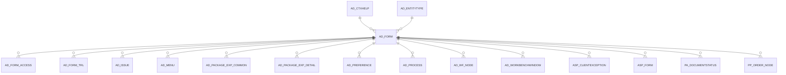

# AD_FORM

Area [AD](../../data-model/ad/index.md) · class **config** (proposed) · read from database `idempiere-db` (owner `ADEMPIERE`) · 50 row(s) when profiled

Application model: `org.compiere.model.X_AD_Form`, access level 4 - System.

## Columns

| column | type | key | not null | business name | references (code) | nulls | distinct |
|---|---|---|---|---|---|---|---|
| `AD_FORM_ID` | NUMBER(10,0) | PK | yes | Special Form |  | 0 | 50 |
| `AD_CLIENT_ID` | NUMBER(10,0) |  | yes | Tenant |  | 0 | 1 |
| `AD_ORG_ID` | NUMBER(10,0) |  | yes | Organization |  | 0 | 1 |
| `ISACTIVE` | CHAR(1) |  | yes | Active |  | 0 | 2 |
| `CREATED` | DATE |  | yes | Created |  | 0 | 50 |
| `CREATEDBY` | NUMBER(10,0) |  | yes | Created By |  | 0 | 2 |
| `UPDATED` | DATE |  | yes | Updated |  | 0 | 39 |
| `UPDATEDBY` | NUMBER(10,0) |  | yes | Updated By |  | 0 | 2 |
| `NAME` | VARCHAR2(60 CHAR) |  | yes | Name |  | 0 | 50 |
| `DESCRIPTION` | VARCHAR2(255 CHAR) |  |  | Description |  | 6 | 43 |
| `HELP` | VARCHAR2(2000 CHAR) |  |  | Comment/Help |  | 20 | 29 |
| `ACCESSLEVEL` | CHAR(1) |  | yes | Data Access Level |  | 0 | 6 |
| `CLASSNAME` | VARCHAR2(60 CHAR) |  |  | Classname |  | 0 | 50 |
| `ENTITYTYPE` | VARCHAR2(40 CHAR) |  | yes | Entity Type |  | 0 | 3 |
| `ISBETAFUNCTIONALITY` | CHAR(1) |  | yes | Beta Functionality |  | 0 | 2 |
| `JSPURL` | VARCHAR2(120 CHAR) |  |  | jsp URL |  | 50 | 0 |
| `AD_FORM_UU` | VARCHAR2(36 CHAR) |  |  | AD_Form_UU |  | 0 | 50 |
| `AD_CTXHELP_ID` | NUMBER(10,0) |  |  | Context Help | [AD_CTXHELP](../../data-model/ad/ad_ctxhelp.md) | 50 | 0 |
| `IMAGEURL` | VARCHAR2(120 CHAR) |  |  | Image URL |  | 50 | 0 |

*references (code)* is the table the application model's code says a column points to; *Foreign keys* below are the constraints the database declares. Counts come from the profile; no value is ever shown.

## Check constraints

| name | expression |
|---|---|
| `SYS_C0020879` | `IsActive in ('Y','N')` |

## Foreign keys

**References**

| table | columns | on delete |
|---|---|---|
| [AD_CTXHELP](../../data-model/ad/ad_ctxhelp.md) | AD_FORM.AD_CTXHELP_ID → AD_CTXHELP.AD_CTXHELP_ID | NO ACTION |
| [AD_ENTITYTYPE](../../data-model/ad/ad_entitytype.md) | AD_FORM.ENTITYTYPE → AD_ENTITYTYPE.ENTITYTYPE | NO ACTION |

**Referenced by**

| table | columns | on delete |
|---|---|---|
| [AD_FORM_ACCESS](../../data-model/ad/ad_form_access.md) | AD_FORM_ACCESS.AD_FORM_ID → AD_FORM.AD_FORM_ID | CASCADE |
| [AD_FORM_TRL](../../data-model/ad/ad_form_trl.md) | AD_FORM_TRL.AD_FORM_ID → AD_FORM.AD_FORM_ID | NO ACTION |
| [AD_ISSUE](../../data-model/ad/ad_issue.md) | AD_ISSUE.AD_FORM_ID → AD_FORM.AD_FORM_ID | SET NULL |
| [AD_MENU](../../data-model/ad/ad_menu.md) | AD_MENU.AD_FORM_ID → AD_FORM.AD_FORM_ID | NO ACTION |
| [AD_PACKAGE_EXP_COMMON](../../data-model/ad/ad_package_exp_common.md) | AD_PACKAGE_EXP_COMMON.AD_FORM_ID → AD_FORM.AD_FORM_ID | NO ACTION |
| [AD_PACKAGE_EXP_DETAIL](../../data-model/ad/ad_package_exp_detail.md) | AD_PACKAGE_EXP_DETAIL.AD_FORM_ID → AD_FORM.AD_FORM_ID | NO ACTION |
| [AD_PREFERENCE](../../data-model/ad/ad_preference.md) | AD_PREFERENCE.AD_FORM_ID → AD_FORM.AD_FORM_ID | NO ACTION |
| [AD_PROCESS](../../data-model/ad/ad_process.md) | AD_PROCESS.AD_FORM_ID → AD_FORM.AD_FORM_ID | NO ACTION |
| [AD_WF_NODE](../../data-model/ad/ad_wf_node.md) | AD_WF_NODE.AD_FORM_ID → AD_FORM.AD_FORM_ID | NO ACTION |
| [AD_WORKBENCHWINDOW](../../data-model/ad/ad_workbenchwindow.md) | AD_WORKBENCHWINDOW.AD_FORM_ID → AD_FORM.AD_FORM_ID | NO ACTION |
| [ASP_CLIENTEXCEPTION](../../data-model/asp/asp_clientexception.md) | ASP_CLIENTEXCEPTION.AD_FORM_ID → AD_FORM.AD_FORM_ID | NO ACTION |
| [ASP_FORM](../../data-model/asp/asp_form.md) | ASP_FORM.AD_FORM_ID → AD_FORM.AD_FORM_ID | NO ACTION |
| [PA_DOCUMENTSTATUS](../../data-model/pa/pa_documentstatus.md) | PA_DOCUMENTSTATUS.AD_FORM_ID → AD_FORM.AD_FORM_ID | NO ACTION |
| [PP_ORDER_NODE](../../data-model/pp/pp_order_node.md) | PP_ORDER_NODE.AD_FORM_ID → AD_FORM.AD_FORM_ID | NO ACTION |

## Write behaviour

- updates: **po_only**
- deletes: **deleted_by_users**
- change log: **recorded**
- evidence: 1 citation(s)

## Read by

| kind | name |
|---|---|
| Procedure | [AD_Synchronize](../../logic/ad_synchronize.md) |

## Schema history

33 change(s); the latest:

| applied | release | operation | column | tickets |
|---|---|---|---|---|
| 2026-01-13T07:07 | iD13 | `modify_column` | Classname | IDEMPIERE-6815 |
| 2026-01-13T07:07 | iD13 | `modify_column` | Classname | IDEMPIERE-6815 |
| 2023-04-09T15:47 | iD11 | `add_constraint` |  | IDEMPIERE-5567 |
| 2023-04-09T15:47 | iD11 | `add_constraint` |  | IDEMPIERE-5567 |
| 2023-03-24T14:49 | iD10 | `add_column` | ImageURL | IDEMPIERE-5644 |
| 2023-03-24T14:49 | iD10 | `add_column` | ImageURL | IDEMPIERE-5644 |
| 2021-12-05T16:45 | i8.2z | `drop_constraint` |  | IDEMPIERE-5075 |
| 2021-12-05T16:45 | i8.2z | `add_constraint` |  | IDEMPIERE-5075 |
| 2020-08-04T01:00 | i7.1z | `modify_column` | HELP | IDEMPIERE-3862 |
| 2020-08-04T01:00 | i7.1z | `modify_column` | DESCRIPTION | IDEMPIERE-3862 |
| 2020-08-04T01:00 | i7.1z | `modify_column` | ENTITYTYPE | IDEMPIERE-3862 |
| 2020-08-04T01:00 | i7.1z | `add_column` | tmp_col_2_tmp | IDEMPIERE-3862 |
| 2020-08-04T01:00 | i7.1z | `drop_column` | tmp_col_5_tmp | IDEMPIERE-3862 |
| 2020-08-04T01:00 | i7.1z | `add_column` | tmp_col_6_tmp | IDEMPIERE-3862 |
| 2020-08-04T01:00 | i7.1z | `add_column` | tmp_col_4_tmp | IDEMPIERE-3862 |

## Notes

<!-- ekos:manual id="table.ad_form.notes" -->
_Business notes about this table._
<!-- /ekos:manual -->
