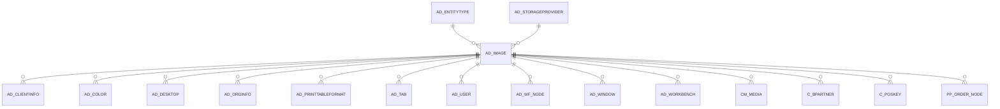

# AD_IMAGE

Area [AD](../../data-model/ad/index.md) · class **config** (proposed) · read from database `idempiere-db` (owner `ADEMPIERE`) · 10 row(s) when profiled

Application model: `org.compiere.model.X_AD_Image`, access level 6 - System - Client.

## Columns

| column | type | key | not null | business name | references (code) | nulls | distinct |
|---|---|---|---|---|---|---|---|
| `AD_IMAGE_ID` | NUMBER(10,0) | PK | yes | Image |  | 0 | 10 |
| `AD_CLIENT_ID` | NUMBER(10,0) |  | yes | Tenant |  | 0 | 2 |
| `AD_ORG_ID` | NUMBER(10,0) |  | yes | Organization |  | 0 | 1 |
| `ISACTIVE` | CHAR(1) |  | yes | Active |  | 0 | 1 |
| `CREATED` | DATE |  | yes | Created |  | 0 | 10 |
| `CREATEDBY` | NUMBER(10,0) |  | yes | Created By |  | 0 | 1 |
| `UPDATED` | DATE |  | yes | Updated |  | 0 | 10 |
| `UPDATEDBY` | NUMBER(10,0) |  | yes | Updated By |  | 0 | 1 |
| `NAME` | VARCHAR2(60 CHAR) |  | yes | Name |  | 0 | 10 |
| `IMAGEURL` | VARCHAR2(120 CHAR) |  |  | Image URL |  | 2 | 8 |
| `BINARYDATA` | BLOB |  |  | Binary Data |  | 10 | 0 |
| `ENTITYTYPE` | VARCHAR2(40 CHAR) |  | yes | Entity Type |  | 0 | 1 |
| `DESCRIPTION` | VARCHAR2(255 CHAR) |  |  | Description |  | 10 | 0 |
| `AD_IMAGE_UU` | VARCHAR2(36 CHAR) |  |  | AD_Image_UU |  | 0 | 10 |
| `AD_STORAGEPROVIDER_ID` | NUMBER(10,0) |  |  | Storage Provider | [AD_STORAGEPROVIDER](../../data-model/ad/ad_storageprovider.md) | 10 | 0 |

*references (code)* is the table the application model's code says a column points to; *Foreign keys* below are the constraints the database declares. Counts come from the profile; no value is ever shown.

## Check constraints

| name | expression |
|---|---|
| `SYS_C0021337` | `IsActive in ('Y','N')` |

## Foreign keys

**References**

| table | columns | on delete |
|---|---|---|
| [AD_ENTITYTYPE](../../data-model/ad/ad_entitytype.md) | AD_IMAGE.ENTITYTYPE → AD_ENTITYTYPE.ENTITYTYPE | NO ACTION |
| [AD_STORAGEPROVIDER](../../data-model/ad/ad_storageprovider.md) | AD_IMAGE.AD_STORAGEPROVIDER_ID → AD_STORAGEPROVIDER.AD_STORAGEPROVIDER_ID | NO ACTION |

**Referenced by**

| table | columns | on delete |
|---|---|---|
| [AD_CLIENTINFO](../../data-model/ad/ad_clientinfo.md) | AD_CLIENTINFO.LOGOREPORT_ID → AD_IMAGE.AD_IMAGE_ID | NO ACTION |
| [AD_COLOR](../../data-model/ad/ad_color.md) | AD_COLOR.AD_IMAGE_ID → AD_IMAGE.AD_IMAGE_ID | NO ACTION |
| [AD_DESKTOP](../../data-model/ad/ad_desktop.md) | AD_DESKTOP.AD_IMAGE_ID → AD_IMAGE.AD_IMAGE_ID | NO ACTION |
| [AD_ORGINFO](../../data-model/ad/ad_orginfo.md) | AD_ORGINFO.LOGO_ID → AD_IMAGE.AD_IMAGE_ID | NO ACTION |
| [AD_PRINTTABLEFORMAT](../../data-model/ad/ad_printtableformat.md) | AD_PRINTTABLEFORMAT.AD_IMAGE_ID → AD_IMAGE.AD_IMAGE_ID | NO ACTION |
| [AD_TAB](../../data-model/ad/ad_tab.md) | AD_TAB.AD_IMAGE_ID → AD_IMAGE.AD_IMAGE_ID | NO ACTION |
| [AD_USER](../../data-model/ad/ad_user.md) | AD_USER.AD_IMAGE_ID → AD_IMAGE.AD_IMAGE_ID | NO ACTION |
| [AD_WF_NODE](../../data-model/ad/ad_wf_node.md) | AD_WF_NODE.AD_IMAGE_ID → AD_IMAGE.AD_IMAGE_ID | NO ACTION |
| [AD_WINDOW](../../data-model/ad/ad_window.md) | AD_WINDOW.AD_IMAGE_ID → AD_IMAGE.AD_IMAGE_ID | NO ACTION |
| [AD_WORKBENCH](../../data-model/ad/ad_workbench.md) | AD_WORKBENCH.AD_IMAGE_ID → AD_IMAGE.AD_IMAGE_ID | NO ACTION |
| [CM_MEDIA](../../data-model/cm/cm_media.md) | CM_MEDIA.AD_IMAGE_ID → AD_IMAGE.AD_IMAGE_ID | NO ACTION |
| [C_BPARTNER](../../data-model/c/c_bpartner.md) | C_BPARTNER.LOGO_ID → AD_IMAGE.AD_IMAGE_ID | NO ACTION |
| [C_POSKEY](../../data-model/c/c_poskey.md) | C_POSKEY.AD_IMAGE_ID → AD_IMAGE.AD_IMAGE_ID | NO ACTION |
| [PP_ORDER_NODE](../../data-model/pp/pp_order_node.md) | PP_ORDER_NODE.AD_IMAGE_ID → AD_IMAGE.AD_IMAGE_ID | NO ACTION |

## Write behaviour

- updates: **po_only**
- deletes: **deleted_by_app, deleted_by_users**
- change log: **recorded**
- evidence: 4 citation(s)

## Schema history

25 change(s); the latest:

| applied | release | operation | column | tickets |
|---|---|---|---|---|
| 2023-04-09T15:47 | iD11 | `add_constraint` |  | IDEMPIERE-5567 |
| 2023-04-09T15:47 | iD11 | `add_constraint` |  | IDEMPIERE-5567 |
| 2021-12-05T16:45 | i8.2z | `drop_constraint` |  | IDEMPIERE-5075 |
| 2021-12-05T16:45 | i8.2z | `add_constraint` |  | IDEMPIERE-5075 |
| 2021-04-16T22:11 | i8.2 | `add_column` | AD_StorageProvider_ID | IDEMPIERE-4762 |
| 2021-04-16T22:11 | i8.2 | `add_column` | AD_StorageProvider_ID | IDEMPIERE-4762 |
| 2021-04-16T22:11 | i8.2 | `add_constraint` |  | IDEMPIERE-4762 |
| 2021-04-16T22:11 | i8.2 | `add_constraint` |  | IDEMPIERE-4762 |
| 2020-08-04T01:00 | i7.1z | `modify_column` | IMAGEURL | IDEMPIERE-3862 |
| 2020-08-04T01:00 | i7.1z | `modify_column` | NAME | IDEMPIERE-3862 |
| 2020-08-04T01:00 | i7.1z | `add_column` | tmp_col_1_tmp | IDEMPIERE-3862 |
| 2020-08-04T01:00 | i7.1z | `drop_column` | tmp_col_3_tmp | IDEMPIERE-3862 |
| 2020-08-04T01:00 | i7.1z | `add_column` | tmp_col_3_tmp | IDEMPIERE-3862 |
| 2020-08-04T01:00 | i7.1z | `drop_column` | tmp_col_2_tmp | IDEMPIERE-3862 |
| 2020-08-04T01:00 | i7.1z | `modify_column` | ENTITYTYPE | IDEMPIERE-3862 |

## Notes

<!-- ekos:manual id="table.ad_image.notes" -->
_Business notes about this table._
<!-- /ekos:manual -->
